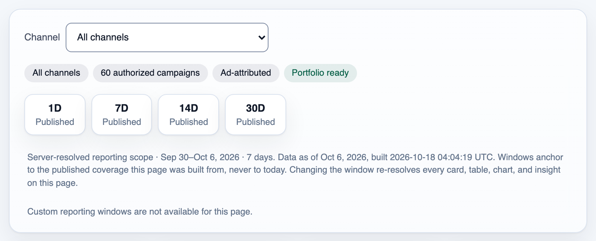
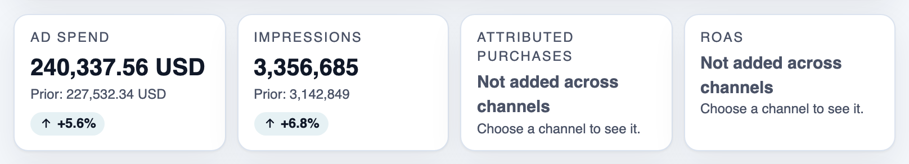
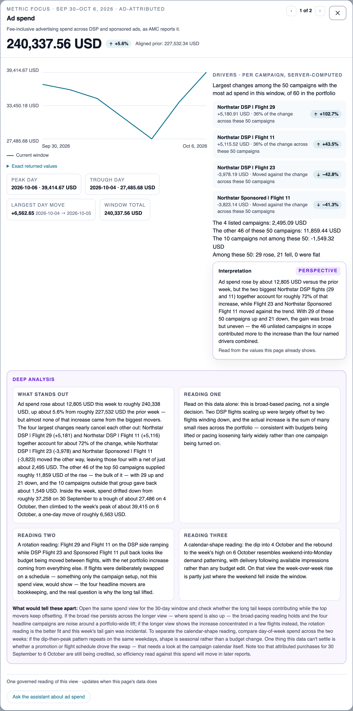
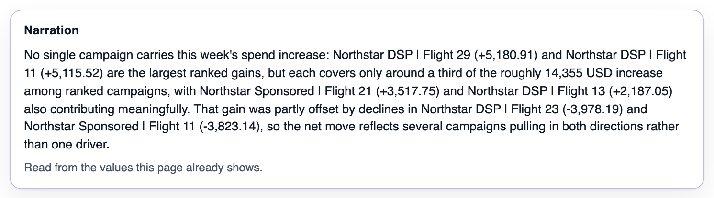
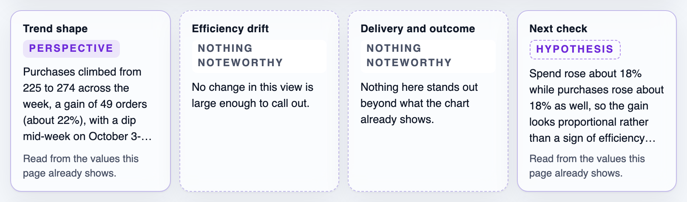
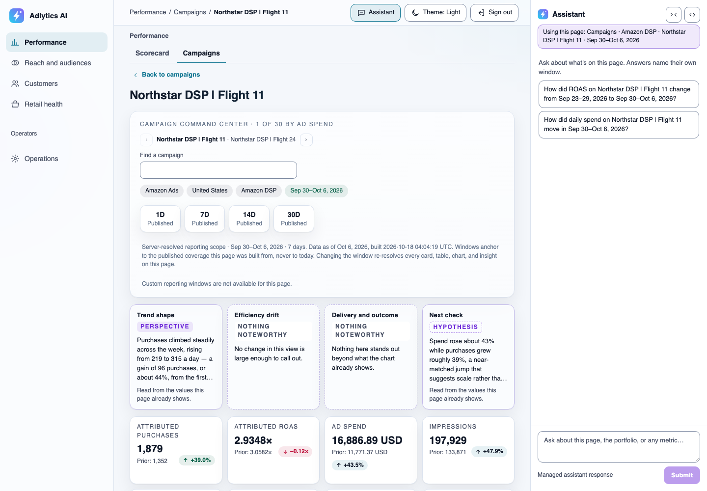
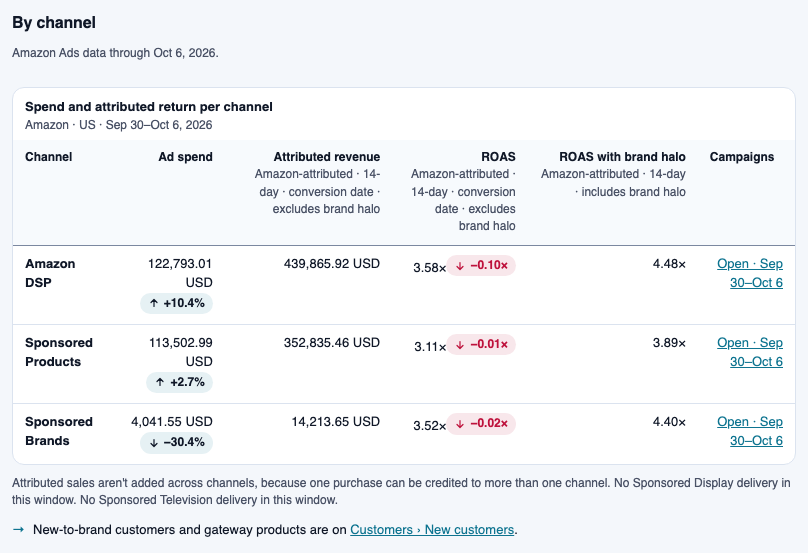
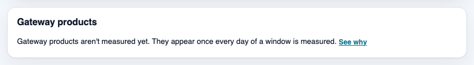
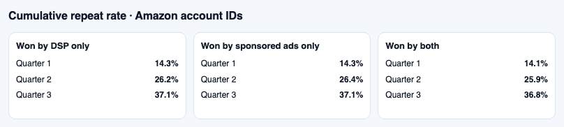
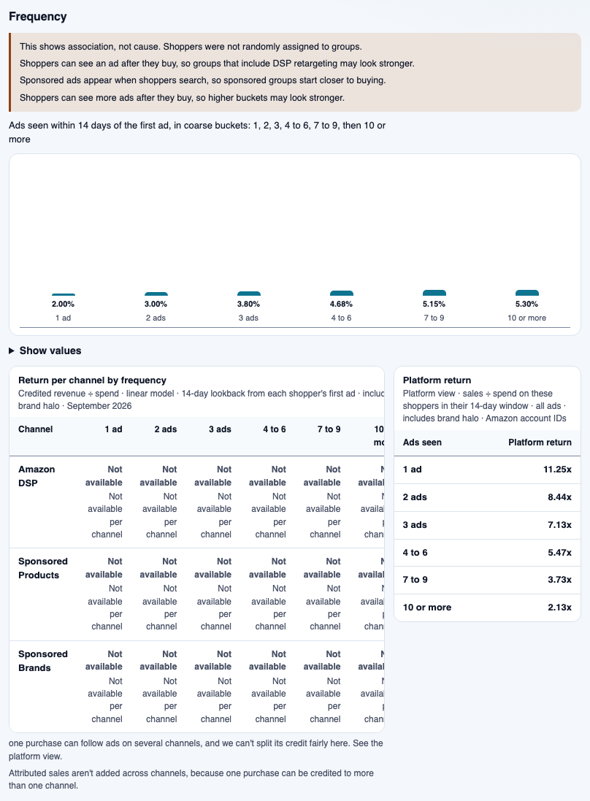

# Adlytics AI

> **This is sample code, not a production-ready solution.** You deploy it into your own AWS account and you are responsible for the AWS charges it incurs and for the security review it needs before production use. See [Cost](#cost), [Security considerations](#security-considerations) and [Known limits](#known-limits).

Adlytics AI is retail-media analytics for brands that sell to Amazon as a first-party (1P) vendor. It brings your Amazon Marketing Cloud (AMC) advertising data and your Vendor Central retail data together in your own AWS account, and lets your team explore it through dashboards and a chat assistant. The product's rule is that every figure comes from a governed read: tested code computes it from your published data, and the assistant explains and compares those figures or says plainly when a question can't be answered. With the optional online answer evaluation turned on, a sampled share of answers (10% by default) is scored, and an unsupported figure in a scored answer can raise the grounded-correctness alarm; answers outside the sample are not checked. One answer with an unsupported figure was observed on 2026-10-18 (see [Known limits](#known-limits)).

## The problem it solves

Amazon gives a 1P vendor two reporting systems that disagree by design:

- **Amazon Marketing Cloud** holds advertising data: who saw an ad, what it cost, and which sales Amazon attributes to it. You query it with SQL in a privacy-protected environment that drops rows describing too few shoppers.
- **Vendor Central** holds retail facts: what shipped, what Amazon paid, what came back. It has no advertising dimension, a different day boundary and a different revision schedule.

"Is my advertising actually growing the business?" needs both. Today that usually means exporting reports from two consoles and reconciling them in spreadsheets, where it is easy to get silently wrong: spend that arrives in units 1,000 times apart, suppressed rows that make totals stop adding up, distinct-shopper counts summed across days. This sample does that reconciliation once, in declared and tested mappings, so a brand manager can ask the question in a sentence and get an answer they can defend. The full problem statement is in [business context](docs/business-context.md).

**Who it is for:** brand managers at 1P vendors, and the analytics leads and agencies who work with them. **Who deploys it:** a builder on that team with an AWS account.

## What it answers, and what it refuses

What a deployment can answer depends on the Amazon access you bring:

| Your Amazon access | Questions it adds | Examples |
|---|---|---|
| Vendor Central reports | Retail performance (can't be loaded into a customer deployment yet; see [Known limits](#known-limits)) | What did I sell, what came back, how did glance views convert? |
| An AMC instance mapped to your advertising accounts | Advertising measurement | What was my return on ad spend (ROAS) by campaign, across display and sponsored ads? How many distinct shoppers saw my ads, and how often? |
| An AMC Paid Features subscription | Wider effects | How much of my business is new-to-brand? Which audience segments do my buyers belong to? |

It refuses, and explains why, when the data can't support an honest answer. Some questions can never be answered from these two sources: retail sales attributed to a specific campaign (Vendor Central has no campaign dimension), anything about an individual shopper, competitor activity, or a single merged revenue figure. The complete list, with the wording the assistant uses, is in [answerable questions](docs/answerable-questions.md).

## How it works

**Call-flow diagram — from your data delivery to an answer in the browser.**

![Call-flow diagram: from your data delivery to an answer in the browser. Your extraction pipeline lands each result in an S3 landing bucket; ingestion validates it against the data contracts and publishes an immutable version to the data lake, which the measurement tools read. A browser question reaches the Conversation API, which checks it with Amazon Bedrock Guardrails and invokes the AgentCore agent as the signed-in user; the agent calls the tools through AgentCore Gateway, and its answer streams back to the browser with an audit record written before the stream ends.](diagrams/how-it-works.svg)

> **Takeaway.** The model chooses which tool to call and writes the explanation; every figure comes from a tool that computed it from your published data.

1. Your own pipeline runs the declared AMC SQL and lands each result in this deployment's S3 landing bucket. Vendor Central reports can't be landed yet; see [Known limits](#known-limits). Extraction stays outside the sample, so it never holds your Amazon credentials.
2. Ingestion validates each delivery against its data contract and publishes it as an immutable version. A delivery that fails validation is refused rather than partly loaded.
3. In chat, the Conversation API verifies the user, screens the question with Amazon Bedrock Guardrails, and invokes an agent hosted on Amazon Bedrock AgentCore. The user's identity travels with every call, and each tool verifies it.
4. The agent calls measurement and catalog tools through AgentCore Gateway. The tools compute figures with Athena and return them with any caveats (coverage, suppression, measurement basis), or a reason the question can't be answered. The answer streams to the browser, and an audit record of the tools used is written for every turn.

**Call-flow diagram — how a page refreshes after new data is published.**

![Call-flow diagram: how a page refreshes after new data is published, in a customer deployment. A new published version in the data lake starts one bake per page and window, which computes that page from the version with the measurement layer. When that page builds, with data or a designed absence, its own pointer advances to the new immutable artifact and the Presentation API serves it to the browser; when it fails, that page keeps serving its last good version, and a bake that keeps failing raises a CloudWatch alarm. Insight narration from Amazon Bedrock is attached to a page by its revision. A box labelled dev environment only notes that the dev environment instead builds every affected page as one set, whose pointers advance together or not at all.](diagrams/page-refresh.svg)

> **Takeaway.** A page never shows a half-built result: each page moves to new data once it builds, or stays on its last good version, and a page that keeps failing raises an alarm.

Pages are computed when data is published, not when someone opens them, so they load fast and every viewer sees the same figures. A customer deployment refreshes pages one at a time, so for a short while after a publication two pages can show different publications (see [Known limits](#known-limits)). A page whose data can't be shown yet shows a designed message instead of a blank or a guess, and that message says what is missing and when to expect it, except where Known limits records otherwise (Reach "last quarter" today). The bake pipeline is described in [preset artifact publisher](docs/ui/preset-artifact-publisher.md).

**Key terms used across the docs:**

| Term | Meaning |
|---|---|
| Governed figure | A number computed by a declared, tested tool from published data, never by the model. |
| Publication / `CURRENT` | An immutable, validated version of a dataset / the pointer to the version being served. |
| Data contract | The declared shape and meaning of one source report, in [`contracts/`](contracts/). |
| Designed absence | The message a page shows, instead of a blank or a guess, when its data can't be shown yet. |
| Calibration | An automated test run a prompt or guardrail must pass before it is activated. |

Architecture in depth: [architecture overview](docs/architecture.md), [conversational runtime](docs/capabilities/conversational-runtime/README.md), and the [documentation index](docs/README.md). Design decisions are recorded as ADRs in [`docs/decisions/`](docs/decisions/).

## The application

These screenshots come from a development deployment loaded with synthetic data on 2026-10-19, in the light theme, so every campaign, product and value shown is fictional. The two assistant examples are illustrative: they replay a scripted answer stream, not a recorded conversation. The images are regenerated with [`validation/capture_screenshots.mjs`](validation/README.md#regenerating-readme-screenshots).

### Campaigns


The Campaigns page shows the whole portfolio for one reporting window, with the assistant beside it, so a brand manager sees what changed before asking why. Purchases and ROAS are shown per channel, because one purchase can be credited to more than one channel. See [campaign portfolio](docs/ui/campaign-portfolio/README.md).



Only windows the server has published can be chosen, and the note says exactly which days the page covers and when it was built, so nobody mistakes stale data for today's. See [temporal control](docs/ui/temporal-control-contract.md).



Each tile shows the exact value with its unit, the prior window's value and the change. A figure that would be wrong to total across channels says so instead of showing a misleading sum. See [metric focus](docs/ui/metric-focus-contract.md).


The trend chart plots the served daily values, and the exact numbers are one click away for anyone who needs to cite them. See [campaign portfolio](docs/ui/campaign-portfolio/README.md).



Opening a tile explains the change: which campaigns drove it, how much the rest of the portfolio contributed, and a deep analysis that offers candidate readings and names the evidence that would separate them. See [metric focus composition](docs/ui/metric-focus-contract.md#2-composition).


Opening an insight card shows the full reading behind it, so a team can check the reasoning before it acts on it. The deep analysis offers more than one explanation and says which evidence would settle it. See [insight focus dialog](docs/ui/insight-presentation-contract.md#3-clickable-cards-and-the-insight-focus-dialog).



The narration is written from the figures the page already shows, and it says so, so every number in it can be found on the page. See [visual narration](docs/ui/workspace-assistant.md#5-page-owned-visual-narration).


The campaigns table ranks every campaign by the column you choose. Its coverage column warns when a source's latest load is older than its staleness threshold, so a team knows recent days may be incomplete before it compares campaigns. In this image it repeats that warning once for every stale source load, joined by commas, so the first row runs the full height of the image; see [Known limits](#known-limits). See [campaign portfolio](docs/ui/campaign-portfolio/README.md).


Opening a campaign shows that campaign alone for the same window, so a team can move from what changed in the portfolio to the campaign that drove it. The assistant's "Using this page" line follows it there. See [campaign portfolio](docs/ui/campaign-portfolio/README.md).



A card with nothing worth saying says "Nothing noteworthy" instead of inventing a story, so the cards that do speak carry weight. See [insight card states](docs/ui/insight-presentation-contract.md#2-the-five-designed-card-states).



The same detail serves every channel, so DSP and sponsored campaigns are read the same way. See [campaign portfolio](docs/ui/campaign-portfolio/README.md).


Delivery tiles give a campaign's media efficiency, including cost per click and cost per thousand impressions, against the prior window. Cost per click is ad spend divided by clicks. Click-through rate shows as an exact decimal multiplier, so 0.0998× means 9.98% of impressions were clicked; see [Known limits](#known-limits). See [campaign portfolio](docs/ui/campaign-portfolio/README.md).

### Scorecard


The Scorecard answers "which channel returns most?" and shows whether the answer depends on the attribution model, so a budget decision doesn't rest on one model's view. See [scorecard](docs/ui/scorecard/README.md).



Every column names its measurement basis, such as 14-day attribution with or without brand halo, so two people reading the table compare the same thing. See [scorecard](docs/ui/scorecard/README.md).

### New customers and retention


New customers shows how much of the business each channel brings from shoppers new to the brand, and what each one costs. See [new customers](docs/ui/new-customers/README.md).



When data for a section isn't complete, the page says so and why, instead of showing a partial list as if it were whole. See [page absence copy](docs/ui/page-absence-copy.md).


Retention follows each group of new customers over time, by the channel that won them, so a team can see whether a channel brings buyers who come back. See [retention](docs/ui/retention/README.md).



The cumulative repeat rate puts the three acquisition groups side by side, so a team can see whether customers won by DSP, by sponsored ads or by both come back more often before it decides where to spend on winning new customers. See [retention](docs/ui/retention/README.md).

### Reach and audiences


Reach and funnel shows how many shoppers your ads reached across DSP and sponsored ads, and how much the two audiences overlap. Cells with too few shoppers read "Not available" rather than a number AMC withheld. See [reach and funnel](docs/ui/reach-and-funnel/README.md).



Frequency shows how the purchaser rate changes with the number of ads a shopper saw, and states up front that this is an association, not a cause. See [reach and funnel](docs/ui/reach-and-funnel/README.md).


Audiences compares the Amazon segments your buyers belong to with the shoppers your ads reached, so a team can see which audiences over-index. See [audiences](docs/ui/audiences/README.md).


Per campaign, it shows how each segment performed. It shows at most 7 DSP campaigns today; see [Known limits](#known-limits). See [audiences](docs/ui/audiences/README.md).

### Retail health


Retail health shows Vendor Central demand, conversion, sales, fulfilment and margin, reconciled to the vendor's reported totals, so retail and advertising teams start from the same figures. See [retail health](docs/ui/retail-health/README.md).


Selecting a product opens its own page with the same measures, so a retail team can find which product moved a Retail health figure, and Previous and Next step through the rest without going back to the list. See [retail health](docs/ui/retail-health/README.md).

### Analytics assistant

|  |  |
|---|---|
| Illustrative: an answer streams in while the assistant shows each tool it calls. | Illustrative: a declined question gets a plain explanation and a `Reference:` line for support. |

The assistant is told which page and window you're on, shown as its "Using this page" line, and each answer names the window it covers. See [workspace assistant](docs/ui/workspace-assistant.md) and [conversational runtime](docs/capabilities/conversational-runtime/README.md).

### Prompt administration


For administrators: every prompt that writes insight text, with its active version and calibration status. The first slot's versions in these images are a fictional fixture, so no real author appears. See [prompt administration](docs/ui/prompt-administration/README.md).


A version can be activated only after its calibration passes. A version created since authorship recording began records who created it; an older one, such as version 25 here, says that its author wasn't recorded. See [prompt administration](docs/ui/prompt-administration/README.md).

## Prerequisites

| Requirement | Detail |
|---|---|
| AWS account and Region | One account you control that runs no other workloads; deployment into a shared account is unsupported ([O-RESULT-SHARED-ACCOUNT-001](docs/security-dispositions.md)). The sample synthesizes only in us-east-1, us-east-2, us-west-2, eu-central-1 and eu-west-1, the Regions it declares a [guardrail profile](https://docs.aws.amazon.com/bedrock/latest/userguide/guardrails-cross-region-support.html) for ([`route-guardrail.ts`](infra/lib/constructs/agent/route-guardrail.ts)). It has been deployed and accepted only in us-east-1. |
| AWS credentials | A named, non-default AWS CLI profile with administrator-level permissions in that account and a Region set. The deployment creates IAM roles and policies. |
| Amazon Bedrock model access | Access, in your Region, to all three models `.env` configures. The values `.env.example` ships are `ADLYTICS_QUICK_CHAT_MODEL_ID` (`us.anthropic.claude-haiku-4-5-20251001-v1:0`), `ADLYTICS_DEEP_DIVE_MODEL_ID` (`us.anthropic.claude-sonnet-4-5-20250929-v1:0`) and `ADLYTICS_MEMORY_MODEL_ID` (`us.anthropic.claude-sonnet-4-6`). These are US cross-Region inference profiles. In eu-central-1 or eu-west-1, replace each with the matching profile ID that `aws bedrock list-inference-profiles --region <region> --type-equals SYSTEM_DEFINED` lists there. The third runs long-term memory ([ADR-147](docs/decisions/adr-147-treat-long-term-memory-as-context-never-evidence.md)) and has no fallback to the other two. Before you deploy, enable access to each one as [Request access to models](https://docs.aws.amazon.com/bedrock/latest/userguide/model-access.html) describes, including the one-time use-case form Anthropic models need (read 2026-10-19). |
| Athena concurrent queries | The deployment starts up to 41 background queries at once and keeps 20 for chat, so page refreshes never take chat's capacity. It needs an Athena "Active DML queries" quota of at least 61. Before you deploy, open Service Quotas in the supported Region you chose (us-east-1, us-east-2, us-west-2, eu-central-1 or eu-west-1), read the applied value of Amazon Athena's "Active DML queries", and request an increase if it is below 61. AWS lists a default of 150 or 200 for these Regions ([Athena quotas](https://docs.aws.amazon.com/general/latest/gr/athena.html), read 2026-10-18), but your account's applied value can differ. Then set `active_dml_quota` in [`contracts/operations/execution-graphs.yaml`](contracts/operations/execution-graphs.yaml) to that applied value ([query path](docs/capabilities/query-path/architecture.md)); if you changed it, run `make generate-execution-graph-protocol`. `make deploy` and `make deploy-all` first run `make check-execution-graph-deployable`, which refuses to deploy while the generated files are stale. |
| Lambda concurrency | One environment reserves 35 concurrent executions for its functions once producer onboarding is on (33 before), and Lambda always keeps 100 of the account's concurrency unreserved. The account's applied "Concurrent executions" quota in your Region must therefore be at least 135. New accounts can start lower. Read it with `aws lambda get-account-settings --profile <your-profile>` (`AccountLimit.ConcurrentExecutions`), and request an increase in Service Quotas if it is below 135; otherwise the first stack that reserves concurrency fails to deploy. |
| Edge rate limit | The website's AWS WAF rule limits requests per source IP per five minutes (`ADLYTICS_EDGE_WAF_RATE_LIMIT_PER_FIVE_MINUTES` in [`.env.example`](.env.example), with a separate limit for sign-in). A team behind one corporate IP shares that one budget, and each page view makes several requests. Size it for your team's combined traffic before you invite users. |
| Local tools | Node.js 24 (`.nvmrc`), Python 3.14 through [uv](https://docs.astral.sh/uv/), AWS CLI v2, `make`, `bash` and the `file` utility. Developed and deployed from macOS. Docker is not needed. |
| Amazon data (optional at deploy time) | An AMC instance decides what the deployment can answer today; Vendor Central reports can't be loaded yet ([Known limits](#known-limits)). See the table above. A fresh deployment is designed to show empty pages until data arrives. Loading data needs a second AWS account for your extraction pipeline; see [Load your data](#load-your-data). |

## Quickstart

```bash
cp .env.example .env                                   # fill in the blanks; each value is explained in the file
make deploy-all PROFILE=<your-profile> ENV=<env>       # shows the account, Region and changes; deploys nothing
make deploy-all PROFILE=<your-profile> ENV=<env> APPROVE=1 EMAIL=<you@example.com>
```

The command prints the website URL, and the invited user receives a temporary password by email. When you are done:

```bash
make destroy-all PROFILE=<your-profile> ENV=<env> CONFIRM=<env>
```

`destroy-all` keeps resources that hold data, which keep billing until you delete them; see [Clean up](#clean-up).

## Deploy

1. **Configure.** Copy `.env.example` to `.env` and fill in the blanks. Every value is explained in the file.
2. **Deploy everything.** Run `make deploy-all` without `APPROVE` first: it deploys nothing and shows the target account, Region and the changes. Then run it with `APPROVE=1 EMAIL=<address>` to deploy and invite the first user. What the target decides for you, such as CDK bootstrapping and the frontend's second pass on a first deployment, is listed in the header of [`scripts/deploy-all.sh`](scripts/deploy-all.sh). If a step fails, fix the cause and run the same command again: stacks with no changes are skipped, and a user who is already invited is not sent a second invite. If CloudFormation then reports that a name already exists, a failed first create left a retained resource behind: delete it (see [Clean up](#clean-up)) or use a new `ENV`.
3. **Sign in.** Open the printed URL and set a new password at first sign-in. To invite more users: `make create-user PROFILE=<your-profile> ENV=<env> EMAIL=<address>`.

An update of an existing development environment with no stack changes took about 11 minutes end to end (2026-10-01). A first deployment of a new environment took about 42 minutes end to end (2026-10-19), in an account already CDK-bootstrapped and with model access enabled; it has not yet been run in a new account ([record](docs/capabilities/operational-data-flow-status/operator-tools.md#appendix-fresh-environment-deploy-and-destroy-2026-10-19)).

**Updating an existing environment.** Run the same two commands. A new version can carry a one-time step between two stacks; it is stated beside the stack in `DEPLOY_ORDER` in [`infra/lib/config/index.ts`](infra/lib/config/index.ts). Read it before an update, because `make deploy-all` does not stop for them.

To deploy one stack on its own, export the `.env` values in your shell and run `make deploy STACK=Adlytics-<Area>-<env> PROFILE=<your-profile> ENV=<env> APPROVE=1`; it deploys exactly that stack. It takes no deploy lock, and it isn't for a `src/` change on a shared environment: every function-bearing stack shares one Lambda source asset, so deploy that change to every stack with `make deploy-all-locked` ([ADR-136](docs/decisions/adr-136-deploy-a-shared-asset-change-as-one-deploy-all-from-one-declared-source.md)).

### Check the deployment

- You can sign in with the invited user.
- The pages load and show their designed empty states. A new deployment has no data: its pages stay empty until you set up your data producers and their first deliveries land in the data lake. [Load your data](#load-your-data) says how.
- The chat assistant answers a question such as "What metrics can I ask about?".
- Subscribe to the alarm topic. Every alarm notifies one SNS topic, which the deployment creates with no subscriber, so no alarm reaches anyone until you add one:

  ```bash
  aws sns subscribe --profile <your-profile> --protocol email --notification-endpoint <you@example.com> \
    --topic-arn "$(aws ssm get-parameter --profile <your-profile> --name /adlytics/<env>/ingestion/alarm-topic-arn --query Parameter.Value --output text)"
  ```

  Confirm the subscription from the email AWS sends.

- A deployment can put three tamper-detection alarms in ALARM briefly. Each returns to OK on its own within about 15 minutes: `adlytics-<env>-record-control-plane-changes` records any deployment that changes what it watches, so it fires on the first deployment and on any later one that changes a record table's policy, TTL or point-in-time recovery, an evaluation result group, or the detection itself; `adlytics-<env>-record-function-changes` records any deployment that creates or changes a function or role a record table's policy names, so it fires on the first deployment and on any later one that changes those; `adlytics-<env>-record-delivery-failures-self-events` fires on a first deployment only, counting the few events that detection matched before its log delivery policy existed.

### Optional features

All are off by default and are set in `.env`.

| Feature | Setting | Read first |
|---|---|---|
| Producer onboarding: a cross-account role your extraction pipeline assumes to land data | `ADLYTICS_PRODUCER_ONBOARDING_ENABLED` with the role ARN and external ID | [Source acquisition](docs/capabilities/source-acquisition/README.md) |
| Searchable traces (CloudWatch Transaction Search). An account-wide setting with its own charges. The agent runtime's span diagnostics need it | `ADLYTICS_TRANSACTION_SEARCH` | [Observability](docs/concepts/observability.md) |
| Online answer evaluation | `ADLYTICS_EVALUATION_INPUT_PROVISIONED` and related settings; parts are accepted only for an environment named `dev` | [Agent quality loop](docs/capabilities/agent-quality-loop/README.md) |

## Load your data

A new deployment starts with an empty data lake, so every page shows its designed empty state until data lands. The sample does not connect to Amazon itself: data arrives only from producers you set up, and only through producer onboarding, which is off by default.

To turn it on, set `ADLYTICS_PRODUCER_ONBOARDING_ENABLED=true` in `.env` with `ADLYTICS_LANDING_PIPELINE_ROLE_ARN`, one IAM role in a different AWS account from this deployment that your extraction pipeline runs as (synth refuses a role in the same account), and an `ADLYTICS_LANDING_EXTERNAL_ID` you choose. Then run `make deploy-all` again. The `Adlytics-Ingestion-<env>` stack outputs `OutLandingRoleArn`, the role your pipeline assumes with that external ID, and `OutLandingBucketName` and `OutLandingIncomingPrefix`, where it lands. For each AMC query pack in [`contracts/amc/query-packs/`](contracts/amc/query-packs/), your pipeline runs the exact SQL against your AMC instance, writes the result, then writes the registration object last. The [producer CLI](docs/capabilities/operational-data-flow-status/operator-tools.md#producer-cli) describes a pack, validates a result and renders the landing keys and registration for you. This registration handshake, described in [source acquisition](docs/capabilities/source-acquisition/architecture.md), is for the AMC query packs only: the reports the [`contracts/vendor-central/`](contracts/vendor-central/) contracts declare can't be landed through it yet; see [Known limits](#known-limits). For example deliveries of every contract, see the synthetic fixture generator in [development seeding](docs/concepts/dev-seeding.md).

## Extend it

**Call-flow diagram — how a change moves from a declared contract to a deployed environment.**


> **Takeaway.** You change what the product means in one declared place; generators and gates keep the code and docs in step with it.

| To add | Edit | Then run |
|---|---|---|
| A metric | [`contracts/shared/metric-dictionary.yaml`](contracts/shared/metric-dictionary.yaml) | `make check-lineage` |
| An AMC query or Vendor Central report | [`contracts/amc/`](contracts/amc/), [`contracts/vendor-central/`](contracts/vendor-central/) | `make validate-contracts`, `make generate-schemas`, `make generate-producer-packs`, `make generate-fixtures` |
| An agent tool | [`src/adapters/inbound/tool_handlers/schemas.py`](src/adapters/inbound/tool_handlers/schemas.py) and a handler beside it | `make generate-tool-schemas` |
| A page or preset view | [`presentation/pages/v2/pages.yaml`](presentation/pages/v2/pages.yaml) | `make validate-page-schemas`, `make check-bakeability` |
| Insight narration | [`contracts/insights/`](contracts/insights/), [`contracts/prompts/insights/`](contracts/prompts/insights/) | `make generate-insight-matrix`; activate new prompt versions in Prompt administration |
| The agent's instructions | [`contracts/prompts/v1/managed-conversation.md`](contracts/prompts/v1/managed-conversation.md) | `make check-prompt-text`, then the agent regression in [validation](validation/README.md) |
| Different models | `ADLYTICS_*_MODEL_ID` in `.env` | `make deploy-all` |

Then run the gates [CONTRIBUTING](CONTRIBUTING.md#run-the-gates) lists for what you changed, and redeploy with `make deploy-all`. [Repository structure](docs/repo-structure.md) explains where everything lives.

## Build with an AI assistant

The repository ships guidance for AI coding assistants: [Kiro](https://kiro.dev/) loads `.kiro/steering/` automatically, and other assistants read [AGENTS.md](AGENTS.md). Starter prompts, and how the guidance is organised, are in [Build with an AI assistant](docs/kiro.md). For example:

1. "Check my machine and account against the README prerequisites, then deploy Adlytics AI to a new environment called `trial` with my `<profile>` profile. Show me the diff before you deploy."
2. "Explain which AMC query packs and Vendor Central reports I need for the Campaigns and Retail health pages, and how my pipeline should land them."
3. "Add a metric for `<definition>` to the metric dictionary, regenerate what depends on it, and run the gates."
4. "On the Campaigns page, ad spend for the last 7 days is `<value>`. Trace where that figure comes from."
5. "Destroy the `trial` environment, then list every retained resource that is still billing."

The assistant still asks before anything that deploys, deletes, or weakens a security control.

## Known limits

What a seller can't do today, as of 2026-10-19. A fix described as designed, in review or in progress is not deployed yet; the linked document owns how the product behaves now. Sizes are from the code and from a development deployment with one synthetic dataset, not from a seller's real catalog.

| What you can't do | Who notices | Status |
|---|---|---|
| **See more than 7 DSP campaigns on Audiences.** The page says "Showing 7 of N", and chat can't rank across the rest. | Any seller with more than 7 DSP campaigns | Fix designed: one grouped read for every campaign, and a page per campaign fetched on selection. [Audiences design](docs/ui/audiences/low-level-design.md) |
| **Use Retail health above 500 active products, or see past the top 50 below that.** Above 500 the page shows its designed absence instead of data; otherwise only the top 50 products have a list row and a detail page. | Sellers with large catalogs | Fix designed for the 500 limit (a separate row ceiling for page builds); reaching every product is a later change. [Retail health design](docs/ui/retail-health/low-level-design.md) |
| **See Campaigns above 1,000 campaigns.** The page is empty. | Large multi-brand sellers | Fix designed: a 10,000-campaign bound with streamed page writes. [Campaigns operational design](docs/ui/campaign-portfolio/operational-design.md) |
| **See Reach for "last quarter".** The option reads "Not available yet" even when the quarter's data has landed, because the page build refuses the quarter as too large. | Everyone | Fix designed: measure the quarter's size, then check it per data pack instead of as one selection. [Reach design](docs/ui/reach-and-funnel/low-level-design.md), [dated result](validation/RESULTS.md#d2-pages-and-graph-control-plane-live-acceptance-on-dev--2026-10-18) |
| **Load one day of vendor sales above about 840 active products.** That delivery fails to load. Product and campaign history grows with each delivery, so a smaller catalog reaches the limit over time. | Large catalogs first | Fix designed: load each unit from one staged file in a single set-based write. [Load path](docs/capabilities/load-path/README.md) |
| **Keep the other pages fresh when one page fails, in the dev environment's set-at-once refresh.** There, one page's failure holds every page on its last good version until a build succeeds. A customer deployment refreshes each page on its own, so this applies to it only once the set-at-once refresh ships everywhere. | The dev environment, once any page hits a limit above | Fix designed: a page's failure becomes that page's own designed absence. [Preset artifact publisher](docs/ui/preset-artifact-publisher.md#scaling-and-operational-gaps) |
| **Filter by brand, or use Audiences and Retention outside the US.** Top lists mix brands, so the biggest brand dominates, and those two pages serve one marketplace. | Multi-brand and non-US sellers | Not designed yet; brand scope is a planned later capability. Workaround: the Campaigns name filter, or ask chat about a named product. [Answerable questions](docs/answerable-questions.md) |
| **Rely on every chat answer to hold only figures a read returned.** On dev on 2026-10-18, a new-to-brand answer stated a customer count the assistant had remembered from an earlier conversation; no read in that turn returned it, and the dev data held no buyer rows for it. | Everyone who uses chat | **Fixed** on dev on 2026-10-18 ([ADR-147](docs/decisions/adr-147-treat-long-term-memory-as-context-never-evidence.md)): measured figures are kept out of the assistant's long-term memory, and the prompt treats recall as context. In live checks on 2026-10-18 and 2026-10-19, no answer restated a remembered figure; that is a few turns, not a rate. Memory may still hold a goal the user typed, attributed to the user. [Dated result](validation/RESULTS.md#chat-long-term-memory-fix-adr-147-on-dev--2026-10-18) |
| **Open a Sponsored Products or Sponsored Brands campaign's detail, or a portfolio insight's deep analysis under All channels or Sponsored ads.** On dev on 2026-10-18 from 17:34 to 17:36 UTC, both returned an error (HTTP 500) instead of the page. | Everyone who reviews sponsored campaigns | **Fixed** on dev on 2026-10-19: both load with data, and no 500 was seen in the live check. [Dated result](validation/RESULTS.md#campaign-detail-and-deep-analysis-fix-on-dev--2026-10-19), [campaign portfolio](docs/ui/campaign-portfolio/README.md) |
| **Ask chat for Amazon DSP cost per click.** As of 2026-10-19, a chat question about Amazon DSP cost per click may return no figure. | Everyone who uses chat for DSP campaigns | Campaign detail and the Campaigns page show it. A root fix in the query planner is planned. [Dated result](validation/RESULTS.md#amazon-dsp-campaign-detail-cost-per-click-on-dev--2026-10-19) |
| **Read click-through rate and other rate metrics as a percentage.** As of 2026-10-19, a ratio metric such as click-through rate shows as an exact decimal multiplier: 0.0998× means 9.98%. This display predates this release. | Everyone who reads delivery tiles | A percentage format for rate metrics is a planned follow-up. [Campaign portfolio](docs/ui/campaign-portfolio/README.md) |
| **Read a campaign's Coverage note at a glance.** As of 2026-10-19, the Campaigns table's Coverage column lists every stale source load as a separate sentence, joined by commas, so one row can run very tall. | Everyone who reads the Campaigns table | Not fixed in this release; a UI copy fix is planned. [Campaign portfolio](docs/ui/campaign-portfolio/README.md) |
| **Read accurate period-picker text on a new deployment with no data yet.** As of 2026-10-19, before any data is published, the period picker's note under each period still says "Choose another available reporting window", although no period is available. The picker also shows "Data as of" today's date, although nothing has been published. | Every new deployment, until its first data is published | Copy-only follow-ups, not fixed in this release. The pages otherwise show their designed no-data state. |
| **Load Vendor Central reports into your deployment.** As of 2026-10-19, producer onboarding accepts only the AMC query packs; Vendor Central cannot be landed through the documented registration handshake. Retail health and product detail therefore have no documented way to receive data in a customer deployment. | Every vendor who wants Retail health | Open as of 2026-10-19: the registration handshake refuses a registration that names no installed query pack, and every installed pack is an AMC pack. [Source acquisition](docs/capabilities/source-acquisition/architecture.md) |
| **Follow every authority a validation file cites.** As of 2026-10-19, two strings in validation tooling reference unpublished operator-local files: the `source` field of `validation/fixtures/graph-hold-clear-migration-v1.json` (an `acceptance.md`) and a reason string in `validation/probe_turn_latency.py` (an `owner-decisions.md`). | Contributors reading the validation tools | No further action this release; the tooling is unchanged. [Validation](validation/README.md) |
| **Trust that a chat figure is for the channel you asked about.** On dev on 2026-10-19, after a refusal, chat answered two of five Sponsored Products questions with Amazon DSP figures. The figures were labelled DSP, but the heading above them did not name DSP. | Everyone who uses chat for sponsored channels | Not investigated; this is model and planner behaviour. Check the channel named next to each figure. [Dated result](validation/RESULTS.md#campaign-detail-and-deep-analysis-fix-on-dev--2026-10-19) |
| **Rely on the automated memory-recall regression check.** On dev on 2026-10-18, the two regression questions that seed a figure in memory and then ask for it went unscored: the answer evaluator graded the seed answers below Grounded, though each read its figures in the same turn. It also labelled correct refusals Partially Grounded, not Grounded. | Operators | Accepted 2026-10-18; live checks of both failure shapes stand in. Next: investigate the evaluator's grading of the seed answers, then fix the seed wording or rule. [Dated result](validation/RESULTS.md#chat-long-term-memory-fix-adr-147-on-dev--2026-10-18) |
| **Get fast answers to hard chat questions.** On dev on 2026-10-18, a full answer took a median of about 20 s and up to about 51 s at the 95th percentile (11 turns); model calls are most of that time. | Everyone | Being diagnosed; no fix is designed yet. [Dated result](validation/RESULTS.md#d2-pages-and-graph-control-plane-live-acceptance-on-dev--2026-10-18) |
| **See AMC history older than 13 months, or data fresher than your pipeline lands it.** AMC keeps 13 months of history, and pages refresh only when a delivery is published. | Everyone | AMC's own limit, not this sample's; history you land is kept. [AMC source facts](docs/sources/amc.md) |
| **See every page move to new data at the same moment.** Pages refresh one at a time, so for a short while after a publication two pages can show different publications. | Every customer deployment | Decided 2026-10-18: every deployment except the dev environment keeps the one-at-a-time refresh. The set-at-once refresh runs only in the dev environment, where it was accepted live on 2026-10-18; making it deployable everywhere and retiring the one-at-a-time path is the next planned change. The one-at-a-time path that customer deployments run is proven by unit and integration tests, not live, as of 2026-10-19: the fresh-environment deploy loads no data, so it bakes nothing. [Preset artifact publisher](docs/ui/preset-artifact-publisher.md#the-pipeline), [dated result](validation/RESULTS.md#d2-pages-and-graph-control-plane-live-acceptance-on-dev--2026-10-18) |
| **Trust every operations signal.** The errors-by-operation alarm can return to OK while a page is still broken, and a chat answer can't yet be tied to the insight it cited. | Operators | Alarm fix designed and pending; the chat-to-insight link has no fix built. [Dated result](validation/RESULTS.md#d2-pages-and-graph-control-plane-live-acceptance-on-dev--2026-10-18) |

What has been accepted, and when, is recorded in [validation results](validation/RESULTS.md); what is built and what is deferred is in [current state](docs/repo-structure.md#8-current-state). The sample includes no AMC or Vendor Central client; you bring the extraction pipeline. Several validation tools and optional modes are restricted to an environment named `dev`.

## Cost

You are responsible for the cost of the AWS services you use while running this sample. We recommend creating an [AWS Budget](https://docs.aws.amazon.com/cost-management/latest/userguide/budgets-managing-costs.html) to monitor costs. Prices below are us-east-1, on-demand, without Free Tier or discounts, and are estimates, not a quote. Use the [AWS Pricing Calculator](https://calculator.aws/#/) for your Region and usage.

### While idle

Charged whether or not anyone uses the deployment. Counts are from the default configuration (22 stacks; the alarm count was re-read from a synthesized template on 2026-10-19); prices are from the AWS Price List API on 2026-10-01, and alarm billing per metric from the [CloudWatch pricing](https://aws.amazon.com/cloudwatch/pricing/) page on 2026-10-19.

| Service | What is deployed | Monthly |
|---|---|---:|
| AWS WAF | 3 web ACLs ($5 each) with 8 rules in total ($1 each) | $23.00 |
| CloudWatch alarms | 76 standard-resolution alarms, billed $0.10 per metric each alarm reads: 64 alarms on 73 metrics, plus 12 Metrics Insights query alarms billed per metric their query analyses (at least one each) | from $8.50 |
| AWS Secrets Manager | 3 secrets ($0.40 each) | $1.20 |
| AWS KMS | 1 customer-managed signing key | $1.00 |
| **Subtotal** | | **from $33.70** |

Add small charges for scheduled Lambda jobs, DynamoDB point-in-time recovery, S3 and CloudWatch Logs storage, and AgentCore Memory, all of which grow with use. [AWS WAF](https://aws.amazon.com/waf/pricing/), [CloudWatch](https://aws.amazon.com/cloudwatch/pricing/), [Secrets Manager](https://aws.amazon.com/secrets-manager/pricing/), and [KMS](https://aws.amazon.com/kms/pricing/) pricing pages have current rates.

### With use

An illustrative model for chat turns only. Page insight narration also calls Bedrock: after each data publication, and when a user opens a deeper analysis.

| Input | Reference value |
|---|---:|
| Turn mix | 80% quick (2,000 input + 500 output tokens), 20% deep (8,000 input + 2,000 output tokens) |
| Illustrative model rate | $6 per million input tokens, $30 per million output tokens. Replace with the prices of the models you configure on [Amazon Bedrock pricing](https://aws.amazon.com/bedrock/pricing/). |
| AgentCore Runtime | One session per turn: 18 active vCPU-seconds and 125 GB-seconds (10 s at 1 GB, 20 s at 2 GB, 30 s at 2.5 GB), at $0.0895 per vCPU-hour and $0.00945 per GB-hour |
| AgentCore Gateway | Two operations per turn at $5 per million |
| Athena | 10 MB scanned per turn at $5 per TB |
| Bedrock Guardrails | One check per question, under 1,000 characters: $0.15 per 1,000 text units for content filters and $0.10 for sensitive information (2026-10-01) |

| Scenario | Turns per month | Bedrock | AgentCore Runtime | Gateway | Athena | Guardrails | Subtotal |
|---|---:|---:|---:|---:|---:|---:|---:|
| Trial | 100 | $4.32 | $0.08 | <$0.01 | $0.01 | $0.03 | **$4.43** |
| Team | 2,000 | $86.40 | $1.55 | $0.02 | $0.10 | $0.50 | **$88.57** |
| Department | 10,000 | $432.00 | $7.76 | $0.10 | $0.50 | $2.50 | **$442.86** |

Bedrock, AgentCore, Gateway, and Athena rates were checked on 2026-09-04. Not included: CloudFront, Cognito, Lambda, DynamoDB and S3 requests, CloudWatch Logs ingestion, data transfer, the optional features, and any AMC subscription. Monthly total = idle subtotal + usage subtotal + those.

## Security considerations

This sample has been reviewed and tested in a development account with synthetic data only. Before production use, review it against your own requirements. In particular:

| Area | What the sample does | What you should do for production |
|---|---|---|
| API endpoint | The HTTP API keeps its default `execute-api` hostname, which is publicly reachable. Every protected route requires a verified Cognito session, and requests that bypass CloudFront are refused ([edge entry](docs/concepts/authentication.md#edge-entry-adr-078)). | Serve the API from your own domain and disable the default endpoint. |
| Viewer TLS | The site uses CloudFront's default `*.cloudfront.net` certificate. CloudFront fixes its security policy at TLSv1, so browsers may connect with TLS 1.0 or 1.1. | Serve the site from your own domain with an ACM certificate, and set the distribution's minimum protocol to TLS 1.2 (`TLSv1.2_2021`) or later. |
| Encryption | S3 and Athena use S3-managed keys (SSE-S3); a customer-managed key mode is not available yet ([ADR-018](docs/decisions/adr-018-encryption-at-rest.md)). | Decide whether your data classification needs KMS customer-managed keys. |
| Data residency | Data stays in your account. Question screening uses a guardrail profile, and the example model IDs are cross-Region inference profiles; both may process a request in another Region of the same geography (US or EU). The edge WAF is in us-east-1. | Confirm this meets your residency requirements. Model IDs without a geography prefix keep inference in your Region where the model is offered there. |
| Diagnostic logs | The agent runtime's own log group keeps its runtime logs for 90 days. With `ADLYTICS_TRANSACTION_SEARCH` on, the runtime's spans, raw tool results included, go to the account-wide Transaction Search group `aws/spans`. Its retention is the account's Transaction Search setting, and with online evaluation on, the evaluation execution role can read it ([observability](docs/concepts/observability.md#34-protected-harness-diagnostics)). | Restrict who can read CloudWatch Logs in the account, `aws/spans` included, and decide whether that group's retention and readers fit your data. |
| Sign-in | Self sign-up is off; users are invited by an administrator. | Use your identity provider policies (MFA, password rules) as required. |
| Test tooling | The probes in [`validation/`](validation/README.md) are restricted to an environment named `dev` and use fictional data. | Do not treat sample test users or probes as production controls. |

Report a potential security issue through the [AWS vulnerability reporting page](https://aws.amazon.com/security/vulnerability-reporting/), not a public GitHub issue.

## Clean up

```bash
make destroy-all PROFILE=<your-profile> ENV=<env> CONFIRM=<env>
```

[`scripts/destroy-all.sh`](scripts/destroy-all.sh) states what it removes, what it keeps, and how it reports what is left. It empties the Frontend's site bucket before destroying the stacks, because S3 refuses to delete a non-empty bucket; a bare `cdk destroy` of `Adlytics-Frontend-<env>` therefore fails while the site is deployed. It keeps `Adlytics-Observability-<env>` unless you add `INCLUDE_ACCOUNT_SETTINGS=1`, because that stack holds an account-wide tracing setting. Resources that hold data are retained on purpose and keep billing until you delete them by hand:

| Resource | Where | Before deleting |
|---|---|---|
| S3 buckets: raw deliveries, data lake, Athena results, published page artifacts | `Adlytics-DataV2-<env>`, `Adlytics-PublisherArtifactStore-<env>` | Empty them, including old object versions. |
| DynamoDB tables: publication state, insight cache, prompt registry, artifact pointers, audit records | DataV2, InsightCache, InsightPromptRegistry, PublisherArtifactStore, AgentQuality | None, except the two audit tables `adlytics-<env>-agent-quality-audit` and `adlytics-<env>-agent-quality-findings`: they are tamper-protected by design ([ADR-080](docs/decisions/adr-080-confine-each-audit-and-evaluation-record-family-to-one-writer.md)) and are kept. See [Remove the audit tables](#remove-the-audit-tables-optional). |
| Glue databases `adlytics_<env>_v2_source_aligned`, `adlytics_<env>_v2_candidate` and `adlytics_<env>_v2_current`, with their tables (`<env>` with each `-` written as `_`) | `Adlytics-DataV2-<env>`; untagged, so `destroy-all` lists them by name | None: `aws glue delete-database --name <database>` deletes a database and its tables. |
| Cognito user pool, its client secret, and the review-token function and its log group | `Adlytics-Auth-<env>` | None. |
| AgentCore Memory (conversation history) | `Adlytics-Memory-<env>` | None. |
| Audit log group | `Adlytics-AgentQuality-<env>` | Deletion protection; turn it off first. |
| Agent runtime log group | `/aws/bedrock-agentcore/runtimes/harness_*` | Expires after 90 days, or delete it. |
| Optional features' data: evaluation evidence tables and result log groups, the evaluator, the operational status table | `Adlytics-EvaluationEvidence-<env>`, `Adlytics-EvaluationV4-<env>`, `Adlytics-OperationalStatusStore-<env>` | Result log groups have deletion protection; turn it off first. |
| Optional operational plane: the execution-graph tables | `Adlytics-ControlPlaneAuthorityStore-<env>` | Every table has deletion protection; turn it off first. |

Deploying the same environment name again fails while these exist, because several have fixed names: delete them first, or choose a new `ENV`.

### Remove the audit tables (optional)

The two audit tables hold only audit records and bill on demand, so with no traffic they cost close to nothing. You can leave them. Their resource policy denies `UpdateTable`, `DeleteTable` and `DeleteResourcePolicy` to every principal except the deployment's CloudFormation execution role, so no IAM user or role can turn off their deletion protection directly. To remove them, import them into a throwaway stack that runs as that role, turn the protection off through it, then delete the stack. `cdk-hnb659fds-cfn-exec-role-<account-id>-<region>` is the role's name under the default CDK bootstrap.

Save this template as `import.yaml`, with `<env>` replaced:

```yaml
Resources:
  Audit:
    Type: AWS::DynamoDB::Table
    DeletionPolicy: Retain
    UpdateReplacePolicy: Retain
    Properties:
      TableName: adlytics-<env>-agent-quality-audit
      BillingMode: PAY_PER_REQUEST
      DeletionProtectionEnabled: true
      KeySchema:
        - { AttributeName: audit_id, KeyType: HASH }
        - { AttributeName: item_key, KeyType: RANGE }
      AttributeDefinitions:
        - { AttributeName: audit_id, AttributeType: S }
        - { AttributeName: item_key, AttributeType: S }
        - { AttributeName: correlation_id, AttributeType: S }
        - { AttributeName: correlation_audit_id, AttributeType: S }
        - { AttributeName: turns_day, AttributeType: S }
        - { AttributeName: turns_created_at, AttributeType: S }
      GlobalSecondaryIndexes:
        - IndexName: correlation-audit
          KeySchema:
            - { AttributeName: correlation_id, KeyType: HASH }
            - { AttributeName: correlation_audit_id, KeyType: RANGE }
          Projection: { ProjectionType: KEYS_ONLY }
        - IndexName: turns-by-day
          KeySchema:
            - { AttributeName: turns_day, KeyType: HASH }
            - { AttributeName: turns_created_at, KeyType: RANGE }
          Projection:
            ProjectionType: INCLUDE
            NonKeyAttributes: [terminal_outcome, correlation_id, expires_at]
      StreamSpecification: { StreamViewType: KEYS_ONLY }
      SSESpecification: { SSEEnabled: true, SSEType: KMS }
  Findings:
    Type: AWS::DynamoDB::Table
    DeletionPolicy: Retain
    UpdateReplacePolicy: Retain
    Properties:
      TableName: adlytics-<env>-agent-quality-findings
      BillingMode: PAY_PER_REQUEST
      DeletionProtectionEnabled: true
      KeySchema:
        - { AttributeName: audit_id, KeyType: HASH }
        - { AttributeName: item_key, KeyType: RANGE }
      AttributeDefinitions:
        - { AttributeName: audit_id, AttributeType: S }
        - { AttributeName: item_key, AttributeType: S }
      StreamSpecification: { StreamViewType: KEYS_ONLY }
      SSESpecification: { SSEEnabled: true, SSEType: KMS }
```

Then import, unprotect and delete, running each step as the execution role:

```bash
STACK=adlytics-<env>-audit-table-cleanup
ROLE=arn:aws:iam::<account-id>:role/cdk-hnb659fds-cfn-exec-role-<account-id>-<region>
aws cloudformation create-change-set --profile <your-profile> --stack-name "$STACK" --change-set-name import \
  --change-set-type IMPORT --role-arn "$ROLE" --template-body file://import.yaml \
  --resources-to-import '[{"ResourceType":"AWS::DynamoDB::Table","LogicalResourceId":"Audit","ResourceIdentifier":{"TableName":"adlytics-<env>-agent-quality-audit"}},{"ResourceType":"AWS::DynamoDB::Table","LogicalResourceId":"Findings","ResourceIdentifier":{"TableName":"adlytics-<env>-agent-quality-findings"}}]'
aws cloudformation wait change-set-create-complete --profile <your-profile> --stack-name "$STACK" --change-set-name import
aws cloudformation execute-change-set --profile <your-profile> --stack-name "$STACK" --change-set-name import
aws cloudformation wait stack-import-complete --profile <your-profile> --stack-name "$STACK"
sed -e 's/DeletionPolicy: Retain/DeletionPolicy: Delete/' \
  -e 's/DeletionProtectionEnabled: true/DeletionProtectionEnabled: false/' import.yaml > unprotect.yaml
aws cloudformation update-stack --profile <your-profile> --stack-name "$STACK" --role-arn "$ROLE" \
  --template-body file://unprotect.yaml
aws cloudformation wait stack-update-complete --profile <your-profile> --stack-name "$STACK"
aws cloudformation delete-stack --profile <your-profile> --stack-name "$STACK" --role-arn "$ROLE"
aws cloudformation wait stack-delete-complete --profile <your-profile> --stack-name "$STACK"
```

Deleting the stack deletes both tables and every record in them.

The CDK bootstrap stacks (`CDKToolkit`) in your Region and us-east-1 are shared by any CDK app in the account; remove them only if nothing else uses them.

## Contributing

See [CONTRIBUTING](CONTRIBUTING.md), which lists the local gates.

## Security

See [CONTRIBUTING](CONTRIBUTING.md#security-issue-notifications) for more information.

## License

This library is licensed under the MIT-0 License. See the [LICENSE](LICENSE) file.
