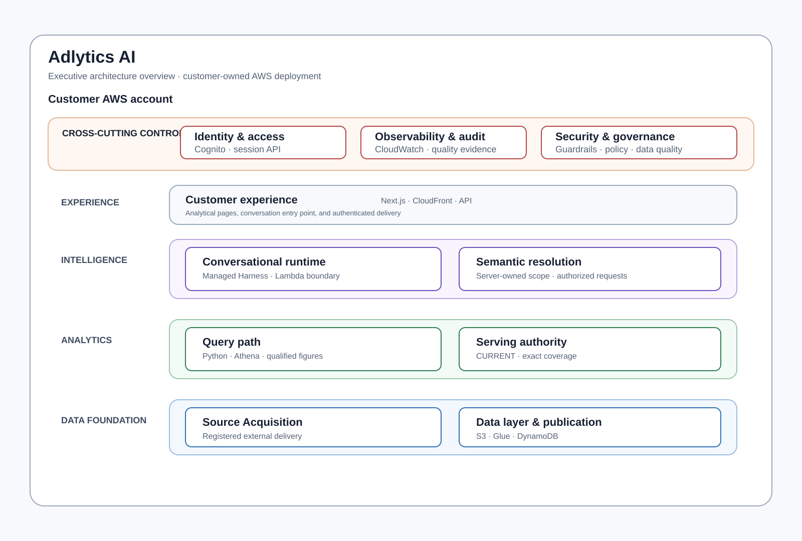
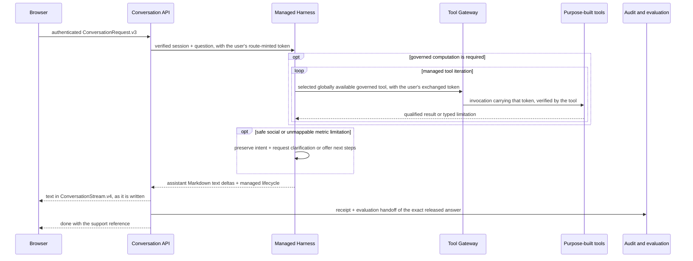

# Architecture — Adlytics AI

| | |
|---|---|
| **Level** | L1 — system context and container view |
| **Status** | Dev acceptance for Semantic V2 data/query, scoped Conversational Runtime V2, preset artifact publication, and tier insight narration (ADR-076 Phase 1) is recorded in [validation results](../validation/RESULTS.md). Deferred capabilities state their own boundaries. |
| **Conventions** | [Documentation conventions](conventions.md) |

## 1. Purpose and scope

Adlytics AI is a customer-account retail-media intelligence system. It turns governed source deliveries into exact analytical evidence and structured conversational or page experiences. This document owns system context, containers, trust boundaries, and capability navigation; child packages own behavior and interfaces.

## 2. Quality goals

| Goal | System rule |
|---|---|
| Correctness | Observed claims derive from selected successful evidence and retain required qualifications. |
| Useful conversation | Natural conversation, education, perspective, clarification, and analysis use explicit authority boundaries. |
| Honest degradation | Missing source, identity, suppression, semantic, DQ, or control evidence cannot become current or observed output. |
| Residency | Customer data remains in the customer AWS account. |
| Extensibility | New behavior adds governed contracts and typed structures rather than model-authored SQL or browser calculation. |

## 3. Constraints

- Deployments are single-tenant customer AWS accounts.
- External extraction stays outside the application boundary. ([ADR-097](decisions/adr-097-ship-one-first-party-connector-per-source-as-its-own-stack.md), Proposed 2026-10-07, would amend this to allow first-party connectors as separate stacks.)
- Managed services are preferred, but customer-data lifecycle and authority remain explicit.
- Python backend and TypeScript frontend/CDK meet through governed contracts, not runtime imports.

## 4. Context

**System Context diagram — Adlytics AI and its external delivery, identity, and model boundaries; context viewpoint, system depth.**

> **Takeaway.** External delivery, customer interaction, identity, and model services meet only through repository-owned authority boundaries.

## 5. Solution strategy

Exact source identity, immutable publication, `CURRENT` selection, governed computation, and the audited, evaluated conversational answer are separate capabilities. The model may propose intent and write the answer; it never creates data authority, SQL, values, or scope.

## 6. Container view and capability index

**Executive architecture overview — customer-account layers and cross-cutting controls; container viewpoint, platform depth.**

> **Takeaway.** Cross-cutting controls span the customer-account platform; experience, intelligence, analytics, and data foundation remain separate responsibilities.

### Capability index

| Capability | Responsibility | Document |
|---|---|---|
| Source Acquisition | Registered external delivery and manifest finalization. | [Source Acquisition](capabilities/source-acquisition/README.md) |
| Data Layer | Canonical semantics and immutable storage shapes. | [Data Layer](capabilities/data-layer/README.md) |
| Load Path | Ordered publication or refusal. | [Load Path](capabilities/load-path/README.md) |
| Publication State | Serving authority, `CURRENT`, and exact coverage. | [Publication State](capabilities/publication-state/README.md) |
| Query Path | Exact selection and deterministic figures. | [Query Path](capabilities/query-path/README.md) |
| Conversational Runtime | Verified managed-Harness turns and the streamed, audited agent answer. | [Conversational Runtime](capabilities/conversational-runtime/README.md) |
| Analytics Discovery | Declared navigation to existing pages/capability. | [Analytics Discovery](capabilities/analytics-discovery/README.md) |
| Agent Quality Loop | Content-minimized trace-anchored audit and protected per-evaluator result linkage. | [Agent Quality Loop](capabilities/agent-quality-loop/README.md) |
| Protected Quality Review API | Entitled review of one turn and a bounded turn listing. | [Protected Quality Review API](capabilities/protected-quality-review-api/README.md) |
| Operational Data-Flow Status | Registered authority-backed movement lifecycle and baseline visibility for entitled operators; incomplete surfaces remain explicit. | [Operational Data-Flow Status](capabilities/operational-data-flow-status/README.md) |
| Presentation Publication | Publication-time baked preset artifacts and pointer-selected page serving. | [Preset Artifact Publisher](ui/preset-artifact-publisher.md) |
| Insight Narration | Card and deep-dive narration over declared page slots; prompts ship through the calibration-gated registry ([ADR-076](decisions/adr-076-tier-insight-narration-across-card-and-deep-dive-models.md)). | [Insight Presentation Contract](ui/insight-presentation-contract.md) |
| Forecasting | Proposed offline baseline forecast artifacts. | [Forecasting](capabilities/forecasting/README.md) |
| Saturation | Proposed offline response-curve artifacts. | [Saturation](capabilities/saturation/README.md) |

Authentication and observability are reusable [concepts](concepts/), not capability contracts.

## 7. Trust boundaries

**Trust-boundary diagram — Conversation Runtime release controls; trust-boundary viewpoint, component depth.**

> **Takeaway.** Harness text is user-facing as it is written, tools remain mandatory authority for customer-specific facts and all figures, and the API remains the identity, inbound-policy, and audit boundary.

The browser supplies untrusted text in the reduced `ConversationRequest.v3` envelope, whose only page input is an opaque reference the server redeems ([ADR-120](decisions/adr-120-carry-page-context-to-chat-as-a-server-redeemed-reference.md)). The Conversation API verifies identity, invokes Harness with the verified session and question, and does not accept browser-supplied scope, filtering, or tool-authority data. [ADR-077](decisions/adr-077-carry-the-end-user-identity-to-every-hop-through-token-exchange.md) carries the verified user identity as signed claims past the Conversation API: the Harness accepts only a single-turn token the route mints from the user's verified token, and the Gateway and every tool verify a token derived from it (hop mechanics: [Conversational Runtime §5](capabilities/conversational-runtime/architecture.md#5-key-runtime-flow)). Purpose-built tools resolve explicit semantic intent inside the server-owned deployment-wide `AuthorizedAnalyticalScope` and remain mandatory authority for customer-specific facts and all figures. Harness may safely answer a social message or explain that an unrecognized or unsupported metric request cannot be mapped without a tool only if it makes no customer-specific claim or figure, executes no substitute query or tool, preserves intent, and asks for clarification or offers next steps; typed tool refusal remains equally valid. Free-form prose cannot establish SQL, scope, data, or platform capability. The API applies the inbound Guardrail, validates the managed lifecycle, and streams the agent's Markdown text unchanged; nothing checks it before the user sees it. It then records every turn and admits each complete turn's exact released answer to evaluation ([ADR-083](decisions/adr-083-stream-the-agent-answer-and-govern-it-by-audit-and-evaluation.md); release semantics: [Conversational Runtime §5](capabilities/conversational-runtime/architecture.md#release-semantics)). Source publication authority begins only after immutable delivery validation and ends at strongly read `CURRENT`.

## 8. Technology and IaC

The platform uses S3, DynamoDB, Glue, Athena, Lambda, EventBridge/SQS, CloudFront, Cognito, AgentCore, Bedrock, CloudWatch, and X-Ray according to the capability packages and [repo structure](repo-structure.md). Infrastructure exchanges values through typed SSM parameters, not stack construct references or exports.

## 9. Runtime view

**Sequence diagram — verified conversation turn through Conversation Runtime; runtime viewpoint, interaction depth.**

> **Takeaway.** The route streams Harness wording as it is written, after identity and inbound policy and before the receipt and evaluation handoff that precede `done`; governed tool iteration occurs whenever customer-specific facts or figures require authority.

A verified browser turn passes through Conversation Runtime, which invokes the managed Harness with the verified session and question. The Harness can select any globally configured Gateway tool; each resolves the user's explicit semantic candidates inside the server-owned deployment scope and returns governed facts with necessary freshness, coverage, suppression, measurement-basis, and other qualifiers. Harness naturally combines those results into concise prose and explains typed limitations without weakening intent. For social messages and unmappable unsupported-metric requests only, it may instead complete without a tool under the safe boundary in the trust view; mixed analytical intent cannot be skipped. The API validates the lifecycle and streams the text unchanged in the typed stream while retaining audit and evaluation linkage. The model has no direct source, storage, browser, scope, query, or factual authority.

## 10. Crosscutting concepts

- [Authentication](concepts/authentication.md)
- [Business Outcome Measurement](concepts/business-outcome-measurement.md) (proposed)
- [Data-Flow Completion and Service Levels](concepts/data-flow-completion-and-service-levels.md)
- [Observability](concepts/observability.md)
- [Provenance Chain](concepts/provenance-chain.md)
- [Response Curves and Budget Simulation](concepts/response-curves-and-budget-simulation.md) (proposed)
- [Semantic Accuracy](concepts/semantic-accuracy.md)
- [Semantic Resolution](concepts/semantic-resolution.md)

## 11. Decisions

[ADRs](decisions/) own rationale and historical alternatives. Capability packages link only to decisions that constrain their current contract.

## 12. Open questions and risks

Sanitized acceptance conclusions are in [validation results](../validation/RESULTS.md) and are not duplicated here.
