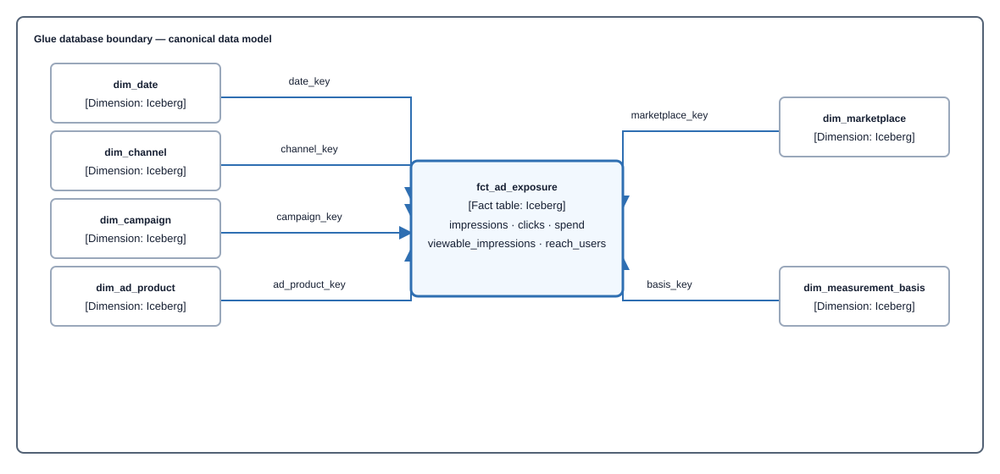

# Canonical Model — field-level reference

| | |
|---|---|
| **Level** | L3 — reference |
| **Status** | Governing local Semantic V2 field and metric reference; declared metric checks pass locally, while deployment, cutover, live-publication, and browser acceptance remain pending ([validation results](../validation/RESULTS.md#pending-acceptance--2026-08-24)) |
| **Last updated** | 2026-09-25 |
| **Owns** | every column of every dimension and fact, and the source-to-canonical mapping |
| **Parent** | [data-layer](capabilities/data-layer/README.md) — owns the approach, pipeline, and load semantics |
| **Decisions** | [ADR-002](decisions/adr-002-canonical-data-model.md) · [ADR-003](decisions/adr-003-canonical-model-decomposition.md) |

## 1. How to read this

**This document is the governed model, including current and explicitly deferred entries.** Semantic V2 publishes only validated immutable successes and serves only the versions selected by `CURRENT`; [Publication State](capabilities/publication-state/README.md) owns that authority and exact coverage. `contracts/generated/tables.json` is generated from the contracts and remains the deployment-shape authority, while the deferred rows below describe model work outside the current release. A field documented here is queryable only when its dataset has a selected current successful publication covering the requested buckets.


### `dim_*` and `fct_*` are table names, not column names

| Prefix | Is a | Holds | Columns listed in |
|---|---|---|---|
| `dim_` | **table** | the things you group *by* — one row per product, per date, per channel | §3 |
| `fct_` | **table** | the numbers you add up, plus `_key` columns pointing at dimensions | §4 |
| `snap_` | **table** | a *state* measured at a point in time — **never summed across time** | §4 |

The `snap_` distinction matters: you can add up sales across days, but adding up in-stock rate across days is meaningless. Same shape, opposite semantics, and the error is silent — so the prefix carries the warning.

So in §3 the heading `dim_product` is a table, and the grid underneath lists **that table's columns**. Same pattern in §4 for facts.

Columns ending `_key` are the joins. They are what let one `dim_product` serve both advertising and retail facts.

```sql
-- dim_product: one row per ASIN per marketplace per validity window
amazon_asin | marketplace_key | amazon_parent_asin | brand | is_current
------------|-----------------|--------------------|-------|-----------
B08N5WRWNW  | US              | B08N5PARENT        | Acme  | true

-- fct_retail_sales: one row per product per day, with keys pointing out
date_key   | amazon_asin | marketplace_key | basis_key     | units_shipped | revenue_shipped
-----------|-------------|-----------------|---------------|---------------|----------------
2026-08-13 | B08N5WRWNW  | US              | retail_actual | 412           | 8240.00

-- a question joins them. `is_current` asks for the brand as it is NOW; swapping that
-- predicate for a validity range asks for the brand as it was THEN — see below.
SELECT p.brand, SUM(f.revenue_shipped)
FROM fct_retail_sales f
JOIN dim_product p
  ON f.amazon_asin = p.amazon_asin
 AND f.marketplace_key = p.marketplace_key
 AND p.is_current
GROUP BY p.brand
```

These are real Iceberg tables in the curated lake, queried through Athena.

> **The join uses the natural key, not a surrogate.** A fact carries `amazon_asin` and joins `dim_product` on `(amazon_asin, marketplace_key)`. There is no `product_key`. Because the dimension is SCD2, the join must also state *which version* it wants: `AND p.is_current` for the brand as it is now, or a validity range for the brand as it was then. A join stating neither returns one row per version. Why, and what was rejected: [ADR-023](decisions/adr-023-product-natural-key.md).

### Verification marks

Every grid below has a **Source** column giving the upstream field, and a **✓** column marking verification:

| Mark | Meaning |
|---|---|
| **✓** | source field name verified against published docs or schema |
| **?** | source field name **not verified** — check before building |
| **—** | ours, not from any source (surrogate keys, stamped literals, derived values) |

Anything marked **?** is a guess about naming, not about existence. Do not write a mapping against it without checking [sources/amc](sources/amc.md) or [sources/vendor-central](sources/vendor-central.md) first.

For the *summary* view — layering, bus matrix, naming rules, load semantics — see [data-layer](capabilities/data-layer/README.md). This document is the drill-down.

## 2. Structure

Every fact follows the same shape: measures in the middle, conformed dimensions around it. `fct_ad_exposure` as the exemplar.

**Entity relationship diagram — `fct_ad_exposure` and its six conformed dimensions; canonical data-model viewpoint, table depth.** Every table below lives in the one Glue database.



> **Takeaway.** Facts hold only additive numbers; everything you slice by is a conformed dimension reached through a key.

**Which dimensions apply to which fact** is the [bus matrix](capabilities/data-layer/README.md) — a grid is the right form for that, not a diagram. The one asymmetry to carry in your head: `dim_campaign` reaches both advertising facts and **neither retail fact**, which is why retail sales cannot be attributed to a campaign.

### Columns every fact carries

Two columns are on every fact and are listed in no fact's column table below, because repeating them fourteen times is how they come to disagree. Both are **projected by the generator from contract-level metadata**, so neither appears in a contract's field mappings and no contract can omit one.

| Column | Type | Value | Why it cannot be derived |
|---|---|---|---|
| `basis_key` | string | `ad_attributed`, `retail_actual`, `modelled` — joins [`dim_measurement_basis`](#dim_measurement_basis) | No source knows it is one of several measurement systems. Two bases do not reconcile at any grain ([ADR-002](decisions/adr-002-canonical-data-model.md)), and a fact whose basis is unstored can be summed with one of another basis |
| `source_timezone` | string | `UTC` for AMC, `PST` for Vendor Central | A pre-aggregated day bucket cannot be re-bucketed, so the boundary is stored rather than normalised ([ADR-004](decisions/adr-004-timezone-and-fx.md)) |
| `ecosystem_key` | string | governed customer-facing ecosystem | Independent of source system: AMC can emit advertising and retail measurements |
| `platform_key` | string | governed business service | Separates Amazon Ads from Amazon Retail without inventing a retail advertising channel ([ADR-052](decisions/adr-052-separate-ecosystem-platform-channel-and-ad-product.md)) |

They are two columns rather than one because they vary independently: `amc-retail-purchases` is `retail_actual` on `UTC` while `vendor-sales-by-asin` is `retail_actual` on `PST`. Neither is recoverable from the other, from the source system, or from the table name.

A dimension carries neither. `dim_product` declares a `measurement_basis` because every contract must, but a product is not a measurement — it has no basis to reconcile and no day boundary it was aggregated into, so projecting one would invite a join that means nothing.

> **These were declared here and written by nothing.** The ERD above joined `dim_measurement_basis` on `basis_key`, the worked example in [§1](#dim_-and-fct_-are-table-names-not-column-names) showed it in a `fct_retail_sales` row, and [`dim_measurement_basis`](#dim_measurement_basis) enumerated its values — while no contract produced the column and no gate noticed, because `check-lineage` reads field mappings and these are not fields. ADR-004 put a deadline on the same defect for `source_timezone`: mandatory from the first load, since a later backfill needs a value that may no longer be knowable. Both were corrected before the first load. `make check-conformed-columns` is now the gate.

---

## 3. Conformed dimensions

### `dim_date`

| Column | Type | Source | ✓ |
|---|---|---|---|
| `date_key` | date | — | — |
| `day_of_week`, `week_start`, `month_start`, `quarter_start`, `year` | derived | — | — |
| `is_amazon_peak` | boolean | ours (Prime Day, BFCM) | — |

Grain: one row per calendar date. Timezone is resolved *before* this dimension is reached — see §7.

### `dim_channel`

The dimension that makes the model multi-channel. Amazon is a set of rows, not a schema.

| Column | Type | Example values | Source | ✓ |
|---|---|---|---|---|
| `channel_key` | string | `amazon_sp`, `amazon_sb`, `amazon_sd`, `amazon_stv`, `amazon_dsp` | — | — |
| `platform` | string | `amazon` today; other retail media networks, or a customer's own source | — | — |
| `channel_group` | string | `search`, `display`, `video`, `offsite`, `in_store` | — | — |
| `channel_name` | string | "Sponsored Products" | — | — |
| `channel_type` | string | `marketplace`, `retailer_owned`, `network` | — | — |

Mapped from AMC `ad_product_type` (`sponsored_products` \| `sponsored_brands` \| `sponsored_display` \| `sponsored_television`) ✓, where **`NULL` means DSP** in the attributed-events tables ✓. That null-means-DSP rule is a mapping trap — see [sources/amc](sources/amc.md) §4.

> **Current implementation:** no `dim_channel` table is generated or loaded. Advertising facts carry
> mapped key values, and the canonical examples, active contract values, and presentation grouping do
> not yet share one governed hierarchy. Accepted [ADR-052](decisions/adr-052-separate-ecosystem-platform-channel-and-ad-product.md)
> defines ecosystem, platform, channel group, channel, and ad product; implementation is in progress.

### `dim_marketplace`

| Column | Type | Source | ✓ |
|---|---|---|---|
| `marketplace_key` | string | — | — |
| `marketplace_id` | string | vendor `reportSpecification.marketplaceIds[]` | ✓ |
| `marketplace_name` | string | AMC `marketplace_name` | ✓ |
| `country_code` | string | ISO 3166 alpha-2 | — |
| `default_currency_code` | string | ISO 4217 | — |

AMC `marketplace_id` is classified `INTERNAL` and cannot be output ✓. AMC marketplace names and DSP country codes, Vendor marketplace IDs, producer routing values, country, and currency are source keys or attributes rather than interchangeable aliases. Each resolves through a governed mapping to one canonical marketplace identity or publication fails, as required by [ADR-045](decisions/adr-045-separate-delivery-commerce-marketplace-and-product-identities.md).

### `dim_product`

The polyseme: one product, differently identified per channel. **Never name anything after ASIN.**

| Column | Type | Source | ✓ |
|---|---|---|---|
| `amazon_asin` | string | Data Kiosk `asin` ✓ · vendor `asin` ✓ · AMC `tracked_asin` / `creative_asin` ✓ | ✓ |
| `amazon_parent_asin` | string | **Data Kiosk `parentAsin`** ✓ — [ADR-020](decisions/adr-020-vendor-sources-split-by-capability.md) | ✓ |
| `marketplace_key` | string | Data Kiosk `marketplaceId` — part of the key; ASIN-only keying is **[unverified]**, [Q-16](decision-coverage-registry.md#question-register-q-nn) | ✓ |
| `gtin` | string | no source in either system — deferred | ? |
| `<platform>_item_id` | string | one namespaced column per platform onboarded | — |
| `brand` | string | **Data Kiosk `brand`** ✓ — free, not the paid ARP feature | ✓ |
| `brand_code` | string | Data Kiosk `brandCode` ✓ — the stable key behind the display name | ✓ |
| `product_title` | string | Data Kiosk `productTitle` ✓ | ✓ |
| `valid_from`, `valid_to`, `is_current` | SCD2 | ours — assigned by the merge, not supplied by the source | — |

> **Parent ASIN and brand are resolved through Vendor Data Kiosk.** Vendor sales and traffic reports
> do not supply the hierarchy themselves; the Data Kiosk dimension publishes child ASIN, parent ASIN,
> stable brand code, display brand, and title under SCD2 validity. [ADR-020](decisions/adr-020-vendor-sources-split-by-capability.md)
> owns the source split. Brand or parent-name lookup still requires the dimension join and validity
> semantics; source availability is not the same as a model-visible resolver.
>
> This removes brand and parent ASIN from the AMC paid-feature dependency. AMC brand-halo measures
> still describe attributed same-brand outcomes without naming the brand, and converted
> `tracked_asin` is not necessarily the promoted `creative_asin`.

Channel-private attributes are permitted here — browse node, Subscribe & Save eligibility — provided they are never used as drill-across row headers.

### `dim_campaign`

| Column | Type | Source | ✓ |
|---|---|---|---|
| `campaign_key` | string | derived opaque key over commerce scope, platform, resolved channel, source system, qualified source scope, identifier kind, and AMC campaign value | — |
| `commerce_scope_key` | string | governed commerce identity bridge | — |
| `source_system_key`, `source_scope_namespace`, `source_scope_value` | string | immutable delivery scope retained as account-qualified identity evidence | — |
| `ecosystem_key`, `platform_key`, `channel_group_key`, `channel_key`, `ad_product_key` | string | governed media taxonomy selected by source-qualified media identity | — |
| `marketplace_key` | string | AMC campaign country or marketplace name resolved by ADR-045 | ✓ |
| `campaign_name` | string | AMC `campaign` — outputtable, settled by live probe | ✓ |
| `advertiser_key` | string, nullable | opaque key from AMC `advertiser_id` where source-capable; unavailable on the current sponsored observation | ✓ |
| `advertiser_name` | string | AMC `advertiser` — outputtable, same probe | ✓ |
| `source_campaign_id`, `source_campaign_namespace`, `source_campaign_identifier_kind` | string | qualified source alias evidence; never the canonical key | ✓ |
| `source_advertiser_id` | string, nullable | AMC `advertiser_id` on DSP; absent from the governed sponsored observation | ✓ |
| `source_ad_product_type` | string, nullable | sponsored observation source label; DSP is governed by its pack profile | ✓ |
| `source_observed_on` | date | minimum source event date in the governed observation window | ✓ |
| `valid_from`, `valid_to`, `is_current` | SCD2 | complete immutable history built before publication | — |
| `rows_suppressed` | boolean | AMC discriminator; governed campaign packs reject any suppressed delivery | ✓ |
| `ad_group_key`, `placement_key` | string | AMC — column names not pinned; deferred | ? |

Two things to get right:

- **Use `campaign_id_string`, not `campaign_id`.** On DSP both hold identical values as `STRING` and `LONG` ✓, and 18-digit DSP IDs do not survive JSON integer precision. On `sponsored_ads_traffic` they are **different identifiers from different systems** — the console ID is not even numeric ✓. Both columns are populated on both platforms, so picking the wrong one drops rows silently rather than erroring. `campaign_id_string` is the only choice that is correct for both.
- **Campaign and advertiser *names* are outputtable, settled by live probe 2026-08-19** ✓. This document previously recorded them as `INTERNAL` and never outputtable, researched from the docs on 2026-08-17. That was wrong. A final `SELECT campaign_id_string, campaign, advertiser, SUM(impressions) … GROUP BY` ran to `SUCCEEDED` against sandbox instance `SANDBOX_INSTANCE` with aggregation controls on, returning real names — and an `INTERNAL` column cannot appear in a `GROUP BY`, so the query would have been rejected. **No external campaign-metadata source is needed.** See [sources/amc](sources/amc.md) §4.

> **Current implementation:** governed DSP and sponsored source packs publish generated `dim_campaign`
> rows with effective-dated alias history and account-qualified canonical keys shared by matching
> advertising facts. Authorized campaign names and effective product-title aliases resolve locally to
> exact canonical keys before measurement; development publication and browser acceptance remain
> pending. Direct advertiser, brand, and parent measurement still require governed dimension joins
> and remain unavailable; see [answerable questions](answerable-questions.md).

### `dim_audience_segment`

**Audience segments, in two namespaces that are never linked** ([ADR-103](decisions/adr-103-model-audience-segments-as-a-source-namespaced-overlapping-dimension.md)). DSP behaviour segments (`amc_dsp_behavior`, written by `amc-dsp-segment-names`, pack 9) and Amazon audience segments from Audience Segment Insights (`amc_asi`, written by `amc-segment-metadata`, pack 13, a paid feature). The two use different IDs: P-BO-4 step 1 failed on the validation instance on 2026-10-09 ([results](../validation/RESULTS.md#p-bo-3-and-p-bo-4-on-the-standard-demo-instance)), so there is no cross-namespace key or join column, and a segment is always read with its namespace. Each namespace has its own writer, publication scope and history.

**Grain:** one row per platform × segment_namespace × segment_id × segment_marketplace_key × valid_from. SCD2 as `dim_product`: each monthly delivery folds into the history at the month's first day; a segment whose row came back withheld keeps its earlier version, and a name first withheld arrives in a later month (design §5.4). Both packs load under `discard_suppressed_rows` with no stored discriminator.

| Column | Type | Source | ✓ |
|---|---|---|---|
| `platform_key`, `ecosystem_key` | string | the pack's media profile through the taxonomy (`amazon_ads`) | — |
| `segment_namespace` | string | **literal per writer**: `amc_dsp_behavior` or `amc_asi` | — |
| `segment_id` | string | DSP `behavior_segment_id` or ASI `segment_id`, both AMC `INTEGER`, as decimal text | ✓ |
| `segment_marketplace_key` | string | pack 13: `segment_marketplace_id` through `amc.segment_marketplace_id`; pack 9: the delivery's `campaign_country` (the DSP table's own `segment_marketplace_id` meaning is [unverified]) | — |
| `segment_name`, `segment_description` | string, nullable | free text, read through AMC's backslash-escaped CSV dialect; an RFC-doubled quote refuses the delivery (`CSV_ESCAPE_AMBIGUOUS`) | ✓ |
| `category_level_1`, `category_level_2`, `category_path` | string, nullable | ASI only; NULL, `unsupported_by_channel`, on DSP segments | ✓ |
| `provider` | string, nullable | `amazon` or `third_party` from the governed classification `contracts/shared/audience-segment-providers.yaml`, applied at load; NULL reads "Provider not recorded", never "Amazon" | — |
| `valid_from`, `valid_to`, `is_current` | SCD2 | complete history built before publication | — |

> **Current implementation:** packs 9 and 13 and their contracts publish generated `dim_audience_segment` rows; a chat answer over `fct_segment_delivery` names each segment from this dimension with its provider label, reading only the answer's own marketplace (a segment ID is unique only within its segment marketplace, so a marketplace with no names publication leaves its segments unnamed rather than borrowing another's). The provider classification is the P-BO-3 first pass accepted for dev on 2026-10-09; its human review is pending. First live runs are pending.

### `dim_measurement_basis`

The dimension that stops incompatible numbers being summed.

| Column | Type | Values |
|---|---|---|
| `basis_key` | string | `ad_attributed`, `retail_actual`, `modelled` |
| `basis_name` | string | display label |
| `attribution_window_days` | integer | null for `retail_actual` |
| `lookback_days` | integer | for new-to-brand style windows |
| `methodology_ref` | string | link to the defining doc or standard |
| `reconciles_with` | string[] | **deliberately empty** — these bases do not reconcile |

All values are ours. `measurement_basis` is stamped as a literal during mapping, not read from a source.

### `dim_ad_product`

| Column | Type | Source | ✓ |
|---|---|---|---|
| `ad_product_key` | string | AMC `ad_product_type` ✓ | ✓ |
| `ad_product_name` | string | — | — |
| `is_self_service` | boolean | — | — |

### `dim_treatment_type`

Meridian's four-way split. Gives Amazon retail levers a conformed home instead of an Amazon-specific dumping ground.

| `treatment_key` | Meaning | Example |
|---|---|---|
| `paid_media` | media activity with a direct cost | Sponsored Products spend |
| `organic_media` | media activity with no direct cost | organic search placement |
| `non_media_treatment` | intervenable, not media | price change, Subscribe & Save promotion |
| `control` | not intervenable | seasonality, category demand |

---

## 4. Facts

### 4a. Which contract writes what

Thirteen contracts, decomposed by **dataset and grain** rather than by analysis topic ([ADR-022](decisions/adr-022-contract-decomposition-by-dataset.md)). Every one passes `make validate-contracts`, and `make check-lineage` proves every column it writes is declared below.

**Container diagram — source datasets writing canonical tables; ingestion viewpoint, container depth.**


> **Takeaway.** Four datasets feed one exposure fact, because no single AMC table carries impressions, clicks and viewability together. A fifth contract adds DSP reach to it.

| Contract | Dataset | Writes | Note |
|---|---|---|---|
| `amc-reach-frequency` | `sponsored_ads_traffic` | `fct_ad_exposure` | sponsored rows; impressions, clicks, spend, reach |
| `amc-dsp-impressions` | `dsp_impressions` | `fct_ad_exposure` | DSP impressions and fee-inclusive spend; media-only cost is excluded pending evidence |
| `amc-dsp-clicks` | `dsp_clicks` | `fct_ad_exposure` | `dsp_impressions` has **no `clicks` column** |
| `amc-dsp-views` | `dsp_views` | `fct_ad_exposure` | viewability; DSP only |
| `amc-dsp-reach` | `dsp_impressions` | `fct_ad_exposure` | DSP distinct reach per campaign-day only; `reject_delivery` (pack 4, [ADR-109](decisions/adr-109-null-fill-non-additive-measures-in-multi-writer-facts.md)) |
| `amc-attributed-conversion` | `amazon_attributed_events_by_conversion_time` | `fct_attributed_conversion` | **unblocks seven metrics including ROAS** |
| `amc-deduplicated-temporal-attribution` | `conversions` joined to DSP and sponsored traffic inside AMC | `fct_deduplicated_temporal_attribution` | exact first-touch, last-touch, or linear selector; [ADR-055](decisions/adr-055-govern-temporal-attribution-as-an-exact-selector.md) |
| `vendor-sales-by-asin` | `salesByAsin[]` | `fct_retail_sales` | |
| `vendor-traffic-by-asin` | `trafficByAsin[]` | `fct_product_page_views` | unblocks `conversion_rate_retail` |
| `vendor-product-hierarchy` | Data Kiosk | `dim_product` | hierarchy **and brand**; SCD2 load |
| `vendor-sales-reported-total` | `salesAggregate[]` | `fct_retail_sales_reported_total` | control total |
| `vendor-traffic-reported-total` | `trafficAggregate[]` | `fct_product_page_views_reported_total` | control total |
| `amc-retail-purchases` | `amazon_retail_purchases` | `fct_retail_purchase_amc` | **paid feature**; cross-system control |
| `amc-new-to-brand-buyers-platform` | `amazon_attributed_events_by_conversion_time` | `fct_new_to_brand_buyers` | distinct buyers per complete week or month, platform grain set; `discard_suppressed_rows` ([ADR-099](decisions/adr-099-treat-distinct-shopper-counts-as-a-new-kind-of-fact.md)) |
| `amc-new-to-brand-buyers-channel` | `amazon_attributed_events_by_conversion_time` | `fct_new_to_brand_buyers` | distinct buyers per ad product per complete week or month, channel grain set; `discard_suppressed_rows`; read against the ad-product roster |
| `amc-new-to-brand-buyers-campaign` | `amazon_attributed_events_by_conversion_time` | `fct_new_to_brand_buyers` | distinct buyers per campaign per complete calendar month, campaign grain set, chat only; `discard_suppressed_rows`; read against the campaign roster |
| `amc-exposure-groups` | `dsp_impressions`, `sponsored_ads_traffic`, `conversions` | `fct_exposure_group_outcome` | distinct shoppers per exposure group and identity space per complete week or month, and their 14-day outcomes; `discard_suppressed_rows`; declared expected cells and pack variants (pack 5) |
| `amc-exposure-frequency-platform` | `dsp_impressions`, `sponsored_ads_traffic`, `conversions` | `fct_exposure_frequency` | distinct shoppers per frequency bucket and identity space per complete month or quarter, and their 14-day purchases; `discard_suppressed_rows`; fine buckets, with the coarse scheme as a declared automatic variant (pack 6) |
| `amc-exposure-frequency-channel` | `dsp_impressions`, `sponsored_ads_traffic`, `conversions` | `fct_exposure_frequency` | the same per ad product, each (shopper, ad product) pair with its own window, channel grain set, read against the ad-product roster; no credit branch (pack 7, plan D12) |
| `amc-dsp-segment-names` | `dsp_impressions_by_matched_segments` | `dim_audience_segment` | DSP behaviour segment names per complete calendar month, namespace `amc_dsp_behavior`; `discard_suppressed_rows`; SCD2 (pack 9) |
| `amc-segment-metadata` | `segment_metadata` | `dim_audience_segment` | **paid feature** (ASI); segment names and categories under the pinned US `segment_marketplace_id`, namespace `amc_asi`; `discard_suppressed_rows`; SCD2 (pack 13) |
| `amc-audience-performance` | `dsp_impressions_by_matched_segments`, `amazon_attributed_events_by_conversion_time` | `fct_segment_delivery` | DSP delivery and DSP-attributed outcomes per campaign and matched segment per complete calendar month, chat only; `discard_suppressed_rows`; read against the campaign's segment roster (pack 8, C1-a) |
| `amc-segment-buyer-profile-inmarket` | `dsp_impressions`, `sponsored_ads_traffic`, `audience_segments_amer_inmarket_snapshot`, `conversions` | `fct_segment_profile` | **paid feature** (ASI); the month's ad-touched buyers and reached shoppers per in-market Amazon audience segment and their profiled totals, profile path `asi_in_market`; the exposure fence, then Amazon account IDs only; the month's first-Thursday snapshot; `discard_suppressed_rows` (pack 10) |
| `amc-segment-buyer-profile-lifestyle` | the same, with `audience_segments_amer_lifestyle_snapshot` | `fct_segment_profile` | **paid feature** (ASI); the same per lifestyle segment, profile path `asi_lifestyle` (pack 11) |
| `amc-segment-buyer-profile-dsp-exposed` | `dsp_impressions_by_user_segments`, `conversions` | `fct_segment_profile` | the same per DSP behaviour segment for DSP-exposed shoppers, profile path `dsp_exposed_only`, no fence (pack 12) |

**One contract is deliberately not written.** `amc-organic-vs-ad` needs three `conversions_all` money columns whose scale is `status: disputed`, so the gate refuses them and a probe must settle it first. It is recorded as deferred work, with what would unblock it. (`amc-audience-performance` was the second until the segment tables were transcribed; it is pack 8 above.)

**`fct_ad_exposure` is written by five contracts at one grain**, contributing different measures. They are combined by `UNION ALL` with zero-filled additive columns and then summed — never a row-level join, which would double-count spend against clicked impressions. `reach_users` is null-filled instead ([ADR-109](decisions/adr-109-null-fill-non-additive-measures-in-multi-writer-facts.md)).

### `fct_ad_exposure` — domain `exposure`

**Grain:** one row per date × channel × campaign × ad_product × marketplace × `rows_suppressed`.
**Basis:** `ad_attributed` (delivery side).
**Written by five contracts** — `amc-reach-frequency` (sponsored), `amc-dsp-impressions`, `amc-dsp-clicks`, `amc-dsp-views`, and `amc-dsp-reach` (DSP reach, pack 4). They contribute different measures at the same grain and are combined by `UNION ALL`, never a row-level join. An additive column a writer doesn't supply is zero-filled; `reach_users`, which every writer of it declares non-additive, is null-filled, so a DSP campaign-day without a reach delivery reads "not available", never 0. See [ADR-022](decisions/adr-022-contract-decomposition-by-dataset.md) and [ADR-109](decisions/adr-109-null-fill-non-additive-measures-in-multi-writer-facts.md).

| Column | Type | Source | ✓ |
|---|---|---|---|
| `date_key` | date | AMC `impression_date_utc` (DSP) · `event_date_utc` (sponsored, views) | ✓ |
| `channel_key` | string | governed from `ad_product_type` (sponsored) or DSP pack profile | ✓ |
| `channel_group_key` | string | governed search/display/video grouping from ADR-052 taxonomy | — |
| `campaign_key` | string | opaque canonical key resolved from qualified AMC `campaign_id_string` | ✓ |
| `ad_product_key` | string | `ad_product_type` (sponsored) · **literal** `amazon_dsp` (DSP) | ✓ |
| `marketplace_key` | string | `marketplace_name` (sponsored) · `campaign_country` (DSP, [ADR-022](decisions/adr-022-contract-decomposition-by-dataset.md)) | ✓ |
| `impressions` | bigint | AMC `impressions` | ✓ |
| `clicks` | bigint | AMC `clicks` — **`dsp_clicks` only**, absent from `dsp_impressions` | ✓ |
| `spend` | decimal | DSP `total_cost` ÷ 1e5 · sponsored `spend` ÷ 1e8 — **fee-inclusive** | ✓ |
| `currency_code` | string | AMC `currency_iso_code` | ✓ |
| `viewable_impressions` | bigint | `sum(dsp_views.viewable_impressions)` — the dedicated 1/0 flag column, **not** a filter on `event_type` | ✓ |
| `measurable_impressions` | bigint | `dsp_views.measurable_impressions` — the denominator of a viewability rate | ✓ |
| `viewable_impressions_estimated` | bigint | `dsp_views.unmeasurable_viewable_impressions` — **estimated, not observed** | ✓ |
| `reach_users` | bigint | **derived** — `COUNT(DISTINCT user_id)` inside AMC: sponsored from `sponsored_ads_traffic`, DSP from `dsp_impressions` (`amc-dsp-reach`) | ✓ |
| `rows_suppressed` | boolean | AMC filtered-metrics discriminator | ✓ |
| `distinct_user_count` | integer | AMC `distinctUserCountColumn` | ✓ |
| `suppression_reason` | string | AMC `filteredReasonColumn` | ✓ |

> **Spend is verified, and the divisor belongs to the column — never to the table or the platform.** `dsp_impressions` alone mixes both scales: `total_cost` is millicents while every fee column is microcents, so a platform-keyed divisor makes DSP fees wrong by 1000×. Divisors are enumerated in [sources/amc](sources/amc.md#6-time-money-currency) ✓. Media-only spend is deliberately absent: `impression_cost` fee scope remains unverified and sponsored ads has no equivalent.

> **`viewable_impressions` is summed from its own column, never filtered by `event_type`.** `dsp_views` carries `viewable_impressions`, `measurable_impressions` and `unmeasurable_viewable_impressions` as separate 1/0 flag columns at threshold `NONE`, and the page's own guidance is to *use the per-kind metric columns* because one impression that is both measurable and viewable produces **two rows** ✓. The observed enumeration is settled in [sources/amc](sources/amc.md) but is unnecessary to this mapping; a wrong filter literal would return zero rows where a missing column fails loudly.

> **`winning_bid_cost` is deliberately not modelled.** AMC's docs contradict themselves: it is absent from the `dsp_impressions` schema page but used by a live playbook. It needs a probe against a real instance before it can be mapped ✓. No current Semantic V2 metric requires it; fee-inclusive `spend` is fully sourced.

> **Spend and conversions come from different tables, so this fact and `fct_attributed_conversion` load from separate AMC outputs unioned at a shared grain** — `amazon_attributed_events_*` has no spend column at all ✓. A row-level join would double-count spend across the one-to-many traffic-to-conversion relationship.

> **`reach_users` cannot be re-aggregated.** It is a distinct count, so summing it across rows is wrong. It must be computed inside AMC at the exact grain requested, and AMC has **no approximate-distinct function** ✓ — reach is always an exact `COUNT(DISTINCT user_id)`, and `user_id` may never be output ✓. It is therefore expressed in a contract as a *derived* column naming `user_id` as its input, never as a field mapping, because a `VERY_HIGH` column is legal only inside a CTE.

> **DSP reach is served only for days `amc-dsp-reach` has published.** Pack 4 joined a fact whose DSP rows its three delivery contracts had written for months, so those days carry no reach. A request pinning the DSP rows (`channel_key` or `ad_product_key` `amazon_dsp`) is planned only over days with a CURRENT `amc-dsp-reach` publication (`ADLY-PLAN-0005`, `served_where_published` on the field). A window ending on a covered day names the first day of its covered run; a window wholly before the writer's first publication names that first day; a later day without one (a refused delivery) names none. That writer is never bound by a request that doesn't read reach over DSP rows, and never narrows the fact's or a media scope's coverage, so a refused reach delivery can't hide a day of DSP spend. Its rows carry only `reach_users`, so a figure carrying a column the writer doesn't write is refused over DSP rows (`ADLY-PLAN-0006`): `cost_per_reach` groups by `currency_code`, which only `amc-dsp-impressions` writes, so no row would hold both spend and reach. `avg_frequency` carries nothing and is answered.

> **`avg_frequency` is not stored here.** It is impressions ÷ reach, so it is a ratio and belongs in §5 with the other ratios — and it is the worst case of the general rule, because its denominator is non-additive. Averaging or summing a stored frequency across any two rows is wrong twice over. It is computed on read at the grain asked for.

### `fct_attributed_conversion` — domain `conversion`

**Grain:** one row per date × channel × campaign × ad_product × product × marketplace × `rows_suppressed`.
**Basis:** `ad_attributed`. **Written by** `amc-attributed-conversion`.

| Column | Type | Source | ✓ |
|---|---|---|---|
| `date_key` | date | AMC `conversion_event_date_utc` | ✓ |
| `channel_key` | string | governed from AMC `ad_product_type`, including its DSP sentinel | ✓ |
| `channel_group_key` | string | governed search/display/video grouping from ADR-052 taxonomy | — |
| `campaign_key` | string | opaque canonical key resolved from qualified AMC `campaign_id_string` | ✓ |
| `ad_product_key` | string | AMC `ad_product_type` | ✓ |
| `amazon_asin` | string | AMC `tracked_asin` — purchase events only; includes halo | ✓ |
| `marketplace_key` | string | AMC `conversion_event_marketplace_name` — **not** the traffic-side variant | ✓ |
| `conversions` | bigint | AMC `conversions` | ✓ |
| `purchases` | bigint | AMC `purchases` | ✓ |
| `revenue_attributed` | decimal | AMC `product_sales` — **unscaled, local currency** | ✓ |
| `revenue_attributed_incl_halo` | decimal | AMC `total_product_sales` — **unscaled** | ✓ |
| `units_attributed` | bigint | AMC `units_sold` | ✓ |
| `units_attributed_incl_halo` | bigint | AMC `total_units_sold` | ✓ |
| `purchases_incl_halo` | bigint | AMC `total_purchases` | ✓ |
| `purchases_new_to_brand_12mo` | bigint | AMC `new_to_brand_purchases` — advertised products only | ✓ |
| `purchases_new_to_brand_incl_halo_12mo` | bigint, nullable | AMC `new_to_brand_total_purchases` — advertised plus brand halo. Added at `amc-attributed-conversion` query pack version 2 (`present_from_pack_version: 2`); a row a pack-version-1 delivery landed reads NULL with `not_applicable_under_options` (the pack version is the option), never zero. Load and serving rules: [Load path, pack-versioned columns](capabilities/load-path/low-level-design.md#pack-versioned-columns) | ✓ |
| `revenue_new_to_brand_12mo` | decimal | AMC `new_to_brand_product_sales` — **unscaled** | ✓ |
| `currency_code` | string | AMC `purchase_currency` | ✓ |
| `rows_suppressed` | boolean | AMC filtered-metrics discriminator | ✓ |
| `distinct_user_count` | integer | AMC `distinctUserCountColumn` | ✓ |
| `suppression_reason` | string | AMC `filteredReasonColumn` | ✓ |

Three things this table encodes that are easy to miss:

- **Brand halo is a separate measure, not a variant.** AMC's `tracked_asin` includes same-brand products that were not advertised ✓. `product_sales` excludes halo; `total_product_sales` includes it, and AMC documents the identity `total_product_sales = product_sales + brand_halo_product_sales` ✓. Keeping both means the halo question is answerable and the default is honest. Halo analysis *at promoted-ASIN grain* needs a subtype fact, because promoted and converted ASIN are different products.
- **The window is in the name.** `purchases_new_to_brand_12mo` — AMC documents a **12-month** NTB lookback consistently across every NTB column ✓. The name carries it because Amazon's windows disagree across other surfaces (a 14-day order window elsewhere) and IAB Europe defines five generic timeframes.
- **Revenue is not scaled; spend is.** Attributed sales arrive as `DECIMAL(38,4)` already in local currency, while cost columns in the same table are scaled integers ✓. Applying a cost divisor to revenue is a 5-to-8 order-of-magnitude error in the ROAS numerator.
- **The three suppression columns are part of the schema, not diagnostics.** Setting `filteredMetricsDiscriminatorColumn` changes row semantics: sub-threshold rows are retained with values nulled, then **re-aggregated with SUM, so rows merge** ✓. The declared primary key can legitimately collapse. Either include `rows_suppressed` in the key or document that the key is unique only among unsuppressed rows.

### `fct_deduplicated_temporal_attribution` — domain `conversion`

**Grain:** one row per conversion date × channel × marketplace × currency × attribution model ×
`rows_suppressed`. **Basis:** `ad_attributed`. **Written by**
`amc-deduplicated-temporal-attribution`.

| Column | Type | Source | ✓ |
|---|---|---|---|
| `date_key` | date | AMC conversion `event_date_utc` | ✓ |
| `channel_key` | string | qualifying traffic `ad_product_type` | ✓ |
| `channel_group_key` | string | governed search/display/video grouping | — |
| `ad_product_key` | string | qualifying traffic `ad_product_type` | ✓ |
| `marketplace_key` | string | conversion `marketplace_name` | ✓ |
| `attribution_model_key` | string | registered first-touch, last-touch, or linear branch | ✓ |
| `matched_purchase_credit` | decimal | allocated matched-conversion credit | ✓ |
| `revenue_attributed_deduplicated_incl_halo` | decimal | allocated `total_product_sales`, unscaled | ✓ |
| `currency_code` | string | conversion `purchase_currency` | ✓ |
| `rows_suppressed` | boolean | AMC filtered-metrics discriminator | ✓ |
| `distinct_user_count` | integer | AMC `distinctUserCountColumn` | ✓ |
| `suppression_reason` | string | AMC `filteredReasonColumn` | ✓ |

The fact stores additive operands, never ROAS. `attribution_model_key` selects one alternative
interpretation exactly; it is not a dimension that may be summed or grouped away. Spend remains in
`fct_ad_exposure` and is joined only after each side is aggregated. The registry and producer
binding are governed by
[ADR-055](decisions/adr-055-govern-temporal-attribution-as-an-exact-selector.md).

### `fct_new_to_brand_buyers` — domain `shopper_lifecycle`

**A shopper-aggregate fact** ([ADR-099](decisions/adr-099-treat-distinct-shopper-counts-as-a-new-kind-of-fact.md)): exact distinct shoppers for one complete period, an explicit periodic fact ([ADR-046](decisions/adr-046-separate-extraction-coverage-from-measurement-time-grain.md) class 2, [ADR-100](decisions/adr-100-serve-periodic-metrics-only-for-complete-measured-periods.md)).
**Grain:** each grain set is its own contract with its own grain (ADR-099 point 2), and `grain_set` keeps their rows apart. Three are served:

- `platform` (`amc-new-to-brand-buyers-platform`): one row per period_start × period_end × time_grain × grain_set × marketplace_key. Channel, channel group, ad product and campaign are NULL with meaning `not_applicable_under_options`.
- `channel` (`amc-new-to-brand-buyers-channel`): one row per period_start × period_end × time_grain × grain_set × marketplace_key × ad_product_key. Channel and channel group follow from the ad product through the taxonomy; campaign is NULL with meaning `not_applicable_under_options`.
- `campaign` (`amc-new-to-brand-buyers-campaign`): one row per period_start × period_end × time_grain × grain_set × marketplace_key × campaign_key, for calendar months only. A campaign runs on one ad product [unverified until the pack's first live execution shows one row per campaign; two would block the delivery as `CELL_DUPLICATE`], so its ad product, channel and channel group are columns, not grain.

The table's grain is the union of the three, so its uniqueness rule includes `ad_product_key` and `campaign_key`, NULL on rows of the grain sets that don't split by them.
**Partition:** `marketplace_key`, `period_start`.
**Basis:** `ad_attributed`, 14-day attribution by conversion date, advertised products, 12-month new-to-brand lookback. **Written by** `amc-new-to-brand-buyers-platform` and `amc-new-to-brand-buyers-channel`, each one ISO week (Monday to Sunday, UTC) or calendar month per delivery, and `amc-new-to-brand-buyers-campaign`, one calendar month per delivery.

| Column | Type | Source | ✓ |
|---|---|---|---|
| `period_start` | date | the row's measurement bucket: the delivered half-open AMC window, `time_window_start` | ✓ |
| `period_end` | date | the day before `time_window_end` | ✓ |
| `time_grain` | string | `week` or `month`, the declared period that window is; `month` only on campaign rows | ✓ |
| `grain_set` | string | **literal** `platform`, `channel` or `campaign`, by contract | ✓ |
| `marketplace_key` | string | AMC `conversion_event_marketplace_name`, through the governed mapping; on a `not_returned` row, the delivery's marketplace | ✓ |
| `channel_group_key` | string | platform: NULL, `not_applicable_under_options` (media profile `amazon_ads`); channel and campaign: from the ad product through the taxonomy | ✓ |
| `channel_key` | string | platform: NULL, `not_applicable_under_options`; channel and campaign: from the ad product through the taxonomy | ✓ |
| `ad_product_key` | string | platform: NULL, `not_applicable_under_options`; channel and campaign: AMC `ad_product_type`, NULL COALESCEd to `amazon_dsp` in the pack, through the taxonomy | ✓ |
| `campaign_key` | string | platform and channel: NULL, `not_applicable_under_options`; campaign: AMC `campaign_id_string`, resolved to the same canonical campaign key the spend rows carry | ✓ |
| `identity_unit` | string | **literal** `amazon_user_id` | ✓ |
| `cell_state` | string | `returned`, or `not_returned` for the expected platform cell when no row came back; always `returned` on channel and campaign rows | ✓ |
| `buyers_new_to_brand_12mo` | bigint | **derived** — `COUNT(DISTINCT CASE WHEN new_to_brand THEN user_id END)` inside AMC; NULL, `not_returned` | ✓ |
| `buyers_attributed` | bigint | **derived** — `COUNT(DISTINCT user_id)` inside AMC; NULL, `not_returned` | ✓ |

> **A missing cell is absent, never zero.** A platform delivery expects one cell, the platform row for its marketplace. Withheld rows are discarded before the fact write, and when no row survives, the load writes the cell `cell_state = not_returned` with NULL counts; it reads "not available: too few shoppers, or none". The loss ratio (`not_returned` cells over expected cells) and the discarded-row count are recorded on the partition's publication evidence (rule `suppression:<contract>.cell-loss.v1`).
>
> **A channel delivery has no closed enumeration at load.** Its expected cells are the ad-product roster: the ad products with `ad_spend > 0` in `fct_ad_exposure` over exactly the period's days, for its marketplace and platform. Serving reads the roster beside every channel figure (`domain.measurement.rosters`), so in chat, the bake and insights a rostered ad product with no row reads "not available: too few shoppers, or none", and a returned ad product off the roster is kept. The loss, roster entries with no row over roster entries, is graded and, under 20 entries, never withdrawn. A channel delivery with no row publishes zero rows (rule `suppression:no-cell-returned`), so its period reads as landed.
>
> **A campaign delivery is read against the campaign roster the same way**, chat only: the campaigns with `ad_spend > 0` over exactly the month's days, each named by its public label, never its key. A roster of 20 or more with more than a fifth of its campaigns missing withdraws the grain set ([ADR-099](decisions/adr-099-treat-distinct-shopper-counts-as-a-new-kind-of-fact.md) point 9): no campaign figure is offered, each rostered campaign reads "not available: too few shoppers in this breakdown; see new buyers per channel", and a comparison or ranking over that month is refused (`ADLY-PLAN-0009`). Under 20 campaigns it is graded only. A question filtered to one ad product, channel or channel group reads the roster under the same filter, so a campaign the filter excludes is never graded missing. Withdrawal is per delivery: a question naming one campaign is graded on every campaign the month's delivery returned, so in a withdrawn month that campaign reads "not available" with the pointer too. A campaign with spend that has no governed public name refuses the per-campaign answer (`ADLY-PLAN-0008`) rather than naming it by key or placeholder.

> **Served only at one exact extracted period** (D-1, D-7). `time_grain` and `grain_set` are exact selectors: no answer sums a count across weeks, months, marketplaces, ad products or grain sets. A marketplace question reads the platform grain set, an ad-product question the channel grain set and a campaign question the campaign grain set, which answers calendar months only; none is derived from another. How a question about any other window is answered is the complete-period rule in [answerable questions §3](answerable-questions.md#3-bucket-a--answerable-execution-only).

### `fct_exposure_group_outcome` — domain `shopper_lifecycle`

**A shopper-aggregate fact** ([ADR-099](decisions/adr-099-treat-distinct-shopper-counts-as-a-new-kind-of-fact.md)) over disjoint shopper groupings ([ADR-101](decisions/adr-101-model-shopper-groupings-as-disjoint-axes-with-one-window-per-shopper.md)): shoppers reached per exposure group and identity space for one complete period, and what they did next. Each shopper's group, impressions, window spend and outcomes come from one 14-day window W from their first ad in the period, so overlap (D1b) and the funnel (E1) read identical groups from one extraction. Groups aren't random, so every metric over this fact is `causal: false` and its answer says "association, not cause" ([ADR-102](decisions/adr-102-flag-association-only-metrics-and-require-their-caveat.md)).

**Grain:** one row per period_start × period_end × time_grain × grain_set (`platform`) × marketplace_key × exposure_group × identity_space × row_kind. `row_kind` is `combined` on every pack version 1 row; the touch-only variant (pack version 2, trigger `manual`, off) writes `exposure` rows for both identity spaces and `outcome` rows for account IDs only, so switching it on needs no DataV2 append (plan D11).
**Partition:** `marketplace_key`, `period_start`.
**Basis:** `ad_attributed`. **Written by** `amc-exposure-groups` (pack 5), one ISO week or calendar month per delivery.

| Column | Type | Source | ✓ |
|---|---|---|---|
| `period_start`, `period_end`, `time_grain` | date, date, string | the delivery's measurement bucket; `week` or `month` | ✓ |
| `grain_set` | string | **literal** `platform` | ✓ |
| `marketplace_key` | string | the pack's echoed `sponsored_marketplace_name` parameter, through the governed mapping | ✓ |
| `channel_group_key`, `channel_key`, `ad_product_key`, `campaign_key` | string | NULL, `not_applicable_under_options` | ✓ |
| `exposure_group` | string | `dsp_only`, `sponsored_only` or `dsp_and_sponsored`, resolved by the load from `exposure_source_set` through the taxonomy's `exposure_source_sets` | ✓ |
| `exposure_source_set` | string | **derived** in AMC — which touch tables reached the shopper inside W (`dsp`, `sponsored`, `dsp+sponsored`) | ✓ |
| `identity_space` | string | **derived** in AMC — `account` when `user_id_type = 'adUserId'`, else `device_or_browser` | ✓ |
| `row_kind` | string | **literal per pack branch** — `combined`, or `exposure` / `outcome` on the touch-only variant | ✓ |
| `identity_unit` | string | **literal** `amazon_user_id` | ✓ |
| `cell_state` | string | `returned`, or `not_returned` for an expected cell no row came back for | ✓ |
| `shoppers_reached`, `search_shoppers`, `detail_page_view_shoppers`, `purchasers`, `ntb_purchasers` | bigint | **derived** — `COUNT(DISTINCT ...)` inside AMC; NULL, `not_returned`. Searches and page views count from the hour after first exposure; `search_shoppers` is never called branded (plan D13) | ✓ |
| `impressions`, `purchases` | bigint | **derived** — sums inside W; NULL, `not_returned` | ✓ |
| `dsp_window_spend` | decimal | DSP `total_cost` on these shoppers' impressions in W, millicents ÷1e5, in `dsp_currency` | ✓ |
| `sponsored_window_spend` | decimal | sponsored `spend` on these shoppers' impressions and clicks in W, microcents ÷1e8, in `sponsored_currency` | ✓ |
| `revenue_incl_halo` | decimal | `total_product_sales` of these shoppers' purchases in W, halo-inclusive, in `currency_code` | ✓ |
| `dsp_currency`, `sponsored_currency`, `currency_code` | string | each money column's own currency; the pack's `_min` twin of each is read by the load and never stored | ✓ |

> **Expected cells are declared in the contract** (`expected_cells`, plan D8): three exposure groups by two identity spaces. A withheld row is discarded before the fact write whatever its shopper count (the bar applies per data-source path, plan D19), and a cell no row came back for is written `not_returned` with NULL measures. The loss is graded per identity space and never withdrawn (design §4.4); the record (rule `suppression:amc-exposure-groups.cell-loss.v1`) carries one entry per slice.
>
> **Three load checks refuse a delivery** with a typed finding: a currency whose MAX and `_min` differ on any row (`CURRENCY_DISAGREEMENT`), every reached account row with no purchaser (`MARKETPLACE_FILTER_SUSPECTED`, a heuristic, design DS4-7), and a delivery of a pack variant other than the one the period expects (`PACK_VARIANT_MISMATCH`, plan D10).
>
> **Sums are exact only inside one fully returned delivery** (D-3, D-9). Shares, rates and the index divide one delivery's cells and are computed in domain code by the Reach and funnel bake; chat offers the per-cell counts. Rates read account IDs only. The fence result of 2026-10-09 is a structural check, not the exact pack text, and AC-E1.5 (no pre-exposure purchase and no post-window DSP touch counted) is pending Step B.

### `fct_exposure_frequency` — domain `shopper_lifecycle`

**A shopper-aggregate fact** ([ADR-099](decisions/adr-099-treat-distinct-shopper-counts-as-a-new-kind-of-fact.md)) over disjoint frequency buckets ([ADR-101](decisions/adr-101-model-shopper-groupings-as-disjoint-axes-with-one-window-per-shopper.md)): shoppers per frequency bucket and identity space for one complete calendar month or quarter, and what they bought. A shopper's bucket counts the impressions they saw in the 14-day window W from their first impression in the period, and their purchases, sales and window spend come from the same W, as on `fct_exposure_group_outcome`. Groups by frequency aren't random, so every metric over this fact is `causal: false` and its answer says "association, not cause" ([ADR-102](decisions/adr-102-flag-association-only-metrics-and-require-their-caveat.md)).

**Grain:** one row per period_start × period_end × time_grain × grain_set × marketplace_key × (`ad_product_key`, channel grain set only) × frequency_bucket × identity_space × bucket_scheme × row_kind. Two grain sets: `platform` (pack 6, media NULL) and `channel` (pack 7, one row per ad product; each (shopper, ad product) pair has its own window). `bucket_scheme` is `fine` (`1`..`9`, `10_plus`) on pack version 1 rows and `coarse` (`1`, `2`, `3`, `4_6`, `7_9`, `10_plus`) on the declared coarse variant's; `row_kind` is `window` on every row. `attribution_model_key` exists from creation, NULL with `not_applicable_under_options`, for pack 7's credit branch, which isn't built (plan D11, D12); that branch adds it to the grain.

**Partition:** `marketplace_key`, `period_start`.

**Basis:** `ad_attributed`. **Written by** `amc-exposure-frequency-platform` (pack 6) and `amc-exposure-frequency-channel` (pack 7), one calendar month or quarter per delivery.

| Column | Type | Source | ✓ |
|---|---|---|---|
| `period_start`, `period_end`, `time_grain` | date, date, string | the delivery's measurement bucket; `month` or `quarter` | ✓ |
| `grain_set` | string | **literal** `platform` (pack 6) or `channel` (pack 7) | ✓ |
| `marketplace_key` | string | the pack's echoed `sponsored_marketplace_name` parameter, through the governed mapping | ✓ |
| `ad_product_key`, `channel_key`, `channel_group_key` | string | pack 7: the touch's `ad_product_type` (DSP as `amazon_dsp`) and the channel it resolves to through the taxonomy; NULL, `not_applicable_under_options`, at the platform grain set | ✓ |
| `campaign_key`, `attribution_model_key` | string | NULL, `not_applicable_under_options` | ✓ |
| `frequency_bucket` | string | **derived** in AMC — one `CASE` over the shopper's impressions in W, written in full with no `ELSE` | ✓ |
| `identity_space` | string | **derived** in AMC — `account` when `user_id_type = 'adUserId'`, else `device_or_browser` | ✓ |
| `bucket_scheme`, `row_kind` | string | **literal per pack version** — `fine` or `coarse`; `window` | ✓ |
| `identity_unit`, `cell_state` | string | **literal** `amazon_user_id`; `returned`, or `not_returned` for an expected cell no row came back for | ✓ |
| `shoppers`, `purchasers`, `ntb_purchasers` | bigint | **derived** — `COUNT(DISTINCT ...)` inside AMC; NULL, `not_returned` | ✓ |
| `impressions`, `purchases` | bigint | **derived** — sums inside W; NULL, `not_returned` | ✓ |
| `dsp_window_spend`, `sponsored_window_spend` | decimal | DSP `total_cost` (millicents ÷1e5) and sponsored `spend` (microcents ÷1e8) on these shoppers' touches in W, in `dsp_currency` and `sponsored_currency` | ✓ |
| `revenue_incl_halo` | decimal | `total_product_sales` of these shoppers' purchases in W, halo-inclusive, in `currency_code` | ✓ |
| `dsp_currency`, `sponsored_currency`, `currency_code` | string | each money column's own currency; the `_min` twins are read by the load and never stored | ✓ |

> **Expected cells are declared in the contract** (plan D8): every bucket of the scheme by two identity spaces, and on pack 7 for each ad product that returned a row. A rostered ad product with no row at all is the serve-side spend roster's gap. Loss is graded per slice (identity space; on pack 7 also ad product) and never withdrawn. A NULL bucket on a kept row refuses the delivery (`FREQUENCY_BUCKET_NULL`), as do the pack 5 checks (`CURRENCY_DISAGREEMENT`, `MARKETPLACE_FILTER_SUSPECTED`, `PACK_VARIANT_MISMATCH`).
>
> **The coarse scheme switches on automatically** (plan D9, D10): a delivery any slice of which grades degraded makes the next period's expected variant `coarse` for that contract, marketplace and period grain, and the load then refuses a fine delivery; once coarse, it stays coarse until Step B. Fine and coarse are separate series and are never compared ("bucket scheme changed in {period}", D-8 (a)).
>
> **Purchases and sales are never summed across ad products** (D-9): one purchase sits in each ad product's row for its shopper. Per-channel return uses credited revenue, and pack 7's credit branch isn't built, so return by frequency is served at the platform grain set only.

### `fct_segment_delivery` — domain `exposure`

**A shopper-aggregate fact** ([ADR-099](decisions/adr-099-treat-distinct-shopper-counts-as-a-new-kind-of-fact.md), [ADR-103](decisions/adr-103-model-audience-segments-as-a-source-namespaced-overlapping-dimension.md)): per DSP campaign and matched DSP behaviour segment, for one complete calendar month, the campaign's impressions and spend matched to the segment, the shoppers reached in it, and their purchases attributed to the same campaign (route C1-a, design §5.5). **Segment figures never add up:** a shopper and an impression repeat once per matched segment, so nothing over this fact is summed across segments or campaigns (D-4). DSP only; DSP and ASI segments are never compared as one series. Campaign grain shows which segments perform, not which line item to change.

**Grain:** one row per period_start × period_end × time_grain × grain_set × marketplace_key × campaign_key × segment_namespace × segment_id. One grain set, `campaign`; `segment_namespace` is `amc_dsp_behavior` on every row, and a chat answer pins it.
**Partition:** `marketplace_key`, `period_start`.
**Basis:** `ad_attributed`. **Written by** `amc-audience-performance` (pack 8), one calendar month per delivery.

| Column | Type | Source | ✓ |
|---|---|---|---|
| `period_start`, `period_end`, `time_grain` | date, date, string | the delivery's measurement bucket; `month` | ✓ |
| `grain_set` | string | **literal** `campaign` | ✓ |
| `marketplace_key` | string | the delivery's `campaign_country` (the governed `dsp_campaign_country` filter), through the governed mapping | ✓ |
| `campaign_key` | string | DSP `campaign_id_string`, the key `dim_campaign`'s DSP rows carry | ✓ |
| `segment_namespace`, `segment_id` | string | **literal** `amc_dsp_behavior`; `behavior_segment_id` as decimal text, the key `dim_audience_segment` carries | ✓ |
| `ad_product_key`, `channel_key`, `channel_group_key` | string | the DSP profile through the taxonomy | ✓ |
| `identity_unit`, `cell_state` | string | **literal** `amazon_user_id`; `returned` (campaigns and segments are open slices, so no `not_returned` cell is written at load) | ✓ |
| `segment_reach`, `segment_purchasers` | bigint | **derived** — `COUNT(DISTINCT ...)` inside AMC; NULL, `not_returned` | ✓ |
| `impressions`, `segment_purchases` | bigint | **derived** — sums within the row; purchases NULL where no attributed purchase reached the row | ✓ |
| `dsp_spend` | decimal | DSP `total_cost` (millicents ÷1e5) of the matched impressions, in `dsp_currency` | ✓ |
| `segment_attributed_revenue` | decimal | `product_sales` of the campaign-attributed purchases, in `purchase_currency` | ✓ |
| `dsp_currency`, `purchase_currency` | string | each money column's own currency; the `_min` twins are read by the load and never stored | ✓ |

> **The segment roster is last month's returned segments of the same campaign** (design §6.5). A rostered segment with no row this month reads "not available", never 0; a returned segment not on the roster is shown and joins next month's; the campaign's first observed month, with no earlier published month holding this campaign's rows, has an empty roster and says so. A month whose previous month isn't published while an earlier month holds this campaign follows a gap in its history, not a first month, so its segment breakdown is refused (`ADLY-PLAN-0008`); another campaign's older months decide neither. Whether an earlier month holds the campaign costs one publication selection and one statement however many months are retained, each month fenced to its own publications; past the selector's exact-partition bound the breakdown is refused. Loss is graded and never withdrawn, because no coarser served view of segments exists. A segment answer is read for one campaign at a time, and refused naming the campaign otherwise.
>
> **Load checks:** the bar check (`expectedBar` 2) and the currency check (`CURRENCY_DISAGREEMENT`) refuse a delivery; a withheld row is discarded whatever its shopper count (the bar applies per data-source path). AC-E1.5 is pending Step B, and pack 8 rides on pack 5's pre-built alternative (plan D14).

### `fct_segment_profile` — domain `exposure`

**A shopper-aggregate fact** ([ADR-099](decisions/adr-099-treat-distinct-shopper-counts-as-a-new-kind-of-fact.md), [ADR-103](decisions/adr-103-model-audience-segments-as-a-source-namespaced-overlapping-dimension.md), [ADR-107](decisions/adr-107-derive-paid-feature-availability-from-delivery-evidence.md)): for one complete calendar month and one profile path, which audience segments the month's ad-touched buyers belong to, beside the shoppers the ads reached (C2, design §5.5 and §6.5).

**Grain:** one row per period_start × period_end × time_grain × grain_set × marketplace_key × profile_path × segment_namespace × segment_id × row_kind. One grain set, `platform`. `profile_path` names the delivery's own profiled base and is an exact selector: `asi_in_market` (pack 10) and `asi_lifestyle` (pack 11) are the Audiences page's "Amazon audience segments (paid)", each its own category table with its own total; `dsp_exposed_only` (pack 12) is "DSP-exposed buyers only". Design §6.5 names one paid value, `asi_all_exposed`; it is two here so each delivery's total keeps its own key.
**Partition:** `marketplace_key`, `period_start`.
**Basis:** `ad_attributed`. **Written by** packs 10, 11 and 12, one calendar month per delivery. No `_withheld` sibling: every measure is a distinct count.

| Column | Type | Source | ✓ |
|---|---|---|---|
| `period_start`, `period_end`, `time_grain` | date, date, string | the delivery's measurement bucket; `month` | ✓ |
| `grain_set` | string | **literal** `platform` | ✓ |
| `marketplace_key` | string | the delivery's echoed `sponsored_marketplace_name`, through the governed mapping | ✓ |
| `profile_path`, `segment_namespace` | string | **literals** per contract: `asi_in_market` or `asi_lifestyle` with `amc_asi`; `dsp_exposed_only` with `amc_dsp_behavior` | ✓ |
| `segment_id` | string | ASI `segment_id` or DSP `behavior_segment_id` as decimal text, the key `dim_audience_segment` carries; NULL on the `profiled_total` row (`not_applicable_under_options`) | ✓ |
| `row_kind` | string | `segment`, or `profiled_total` for the delivery's one total row | ✓ |
| `ad_product_key`, `channel_key`, `channel_group_key`, `campaign_key` | string | NULL at the platform grain set | ✓ |
| `identity_unit`, `cell_state` | string | **literal** `amazon_user_id`; the declared `profiled_total` cell is written `not_returned` when it doesn't come back; segments are an open slice | ✓ |
| `segment_exposed_shoppers`, `segment_buyers`, `segment_buyers_new_to_brand` | bigint | **derived** — `COUNT(DISTINCT ...)` inside AMC on segment rows; NULL on the total row | ✓ |
| `profiled_exposed_total`, `profiled_buyers_total` | bigint | **derived** — the delivery's two bases on its total row: profiled reached shoppers, and those of them who bought in the month | ✓ |

> **Bases (design §5.5, BO-11).** Packs 10-11 read the exposure fence (byte-identical to pack 5's), then Amazon account IDs with an impression in the period (the ASI ID space is [unverified] until P-BO-4 step 2), and the snapshot Amazon takes on the month's first Thursday through a 2-day UTC range the producer planner derives from the period and the Finalizer re-derives. Pack 12's two bases both come from `dsp_impressions_by_user_segments`. Buyers are any ad-touched purchasers in the month and may have bought before their first ad.

> **The segment roster is last month's returned segments of the same profile path** (design §6.5): a rostered segment with no row this month reads "not available", never index 0; the path's first published month has an empty roster and says so; a previous month unpublished while an earlier one is published is a gap, refused (`ADLY-PLAN-0008`). Loss is graded and never withdrawn. A total read from the `profiled_total` row names no segment, so nothing is graded.

### `fct_shopper_acquisition` — domain `shopper_lifecycle`

**A shopper-aggregate fact** ([ADR-099](decisions/adr-099-treat-distinct-shopper-counts-as-a-new-kind-of-fact.md), [ADR-104](decisions/adr-104-define-acquisition-cohorts-by-amazons-new-to-brand-flag.md)): acquisition cohorts and their repeat purchases for one cohort vintage, the 13 whole calendar months ending with its `as_of_month`. A shopper's cohort is the calendar month of their first new-to-brand purchase in the vintage, and their acquisition channel group (won by DSP only, by sponsored ads only, or by both) comes from the credit sources of that day's new-to-brand purchase rows. Each row counts a cohort's shoppers who bought again in follow-up month *k* (1 to 12). Two paths: `standard` counts ad-touched repeats from `conversions` ("Ad-touched repeat only. Understates true repeat."); `arp` counts every Amazon purchase from Amazon Retail Purchases, for Amazon account IDs only (paid). On a multi-brand instance a repeat is "from this advertiser".

**Grain:** one row per period_start × period_end × time_grain (`custom`) × as_of_month × grain_set (`platform`) × marketplace_key × cohort_path × cohort_grain × cohort_month × months_since_acquisition × acquisition_channel_group. `cohort_grain` is `month` on pack version 1 rows and `quarter` on the calendar-quarter variant's (pack version 2), where `cohort_month` holds the cohort quarter's first day and `months_since_acquisition` counts follow-up quarters 1 to 3; both columns exist from creation, so switching the variant on needs no DataV2 append (plan D11).

**Partition:** `marketplace_key`, `period_start`.

**Basis:** `ad_attributed` on `standard` rows, `retail_actual` on `arp` rows. **Written by** `amc-acquisition-cohorts` (pack 14) and `amc-acquisition-cohorts-arp` (pack 15, AMC Paid Feature, ARP), one vintage per delivery. Pack 15's cohort set is pack 14's text byte for byte (a contract test compares them), restricted after it to Amazon account IDs. It reads the ARP marketplace from its own `arp_marketplace_name` parameter, resolved from the `amc.arp_marketplace_name` namespace pinned to the registry's `AMAZON.COM` form (plan D15).

| Column | Type | Source | ✓ |
|---|---|---|---|
| `period_start`, `period_end`, `time_grain` | date, date, string | the delivery's vintage window; `custom` | ✓ |
| `as_of_month` | date | the vintage's last month, from the period; the pack's `as_of_month` parameter carried it | ✓ |
| `grain_set` | string | **literal** `platform` | ✓ |
| `marketplace_key` | string | the pack's echoed `sponsored_marketplace_name` parameter, through the governed mapping | ✓ |
| `cohort_path`, `cohort_grain` | string | **literal per pack and pack version** — `standard` or `arp`; `month` or `quarter` | ✓ |
| `cohort_month`, `months_since_acquisition` | date, bigint | **derived** in AMC — the acquisition month (or quarter) and the follow-up offset `MONTH_INDEX` in the probe-compiled form (plan D16) | ✓ |
| `acquisition_source_set`, `acquisition_channel_group` | string | the pack's source set (`dsp`, `sponsored`, `dsp+sponsored`) and the canonical group the load resolves from it through the taxonomy's `exposure_source_sets` | ✓ |
| `ad_product_key`, `channel_key`, `channel_group_key`, `campaign_key` | string | NULL, `not_applicable_under_options` | ✓ |
| `identity_unit`, `cell_state` | string | **literal** `amazon_user_id`; `returned`, or `not_returned` for an expected cell no row came back for | ✓ |
| `cohort_buyers_new_to_brand_12mo`, `cohort_buyers_account_ids` | bigint | **derived**, standard path only — the cohort's size and its Amazon account ID part, repeated on every *k* row and never summed across *k*; NULL, `not_returned` | ✓ |
| `repeat_buyers`, `first_repeat_buyers`, `cumulative_repeat_buyers` | bigint | **derived**, both paths — `COUNT(DISTINCT ...)` inside AMC; cumulative is its own extracted count, never a sum; NULL, `not_returned` | ✓ |
| `repeat_buyers_account_ids`, `cumulative_repeat_buyers_account_ids` | bigint | **derived**, standard path only — the Amazon account ID part of the two counts above | ✓ |
| `cohort_buyers_account_ids_check` | bigint | **derived**, ARP path only — pack 15's own count of the cohort; an integrity column with no dictionary metric, never served | ✓ |
| `repeat_purchases`, `repeat_revenue` | bigint, decimal | sums inside the row: purchase events and `total_product_sales` (standard), `COUNT(DISTINCT purchase_id)` and `unit_price × purchase_units_sold` (ARP), in `currency_code` | ✓ |
| `currency_code` | string | the repeat revenue's currency; its `_min` twin is read by the load and never stored; NULL on a row with no repeat | ✓ |

> **Expected cells are declared in the contract** (plan D8, design §6.6): every cohort month *m* and follow-up month *k* from 1 to 12 with *m* + *k* inside the vintage, by three acquisition source sets; on the quarterly variant, cohort quarters wholly inside the vintage and follow-up quarters 1 to 3 that have ended. A cohort and group with no row at any *k* is an **absent cohort**: it reads "No shoppers were won this way in {month}, or too few to show." and stays out of the loss denominator, so a sponsored-only advertiser keeps an intact sponsored triangle. Loss is graded per acquisition source set and never withdrawn, because no coarser served view of the grid exists.
>
> **Load checks:** the bar check (`expectedBar` 2); a cohort size that differs across its *k* rows (`REPEATED_TOTAL_MISMATCH`); two currencies behind one row (`CURRENCY_DISAGREEMENT`); a cell outside the vintage's triangle; a delivery of the cohort grain the series doesn't expect (`PACK_VARIANT_MISMATCH`). Each refuses the delivery. A withheld row is discarded whatever its shopper count (the bar applies per data-source path), and its repeat purchases and revenue go to `fct_shopper_acquisition_withheld`, keyed on `as_of_month`, `cohort_grain` and `cohort_path` from creation; its revenue is summed only beside its currency, otherwise it reads "withheld".
>
> **The calendar-quarter variant switches on automatically** (plan D9, D10): a vintage any slice of which grades degraded makes the next vintage's expected variant `quarterly` for pack 14 and that marketplace, sticky until Step B. Pack 15 follows pack 14's decision for the same marketplace, so the ARP rate's operands share one cohort grain, and its own loss switches neither pack. Monthly and quarterly vintages are separate series and never compared ("Cohort grain changed in {period}.", D-8 (a)).
>
> **Rates divide one cell's counts.** Standard-path rates divide by `cohort_buyers_new_to_brand_12mo`, or, for the account-ID rates a comparison across groups binds, by `cohort_buyers_account_ids`. The ARP rates divide pack 15's repeat buyers by pack 14's `cohort_buyers_account_ids` for the same vintage, cohort and group (`mixes_basis`, D-8 (b)) and are withheld with "cohort sizes changed between runs" when pack 15's check differs or the numerator exceeds the denominator. Chat and the Retention bake compute them per cell through one domain rule (owner decision 2026-10-12); without a pack 15 delivery for the vintage only they are refused.

### `fct_retail_sales` — domain `retail_demand`

**Grain:** one row per date × product × marketplace × distributor_view × selling_program.
**Basis:** `retail_actual`.

| Column | Type | Source | ✓ |
|---|---|---|---|
| `date_key` | date | `salesByAsin[].startDate` | ✓ |
| `amazon_asin` | string | `salesByAsin[].asin` | ✓ |
| `marketplace_key` | string | `reportSpecification.marketplaceIds[0]` | ✓ |
| `units_shipped` | bigint | `salesByAsin[].shippedUnits` | ✓ |
| `revenue_shipped` | decimal | `salesByAsin[].shippedRevenue.amount` | ✓ |
| `cogs_shipped` | decimal | `salesByAsin[].shippedCogs.amount` | ✓ |
| `units_ordered` | bigint | `salesByAsin[].orderedUnits` | ✓ |
| `revenue_ordered` | decimal | `salesByAsin[].orderedRevenue.amount` | ✓ |
| `customer_returns` | bigint | `salesByAsin[].customerReturns` | ✓ |
| `currency_code` | string | `shippedRevenue.currencyCode` — the other two `Amount` currencies are asserted equal to it, then dropped ([ADR-021](decisions/adr-021-money-column-shape.md)) | ✓ |
| `distributor_view` | string | `reportOptions.distributorView` | ✓ |
| `selling_program` | string | `reportOptions.sellingProgram` | ✓ |
| `source_watermark` | date | `reportSpecification.lastUpdatedDate` | ✓ |

`distributor_view` and `selling_program` are **in the grain, not attributes**, because they change which population the row describes ✓:

- `orderedUnits` and `orderedRevenue` are **null under `SOURCING`** ✓
- `customerReturns` is **null under `FRESH`** ✓
- **Only `MANUFACTURING` reconciles to AMC retail purchases** ✓

Revenue is **net of returns** ✓, which is why `source_watermark` matters — these figures move after publication.

### `fct_product_page_views` — domain `retail_demand`

**Grain:** one row per date × product × marketplace. **Basis:** `retail_actual`.

| Column | Type | Source | ✓ |
|---|---|---|---|
| `date_key` | date | `trafficByAsin[].startDate` | ✓ |
| `amazon_asin` | string | `trafficByAsin[].asin` | ✓ |
| `marketplace_key` | string | `reportSpecification.marketplaceIds[0]` | ✓ |
| `glance_views` | bigint | `trafficByAsin[].glanceViews` | ✓ |
| `source_watermark` | date | `reportSpecification.lastUpdatedDate` | ✓ |

`glanceViews` is the **only** metric in the vendor traffic report ✓. The report has **no `distributorView` option** ✓ — so it cannot be rate-ed against a `SOURCING` sales pull, and conversion rate is only coherent under `MANUFACTURING`.

### Reconciliation facts — control totals, never analytical row headers

Three tables exist for one purpose: **detecting that a load was incomplete.** They are not drill-across targets, never carry row headers, and no metric reads them.

They earn their place because an incomplete load is invisible without them. If Amazon's by-ASIN array is short, every row present is still correct and nothing is null — the total is simply understated, and every figure downstream is quietly low. That is the same class of failure as AMC suppression: information lost before delivery, detectable only by holding a second statement of the same fact.

The first two carry the same measures as the fact they check, minus the product dimension — that absence *is* their grain, which is why they are named for their role rather than their grain.

#### `fct_retail_sales_reported_total`

**Grain:** date × marketplace × distributor_view × selling_program. **Basis:** `retail_actual`.
**Written by** `vendor-sales-reported-total`. **Checks** `sum(fct_retail_sales)` for the same period.

| Column | Type | Source | ✓ |
|---|---|---|---|
| `date_key` | date | `salesAggregate[].startDate` | ✓ |
| `marketplace_key` | string | `reportSpecification.marketplaceIds[0]` | ✓ |
| `distributor_view` | string | `reportOptions.distributorView` | ✓ |
| `selling_program` | string | `reportOptions.sellingProgram` | ✓ |
| `units_shipped` | bigint | `salesAggregate[].shippedUnits` | ✓ |
| `revenue_shipped` | decimal | `salesAggregate[].shippedRevenue.amount` | ✓ |
| `cogs_shipped` | decimal | `salesAggregate[].shippedCogs.amount` | ✓ |
| `units_ordered` | bigint | `salesAggregate[].orderedUnits` — null under `SOURCING` | ✓ |
| `revenue_ordered` | decimal | `salesAggregate[].orderedRevenue.amount` — null under `SOURCING` | ✓ |
| `customer_returns` | bigint | `salesAggregate[].customerReturns` — null under `FRESH` | ✓ |
| `currency_code` | string | `salesAggregate[].shippedRevenue.currencyCode` | ✓ |
| `source_watermark` | date | `reportSpecification.lastUpdatedDate` | ✓ |

#### `fct_product_page_views_reported_total`

**Grain:** date × marketplace. **Basis:** `retail_actual`.
**Written by** `vendor-traffic-reported-total`. **Checks** `sum(fct_product_page_views)`.

| Column | Type | Source | ✓ |
|---|---|---|---|
| `date_key` | date | `trafficAggregate[].startDate` | ✓ |
| `marketplace_key` | string | `reportSpecification.marketplaceIds[0]` | ✓ |
| `glance_views` | bigint | `trafficAggregate[].glanceViews` | ✓ |
| `source_watermark` | date | `reportSpecification.lastUpdatedDate` | ✓ |

#### `fct_retail_purchase_amc`

**Grain:** date × product × marketplace × `rows_suppressed`. **Basis:** `retail_actual`.
**Written by** `amc-retail-purchases` — **AMC Paid Feature**, free through 2026-12-31 ([Q-07](decision-coverage-registry.md#question-register-q-nn)).
**Checks** `fct_retail_sales` under `distributorView = MANUFACTURING`.

The cross-*system* check, and the only documented one: ARP's scope is documented to match Vendor Central → Retail Analytics → Sales → Distributor View = `MANUFACTURING` ✓.

| Column | Type | Source | ✓ |
|---|---|---|---|
| `date_key` | date | ARP `purchase_date_utc` — the only date-typed column on the table | ✓ |
| `amazon_asin` | string | ARP `asin` | ✓ |
| `marketplace_key` | string | ARP `marketplace_name` — `marketplace_id` is `INTERNAL` | ✓ |
| `units_purchased` | bigint | ARP `purchase_units_sold` | ✓ |
| `revenue_purchased` | decimal | **derived** — `unit_price × purchase_units_sold`. ARP has **no revenue column** ✓ | ✓ |
| `currency_code` | string | ARP `currency_code` | ✓ |

> **Never sum a reconciliation fact with the fact it checks.** `fct_retail_purchase_amc` and `fct_retail_sales` are both `retail_actual` and both cover the same purchases, so adding them double-counts every sale. Two sources of one measurement system are two tables, compared, never combined. A residual difference is expected — ARP is purchase-side, the vendor column is shipped-side.

### Remaining facts — deferred outside Semantic V2

Structure agreed, fields not yet specified. They depend on decisions or sources not yet settled, and each records its consequence while deferred. The current release does not publish these facts.

| Fact | Domain | Grain | Blocked on |
|---|---|---|---|
| `fct_conversion_path` | conversion | date range × channel × path sequence | AMC playbook SQL output columns |
| `fct_attributed_conversion_amazon` | conversion | date × campaign × **promoted** product × marketplace | a **channel subtype fact** — brand halo analysis at promoted-ASIN grain, where promoted and converted product differ. Reached by drill-across, not a bus matrix row |
| `snap_product_availability` | retail_availability | **snapshot** — date × product × marketplace | vendor inventory report not yet in scope |
| `fct_repeat_purchase_reported` | shopper_lifecycle | product × report period (week, month or quarter) × marketplace; basis `retail_actual` | [ADR-105](decisions/adr-105-keep-source-reported-shares-source-aligned-and-publish-brand-analytics-levels-only.md) (Proposed) and its first contract |
| `fct_incremental_effect` | incrementality | date × channel × product | deferred ML capability |
| `fct_cross_channel_performance` | cross_channel_performance | date × product × marketplace × channel | derived from the above by merge |
| `snap_campaign_budget_state` | exposure | **snapshot** — campaign × budget scope × scope key × observed_at × budget period | [ADR-088](decisions/adr-088-model-budget-pacing-and-pool-state-as-platform-neutral-snapshots.md) (Proposed) and its first contract |
| `snap_budget_pool_state` | exposure | **snapshot** — pool × observed_at | ADR-088 (Proposed) and its first contract |
| `snap_budget_settings` | exposure | **snapshot** — qualified source scope × observed_at | ADR-088 (Proposed) and its first contract |
| `snap_budget_usage` | exposure | **snapshot** — subject kind (campaign or portfolio) × subject × observed_at | ADR-088 (Proposed) and its first contract |
| `snap_budget_rule_association` | exposure | **snapshot** — rule × campaign × observed_at | ADR-088 (Proposed) and its first contract |
| `snap_campaign_delivery_settings` | exposure | **snapshot** — campaign × scope × observed_at | ADR-088 (Proposed) and its first contract |
| `snap_campaign_fee_line` | exposure | **snapshot** — campaign × fee line × observed_at | ADR-088 (Proposed) and its first contract |
| `fct_campaign_change_event` | exposure | campaign × entity × entity key × changed_at × change kind | ADR-088 (Proposed) and its first contract |
| `fct_campaign_pacing` | exposure | date (campaign timezone) × campaign | ADR-088 (Proposed) and its first contract |
| `fct_campaign_hourly_cost` | exposure | date (campaign timezone) × campaign × hour of day | ADR-088 (Proposed) and its first contract |
| `fct_ad_exposure_hourly` | exposure | date (UTC) × campaign × hour of day | ADR-088 (Proposed) and its first contract |
| `fct_ad_exposure_by_product` | exposure | date × campaign × product | ADR-088 (Proposed) and its first contract |
| `snap_platform_forecast_vintage` | exposure | **snapshot** — subject × platform × source kind × retrieved_at × origin × periodicity × metric; basis `modelled` | ADR-088 (Proposed) and its first contract |
| `snap_platform_forecast_curve_point` | exposure | **snapshot** — subject × platform × source kind × retrieved_at × origin × periodicity × curve metric × point; basis `modelled` | ADR-088 (Proposed) and its first contract |
| `fct_attributed_conversion_by_traffic_date` | conversion | traffic date (campaign timezone) × campaign × channel × ad product × marketplace | ADR-088 (Proposed) and its first contract |
| `snap_promotion_status` | retail_demand | **snapshot** — promotion × observed_at | ADR-088 (Proposed) and its first contract |
| `fct_lift_test_result` | incrementality | subject × test window × test | ADR-088 (Proposed); optional customer input |

The rows from `snap_campaign_budget_state` down are proposed by ADR-088, not agreed. Their domain is the closest existing ADR-003 domain: budget, pacing, cost and the platform's spend forecasts answer "at what cost" (`exposure`). Each becomes a live canonical fact, with field-level columns here, when its first contract ships.

ADR-088 proposes these dimensions on the same terms:

| Dimension | Grain | Blocked on |
|---|---|---|
| `dim_ad_account` | ad account × valid_from (one row per qualified source scope) | ADR-088 (Proposed) and its first contract |
| `dim_ad_group` | ad group × valid_from | ADR-088 (Proposed) and its first contract |
| `dim_campaign_product_membership` | ad group × ad × product × valid_from | ADR-088 (Proposed) and its first contract |
| `dim_promotion_product` | promotion × product × valid_from | ADR-088 (Proposed) and its first contract |
| `dim_retail_event` | event × marketplace | ADR-088 (Proposed) and its first contract |

The `fct_repeat_purchase_reported` row is proposed by ADR-105, not agreed. Its domain is the closest existing ADR-003 domain: repeat purchase answers "are we acquiring or milking" (`shopper_lifecycle`), where ADR-003 already places repurchase behaviour. It becomes a live canonical fact, with field-level columns here, when its first contract ships.

`dim_audience_segment` ([ADR-103](decisions/adr-103-model-audience-segments-as-a-source-namespaced-overlapping-dimension.md)) is no longer proposed here: packs 9 and 13 write it (§3).

### 4a. Withheld residuals — one sibling per suppressible fact

**Eight tables, none of them declared.** Any fact whose contracts set the suppression discriminator and map an additive measure gets a `<fact>_withheld` sibling, derived from the fact itself by `make generate-schemas`. Today: `fct_ad_exposure_withheld`, `fct_attributed_conversion_withheld`, `fct_deduplicated_temporal_attribution_withheld`, `fct_retail_purchase_amc_withheld`, `fct_exposure_group_outcome_withheld`, `fct_exposure_frequency_withheld`, `fct_segment_delivery_withheld`, `fct_shopper_acquisition_withheld`. `fct_new_to_brand_buyers`, `fct_segment_profile` and `dim_audience_segment` get none: their contracts map only distinct counts, which a residual excludes. `fct_exposure_group_outcome_withheld` holds a discarded withheld row's impressions, window spend, purchases and revenue (each money sum only beside its currency); its distinct counts are dropped. It keys on the fact's `row_kind` too, from creation (plan D11), so a touch-only delivery's withheld `exposure` and `outcome` rows land as two residual rows rather than one sum of two branches. `fct_exposure_frequency_withheld` does the same for packs 6 and 7, keyed on `row_kind` and `bucket_scheme` from creation, so a residual names the scheme its withheld buckets were counted under; a withheld row without the scheme, or two schemes in one delivery, refuses the delivery. Vendor facts get none, because Vendor Central has no threshold mechanism.

**Why they exist.** AMC nulls each output column against that column's own threshold, so a row behind which one shopper sat loses **every** dimension these contracts map — `campaign_key`, `date_key` and `marketplace_key` together [verified 2026-08-21, [amc.md](sources/amc.md) §5]. Its measures survive and still belong in a total, so the row can be neither stored in the fact (three non-nullable grain columns, two of them partition keys) nor discarded (the total would be short by an unstated amount).

**Grain: `contract_id × marketplace_key × period_start × period_end × option_set_hash`.** Every column comes from the delivery's manifest or the contract's identity, so suppression cannot reach it. Keyed on the row's own dimensions instead, two windows' residuals would share one all-NULL grain and overwrite each other — measured, not reasoned about. [ADR-034](decisions/adr-034-a-withheld-residual-is-keyed-on-its-delivery.md) carries the argument and the rejected alternatives.

Columns are the fact's own measures, all nullable, so the two tables stay comparable figure for figure. The full grid is generated — see `contracts/generated/tables.json` rather than a copy here.

> **A coarse total is `fact sum + residual for the window`.** [ADR-019](decisions/adr-019-grain-viability-is-measured.md) established that a coarse aggregate survives suppression intact; it does, but not from the fact alone. [ADR-035](decisions/adr-035-suppression-is-a-quantity-not-a-flag.md) closed [G-30](decision-coverage-registry.md#gap-register-g-nn) by folding suppression over the fact: every answer reports the fact's withheld quantity and row count beside the attributable figure. It deliberately keeps this residual out of answers, so an answer's withheld quantity under-reports by the residual; the residual lands and is queryable, and no answer query path reads it. The one place fact plus residual is summed is the load-time control-total check (`src/domain/semantics/prepublication.py`).

> **A distinct count is never in a residual or a control total** ([ADR-099](decisions/adr-099-treat-distinct-shopper-counts-as-a-new-kind-of-fact.md) point 12). No total is built by summing distinct counts, and two withheld rows' counts may share shoppers. So the residual folds only additive measures (`split_withheld`, `src/domain/curation/ingestion.py`), and the control total checks every measure except a contract's `non_additive` ones (`control_total_measures`, `src/domain/curation/assertions.py`). A `reject_delivery` pack whose contract maps a distinct count refuses a delivery with any withheld row first. A pack that declares `discard_suppressed_rows` (the new-to-brand buyer packs and `amc-exposure-groups`) drops its withheld rows before the fact write and keeps the rest (`split_discarded`, `src/domain/curation/ingestion.py`); where its contract maps additive measures (pack 5), the dropped rows' additive measures fold into the residual (`fold_discarded`).

> **A withheld amount without its currency is never added to money** (AMC-V decision 5, owner S-8). On multi-source withheld rows AMC returned purchase-side sums and every currency column NULL [verified 2026-10-09, [amc.md](sources/amc.md) §5]. That a single-source withheld row nulls its LOW currency column with its keys is [inference] from the verified per-column nulling of LOW columns on one-user rows (2026-08-21); no forced-suppression probe has selected a currency column. A money amount with no currency has no unit. So the residual sums a money measure only from withheld rows that kept their currency, and stores it NULL when none did; the load's control total leaves those rows out of both sides, and passes a money measure no row carries a currency for; and an answer leaves a currency-less withheld group out of its withheld amount and out of the currency check. The measurement carries the typed absence `withheld` (`Withholding.withheld_amount`, a `WithheldAmount` in `src/domain/shared_kernel/provenance.py`); the answer states it in its suppression reason, naming those groups apart from the stated amount, with the text "Amazon withheld this amount, so it isn't added to the total." A typed wire field arrives with the first versioned artifact that needs one. Counts and other non-money measures on the same row are summed as before. For a pack that groups by currency the NULL is [inference] until a probe groups by it.

---

## 5. Metrics

Defined once in the semantic layer, over the facts above. **No ratio is ever stored** — ROAS, CTR and CVR are not summable.

The dictionary is now an executable typed contract rather than a list of formulas. The canonical
model owns formula, grain, basis, and interpretation semantics; the dictionary projects those
semantics and owns the exact bounded `customer_definition` and `customer_caveat` copy released by
the runtime. Every metric states its aggregation class, time class/grain and compatibility mode;
governed axis defaults state whether each axis is groupable, filterable, alignable and additive or
exact-only. Each metric also declares `ecosystem_aggregation`, which sets the ecosystem and platform
axes: only `ad_spend` is additive, within one marketplace and currency, and no other metric is ever
summed across networks. The platforms a simple metric can come from are derived from its contracts,
source packs and the media taxonomy, and an operand with one platform has both axes accounted
([ADR-106](decisions/adr-106-keep-outcome-metrics-inside-one-network-by-type.md)).
A simple metric may also declare `exact_only_axes`, a list of media or product grains it never sums
across. `purchases_new_to_brand_incl_halo_12mo` declares channel and ad product, because one purchase
can be credited to more than one channel [unverified: the design infers it from the table's one row per
conversion and credited traffic event; no AMC page states it]. A metric reading a pack-versioned column is
planned only over a window whose every day is published from that pack version or later; otherwise the
planner refuses it naming the first fully covered date (`src/domain/measurement/pack_coverage.py`).
Ratios aggregate operands under their own policies before division. Accepted basis,
method, timezone, window, fee and one-sided selector differences retain both operand values as
structured metadata; strict mode refuses them before SQL.

Exposure dims are date, channel, campaign, ad_product, marketplace. Conversion dims add product. Retail dims are date, product, marketplace. `make check-lineage` asserts this table and the dictionary name the same metrics.

**Every simple metric declares its source system and datasets, and no ratio declares either.** A ratio's sources are its operands', derived rather than copied. This exists because `measurement_basis` does not separate two systems measuring the same thing: `retail_revenue_shipped` is Vendor Central and `retail_revenue_purchased` is AMC, both are `retail_actual`, and they will disagree — so `mixes_basis` stays false for a combination that is still a double count. The source is what makes it refusable.

**Additive measures — `fct_ad_exposure`, exposure dims**

| Metric | Reads | Note |
|---|---|---|
| `ad_spend` | `spend` | fee-inclusive |
| `impressions` | `impressions` | |
| `clicks` | `clicks` | |
| `viewable_impressions` | `viewable_impressions` | **DSP only** |
| `measurable_impressions` | `measurable_impressions` | **DSP only** |
| `viewable_impressions_estimated` | `viewable_impressions_estimated` | **DSP only** — modelled, never mixed with the measured column |

**Additive measures — `fct_attributed_conversion`, conversion dims**

| Metric | Reads | Note |
|---|---|---|
| `attributed_revenue_14d` | `revenue_attributed` | the ROAS default |
| `attributed_revenue_incl_halo_14d` | `revenue_attributed_incl_halo` | |
| `attributed_revenue_halo_14d` | the difference of the two above | the halo portion alone |
| `revenue_new_to_brand_12mo` | `revenue_new_to_brand_12mo` | 12-month lookback |
| `purchases` | `purchases` | |
| `purchases_incl_halo` | `purchases_incl_halo` | |
| `purchases_new_to_brand_12mo` | `purchases_new_to_brand_12mo` | 12-month lookback, advertised products only |
| `purchases_new_to_brand_incl_halo_12mo` | `purchases_new_to_brand_incl_halo_12mo` | 12-month lookback, includes brand halo; `exact_only` on channel and ad product; pack-version-2 coverage gate (New customers gateway products) |
| `conversions` | `conversions` | **broader than `purchases`** — includes non-purchase actions |
| `units_attributed` | `units_attributed` | |
| `units_attributed_incl_halo` | `units_attributed_incl_halo` | |

**Additive measures — `fct_deduplicated_temporal_attribution`, conversion date and channel dims**

Every request pins one registered model; model rows are alternative interpretations and are never
summed together.

| Metric | Reads | Note |
|---|---|---|
| `matched_purchase_credit_deduplicated_incl_halo_14d` | `matched_purchase_credit` | fractional matched-conversion credit |
| `attributed_revenue_deduplicated_incl_halo_14d` | `revenue_attributed_deduplicated_incl_halo` | halo-inclusive, local currency |

**Additive measures — `fct_retail_sales` and `fct_product_page_views`, Vendor Central, retail dims**

| Metric | Reads | Note |
|---|---|---|
| `retail_revenue_shipped` | `fct_retail_sales.revenue_shipped` | net of returns, restates |
| `revenue_ordered` | `fct_retail_sales.revenue_ordered` | **`MANUFACTURING` only** |
| `units_shipped` | `fct_retail_sales.units_shipped` | |
| `units_ordered` | `fct_retail_sales.units_ordered` | **`MANUFACTURING` only** |
| `cogs_shipped` | `fct_retail_sales.cogs_shipped` | **Amazon's wholesale cost, not the vendor's** — see the callout below |
| `amazon_margin_proxy` | `fct_retail_sales.revenue_shipped − fct_retail_sales.cogs_shipped` | difference of sums; **Amazon's** margin on the vendor's shipped units, never the vendor's — see the callout below |
| `customer_returns` | `fct_retail_sales.customer_returns` | **`RETAIL` only**, null under `FRESH`, and lags |
| `glance_views` | `fct_product_page_views.glance_views` | the only metric in the traffic report |

**Additive measures — `fct_retail_purchase_amc`, AMC, retail dims**

A second measurement of retail actuals, from a paid AMC feature.

| Metric | Reads | Note |
|---|---|---|
| `retail_revenue_purchased` | `revenue_purchased` | **never summed with `retail_revenue_shipped`** |
| `retail_units_purchased` | `units_purchased` | |

**Non-additive**

| Metric | Reads | Valid grains |
|---|---|---|
| `reach_users` | `fct_ad_exposure.reach_users` — **never summed** | exactly the grain it was extracted at |
| `buyers_new_to_brand_12mo` | `fct_new_to_brand_buyers.buyers_new_to_brand_12mo` — **never summed**, periodic | marketplace (grain set `platform`), or ad product with or without channel (grain set `channel`), at one complete week or month (`time_grain` exact selector); or campaign (grain set `campaign`), at one complete calendar month |
| `buyers_attributed` | `fct_new_to_brand_buyers.buyers_attributed` — **never summed**, periodic | marketplace (grain set `platform`), or ad product with or without channel (grain set `channel`), at one complete week or month (`time_grain` exact selector); or campaign (grain set `campaign`), at one complete calendar month |

Non-additivity propagates through a ratio's operands, so `avg_frequency` and `cost_per_reach` inherit it rather than declaring it again.

**Shopper groups — `fct_exposure_group_outcome`, pack 5, every metric `causal: false`** ([ADR-102](decisions/adr-102-flag-association-only-metrics-and-require-their-caveat.md))

Each reads one complete week or month (`time_grain` exact selector) at marketplace × exposure group × identity space, the cells one delivery returns. Distinct counts are never summed; a sum over every exposure group or identity space of one delivery is computed only where every cell came back, and only in domain code (D-3, D-9). Every answer carries "association, not cause".

| Metric | Reads | Note |
|---|---|---|
| `shoppers_reached` | `shoppers_reached` — **never summed** | the all-ID figure is the sum over both identity spaces of one delivery |
| `search_shoppers_in_window` | `search_shoppers` — **never summed** | never called branded search (plan D13) |
| `detail_page_view_shoppers_in_window` | `detail_page_view_shoppers` — **never summed** | from the hour after first exposure |
| `purchasers_in_window` | `purchasers` — **never summed** | exposure-group shoppers, not the new-to-brand buyer counts |
| `ntb_purchasers_in_window` | `ntb_purchasers` — **never summed** | |
| `impressions_in_window` | `impressions` | additive inside one fully returned delivery only (D-9); never compared with period impressions |
| `purchases_in_window` | `purchases` | additive inside one fully returned delivery only (D-9); withheld rows' purchases are in the residual |
| `revenue_incl_halo_in_window` | `revenue_incl_halo` | additive inside one fully returned delivery only (D-9); a currency-less withheld amount is never summed and reads withheld |
| `search_rate` | `search_shoppers ÷ shoppers_reached`, one cell | **account IDs only** (`requires: identity_space = account`); refused on device or browser IDs |
| `purchaser_rate` | `purchasers ÷ shoppers_reached`, one cell | **account IDs only**; refused on device or browser IDs |
| `revenue_per_exposed_shopper` | `revenue_incl_halo ÷ shoppers_reached`, one cell | **account IDs only**; halo-inclusive |
| `overlap_share` | `dsp_and_sponsored` account shoppers ÷ every group's account shoppers, one delivery | computed by the Reach and funnel bake, refused by the planner; a lower bound, never exact |
| `overlap_share_all_ids` | the same over both identity spaces of one delivery | computed by the bake, refused by the planner; understated |
| `dsp_only_reach_share` | `dsp_only` account shoppers ÷ every group's account shoppers, one delivery | computed by the bake, refused by the planner |
| `purchaser_rate_index_vs_sponsored_only` | a group's `purchaser_rate` ÷ the sponsored-only group's, one delivery, account IDs | computed by the bake, refused by the planner; may understate the difference between groups |
| `dsp_window_spend_on_shoppers` | `dsp_window_spend` | labelled from `dsp_currency`; additive inside one fully returned delivery only (D-9); never added to sponsored window spend |
| `sponsored_window_spend_on_shoppers` | `sponsored_window_spend` | labelled from `sponsored_currency`; additive inside one fully returned delivery only (D-9); never added to DSP window spend; a currency-less withheld amount reads withheld |

**Shoppers by frequency — `fct_exposure_frequency`, packs 6 and 7, every metric `causal: false`** ([ADR-102](decisions/adr-102-flag-association-only-metrics-and-require-their-caveat.md))

Each reads one complete month or quarter (`time_grain` exact selector) at marketplace × frequency bucket × identity space, per ad product at the channel grain set, in the one bucket scheme the period's series used. Distinct counts are never summed; a sum over the buckets or identity spaces of one delivery is computed only where every cell came back, only in domain code, and never across ad products (D-3, D-9).

| Metric | Reads | Note |
|---|---|---|
| `shoppers_in_frequency_bucket` | `shoppers` — **never summed** | |
| `purchasers_in_frequency_bucket` | `purchasers` — **never summed** | |
| `ntb_purchasers_in_frequency_bucket` | `ntb_purchasers` — **never summed** | |
| `impressions_in_frequency_bucket` | `impressions` | additive inside one fully returned delivery only, never across ad products (D-9) |
| `purchases_in_frequency_bucket` | `purchases` | additive inside one fully returned delivery only, never across ad products (D-9); withheld rows' purchases are in the residual |
| `revenue_incl_halo_in_frequency_bucket` | `revenue_incl_halo` | additive inside one fully returned delivery only, never across ad products (D-9); a currency-less withheld amount is never summed and reads withheld |
| `dsp_window_spend_in_frequency_bucket` | `dsp_window_spend` | labelled from `dsp_currency`; never added to sponsored window spend in a query |
| `sponsored_window_spend_in_frequency_bucket` | `sponsored_window_spend` | labelled from `sponsored_currency`; never added to DSP window spend in a query |
| `window_spend_in_frequency_bucket` | both window spends of one bucket | refused by the planner; the Reach and funnel bake adds them only where the bucket's DSP, sponsored and purchase currencies agree (design §5.5), as return's denominator |
| `purchaser_rate_by_frequency` | `purchasers ÷ shoppers`, one bucket | **account IDs only**; computed by the bake per bucket |
| `roas_incl_halo_by_frequency` | `revenue_incl_halo ÷` both window spends, one bucket | **platform grain set and account IDs only**; refused per channel or ad product because per-channel return uses credited revenue; computed by the bake |

**Segment delivery — `fct_segment_delivery`, pack 8, C1** ([ADR-103](decisions/adr-103-model-audience-segments-as-a-source-namespaced-overlapping-dimension.md))

Each reads one complete calendar month (`time_grain` exact selector) at marketplace × campaign × audience segment, one campaign at a time, against the campaign's segment roster. Segments overlap, so the `audience_segment` axis is `exact_only` and **no figure is summed across segments or campaigns** (D-4); a request that would is refused naming `segment_id`.

| Metric | Reads | Note |
|---|---|---|
| `segment_impressions` | `impressions` | within one campaign and segment row only (D-9) |
| `segment_spend` | `dsp_spend` | labelled from `dsp_currency`; a currency-less withheld amount reads withheld |
| `segment_purchases` | `segment_purchases` | summed within one campaign only (design §5.1) |
| `segment_attributed_revenue` | `segment_attributed_revenue` | labelled from `purchase_currency`; a currency-less withheld amount reads withheld |
| `segment_reach` | `segment_reach` — **never summed** | |
| `segment_purchasers` | `segment_purchasers` — **never summed** | |
| `segment_cpm` | `dsp_spend ÷ impressions × 1000`, one row | |
| `segment_roas_attributed` | `segment_attributed_revenue ÷ dsp_spend`, one row | only where the two currencies agree; each has its own currency column, so chat refuses it and only a bake that checks both may compute it |
| `segment_purchase_rate` | `segment_purchasers ÷ segment_reach`, one row | |

**Buyer segment profile — `fct_segment_profile`, packs 10-12, C2** ([ADR-103](decisions/adr-103-model-audience-segments-as-a-source-namespaced-overlapping-dimension.md))

Each reads one complete calendar month on one profile path (`time_grain` and `profile_path` exact selectors); the paths are never compared or added as one series. Segment figures are per segment against the path's roster and never summed (D-4); the totals are read from the delivery's `profiled_total` row.

| Metric | Reads | Note |
|---|---|---|
| `segment_buyers` | `segment_buyers` — **never summed** | carries the C2 label "Ad-touched buyers in the month · may have bought before seeing an ad" |
| `segment_exposed_shoppers` | `segment_exposed_shoppers` — **never summed** | |
| `segment_buyers_new_to_brand` | `segment_buyers_new_to_brand` — **never summed** | the new-to-brand view of `segment_buyers` |
| `profiled_buyers_total` | `profiled_buyers_total`, the `profiled_total` row | one per path and month |
| `profiled_exposed_total` | `profiled_exposed_total`, the `profiled_total` row | one per path and month |
| `segment_buyer_share` | `segment_buyers ÷ profiled_buyers_total`, one delivery | `delivery_ratio: segment_profile`: the measurement tool plans the segment rows and the total row and pairs them per segment (`segment_figures`), the rule the Audiences bake reads; never one query |
| `segment_exposed_share` | `segment_exposed_shoppers ÷ profiled_exposed_total`, one delivery | as above |
| `segment_index` | `segment_buyer_share ÷ segment_exposed_share` | as above; a delivery whose total row is missing answers every share and index "not available" |

**Acquisition cohorts — `fct_shopper_acquisition`, packs 14 and 15, B3** ([ADR-104](decisions/adr-104-define-acquisition-cohorts-by-amazons-new-to-brand-flag.md))

Each reads one cohort vintage (`time_grain` `custom`, `as_of_month` exact selector, the latest by default) and one path (`cohort_path` exact selector, `standard` or `arp`) at marketplace × cohort × months since acquisition × acquisition channel group, in the one cohort grain the vintage's series used. Cohort sizes repeat on every follow-up row and are never summed across *k*; cumulative repeat buyers are their own extracted count.

| Metric | Reads | Note |
|---|---|---|
| `cohort_buyers_new_to_brand_12mo` | `cohort_buyers_new_to_brand_12mo` — **never summed** | standard path only |
| `cohort_buyers_account_ids` | `cohort_buyers_account_ids` — **never summed** | standard path only; the denominator of the account-ID and ARP rates |
| `cohort_repeat_buyers` | `repeat_buyers` — **never summed** | both paths |
| `cohort_first_repeat_buyers` | `first_repeat_buyers` — **never summed** | both paths |
| `cohort_repeat_buyers_cumulative` | `cumulative_repeat_buyers` — **never summed** | both paths |
| `cohort_repeat_buyers_account_ids` | `repeat_buyers_account_ids` — **never summed** | standard path only |
| `cohort_repeat_buyers_cumulative_account_ids` | `cumulative_repeat_buyers_account_ids` — **never summed** | standard path only |
| `cohort_repeat_purchases` | `repeat_purchases` | additive inside one fully returned delivery only (D-9) |
| `cohort_repeat_revenue` | `repeat_revenue` | labelled from `currency_code`; additive inside one fully returned delivery only (D-9); a currency-less withheld amount reads withheld |
| `repeat_buyer_rate` | `repeat_buyers ÷ cohort_buyers_new_to_brand_12mo`, one cell | standard path; all ID types, for one group on its own |
| `cumulative_repeat_rate` | `cumulative_repeat_buyers ÷ cohort_buyers_new_to_brand_12mo`, one cell | standard path; all ID types |
| `repeat_buyer_rate_account_ids` | `repeat_buyers_account_ids ÷ cohort_buyers_account_ids`, one cell | standard path; the only rates a comparison across groups binds |
| `cumulative_repeat_rate_account_ids` | `cumulative_repeat_buyers_account_ids ÷ cohort_buyers_account_ids`, one cell | standard path; the Retention curve |
| `repeat_buyer_rate_arp` | pack 15 `repeat_buyers ÷` pack 14 `cohort_buyers_account_ids`, same vintage and cell | `mixes_basis`; chat and the Retention bake compute it per cell through one domain rule (owner decision 2026-10-12), withheld with "cohort sizes changed between runs" (D-8 (b)) |
| `cumulative_repeat_rate_arp` | pack 15 `cumulative_repeat_buyers ÷` pack 14 `cohort_buyers_account_ids`, same vintage and cell | same as `repeat_buyer_rate_arp` |

**Ratios — never stored, always derived.** Grouped by the grain *intersection* of their operands, because that is what bounds each one.

*exposure ∩ exposure → all exposure dims*

| Metric | Definition | Note |
|---|---|---|
| `ctr` | `clicks / impressions` | |
| `viewable_rate` | `viewable_impressions / measurable_impressions` | **DSP only** |
| `cpc` | `ad_spend / clicks` | |
| `cpm` | `ad_spend / impressions` | the one metric carrying a `multiplier`, of 1000 |
| `cost_per_reach` | `ad_spend / reach_users` | non-additive denominator |
| `avg_frequency` | `impressions / reach_users` | non-additive denominator |

*conversion ∩ conversion → all conversion dims*

| Metric | Definition |
|---|---|
| `ntb_rate_12mo` | `purchases_new_to_brand_12mo / purchases` |
| `ntb_revenue_share` | `revenue_new_to_brand_12mo / attributed_revenue_14d` |
| `aov_attributed` | `attributed_revenue_14d / purchases` |
| `units_per_purchase` | `units_attributed / purchases` |
| `purchase_rate_of_conversions` | `purchases / conversions` |

*conversion ∩ exposure → exposure dims, **never product***

| Metric | Definition | Note |
|---|---|---|
| **`roas_attributed_14d`** | `attributed_revenue_14d / ad_spend` | **the default** |
| `roas_attributed_incl_halo_14d` | `attributed_revenue_incl_halo_14d / ad_spend` | show the default alongside |
| `roas_deduplicated_incl_halo_14d` | `attributed_revenue_deduplicated_incl_halo_14d / ad_spend` | exact model selector on numerator only; no campaign or product grain |
| `cost_per_purchase` | `ad_spend / purchases` | ROAS inverted, in bidding units |
| `cost_per_ntb` | `ad_spend / purchases_new_to_brand_12mo` | reads higher than `cost_per_purchase` by construction |
| `click_to_purchase_rate` | `purchases / clicks` | **not** `conversion_rate_retail` |

*shopper aggregate ∩ exposure → marketplace, **one complete period***

| Metric | Definition | Note |
|---|---|---|
| `cost_per_new_to_brand_buyer_12mo` | `ad_spend / buyers_new_to_brand_12mo` | D-6: spend sums exactly the period's days, refused when any day lacks a current publication; divides by distinct buyers, so it reads higher than `cost_per_ntb` |

*portfolio conversion ∩ exposure → portfolio grains, **never campaign***

| Metric | Definition | Note |
|---|---|---|
| `portfolio_roas_attributed_14d` | `attributed_revenue_14d / ad_spend` | Aggregate 14-day attributed revenue for advertised products divided by aggregate fee-inclusive ad spend; ad-attributed, brand halo excluded, never an average of campaign ROAS values, and valid only at portfolio grains (date, ecosystem, platform, channel group, channel, marketplace). |

*retail ∩ retail → all retail dims*

| Metric | Definition | Note |
|---|---|---|
| `conversion_rate_retail` | `units_ordered / glance_views` | **`MANUFACTURING` + `RETAIL` lens**, qualified on the sales operand |
| `return_rate` | `customer_returns / units_shipped` | **`RETAIL` only**, and lags |
| `fulfilment_rate` | `units_shipped / units_ordered` | **`MANUFACTURING` only** |
| `asp_shipped` | `retail_revenue_shipped / units_shipped` | the source states this identity itself |
| `returns_value_estimate_retail` | `customer_returns × asp_shipped` | **product of operands, an estimate** — sizes the returns deduction already netted out of revenue; served from publish-time artifacts, never a live query |
| `revenue_per_glance_view` | `retail_revenue_shipped / glance_views` | **`MANUFACTURING` + `RETAIL` lens**, qualified on revenue |
| `retail_asp_purchased` | `retail_revenue_purchased / retail_units_purchased` | AMC side; the honest aggregate form of source event-level `unit_price` |

*retail ∩ exposure → **date and marketplace only***

| Metric | Definition | Note |
|---|---|---|
| `roas_blended` | `retail_revenue_shipped / ad_spend` | **mixes basis** |
| `tacos` | `ad_spend / retail_revenue_shipped` | **mixes basis** — the reciprocal, declared because targets are set in it |

**Three columns are deliberately not metrics**, and each exclusion is a rule rather than an oversight.

| Column | Why not |
|---|---|
| `fct_ad_exposure.spend_media_only` | would map `impression_cost`, whose "excludes fees" claim is `[unverified]` in [sources/amc](sources/amc.md). A contract may not assert a fact its source doc marks unverified, and neither may a metric — a media-only figure that silently includes fees flatters every ratio built on it |
| `fct_retail_purchase_amc.unit_price` | a **stored ratio**, which §5's own rule forbids. Declaring it would make it summable, and averaging an average is wrong. `retail_asp_purchased` is the same figure computed on read |
| `distinct_user_count` (three facts) | suppression metadata, not a business measure — part of the `(rows_suppressed, suppression_reason, distinct_user_count)` triple that makes a privacy withholding visible |

> **The one margin metric derived from `cogs_shipped` is declared as Amazon's, never the vendor's.** `revenue_shipped` is Amazon's retail revenue and `cogs_shipped` is the wholesale price Amazon *paid the vendor* — so their difference is **Amazon's** retail margin on the vendor's products. The `shippedCogs` semantics were verified against the official report schema and recorded in [sources/vendor-central](sources/vendor-central.md) (2026-09-17), which is what lifted the previous prohibition; `amazon_margin_proxy` carries the whose-margin framing in its own definition and caveat, and presenting it as "your margin" remains forbidden.

**Declared but not computable** — the facts behind them are not built. Listed so nobody plans on them.

| Metric | Waiting on |
|---|---|
| `roas_incremental` | `fct_incremental_effect` — deferred ML capability |
| `incremental_revenue` | same |
| `forecast_revenue` | deferred Chronos forecast paths ([ADR-001](decisions/adr-001-chronos-deployment.md)) |
| `saturation_marginal_return` | deferred fitted Hill parameters |

> **A ratio is valid only where BOTH operands are, and that set is smaller than it looks.** This is the correction `make check-lineage` produced, and it changed three metrics.
>
> **The gate now enforces all of it, and that took a change to the dictionary rather than to the gate.** An operand naming a *declared metric* is resolved and checked; an operand naming a **fact column directly** is skipped silently. `ntb_rate_12mo` was the only metric written that way, so it was correct but unverified. Declaring `purchases` and `purchases_new_to_brand_12mo` as metrics in their own right — which they deserved anyway, since both columns were loaded and unreachable — made its operands resolvable, and **every ratio operand in the dictionary is now a declared metric name**. That closes [gap register](decision-coverage-registry.md#gap-register-g-nn) G-23 and it is also what lets a ratio's source datasets be derived, since a fact column names no dataset.
>
> **`roas_blended` is valid at date and marketplace only.** Retail revenue carries no channel and no campaign; ad spend carries no product. The intersection of the two operands is two dimensions, not four. It had declared `channel` and `product`, and both would have divided figures that do not correspond.
>
> **The two attributed ROAS metrics have no product grain.** `fct_ad_exposure` has no product dimension — DSP impressions carry no ASIN, and the fact is grained on campaign. A product-grain ROAS would divide product-level revenue by spend broadcast across products: computable, plausible, wrong. A promoted-product exposure fact would make it real; recorded as deferred work.
>
> Because the metric declares its valid grains, each of these requests now fails at the semantic layer with a stateable reason instead of returning a number.

**Two different things are called `valid_grains`, and they must not be conflated.** The column above is *structural* — a property of the metric, identical for every customer, and unanswerable means unanswerable for anyone. `Coverage.valid_grains`, which a tool reads at request time, is *measured* — derived per customer from that customer's suppression rates, so it can differ between two accounts and can move between loads ([ADR-019](decisions/adr-019-grain-viability-is-measured.md)). A grain must clear both to be offered: the metric must support it and the customer's data must survive it.

Every ratio that mixes measurement basis carries `mixes_basis: true`, and the narration layer is required to surface it.

**What ROAS means here is settled by [ADR-017](decisions/adr-017-roas-definition.md):** ad-attributed numerator, brand halo excluded from the default and exposed as its own three metrics, and a 14-day window taken from `amazon_attributed_events_by_conversion_time` — never `_by_traffic_time`, whose conversion range auto-extends so the same query drifts between runs. The window stays in every metric name because Amazon's own windows disagree across surfaces.

---

## 6. Source mapping index

The full crosswalk, for building the adapter mappings.

### AMC → canonical

| AMC field | Canonical target | Note | ✓ |
|---|---|---|---|
| `ad_product_type` | `dim_channel.channel_key` | **`NULL` → DSP** | ✓ |
| `campaign_id_string` | `dim_campaign.campaign_key` | not `campaign_id` — different IDs on sponsored ads | ✓ |
| `total_cost` (DSP) | `fct_ad_exposure.spend` | **÷ 100,000**, fee-inclusive, `DOUBLE` | ✓ |
| `impression_cost` (DSP) | intentionally unmapped | fee scope remains `[unverified]`; sponsored ads has no equivalent |
| `spend` (sponsored) | `fct_ad_exposure.spend` | **÷ 100,000,000** — only monetary column in that table | ✓ |
| `units_sold` | `fct_attributed_conversion.units_attributed` | `total_units_sold` for the halo-inclusive variant | ✓ |
| `product_sales` | `fct_attributed_conversion.revenue_attributed` | **apply no divisor** — already local currency | ✓ |
| `winning_bid_cost` | **do not map** | docs contradict themselves; not required by any current Semantic V2 metric; a recorded probe would settle it | ? |
| `campaign_budget_amount` | *(not yet modelled)* | DSP only; sponsored ads has a budget **type**, no amount | ✓ |
| `advertiser_id` | `dim_campaign.advertiser_key` | | ✓ |
| `campaign` (name) | `dim_campaign.campaign_name` | **outputtable** — `LOW`, settled by live probe 2026-08-19 | ✓ |
| `advertiser` (name) | `dim_campaign.advertiser_name` | **outputtable** — `LOW`, same probe | ✓ |
| `tracked_asin` | `dim_product.amazon_asin` | purchase events only; includes halo | ✓ |
| `creative_asin` | `dim_product.amazon_asin` | the *advertised* ASIN | ✓ |
| `tracked_item` | **do not map** | polymorphic | ✓ |
| `asin_parent` (ARP) | `dim_product.amazon_parent_asin` | paid feature | ✓ |
| `marketplace_name` | `dim_marketplace.marketplace_name` | `marketplace_id` is INTERNAL | ✓ |
| `event_date_utc` | `dim_date.date_key` | prefer over `event_dt_utc` — see §7 | ✓ |
| `currency_iso_code` | `fct_ad_exposure.currency_code` | | ✓ |
| `purchase_currency` | `fct_attributed_conversion.currency_code` | | ✓ |
| `user_id` | **unmappable** | `VERY_HIGH`; CTE use only | ✓ |
| *(literal)* | `measurement_basis = 'ad_attributed'` | | — |

### Vendor Central → canonical

| Vendor field | Canonical target | ✓ |
|---|---|---|
| `salesByAsin[].asin` | `dim_product.amazon_asin` | ✓ |
| `salesByAsin[].shippedUnits` | `fct_retail_sales.units_shipped` | ✓ |
| `salesByAsin[].shippedRevenue.amount` | `fct_retail_sales.revenue_shipped` | ✓ |
| `salesByAsin[].shippedRevenue.currencyCode` | `fct_retail_sales.currency_code` | ✓ |
| `trafficByAsin[].glanceViews` | `fct_product_page_views.glance_views` | ✓ |
| `reportSpecification.marketplaceIds[0]` | `dim_marketplace.marketplace_id` | ✓ |
| `reportOptions.distributorView` | `fct_retail_sales.distributor_view` | ✓ |
| `reportOptions.sellingProgram` | `fct_retail_sales.selling_program` | ✓ |
| `reportSpecification.lastUpdatedDate` | `source_watermark` | ✓ |
| `salesAggregate[]` | **a different fact** — catalogue grain, not ASIN | ✓ |
| *(no advertising-channel column)* | Vendor retail facts carry marketplace, product, date, source options, and `measurement_basis = 'retail_actual'`; Amazon ecosystem/platform context must not be represented as an advertising channel | — |

---

## 7. Normalisation rules

Applied during mapping, uniformly.

| Concern | Rule |
|---|---|
| **Timezone** | **Align each fact to its source's business day and carry `source_timezone`** — no global normalisation, because a pre-aggregated day bucket cannot be re-bucketed. AMC is UTC by default; vendor is **PST always** ✓. [ADR-004](decisions/adr-004-timezone-and-fx.md) |
| **AMC date column** | Use `event_date_utc` (threshold `LOW`, 2 users), **not** `event_dt_utc` (threshold `MEDIUM`, 100 users) ✓. The timestamp variant silently drops far more rows |
| **Money scale** | **The divisor is a property of the column, never the table or platform** — `dsp_impressions` mixes millicents and microcents. Attributed *sales* take **no divisor at all**. Full table in [sources/amc](sources/amc.md#6-time-money-currency) ✓. Record the factor applied |
| **AMC time grain** | For hourly grain use `impression_dt_hour` (`LOW`), never a truncation of `impression_dt` / `impression_dt_utc` (both `MEDIUM`) ✓ |
| **Spend vs conversions** | Separate AMC outputs, combined by `UNION ALL` at a shared grain — never a row-level join ✓ |
| **Currency** | never store a bare amount. **One `currency_code` per fact, not per column** — uniform across sources, because AMC supplies one currency per table while vendor supplies one per `Amount`. Where several amounts collapse onto it, every source currency is asserted equal at load time or the partition quarantines. [ADR-021](decisions/adr-021-money-column-shape.md) |
| **FX** | no source provides it. **Store native currency, convert in the semantic layer using a dated `fx_rate` table, at the rate as of the fact's own date.** Never convert at ingestion. [ADR-004](decisions/adr-004-timezone-and-fx.md) |
| **Null** | four distinct meanings: suppressed, not-applicable-under-options, not-yet-available, unsupported-by-channel. Encode with a status column, never collapse |

## 8. Verification status

What must be checked before the mappings are built.

| Item | Status |
|---|---|
| Vendor field names and types | **verified** against Amazon's published JSON Schema |
| AMC identifier and dimension columns | **verified** against the data-source reference pages |
| **AMC spend columns, per-column units, and which is fee-inclusive** | **verified** 2026-08-17 — `dsp_impressions`, `sponsored_ads_traffic` and `amazon_attributed_events_by_conversion_time` read column-by-column |
| AMC attributed measures — sales, units, purchases, NTB family | **verified**, including the 12-month NTB lookback and the halo identity |
| `campaign_id_string` on `sponsored_ads_traffic` | **verified** — exists, but is a *different* identifier from `campaign_id` there |
| Whether `advertiser` and `campaign` names are outputtable | **verified 2026-08-19 by live probe** — they are, threshold `LOW`. The earlier `INTERNAL` reading was wrong, and no campaign-metadata source is needed |
| Whether vendor `Amount` currencies can differ within one row | **[unverified]** and asserted rather than assumed — [ADR-021](decisions/adr-021-money-column-shape.md). Production answers this |
| `brand` availability in AMC | **verified** — ARP (paid) only; absent from every free table |
| Parent ASIN source | **settled** — Data Kiosk `parentAsin`, [ADR-020](decisions/adr-020-vendor-sources-split-by-capability.md) |
| No approximate-distinct function; reach must be exact | **verified** |
| `winning_bid_cost` existence | **unresolved — AMC's own docs contradict each other.** Not modelled. Needs a live-instance probe |
| Whether vendor `asin` is parent or child | **undocumented by Amazon** — no longer a blocker: [ADR-020](decisions/adr-020-vendor-sources-split-by-capability.md) sources the hierarchy from Data Kiosk, so a mismatch surfaces as an unresolvable ASIN rather than a silently wrong join |
| `gtin` source | no confirmed source |
| IAB metric names | standards are PDFs, not yet read — do not adopt names verbatim |

**Nothing outstanding here blocks the current Semantic V2 mappings.** The current contracts avoid `winning_bid_cost`; the disputed `conversions_all` money columns belong to a separately gated deferred contract; and `dsp_views.event_type` is not needed because the viewable measure has its own column. The deferred source questions remain recorded as deferred work.

What remains is one documentation contradiction that only a live instance can settle, and two facts Amazon does not publish.

The technique that closed them: the public AMC `datasources/*` pages carry every column with its type, threshold class and unit, and need no credentials. See [sources/amc](sources/amc.md) §2 for the fetch pattern — note the `en-us/` prefix is required.

## 9. Open decisions blocking completion

| Decision | Effect if unresolved |
|---|---|
| ~~Which revenue is default ROAS~~ | **settled — ad-attributed**, [ADR-017](decisions/adr-017-roas-definition.md) |
| ~~Brand halo in or out by default~~ | **settled — out, and exposed as its own metrics**, [ADR-017](decisions/adr-017-roas-definition.md) |
| ~~Attribution window~~ | **settled — fixed 14d via `_by_conversion_time`**, [ADR-017](decisions/adr-017-roas-definition.md) |
| ~~Canonical timezone~~ | **settled** — [ADR-004](decisions/adr-004-timezone-and-fx.md). Residual: whether vendor "PST" observes DST |
| ~~FX policy~~ | **settled** — [ADR-004](decisions/adr-004-timezone-and-fx.md). Residual: which rate source |
| ~~What counts as spend~~ | **settled — fee-inclusive**, [ADR-017](decisions/adr-017-roas-definition.md). Media-only spend remains absent until `impression_cost` fee scope and a DSP-only metric lens are both governed |

**All six [Q-13](decision-coverage-registry.md#question-register-q-nn) items are settled** — timezone and FX by [ADR-004](decisions/adr-004-timezone-and-fx.md), and revenue, halo, window and spend by [ADR-017](decisions/adr-017-roas-definition.md). Nothing in §5 is a placeholder. Two residuals remain, both narrow: whether Amazon's "PST" observes daylight saving, and which FX rate source to use.
