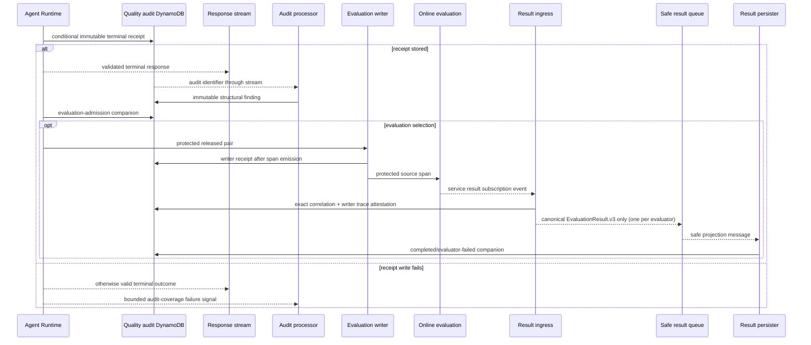

# Agent Quality Loop — architecture

This companion owns the Agent Quality Loop package's internal structure and non-obvious runtime flow.
For its scope, contract, and document map, see the [capability overview](README.md). Diagram notation is
owned by the [documentation conventions](../../conventions.md).

## 4. Internal structure

**Component diagram — Agent Quality Loop audit/evaluation linkage, retained-record viewpoint, component depth.** The Runtime
writes bounded decision facts into the retained audit boundary; an isolated ingress receives a
service-owned result event only in memory and can enqueue only an allowlisted projection after exact
two-reference attestation.

> **Takeaway.** Protected service content is confined to the ingress invocation; every retained record,
> queue message, and downstream consumer receives only the immutable allowlisted result projection.

This diagram shows the flow with one audit table for every record family. ADR-080 gives each family
its own table and adds tamper detection; what of that is deployed is stated in the
[implementation status](low-level-design.md#record-family-storage-mandated-by-adr-080). The mandated
components are in [target structure](#target-structure-mandated-by-adr-079-and-adr-080).

The processor receives an audit identifier rather than raw request, response, prompt, evidence, or
identity data. The ingress neither logs nor persists decoded subscription bytes and has no raw DLQ. It
requires both the managed event's trace/session references and a strong audit/writer attestation before
it can enqueue one safe projection. The persister has no CloudWatch Logs read permission.

### Target structure (mandated by ADR-079 and ADR-080)

- **Record tables.** Four retained tables join the audit table, one per writer
  ([record-family storage](low-level-design.md#record-family-storage-mandated-by-adr-080)).
- **Tamper detection.** Item-change, control-plane, function and role, and self-watch alarms on
  those tables and the detection (same section).
- **Evaluation gate.** A custom resource owns each online-evaluation configuration and writes the
  per-family release record that the outbox dispatcher reads to decide what reaches evaluation
  ([enablement gate](low-level-design.md#evaluation-enablement-gate-adr-079),
  [release records](low-level-design.md#release-records-and-dispatch-adr-079)).
- **Owned result groups.** Online evaluation writes to stack-owned result groups
  ([result custody](../../concepts/observability.md#37-evaluation-result-custody-adr-079)).

## 5. Key runtime flow

**Sequence diagram — Agent Quality Loop terminal receipt/evaluation linkage; response-authority viewpoint, component depth.**

> **Takeaway.** Audit loss is measurable without changing response authority, and semantic results are
> linked when AgentCore emits them rather than being inferred from an arbitrary retry window.

This sequence shows the flow before ADR-080 and ADR-079. Since them, each companion goes to its own
table, the outbox dispatcher sends only delivered turns of enabled families, and the ingress admits a
result only by the turn's delivery receipt
([evaluation linkage](low-level-design.md#immutable-per-evaluator-evaluation-linkage)); what is
deployed is stated in the
[implementation status](low-level-design.md#record-family-storage-mandated-by-adr-080).

A missing service result remains pending/failed acceptance, not an immutable evaluator result. The only
raw result boundary is the source-scoped subscription invocation; malformed or unmatched events are
acknowledged with bounded operational telemetry and never enter a queue, DynamoDB, EventBridge, or a
raw-content failure destination.
