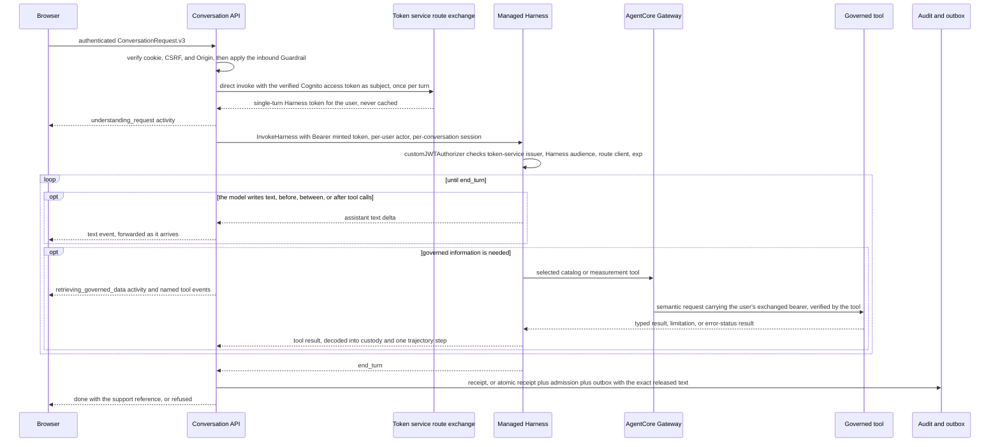
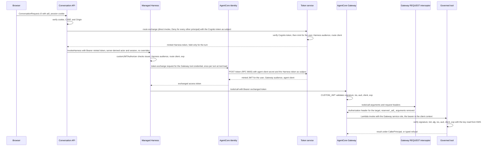

# Conversational Runtime — architecture

## 4. Internal structure

The Conversation API is the trusted ingress and audit boundary. It verifies identity, applies the inbound Guardrail, invokes the managed Harness, validates its lifecycle, relays the agent's answer as it is written, and emits only a closed `ConversationStream.v4` stream. The agent owns the natural-language answer and its Markdown format; governed tools own data and figure authority.

Harness receives the verified conversation session and question, dynamically chooses globally attached catalog and measurement tools, and iterates over their typed results. Tool servers resolve semantic candidates through server-owned metric, grain, period, coverage, currency, and scope contracts before executing trusted plans. They return `ShapedResponse` or typed limitations. The model does not supply identity, scope authority, SQL, query plans, or execution budgets. Under [ADR-077](../../decisions/adr-077-carry-the-end-user-identity-to-every-hop-through-token-exchange.md), each tool receives the user's exchanged bearer token and verifies it before it reads the call; the verified user is attribution, and analytical scope stays deployment-wide.

Harness writes its answer as assistant text in GitHub-flavoured Markdown, choosing the format that fits: paragraphs, headings, lists, tables, emphasis, inline code, quotes, and links. It may write before, between, and after tool calls. The answer may state governed figures and ones validly derived from them; no check reads it before the user sees it. What it says is governed by the prompt and measured by evaluation and audit ([ADR-082](../../decisions/adr-082-govern-the-agent-by-evaluation-and-audit-not-text-heuristics.md), [ADR-083](../../decisions/adr-083-stream-the-agent-answer-and-govern-it-by-audit-and-evaluation.md)). A turn is one Harness invocation: there is no finalizer tool, no presentation plan, and no server repair round, and the model recovers from a failed tool call inside its own loop.

The adapter also decodes bounded tool-result custody for audit and evaluation. It retains logical tool name, order, disposition, the correlation ID the tool minted (which the tool also stamped on its own span), digest, and grounded projection while discarding tool inputs, arbitrary raw JSON, reasoning, and provider events. It records every governed tool call as one trajectory step, including an error-status attempt as `errored` with no evidence reference, so the audit receipt can reach successful or refused calls' own traces while still showing recoverable failed attempts ([ADR-064](../../decisions/adr-064-retire-planner-era-contracts-and-anchor-the-audit-trajectory.md)). A typed refusal retains both its safe reason and its grounded refusal projection ([ADR-062](../../decisions/adr-062-route-claims-by-semantic-authority.md)). The grounded projections and the answer obligations derived from them (mandatory qualifiers, required collections, claim-bearing results) become the turn's evaluation evidence, `GroundedEvaluationContext.v2`. Custody is never a release gate.

The Conversation API forwards each text delta the moment the Harness delivers it and never rewrites it. When the Harness turn ends, it writes the turn's receipt and, for a complete turn, the evaluation admission and outbox record carrying the exact released text, and only then emits `done` ([release semantics](#release-semantics)). A scheduled dispatcher leases due outbox items, sends the existing SQS envelope, retries safely, and records delivery.

The managed Harness remains the only ordinary conversational execution path. The browser sees which declared governed tool is called, by its closed server-owned logical name, as a deliberate transparency choice. It renders the answer's Markdown under the [rendering rule](#release-semantics), never calculates values, and never receives tool arguments, result payloads, reasoning, trace identifiers, or telemetry.

## 5. Key runtime flow

**Sequence diagram — governed tool use, streamed answer, receipt before `done`.**

> **Takeaway.** Tools govern computation; the agent writes the answer and the user reads it as it is written; the API governs identity, the inbound Guardrail, and the receipt and evaluation admission that precede `done`.

The route-to-Harness hop carries the user: the Harness accepts only a token the token service
minted for the route, never a Cognito token, and only the Conversation Function role can invoke the
route exchange. The Conversation Function role holds no AgentCore invoke permission. There is no
freshness margin: a user token only has to be unexpired when it is verified and exchanged, and a
refused exchange is ADR-007's 403 before the stream opens. Every later hop carries the user too:
the Harness exchanges its token once per turn for a Gateway token, the Gateway admits only that
token, and every tool verifies it before it reads the call.

**Sequence diagram — identity chain (ADR-077).**

> **Takeaway.** Every hop after the Conversation API authenticates a token derived from the user's own token, and each tool refuses a call it cannot attribute to a verified user.

This flow is deployed. Endpoints, claims, and each hop's validation are owned by the [caller identity contract](low-level-design.md#6-interfaces-and-contracts).

### Purpose-built tools

The data-tool inventory remains generated from repository contracts. `catalog_list_metrics` and `catalog_describe_metric` answer declared capability questions; description resolves the same customer-facing surfaces the measurement resolver reads — canonical names, labels, and governed aliases, for computable and deferred metrics alike — so a deferred metric's label or alias refuses as not-yet-computable rather than unknown. `measurement_metric_by_grain`, `measurement_compare_windows`, and `measurement_top_n` execute trusted analytical operations. There is no presentation or finalizer tool.

### Release semantics

`ConversationStream.v4` carries `activity` stages, per-call `tool` events naming the declared logical tool as requested and completed, and `text` deltas in a contiguous sequence from one, in any interleaving, then exactly one `done` or `refused`. `understanding_request` is emitted before the first Harness byte and `retrieving_governed_data` once, at the first governed tool call. Text is released the moment the Harness delivers it and is bounded at 64 KiB per turn. The receipt, and for a complete turn the evaluation admission and outbox record, are written after the Harness turn ends and before `done`, so `done` carries the support reference. `done` requires released text: a turn whose model ended without writing any ends `refused` with `no_answer`. A Harness or stream failure ends `refused` with `dependency_unavailable`. Nothing is retracted: text already sent stays on screen. The server writes an SSE comment heartbeat during idle waits; it carries no data and the frontend parser discards it.

The browser renders the concatenated text as Markdown with `react-markdown` and `remark-gfm`, building React elements from the syntax tree. Raw HTML is shown as its literal text and never rendered, and the ADR-082 lint rule against raw-HTML rendering in application code stays in force. Images are never loaded; their alt text is shown instead. A link is kept only for an absolute `http`, `https`, or `mailto` URL, opens in a new tab with `rel="noopener noreferrer nofollow"`, and is followed by its destination host for `http` and `https`. Headings shift below the chat panel's own heading. During the ADR-083 rollout the frontend decodes both `ConversationStream.v3` and `ConversationStream.v4`, one version per stream.

### Audit and evaluation custody

The terminal receipt stores the governed trajectory, tool-custody digest, prompt digest, Guardrail version, the `conversation-stream.v4` response contract, the `answer.markdown.v1` answer format, the released character count, outcomes, and timing identity without question or answer content. Exact released question and answer exist only in the retained evaluation outbox and protected evaluation evidence path. Only a complete turn is admitted: a turn that sent text and then failed or lost its client is recorded by its receipt and delivery record only. Outbox state is `pending`, `leased`, or `delivered`; pending and leased rows have no TTL. Delivered rows leave the ready index and receive retention TTL.

After the public stream closes, the runtime writes one best-effort `DELIVERY` companion beside the audit receipt for every turn that sent text or reached `done`: delivered, truncated, or aborted, with the number of text events the route wrote. Through CloudFront the route's writes keep succeeding after the viewer leaves, so the count measures what the edge accepted and can exceed what the viewer saw ([ADR-063](../../decisions/adr-063-record-delivery-disposition-for-released-turns.md)). A failed disposition write never fails a delivered answer, and an absent disposition reads as unknown delivery, never as delivered.
