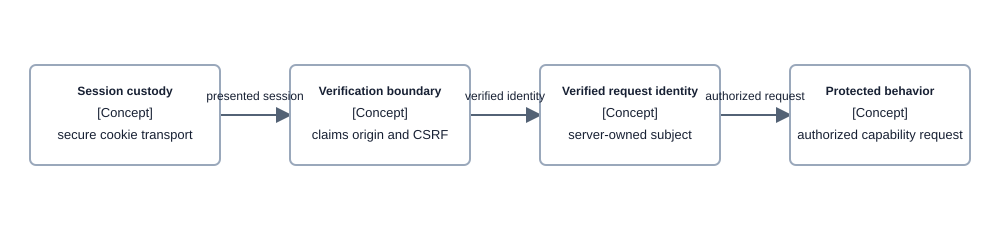

# Concept — Authentication

| | |
|---|---|
| **Level** | L2 — concept |
| **Status** | Current crosscutting identity boundary. End-to-end identity chain by [ADR-077](../decisions/adr-077-carry-the-end-user-identity-to-every-hop-through-token-exchange.md), implemented at every hop. |
| **Last updated** | 2026-10-22 |
| **Owns** | Browser-to-API session authority, cookie custody, verified request identity, the identity-chain rule, and the mandated credential binding, dev validation password flows, and edge entry (including both web ACLs and origin-verify rotation). |
| **Applied by** | [Conversational Runtime](../capabilities/conversational-runtime/README.md) · [Protected Quality Review API](../capabilities/protected-quality-review-api/README.md) |
| **Conventions** | [Documentation conventions](../conventions.md) |

## 1. What this concept is

Authentication is the reusable browser-to-API identity boundary. It verifies who may request protected behavior without giving the browser a bearer token or a way to select an identity.

**Lives elsewhere:** credential-provider integration and protected-route realization belong to their owning capabilities; route-specific authorization policy belongs to the relevant capability; acceptance conclusions belong to [validation results](../../validation/RESULTS.md).

## 2. The rule

> **Tokens remain server-side in secure cookies; protected behavior begins only after verified identity, claim, origin, and CSRF checks.**

A caller cannot choose an actor, reuse an opaque session as a substitute for identity, or use transport-level SigV4 authority as browser-session authority.

Every authorized route accepts the `adl_session` cookie, and the two review routes also accept a
bearer ([credential binding](#credential-binding-adr-078), deployed and dev accepted 2026-09-28).
Every API request enters through CloudFront and its web ACL; a request sent straight to the
`execute-api` hostname is refused ([edge entry](#edge-entry-adr-078), deployed and dev accepted
2026-09-29). The three
sections below are that contract and its only home. Other design docs link here.

### Credential binding (ADR-078)

A request carries exactly one credential, and each credential is bound to one app client and a
fixed route set. Every check fails closed.

| Credential | Valid only with `client_id` | Valid only on |
|---|---|---|
| `adl_session` cookie | The confidential BFF client | Every authorized route |
| `Authorization: Bearer` access token | The public PKCE client | `POST /api/quality-review/turn` and `POST /api/quality-review/turns` |
| `Authorization: Bearer` access token carrying `mcp_tool_use` | The Amazon Quick MCP client (dev only, behind its flag) | The external MCP gateway; every app route refuses it ([ADR-150](../decisions/adr-150-expose-the-governed-tools-to-amazon-quick-through-a-user-authorized-mcp-gateway.md)) |

- Every other combination is denied: a BFF-client token as a bearer, a public-client token in the
  cookie, and a bearer on any other route.
- The MCP client mirrors the public client: authorization code with PKCE, `openid` only, no secret
  and no explicit auth flow in any environment. Its one callback is Amazon Quick's Region callback.
  The external MCP gateway's own checks and the tools' are owned by the
  [caller identity contract](../capabilities/conversational-runtime/low-level-design.md#caller-identity-contract-mandated-by-adr-077-deployed-end-to-end).
- A request that carries an `adl_session` cookie and a bearer is denied, as is one with neither.
  Cookie presence means an `adl_session` cookie, so an unrelated cookie does not trip the rule.
- Both credentials pass the same verification before the client and route check: signature by
  `kid`, `iss`, `exp`, and `token_use = access`.
- CSRF double-submit and Origin checks apply to the cookie credential.
- The public client uses authorization code with PKCE and has no secret. Its only OAuth flow is
  authorization code and its only scope is `openid`, so a token from that flow never carries
  `aws.cognito.signin.user.admin`. Outside dev its only explicit auth flow is refresh. Its only
  callback is `http://localhost:<fixed port>/callback`.
- In dev, a token from the IAM-authorized `ADMIN_USER_PASSWORD_AUTH` flow carries
  `aws.cognito.signin.user.admin` as its only scope [verified 2026-09-28, dev review API probe], so
  that dev-only token can call Cognito's user APIs for its own user.
- Its access tokens have the BFF client's lifetime, and its refresh-token validity is the shortest
  Cognito allows. The authorizer verifies tokens locally, so revoking a token or removing a group
  ends access only when the current access token expires.
- Callers stay human Cognito users on both credentials. A machine caller has no path.
- A bearer token never reaches browser JavaScript. The browser path stays the cookie.

Which review entitlement a verified caller holds on those routes is owned by the review API's
[authorization contract](../capabilities/protected-quality-review-api/low-level-design.md#authorization-contract-adr-078).

### Dev validation password flows (ADR-078)

- The dev validation password flag enables `USER_PASSWORD_AUTH` on the confidential BFF client,
  which needs the client secret, and IAM-authenticated `ADMIN_USER_PASSWORD_AUTH` on the public
  client, so live probes call the bearer path without a browser. No client enables a password flow
  that needs neither a client secret nor IAM credentials.
- `ADMIN_USER_PASSWORD_AUTH` issues a bearer on the secretless public client only to an
  IAM-authenticated caller, and `USER_PASSWORD_AUTH` on it is refused
  [verified 2026-09-28, [validation results](../../validation/RESULTS.md#review-api-slice-6-commit-a--2026-09-28)].
- Outside dev the flag is off and neither flow exists.

### Edge entry (ADR-078)
Implemented by `EdgeSecurityStack`, `FrontendStack`, `AuthStack`, and `ApiStack`; deployed and dev
accepted 2026-09-29, with every rule on both web ACLs blocking ([validation results](../../validation/RESULTS.md#edge-entry-adr-078-slice-7--2026-09-29)).

- Every customer-facing API request enters through the CloudFront distribution and its
  `CLOUDFRONT`-scope AWS WAF web ACL. Its rules, in evaluation order, all blocking:
  1. the AWS managed IP reputation list;
  2. the known-bad-inputs rule set;
  3. the core rule set, with only its `SizeRestrictions_BODY` rule overridden to count;
  4. `PromptCreateBodyCeiling`: a body over 32,768 bytes on exact
     `POST /api/prompt-registry/create-version` with an empty query string;
  5. `BodySizeOutsidePromptCreate`: a body over 8,192 bytes on every other request;
  6. a per-source-IP rate rule.

  The ACL inspects the first 32 KB of each body, and rules 4 and 5 treat a larger body as a match.
  A new rule starts in count and moves to block only after a full live probe run through the
  distribution shows no match on legitimate traffic, unless it only re-imposes a refusal the ACL
  already applies in block mode, as rules 4 and 5 do. A managed rule that matches legitimate
  traffic is excluded for the affected path only, with the evidence recorded (ADR-078, path-scoped
  body-size exclusion, 2026-10-05).
- Every rule on both web ACLs must reach block, or a recorded path-scoped exclusion, before the
  edge slice is accepted.
- The per-source-IP rate limit is a typed per-environment configuration value with no default:
  `ADLYTICS_EDGE_WAF_RATE_LIMIT_PER_FIVE_MINUTES` for the distribution and
  `ADLYTICS_USER_POOL_WAF_RATE_LIMIT_PER_FIVE_MINUTES` for the user pool (`infra/lib/config`).
- A `CLOUDFRONT`-scope web ACL can be created only in us-east-1. A dedicated edge-security stack,
  always deployed to us-east-1 and ordered before `FrontendStack`, owns it and publishes its ARN as
  an SSM parameter in us-east-1. In us-east-1, `FrontendStack` reads it like any other parameter;
  in another application region it reads that one parameter through a CDK SDK-call custom resource
  pinned to us-east-1, a cross-region parameter read the stack-composition rules allow. Live
  acceptance runs in us-east-1 only.
- The user pool has its own regional web ACL, associated directly with the user pool: Cognito sends
  each managed login and unauthenticated user pool API request to AWS WAF and enforces the verdict
  itself, with no API layer in between. It never exposes usernames, passwords, or other PII to the
  rules, and forwards no body for managed login pages
  ([WAF with a user pool](https://docs.aws.amazon.com/cognito/latest/developerguide/user-pool-waf.html))
  [verified 2026-09-28]. It follows the same count-then-block rule and the same
  block-before-acceptance rule. Its rules are the IP reputation list and a per-source-IP rate rule;
  the request-content rule groups are left out, because the rules see no credential and no body
  of a managed login page. AWS WAF is available on every user pool feature plan [verified
  2026-09-29, same page].
- A viewer-request function on every API behaviour refuses a non-canonical path with 400
  ([ADR-078](../decisions/adr-078-serve-quality-review-to-programmatic-callers-through-the-cloudfront-edge.md)
  §5): an empty segment, a `.` or `..` segment, a backslash, or any percent escape. It is
  deployed in dev (2026-09-28), ahead of the rest of the edge. CloudFront normalizes a path only to
  choose a cache behaviour and then sends the raw path to the origin
  ([path normalization](https://docs.aws.amazon.com/AmazonCloudFront/latest/DeveloperGuide/DownloadDistValuesCacheBehavior.html#path-normalization))
  [verified 2026-09-28], so the function sees the spelling the viewer sent, including one that
  reaches an API behaviour only through that normalization. No rule either web ACL runs matches a
  path of its own. A path-scoped exclusion, if evidence ever requires one, applies
  `NORMALIZE_PATH` and `URL_DECODE` first; the managed rule groups apply their own transformations.
- CloudFront adds a secret origin-verify header to every request it forwards to the API.
- The authorizer's identity source is that header. API Gateway answers a request without it with a
  401 and never invokes the authorizer
  ([identity sources](https://docs.aws.amazon.com/apigateway/latest/developerguide/http-api-lambda-authorizer.html))
  [verified 2026-09-29]. No credential is an identity source, because a request carries a cookie or
  a bearer, never both. Through CloudFront every request carries the header, so a request with no
  credential still reaches the authorizer and is refused 403
  ([ADR-007](../decisions/adr-007-auth-cookie-bff.md) 2026-09-28 amendment). The authorizer
  compares the value in constant time, against the current and the previous value, before any
  other check and before it fetches signing keys.
- Every caller presents the same identity source, so an authorizer result cache would share one
  caller's decision with every other caller. There is no cache setting, and synth refuses any
  authorizer result TTL above zero.
- The auth handler's four routes without an authorizer (login, callback, refresh, logout) make the
  same constant-time comparison first.
- The value is a Secrets Manager secret owned by `FrontendStack`, the stack that owns the
  distribution. Anyone who can read the distribution config can read it.
- Rotation is an operator action coupled to a deploy, never automatic, in this order:
  1. write a new secret version whose current value is new and whose previous value is the old
     current;
  2. redeploy `FrontendStack` pinned to that version, so CloudFormation resolves the new value;
  3. warm functions pick up the new value without refusing traffic, by the cache rule below;
  4. after the redeploy is verified, write a second version that drops the previous value. The
     dropped value stops being accepted once the maximum cache age has passed;
  5. redeploy `FrontendStack` without the pin. A pin left in place would make a later deploy
     resolve a version whose value step 4 dropped, and every edge request would be refused.
- `make rotate-origin-verify STEP=begin` and `STEP=finish` write steps 1 and 4 and print only a
  version id. Step 2 sets `ADLYTICS_ORIGIN_VERIFY_SECRET_VERSION_ID` to the version `begin`
  printed; step 5 unsets it. `begin` refuses while a previous value is held and unless the
  distribution reads back deployed and sending the current value, which also catches a stale pin
  redeployed since the last rotation; `finish` refuses until the distribution sends the new
  current value. One operator rotates at a time: nothing serializes two `begin` runs. Step 2
  starts no sooner than the re-read interval after step 1, so a container that re-read just
  before step 1 cannot meet the new value inside its interval.
- Both checks read the secret at cold start and hold it for at most a typed maximum secret-cache
  age. When a presented value matches neither current nor previous, they re-read it once,
  rate-limited to an interval shorter than that age. The age is 300 seconds and the interval 60
  (`EdgeConfig` in `infra/lib/config`). A failed read refuses rather than serve an expired value,
  and is reported as an error, not as an origin-verify refusal. The read makes one attempt with a
  1-second connect and read timeout, well inside the authorizer's 5-second budget.
- A stale pin redeployed between rotations is not caught before the deploy: the distribution
  then sends a dropped value and every edge request is refused until `FrontendStack` is
  redeployed without it. `begin` refuses to rotate over such a drift. This residual risk is
  accepted, because the pin is set only for the one step-2 deploy.
- CloudFormation resolves both the versionless and the version-pinned Secrets Manager dynamic
  reference inside the CloudFront origin custom header [verified 2026-09-29, dev rotation].
- CloudFront, WAF, and access logging never record the origin-verify, `authorization`, or `cookie`
  headers. CloudFront logging is off. Each web ACL logs only the requests a rule counted or
  blocked, to `aws-waf-logs-adlytics-<env>-edge` or `aws-waf-logs-adlytics-<env>-user-pool`, with
  the three headers redacted. Neither samples requests: redaction does not apply to a sampled
  request, which carries every header
  ([logging configuration](https://docs.aws.amazon.com/AWSCloudFormation/latest/TemplateReference/aws-resource-wafv2-loggingconfiguration.html))
  [verified 2026-09-29]. The API access-log format holds no header.
- A request to the `execute-api` hostname is refused, not unreachable. One that guesses the header
  name still reaches the authorizer. The stage throttle bounds the total cost of that traffic but
  does not isolate it from legitimate traffic. The alarm `adlytics-<env>-origin-verify-refused`
  counts the refusals either check logs.
- The header proves a request came through the edge, not who sent it. A caller holding a leaked
  value skips the web ACL and its rate limit, but every authorized route still requires a verified
  credential and entitlement, and the four auth handler routes still make their own origin and CSRF
  checks. A leak therefore costs the edge's filtering, not authentication or authorization.
- Recommended for production deployments: serve the API from the deployer's own custom domain and
  disable the default `execute-api` endpoint, which removes the auto-generated public hostname. The
  custom domain is public too, so origin-verify stays the control that keeps the API behind
  CloudFront.
- Out of scope: the chat Function URL, reachable only through CloudFront by origin access control
  with `AWS_IAM` auth ([ADR-038](../decisions/adr-038-the-conversation-route-streams-from-a-function-url.md));
  the token service's regional REST API, with its own web ACL
  ([ADR-077](../decisions/adr-077-carry-the-end-user-identity-to-every-hop-through-token-exchange.md) §3);
  and the AWS-managed Cognito endpoints the PKCE login calls, which sit outside this edge behind
  the user pool's own web ACL.
- The external MCP gateway, dev only behind its flag, is its own public endpoint and has its own
  regional web ACL, associated with the gateway, with `FAIL_CLOSE` if WAF cannot be reached
  ([ADR-150](../decisions/adr-150-expose-the-governed-tools-to-amazon-quick-through-a-user-authorized-mcp-gateway.md)).
  Its rules follow the distribution's order: the same three managed groups, the 8,192-byte body
  ceiling on every request (the gateway has no exempt route), and a per-source-IP rate rule from
  `ADLYTICS_EXTERNAL_MCP_WAF_RATE_LIMIT_PER_FIVE_MINUTES`. The same count-then-block rule applies, and
  synth refuses its tool targets while any rule counts. It logs to
  `aws-waf-logs-adlytics-<env>-external-mcp` under the same logging and redaction rules.

### Identity chain — ADR-077

> **The verified user identity is carried as signed claims to every hop; no hop accepts an AWS role in place of the user.**

The rule holds at the Conversation API, the Harness, the Gateway, and every tool. The hop-by-hop mechanics are owned by [Conversational Runtime §5](../capabilities/conversational-runtime/architecture.md#5-key-runtime-flow) and its [caller identity contract](../capabilities/conversational-runtime/low-level-design.md#6-interfaces-and-contracts).

## 3. How it works

**Component diagram — browser authentication custody path; authentication viewpoint, component depth.**

> **Takeaway.** Session custody is not authority; only a verified request identity can enter protected behavior.

### Acceptance (ADR-078)

Passed in dev: items 1, 2, 3, 6, and 11 on 2026-09-28
([validation results](../../validation/RESULTS.md#review-api-slice-6-commit-a--2026-09-28)), and
items 4, 5, 7, 8, 9, and 10 on 2026-09-29 ([validation results](../../validation/RESULTS.md#edge-entry-adr-078-slice-7--2026-09-29)).

Live dev acceptance reads each outcome through the CloudFront URL unless the item names another
path, and records only route, credential class, and status counts:

1. A BFF-client `adl_session` cookie succeeds on a review route and on a non-review route, and a
   public-client bearer succeeds on `turn` and `turns`.
2. An `adl_session` cookie plus a bearer is refused; a bearer plus an unrelated cookie is accepted;
   a request with neither is refused.
3. Each crossing is refused: a BFF-client token as a bearer on a review route and on a non-review
   route, a public-client bearer on a non-review route, and a public-client token presented as the
   `adl_session` cookie.
4. A request sent straight to the `execute-api` hostname without the origin-verify header returns
   401, and the API access-log record for that request identifier shows the 401 with no authorizer
   error and no reviewer key. HTTP APIs document no authorizer-latency variable
   ([reviewer access log](observability.md#38-reviewer-access-log-adr-081)),
   so the authorizer logs each origin-verify refusal with API Gateway's request id: a
   missing-header request id with no such record was answered by API Gateway alone, and a
   wrong-value request is the positive control. One with a wrong header value is
   refused by the authorizer, and each auth handler route refuses a missing or wrong value.
5. During a rotation, a probe sending requests through the distribution throughout sees no refused
   request. After step 2, the previous value is still accepted. Measured once the maximum secret-cache
   age has passed after step 4, the previous value and a value that was never current are refused.
6. In dev, `ADMIN_USER_PASSWORD_AUTH` on the public client issues a bearer only to an
   IAM-authenticated caller, and `USER_PASSWORD_AUTH` on the public client is refused.
7. Every enabled CloudFront, WAF, and API access log record holds no origin-verify, `authorization`,
   or `cookie` header value.
8. The `CLOUDFRONT`-scope web ACL exists in us-east-1 and the distribution reads back attached to
   it; the regional web ACL reads back associated with the user pool.
9. Every rule on both web ACLs reads back as BLOCK, or as a path-scoped exclusion with its recorded
   evidence, and a fictional known-bad-inputs request through CloudFront returns 403.
10. Synth with an authorizer result TTL above zero fails; synth in us-east-1 renders a plain
    parameter read of the web ACL ARN, and synth for another application region renders the
    custom resource pinned to us-east-1.
11. The public client reads back with authorization code as its only OAuth flow, `openid` as its
    only scope, and, outside dev, refresh as its only explicit auth flow.

## 4. Rejected alternatives

- Browser-held bearer tokens or `localStorage` — [ADR-007](../decisions/adr-007-auth-cookie-bff.md)
- Cross-origin API cookies or permissive CORS — [ADR-007](../decisions/adr-007-auth-cookie-bff.md)
- Treating transport-level invocation authority as user authentication — [ADR-038](../decisions/adr-038-the-conversation-route-streams-from-a-function-url.md)
- Service-role impersonation of the user at the agent and tools — [ADR-077](../decisions/adr-077-carry-the-end-user-identity-to-every-hop-through-token-exchange.md)

## 5. Decisions

| Decision | Owner |
|---|---|
| Cookie BFF and Cognito authorization-code boundary | [ADR-007](../decisions/adr-007-auth-cookie-bff.md) |
| Streaming conversation transport | [ADR-038](../decisions/adr-038-the-conversation-route-streams-from-a-function-url.md) |
| End-to-end identity chain through token exchange | [ADR-077](../decisions/adr-077-carry-the-end-user-identity-to-every-hop-through-token-exchange.md) |
| Credential binding, the review-route bearer credential, and CloudFront edge entry | [ADR-078](../decisions/adr-078-serve-quality-review-to-programmatic-callers-through-the-cloudfront-edge.md) |
| The Amazon Quick MCP client credential and the external MCP gateway's web ACL | [ADR-150](../decisions/adr-150-expose-the-governed-tools-to-amazon-quick-through-a-user-authorized-mcp-gateway.md) |

## 6. Open items

| Item | What resolves it | Blocks |
|---|---|---|
| New protected credential pattern | A capability-owned custody and verification contract | Only that credential pattern |
