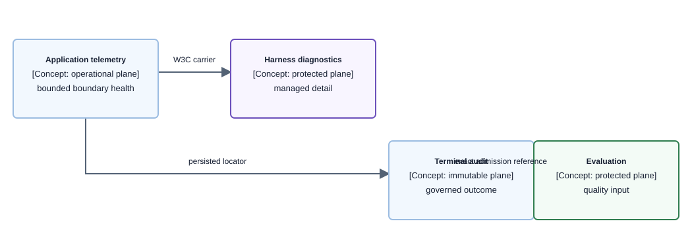

# Concept — Observability

| | |
|---|---|
| **Level** | L2 — concept |
| **Status** | Current telemetry, investigation, audit, and evaluation policy. |
| **Last updated** | 2026-10-21 |
| **Owns** | Telemetry planes, structured-log projections, locator custody, tracing boundaries, error reporting, failure-alarm state semantics (when an alarm's `OK` means recovery), evaluation-evidence locality rules, evaluation result custody, and the reviewer access log. |
| **Applied by** | [Conversational Runtime](../capabilities/conversational-runtime/README.md) · [Agent Quality Loop](../capabilities/agent-quality-loop/README.md) · [Protected Quality Review API](../capabilities/protected-quality-review-api/README.md) · [Load Path](../capabilities/load-path/README.md) |
| **Conventions** | [Documentation conventions](../conventions.md) |

## 1. What this concept is

Observability makes request, computation, publication, and quality-processing behavior explainable without conflating protected diagnostics, application telemetry, durable audit, or evaluation evidence.

**Lives elsewhere:** capability packages own their operational topology; [validation results](../../validation/RESULTS.md) own acceptance outcomes; managed-service retention/configuration belongs to the relevant stack and deployment policy.

## 2. The rules

> **Every signal has one plane, one approved projection, and one access purpose.** A correlation is a support locator, not identity or a substitute for trace propagation.

### 2.1 Telemetry planes

| Plane | Purpose | Custody |
|---|---|---|
| Protected AgentCore diagnostics | Managed Harness model, Gateway-tool, and execution investigation. | Detailed service telemetry stays in customer-account AgentCore/CloudWatch resources with explicit access, AWS-managed encryption where supported, retention, and export controls. |
| Application telemetry | Availability, latency, boundary failures, and deterministic release health. | ADOT spans, Powertools logs, and EMF contain only the bounded projections below. They do not duplicate managed model/tool payloads. |
| Terminal audit | Immutable governed release/refusal, managed lifecycle, and evaluation-admission record. | Exact/correlation-scoped retained data; it is not a trace or transcript store. |
| Evaluation | Quality of the released user-visible answer and managed protocol outcome. | Protected released-response source plus content-free retained result. It is not reconstructed from Harness trace payloads. |

### 2.2 Investigation locators

| Locator | Approved locations | Never represents |
|---|---|---|
| Server-minted `correlation_id` | API and audit-processor structured logs; exact audit correlation lookup; the `x-correlation-id` response header ([ADR-081](../decisions/adr-081-make-every-turn-traceable-and-attributable.md) §2). | Identity, metric dimension, span attribute, or trace parent. |
| `trace_id` and `span_id` | Supported Application Signals/OpenTelemetry structured-log correlation; protected terminal-audit trace reference after proof. | A full W3C carrier, authorization grant, or metric dimension. |
| Opaque `audit_id` | Structured logs after immutable receipt persistence; exact audit read; protected evaluation linkage; the chat terminal responses that end a turn. | A capability or user identifier. It is the support reference on every response that ends a turn with a receipt ([Conversational Runtime](../capabilities/conversational-runtime/low-level-design.md#turn-reference-and-correlation-adr-081)). |
| `gateway_message_ref` | Gateway target-local structured logs. | Browser correlation, end-to-end trace parent, or authorization value. |

Tokens, cookies, authorization headers, secret values, credential objects, private keys, Cognito user attributes, including email addresses, and full W3C carriers are never ordinary application telemetry. Operational principal, actor, owner, session, resource, request, and business-context metadata may be logged when it is relevant to diagnosis, provided it is structured, bounded, and does not embed credential-bearing headers or payload containers.

## 3. How it works

**Component diagram — managed-path investigation planes; observability viewpoint, component depth.**

> **Takeaway.** Application logs tell an operator where to investigate; protected Harness diagnostics explain managed execution; audit proves the governed terminal; evaluation assesses the released answer.

### 3.1 Structured application logs

Every application lifecycle event uses a fixed operation, component, phase, outcome, bounded error projection where applicable, and one `investigation_next` value. The managed-path vocabulary is:

| Boundary | Locator and state projection | `investigation_next` values |
|---|---|---|
| Conversation API | correlation, trace/span when supported, persisted audit ID, managed terminal, publication/audit/evaluation state | `inspect_harness_trace`, `inspect_terminal_audit`, `inspect_evaluation_chain`, `inspect_application_failure` |
| Gateway target | local Gateway message reference, fixed tool operation, outcome, bounded result/error class, whether the caller verified (`caller_verified`, ADR-077), and the received client-context, argument, and propagated-header key names (at most 32, each at most 64 characters, never values) with whether a context key names `authorization` | `inspect_managed_tool_trace`, `inspect_tool_boundary` |
| Audit processor | correlation, trace when supported, audit ID, processor outcome, bounded finding/aggregate counts | `inspect_terminal_audit` |
| Evaluation processing | audit ID, processing outcome, bounded linked/ignored or persisted count | `inspect_evaluation_chain` |

Trace-log correlation uses the supported Application Signals/OpenTelemetry projection. If it cannot populate `trace_id` and `span_id` in the JSON logger, the shared reporting seam projects those two values for lifecycle, denial, and error records; no handler may emit a full `traceparent`, `tracestate`, or baggage. Lifecycle state is never placed in free-form error context.

| Severity | Required use |
|---|---|
| `DEBUG` | Operation start and diagnostic state useful when troubleshooting; disabled by the configured production log level unless explicitly enabled. |
| `INFO` | Successful or expected lifecycle completion, persistence, linkage, or processing. |
| `WARNING` | Authorization denial, validation/domain refusal, degraded result, ignored input, or retryable partial outcome. |
| `ERROR` | Dependency, invariant, or unexpected failure that prevented the operation from completing. |

Every outbound AWS SDK failure projects the exception type, provider, SDK operation, provider error code and description, HTTP status, request ID, and—when present in the provider response—the principal, attempted action, and resource. These remain operator-only application telemetry and never reach browser responses, spans, metrics, audit, or evaluation. Request bodies, authorization headers, cookies, tokens, secret values, and credential objects are excluded; credential-shaped values in provider descriptions are redacted before logging.

### 3.2 Application spans and metrics

Hand-authored spans exist only for operations whose duration must be explainable. They use fixed operation names and bounded derived attributes. Operator execution lineage and progress fields are permitted where declared; customer, canonical, entity, and campaign identifiers, carriers, request data, model content, response data, payloads, and exception text are prohibited. `contracts/observability/spans.yaml` is the versioned source of truth for each static span's name, parent policy, purpose, and closed metadata projection. Its implementation owner is colocated with the function through the typed `@trace_boundary(...)` marker, which performs no runtime span creation. `make generate-trace-contract` produces the imported Python constants; `make check-trace-contract` rejects stale generation, missing or duplicate decorated owners, required metadata absent when the span opens, generated constants the tracing seam does not import and re-export, undeclared static spans, excess or prohibited metadata, direct Powertools lifecycle logger calls outside the shared seam, tracing-enabled handlers without a typed root, error-reporting handlers without terminal metric flushing, and direct OpenTelemetry imports outside the approved telemetry and propagation seams. Dynamic `tool_span(...)` names remain governed by the tool enums rather than duplicated in this registry.

EMF dimensions are fixed operational vocabularies only: error `Operation`, `ErrorClass`, and `ErrorCode`; and validated tool `Tool` and `Outcome`. Each error is emitted in its own EMF context so a later failure in the same batch cannot overwrite its classification. Correlation, trace/span, audit, identity, session, question, prompt, model input/output, payload, result, and exception text are prohibited in EMF dimensions and values.

Every dead-letter queue and stream failure queue alarms on arrival, not on standing depth
([ADR-133](../decisions/adr-133-bound-every-asynchronous-retry-and-alarm-on-its-failure-destination.md)): the
alarm reads `MAX([FILL(sent, 0), FILL(DIFF(visible), 0)])` over the queue's
`NumberOfMessagesSent` and `ApproximateNumberOfMessagesVisible`, and acts on the staffed
destination. A message left in the queue therefore never holds the alarm in `ALARM` and hides the
next arrival. Every stream event source mapping bounds its retries and record age, bisects a
failing batch and sends an exhausted batch to an on-failure queue. `AsyncFailureBoundsAspect`
(`infra/lib/mixins/async-failure-bounds.ts`) fails synth on any consumer that departs from this,
including one whose dead-letter or failure queue is outside its own stack, where the alarm cannot
be checked. The aspect checks that the alarm has an enabled action, not that the action is the
staffed destination; the stack tests that call `expectArrivalAlarm`
(`infra/test/support/async-failure.ts`) prove that for the queues they name. The queues' disposition is in
[operator-tools.md](../capabilities/operational-data-flow-status/operator-tools.md#stream-failure-queues-attempts_failures).

Failures reach the staffed destination in two layers
([ADR-133](../decisions/adr-133-bound-every-asynchronous-retry-and-alarm-on-its-failure-destination.md)
decision 4). Every function has an
`adlytics-<env>-<function>-function-errors` alarm on its `AWS/Lambda` `Errors`, which counts an
unhandled exception, a timeout or running out of memory (`infra/lib/mixins/function-error-alarms.ts`;
only custom-resource handlers are exempt, because their failure fails the deploy). Every operation
that reports a `dependency` or `invariant` error through `report_error` reaches an alarm on the
`Errors` EMF metric: the operations validation probes name have their own alarm, and
`adlytics-<env>-alarming-errors-by-operation` covers every other operation, including the dynamic
ones, with one contributor per `Operation`. The catch-all excludes exactly the operations that have
their own alarm, either an `Errors` alarm or a page alarm (below), so one failure pages once. What
to run when it names only 100 contributors is in
[operator-tools.md](../capabilities/operational-data-flow-status/operator-tools.md#operation-catch-all-alarm-alarming-errors-by-operation).
`infra/test/alarm-coverage.test.ts`
(`make check-alarm-coverage`) fails on an uncovered function, an exempt function that something
other than its custom resource can invoke, a wrong exclusion, a second alarm for one operation, an
alarm without an enabled action, a page route list that differs from the routed
`TELEMETRY_OPERATIONS` in `handler.py` (check 8), or a page route without exactly one page alarm
(check 9).

A standing condition of a synchronous surface, one that recurs on every call until fixed, holds its
alarm until an observed success clears it. A per-item or per-delivery failure keeps arrival
semantics: its alarm's `OK` means only that no new failure arrived. Each of the 17 Presentation page
routes has an `adlytics-<env>-page-<page>-server-errors` alarm on the route's detailed
`AWS/ApiGateway` `Count`, `4xx` and `5xx` (detailed metrics are enabled on those routes only). Its
value is `IF((m_count - FILL(m_4xx, 0)) > 0, FILL(m_5xx, 0))` over 5 minutes, at least 1, missing
data `ignore`, and it acts on the staffed destination on `ALARM` and `OK`. So `ALARM` means a
served request got a 5xx, and `OK` means a period served at least one request without a 4xx
refusal and with no 5xx. With no requests, or only refused ones, the state holds, and
`INSUFFICIENT_DATA` means the page has not been served since the alarm was created. The catch-all
excludes the 17 page operations. Why, and which synchronous surfaces still clear on silence, is in
[ADR-148](../decisions/adr-148-hold-a-page-alarm-until-an-observed-success-clears-it.md); what to do
in each state is in
[operator-tools.md](../capabilities/operational-data-flow-status/operator-tools.md#page-alarms-page-page-server-errors).

Ingestion counts each decided contract on `IngestPartitions` by `Action`: `published`,
`source_only`, `superseded` (every bucket older than its `CURRENT`, a product signal) and `blocked`,
the only one that alarms.

GRAPH bake alarms are rows of `GRAPH_ALARMS` (`infra/lib/stacks/execution-graph-alarms.ts`). Each
reads a gauge or count in the `Adlytics` namespace with only the `Protocol` and
`AuthorityScope=live` dimensions, threshold 1 over one 60-second period, and acts on the staffed
destination on both `ALARM` and `OK`. The detector log or the bake summary line names the run and
task. Run, task, grant and page identifiers are never dimensions.

| Metric (`adlytics-<env>-…` alarm) | Source and read | Missing data | Recovery owner |
|---|---|---|---|
| `GraphBakeTaskFailed` (`graph-bake-task-failed`) | stuck-flow sweep: `BAKE_RECOVERY#` items with reason `fatal` | missing | graph task and its recovery item |
| `GraphBakeRetryExhausted` (`graph-bake-retry-exhausted`) | stuck-flow sweep: `BAKE_RECOVERY#` items with reason `retry_exhausted` | missing | graph task and its recovery item |
| `GraphBakePrecomputeBlocked` (`graph-bake-precompute-blocked`) | stuck-flow sweep: a readiness-stamped `COMPLETE#` older than `PRECOMPUTE_BLOCKED_AFTER` (`src/domain/operations/stuck_flow.py`, derived from the `bake_tasks` precompute readiness timeline in `contracts/operations/execution-graphs.yaml`) whose exact contribution (one strong `GetItem` of `COHORT#<grant>/CONTRIBUTION#precompute`) is absent or carries another roster digest; or ([ADR-140](../decisions/adr-140-a-bake-that-skips-the-finalizer-settles-its-cohort.md)) an unstamped `COMPLETE#` whose stored bake contribution (`CONTRIBUTION#bake`) settled more than `PRECOMPUTE_BLOCKED_AFTER` ago with no precompute contribution | missing | stamped: InsightPrecompute and InsightContinuation; unstamped: the Release (`operation failed` with `ADLY-GRAPH_PRECOMPUTE-0007`/`-0006` and `error_context.run_id`) |
| `GraphBakeFinalizerBlocked` (`graph-bake-finalizer-blocked`) | stuck-flow sweep: the exact contribution settled more than `FINALIZER_BLOCKED_AFTER` ago (same module and timeline) while `COMPLETE#` (deleted with the `FINALIZED` receipt or the Release's completion) remains; for an unstamped `COMPLETE#`, both stored contributions (bound, not completed) | missing | stamped: finalizer DUE; unstamped: the Release's completion |
| `GraphBakeTelemetryLoss` (`graph-bake-telemetry-loss`) | Baker: a bake telemetry emission failed. The bake result is unchanged | not breaching | the Baker's `telemetry_unavailable` WARNING line |
| `GraphBakeTraceIncomplete` (`graph-bake-trace-incomplete`) | Baker: a succeeded Athena execution whose `athena.query` span carries `statistics_unavailable` | not breaching | the task's `task_summary` line |
| `GraphServingWithheld` (`graph-serving-withheld`) | Baker finalizer, a 0/1 gauge ([ADR-139](../decisions/adr-139-serve-designed-absence-and-advance-pages-only-with-a-grantable-cohort.md)): `1`, at least once and read from the committed binding, for a cohort whose binding is withheld (`serving_withheld`: a failure entry kept its pages on last-good, including a stale precompute the finalizer settled, ADR-140); `0` only on a fresh `FINALIZED` commit that is not withheld. The Release emits `1` only, at least once, for a withheld binding it completes (a POST_GRANT invariant, ADR-140). A cohort of designed absences only never emits `1` | ignore: only a real `0` clears `ALARM` | the Baker's `finalize serving_withheld` WARNING line, or the Release's `serving_withheld` WARNING (`phase=complete`) (run, `failure_reasons`) |

The four sweep gauges come from one complete sweep. Silence means the detector could not read,
which `OpenFlowsPastProtocolCeiling` already treats as breaching, so the bake alarms never read
silence as success. The two Baker counts are events and are absent when nothing happened. A visible
bake or precompute dead letter pages through its existing arrival alarm
(`preset-bake-dead-lettered`, `insight-precompute-dead-lettered`), which is that queue's only
alarm. No staged-object cleanup alarm exists while cleanup is deferred.

`PresentationServingRefused` (Presentation, `report_serving_refusal`) counts every grant-serving
refusal (`ungranted_generation`, `serving_refresh_pending`) with exactly the closed dimensions
`Reason` and `Settle`. `Settle` is `past_settle` when the refusal is at least
`SERVING_REFUSAL_SETTLE` (`src/domain/presentation/graph_serving.py`, equal to
`FINALIZER_BLOCKED_AFTER`, 270 s) after the binding's `bound_at`, or after the pointer's
`written_at` when no binding exists, else `within_settle`. Its alarm
(`adlytics-<env>-presentation-serving-refused`, Metrics Insights over `past_settle` only, 60-second
period, missing data not breaching) acts on the staffed destination on `ALARM` and `OK`. Because the
finalizer moves `CURRENT` only under an authorizing binding, any refusal is a write-side defect; a
non-zero `within_settle` count is recorded by ops check O3 and treated as a defect, not paged. The
refusal's `Errors` record stays a non-alarming domain error, the `operation refused` line carries
`error_context.reason` and `error_context.refusal_age_seconds`, and the `presentation.request` span
records `refusal_reason`. The `bake.finalize` span records `serving_authorized`.

### 3.3 W3C boundaries

The Conversation API creates or accepts only a validated server-side trace context. It propagates only W3C `traceparent`, and only through an outbound request contract that explicitly supports that field; `tracestate` and baggage are not propagated. `InvokeHarness` accepts that supported parent, and the Harness's own spans carry it: the API root trace ID finds them (verified 2026-09-30, [validation results](../../validation/RESULTS.md#harness-trace-breakdown--2026-09-30)). Where those spans land, and who can read them, is recorded only in [§3.4](#34-protected-harness-diagnostics). A boundary that does not support `traceparent`, including the Gateway Lambda target, starts a new trace rather than inventing continuity.

The normalized correlation ID is the durable join across broken or unsupported trace boundaries; it never becomes a trace parent. Provider-local references may supplement that join but never replace it. Retries and reprocess recoveries also start a new trace and preserve `predecessor_execution_id` as lineage to the prior execution. OTel baggage is prohibited.

### 3.4 Protected Harness diagnostics

AgentCore Harness detailed diagnostics are a customer-account operational plane, not ordinary application logging. Before customer traffic, the owning stack and acceptance probe must establish its delivery source, authorized readers, encryption, retention, and absence from browser or ordinary application-log export. After application logs or terminal audit identify the relevant investigation, operators retrieve the runtime's logs and metrics through this protected plane, and the Harness's spans, which carry the model-call and tool detail including raw tool results, from `aws/spans`, outside it (below).

- The plane is the group AgentCore writes for the Harness runtime, `/aws/bedrock-agentcore/runtimes/harness_<harness name>-<suffix>-DEFAULT`. It holds the runtime's log streams, including the session start-up lines and OpenTelemetry metrics the turn latency probe reads.
- The Harness's spans are not in that group. The runtime's execution role holds no `logs:PutResourcePolicy` ([ADR-009](../decisions/adr-009-observability-instrumentation.md), H-EVALUATION-RESULT-001), so its attempt to open its own group to X-Ray is refused, and its spans reach the account's Transaction Search group, `aws/spans`, through `ObservabilityStack`'s `XRaySpanDelivery`. That stack, which also turns Transaction Search on, exists only when `ADLYTICS_TRANSACTION_SEARCH=true`, and the flag is off by default (`infra/bin/app.ts`). With it off, and Transaction Search not already on in the account, the Harness's spans reach neither `aws/spans` nor its own group: AgentCore requires Transaction Search to deliver or show its spans, and ADOT needs it to send spans to the X-Ray OTLP endpoint [verified 2026-10-03: https://docs.aws.amazon.com/bedrock-agentcore/latest/devguide/observability-configure.html, https://docs.aws.amazon.com/AmazonCloudWatch/latest/monitoring/CloudWatch-OTLP-UsingADOT.html]. Whether X-Ray keeps them anywhere else is not documented, and the flag-off case has not been run here [unverified]. They carry the route's trace ID and the service name `harness_<harness name>.DEFAULT`. They include model-call, memory and tool spans, and a tool-call span carries the raw tool result (`gen_ai.tool.call.result`). A runtime created under that role leaves the `spans` stream of its own group empty; the one created before 2026-10-02 wrote that stream through a group-scoped X-Ray grant it had made for itself ([validation results](../../validation/RESULTS.md#security-pre-publication-fixes-on-dev--2026-10-02)). AgentCore documents that spans reach the agent's own group only when its execution role holds `logs:PutResourcePolicy` [verified 2026-10-03, the AgentCore page above]; that it then uses `aws/spans` instead is not documented [unverified], and the dev runs show that it does.
- `aws/spans` readers are bounded by IAM. The one application role that may read it, by a synth enumeration of every application role's grants on 2026-10-02 and a live IAM simulation of every role in the dev account on 2026-10-03 ([validation results](../../validation/RESULTS.md#security-pre-publication-fixes-on-dev--2026-10-02)), is each family's evaluation execution role, which only the evaluation service assumes (`logs:StartQuery`, `logs:GetQueryResults`; [result custody](#37-evaluation-result-custody-adr-079)). An account administrator can read it. Its retention is the account's Transaction Search setting, not a repository value (30 days in dev on 2026-10-02).
- Retention: the Harness custom resource creates the group if it is absent and applies `harnessRuntimeLogRetentionDays` from `infra/lib/config` on every create and update, after the Harness is READY. The provider reads the retention back and adds the standard tags. A failure fails the deploy. The group name is the resource's `RuntimeLogGroupName` attribute. Deleting the Harness leaves the group to age out.
- Encryption: CloudWatch Logs default encryption, no customer-managed key. A key would not bound readers, for the reason §3.7 records.
- Readers: bounded by IAM. No application role holds a read action on the group; an account administrator can read it.
- Open: a reader-boundary readback and a check that the group has no subscription filter or export are not built, and neither is the same readback and export check for the Harness's spans in `aws/spans`. Before 2026-10-01 the group had no retention ([validation results](../../validation/RESULTS.md#harness-runtime-log-retention--2026-10-01)).
- Accepted: raw tool results in `aws/spans` sit under that group's readers and retention, not this plane's. O-HARNESS-SPANS-001 records this as ACCEPTED (MEDIUM), with its rationale and review trigger ([security dispositions](../security-dispositions.md); owner decision, 2026-10-03 (UTC)).

### 3.5 Terminal audit and evaluation

The Conversation API writes one content-minimized immutable terminal audit receipt when the Harness turn ends, before the stream's terminal event ([release semantics](../capabilities/conversational-runtime/architecture.md#release-semantics)). The receipt records the API root trace ID as its protected trace reference, so exact audit-to-trace investigation survives ordinary log retention. The Harness's spans share that trace (§3.3); the Gateway target's spans do not, because the Gateway starts a new trace, and they join the turn only through the tool-minted correlation in the receipt trajectory. Browser and quality-review projections redact the reference.

Complete turns enter the protected evaluation source only after terminal audit admission. The exact audit/admission chain resolves delivery, writer, and content-free evaluator result; missing evaluator delivery remains pending/acceptance failure rather than a synthetic score. Audit and evaluation are not authorization inputs and never alter model, tool, prompt, or publication policy automatically.

### 3.6 Managed-path acceptance

Managed Harness telemetry is accepted only after a fixed fictional dev turn proves all of the following:

1. protected Harness diagnostic delivery, IAM reader boundary, encryption, retention, and no ordinary application/browser export, for the runtime group and for the Harness's spans in `aws/spans`, whose readback and export check are open (§3.4);
2. W3C API-to-Harness continuity and a returned managed Gateway-tool invocation outcome;
3. documented Gateway target-local telemetry without an invented carrier;
4. the closed structured-log projection, including correlation, trace/span when supported, persisted audit ID, and the correct investigation-next value;
5. exact terminal audit read, protected trace lookup, and selected evaluation admission/delivery/writer/result linkage.

Raw service responses, traces, logs, identifiers, and payloads stay in ignored local evidence. `validation/RESULTS.md` records only sanitized conclusions.

Operator and preset-publication telemetry was accepted in development on 2026-09-18 by joining an
exported root/child trace to its structured terminal record and durable progress. That acceptance
establishes the collector-less export, lifecycle correlation, heartbeat, Athena timing, and
publisher batch boundaries for the exercised paths; it does not substitute for a live request-path
or managed-Harness acceptance.

### 3.7 Evaluation result custody (ADR-079)

[ADR-079](../decisions/adr-079-enable-online-evaluation-only-through-a-verifying-gate.md) sets
the custody below, and this section is its only home. Before the gate, results went to a group
the service creates under the reserved `/aws/bedrock-agentcore/evaluations/` prefix, which no stack
owns [verified 2026-09-26]; those groups are not yet deleted. The
[enablement gate](../capabilities/agent-quality-loop/low-level-design.md#evaluation-enablement-gate-adr-079)
reads these controls back before it enables evaluation and on every deploy. What is deployed is
stated in the Agent Quality Loop's
[implementation status](../capabilities/agent-quality-loop/low-level-design.md#record-family-storage-mandated-by-adr-080).

- `EvaluationEvidenceStack` creates one result group per evaluation family,
  `/adlytics/<env>/evaluation/results-<family>`, outside the reserved prefix, with retention from
  the typed configuration and log-group deletion protection [verified 2026-09-26, CloudWatch Logs
  and `AWS::Logs::LogGroup` references]. The evaluation service writes to an existing group as-is
  [verified 2026-09-26, `CloudWatchOutputConfig` reference].
- The group keeps CloudWatch Logs' default encryption. A customer-managed key does not bound its
  readers: CloudWatch Logs will not associate a key without its service-principal grant, and with
  that grant a principal the key policy does not name, and explicitly denies `kms:Decrypt`, still
  reads the group through `GetLogEvents` and Logs Insights [verified 2026-09-27, dev experiment;
  ADR-079 amendment of 2026-09-27].
- Readers are therefore bounded by IAM. No application role holds any of the seven actions that
  return a group's events on a result group: `logs:GetLogEvents`, `logs:FilterLogEvents`,
  `logs:StartQuery`, `logs:GetQueryResults`, `logs:StartLiveTail`, `logs:GetLogRecord` and
  `logs:Unmask` (the non-write actions on `log-group` and `log-stream` in the AWS service
  authorization reference for CloudWatch Logs,
  https://servicereference.us-east-1.amazonaws.com/v1/logs/logs.json) [verified 2026-10-02]. An
  account administrator can read it, as it can read the evaluation outbox, which holds the same
  released content.
- Writers are bounded the same way. Only the family's evaluation execution role, which the
  evaluation service assumes, holds `logs:CreateLogStream` and `logs:PutLogEvents` on its result
  group, and `logs:CreateLogGroup` on that one name, which the service requires of the role
  although the group exists [verified 2026-09-27]; no application role does. That grant lets the
  service recreate a deleted owned group at service defaults, with no retention, protection, or
  subscription, so results would land there unlinked. Deleting the group takes lifting its
  deletion protection and then `DeleteLogGroup`, and both raise the result-group alarm. The
  response to that alarm is to delete the recreated group, redeploy `EvaluationEvidenceStack`,
  and redeploy the evaluation stack so its gate reads the controls back. No Logs resource policy grants a service principal write to a
  result group, and no delivery destination names one, so the result ingress links only what the
  evaluation service wrote. The ingress receives subscription deliveries and never reads or writes
  the group. The Agent Quality Loop's role-change rule alarms on any change to the evaluation
  execution roles. Every other Lambda role writes only log groups its own template declares
  ([ADR-085](../decisions/adr-085-lambda-roles-write-only-their-own-log-group.md)), which bounds
  only this application's roles. Any principal outside this application that holds
  `logs:PutLogEvents` on the group can write result-shaped events into it directly, with no
  resource policy or invocation source: an account administrator, a platform role, or, in an
  account shared with other workloads, any role granted `logs:PutLogEvents` on `*`, such as one
  with `AWSLambdaBasicExecutionRole`. The ingress admits such an event only when its
  configuration ID and evaluator match a dispatched delivery receipt, and evaluation results
  authorize nothing (§3.5). The write is outside this bound, and nothing detects it:
  `PutLogEvents` is not among the CloudWatch Logs actions CloudTrail records [verified
  2026-10-03: https://docs.aws.amazon.com/AmazonCloudWatch/latest/logs/logging_cw_api_calls_cwl.html],
  and the result-group rule does not watch `CreateLogStream`. The solution is therefore supported
  only in a dedicated account (O-RESULT-SHARED-ACCOUNT-001, ACCEPTED, MEDIUM, in the
  [security dispositions](../security-dispositions.md)).
- Paths to the content that IAM on application roles does not close are read back by the gate on
  every deploy. The group must exist under its ARN with the configured retention, deletion
  protection, no associated key, no data-protection policy, and no transformer. Its only
  subscription filter must be the result ingress's. No account-level subscription-filter,
  data-protection, or transformer policy may exist, and no delivery destination may name the group.
  No export task on it may be pending or running. No account- or resource-scoped Logs resource
  policy may allow a write to it; a policy the gate cannot evaluate, such as one using `NotAction`,
  `NotResource`, or a policy variable, fails. A transformer is watched because it rewrites events
  before subscription delivery. A Logs resource policy can grant only the two stream writes, and
  only to AWS service principals (CloudWatch Logs `PutResourcePolicy` API reference) [verified
  2026-10-02], which is why the readback's write-only resource-policy check is complete. X-Ray
  writes spans to a caller-chosen group once such a policy allows it (AgentCore Developer Guide,
  observability configuration) [verified 2026-10-02], which is why no application role holds
  `logs:PutResourcePolicy`. Where the Harness runtime's spans land instead is recorded in
  [§3.4](#34-protected-harness-diagnostics).
- Between deploys, the Agent Quality Loop's
  [result-group rule](../capabilities/agent-quality-loop/low-level-design.md#record-family-storage-mandated-by-adr-080)
  alarms on subscription-filter, export, Live Tail, key-association, retention, deletion,
  deletion-protection, data-protection, resource-policy, and transformer changes to a result group,
  and on any account-level policy change or delivery-destination write. All 17 of those actions
  besides `StartLiveTail` are also withheld from every application role: the 13 that take
  `log-group`, on the result group, and the 4 that take no group-scoped resource
  (`logs:PutResourcePolicy`, `logs:PutAccountPolicy`, `logs:DeleteAccountPolicy`,
  `logs:PutDeliveryDestination`), everywhere. The readback and this alarm remain the controls for
  any principal outside the application roles.
- Score metrics per evaluator feed a dashboard and alarms; the Agent Quality Loop's
  [quality over time](../capabilities/agent-quality-loop/low-level-design.md#quality-over-time-adr-079)
  owns them.

Two residuals remain, each accepted by the owner on 2026-10-03 (UTC) and recorded in the
[security dispositions](../security-dispositions.md) with its review triggers: residual 1 is
O-RESULT-INVOKE-EXEMPTION-001 (ACCEPTED, LOW) and residual 2 is O-RESULT-SERVICE-DELIVERY-001
(ACCEPTED, MEDIUM). Each is bounded by IAM for application roles. For any other principal,
residual 1's detection is pattern-proven; residual 2 is detected only on the routes it names.
- Residual 1. The result ingress's and gate provider's invoke Deny exempts Lambda's own service
  principal, which runs queued asynchronous events, so any invocation Lambda makes on its own
  behalf passes it. No application role may create or repoint an event-source mapping for, add or
  remove an invoke permission or resource policy on, change the code, configuration,
  destinations, URL, versions or aliases of, or delete, either function. These are 16 actions,
  simulated live for every application role with none allowed (acceptance item 1), and refused at
  synth for every policy (`infra/test/support/invoke-sources.ts`). For any other principal, the
  function-change alarm's rule matches the CloudTrail names Lambda records,
  `CreateEventSourceMapping20150331`, `UpdateEventSourceMapping20150331` and
  `AddPermission20150331v2`, each with `functionName` (CloudTrail, read 2026-10-02). That
  detection is pattern-proven: no recorded run has fired the alarm on those events.
- Residual 2. A Logs resource policy can let a service principal write a log group, and X-Ray
  writes spans to a caller-chosen group once one allows it (above). Every other route by which a
  service could deliver into the result group needs one of three things. It may need (a) a Logs
  resource policy or (b) a delivery destination: no application role may call
  `logs:PutResourcePolicy`, `logs:PutAccountPolicy`, `logs:DeleteAccountPolicy` or
  `logs:PutDeliveryDestination` (acceptance item 1; synth `r3Unscoped` in
  `infra/test/log-write-scope.test.ts`). Or it may need (c) a role passed to the service that can
  already write the group. The only such role is the family's evaluation execution role. Its
  `iam:PassRole` is conditioned on `bedrock-agentcore.amazonaws.com`
  (`infra/lib/constructs/agent-quality/evaluation-gate.ts:501-506`, pinned by
  `infra/test/evaluation-gate.test.ts:365,387-390`). Its only passer, the gate provider, holds
  only its own log writes, its trace export (`xray:PutTraceSegments` and
  `xray:PutTelemetryRecords` on `*`, neither of which passes a role) and online-evaluation
  configuration, evaluator, evaluator-model, release-record and readback actions
  (`evaluation-gate.ts:466-537`). A synth enumeration on 2026-10-02 found none of these
  log-delivery configuration actions granted to any application role: `events:`, `route53:`,
  `route53resolver:`, `es:`, `states:`, `ec2:`, `cognito-idp:SetLogDeliveryConfiguration`,
  `bedrock:PutModelInvocationLoggingConfiguration`, `xray:UpdateTraceSegmentDestination`,
  `logs:PutDeliverySource`, `logs:PutDeliveryDestination` and `logs:CreateDelivery`. That each of
  those service families delivers only through (a), (b) or (c) is [unverified]: no first-party
  page covering each was read. On routes (a) and (b) any other principal is detected; a route
outside (a), (b) and (c), if one exists, is not. The result-group rule matches an
  account-scoped `PutResourcePolicy` unconditionally, and a group-scoped one by `resourceArn`, the
  parameter names CloudTrail records (read 2026-10-02). The gate readback refuses any write grant
  on the group at the next gate run. This bound depends on code change H, the removal of the
  Harness's `logs:PutResourcePolicy`, and on its two dev acceptances: the existing runtime still
  evaluated (A4), and a freshly created runtime was refused the call and still delivered its spans
  (A5, [validation results](../../validation/RESULTS.md#security-pre-publication-fixes-on-dev--2026-10-02)).

Live dev acceptance, recording only outcomes and error classes. Items 2 and 3 are gate readbacks
and item 4 is unit tests; all three exist in the repository. Item 1 is
`make accept-evaluation-custody`. It passed all eleven checks in dev on 2026-10-02, before and
after a forced gate refusal and after the Harness was recreated
([validation results](../../validation/RESULTS.md#security-pre-publication-fixes-on-dev--2026-10-02)).

1. For every deployed application role, the IAM policy simulator reports each of the seven read
   actions above, and each of the 13 log-group-scoped custody actions, on each result group ARN as
   denied; the 4 unscoped custody actions as denied on `*` (a grant of any of them, whatever its
   resource, is refused at synth by `r3Unscoped`); the three write actions
   (`logs:CreateLogGroup`, `logs:CreateLogStream`, `logs:PutLogEvents`) as allowed only for that
   family's evaluation execution role; and the 16 Lambda actions that attach an invocation source
   to, or change, a function as denied on the result ingress and each gate provider. The synth
   gates `infra/test/log-write-scope.test.ts` and `infra/test/iam-forbidden-actions.test.ts`
   refuse the same action classes in every template.
2. Each Logs resource policy read back grants no service principal write to a result group, and no
   delivery destination, export task, or account-level subscription-filter, data-protection, or
   transformer policy reaches one.
3. Each group reads back its configured retention, deletion protection, no associated key, no
   transformer, and exactly one subscription filter, the result ingress's.
4. The result-group rule's patterns name every group action listed above, with a unit test per
   action.

### 3.8 Reviewer access log (ADR-081)

- On the two review routes only, the authorizer sets two keys in its context: `reviewer`, whose
  value is the verified subject, and an `attribution` flag saying whether the caller may receive the
  principal. The HTTP API stage writes a JSON access log with the request identifier, route key,
  status, and those two keys.
- The format also records `$context.authorizer.error`, `$context.responseLatency`, and
  `$context.integrationLatency`, which carry no identity. HTTP APIs document no authorizer-latency
  variable [verified 2026-09-28,
  [HTTP API logging variables](https://docs.aws.amazon.com/apigateway/latest/developerguide/http-api-logging-variables.html)],
  so the record alone does not prove the authorizer never ran
  ([edge entry acceptance](authentication.md#acceptance-adr-078)).
- On every other route both keys are empty, so the log never records an end user. The log format
  never references the context's general `subject` key. A refused request carries no reviewer key,
  so failed access attempts are counted but not attributed.
- It never records selectors, correlation identifiers, content, or the headers
  [edge entry](authentication.md#edge-entry-adr-078) excludes.
- The log group lives in the retained `AgentQualityStack` with log-group deletion protection
  [verified 2026-09-26, as for the result groups in §3.7]. Its retention is the smallest finite
  CloudWatch value at or above the receipt retention plus `receiptTtlLagMarginDays` (7 as shipped),
  because DynamoDB deletes an expired item "typically within a few days" and states no bound
  [verified 2026-09-28, [how TTL works](https://docs.aws.amazon.com/amazondynamodb/latest/developerguide/howitworks-ttl.html)].
  Synth fails when no finite value covers it.
- Who can read it is an account access decision, as for any CloudWatch log group.

Live dev acceptance:

1. A review-route request's record carries the reviewer key and the attribution flag, with the flag
   true only for a caller in both review groups, and a non-review route's record, such as `/me`,
   has both empty.
2. No record holds a selector, correlation identifier, or content.
3. The rendered retention is the smallest CloudWatch value covering the receipt retention plus the
   lag margin, and synth with a receipt retention no finite value covers fails.
4. A synth test asserts the rendered access-log format references the `reviewer` and `attribution`
   keys and never the `subject` key.

`make accept-quality-review` reads 1 and 2, finding each request's record by the `apigw-requestid`
response header and sending marker selector and correlation values it then looks for;
`infra/test/agent-quality-stack.test.ts` and `infra/test/quality-review-route.test.ts` read 3 and 4.

### 3.9 Turn terminal log (ADR-081)

- Every turn that ends with a receipt, or whose receipt write failed, writes one Conversation API line with `operation`
  `conversation.turn` and `phase` `terminal`. It carries `audit_id`, the server-minted
  `correlation_id`, `managed_terminal`, `publication_outcome`, `audit_state`, `evaluation_state`,
  and `investigation_next`.
- `managed_terminal` covers every receipt-bearing terminal: `complete`, `governed_refusal`,
  `dependency_failure`, `client_disconnected` (the client left mid-stream), and the two that end
  before the Harness runs, `input_policy_intervention` and `exchange_refused`.
  `output_policy_intervention` is read from receipts written before
  [ADR-083](../decisions/adr-083-stream-the-agent-answer-and-govern-it-by-audit-and-evaluation.md)
  retired the outbound Guardrail; no current writer produces it.
- `audit_state` is `persisted` when the receipt was written. When the receipt write itself failed it
  is `not_persisted`, and `audit_id` is empty, so the line still names the outcome.
- `evaluation_state` is `pending` for a complete turn admitted to evaluation and `not_selected`
  when no evaluation plane is provisioned or the turn did not complete. It is `failed` for a
  complete turn whose answer the evaluation envelope refused (whitespace only, or past its size
  bound): the receipt is written without admission, and a warning with error code
  `ADLY-MANAGED_CONVERSATION-0002` precedes the line.
- ApiStack ships the saved CloudWatch Logs Insights query `adlytics-<env>/conversation-turn-terminal`
  over the conversation function's log group, which finds that line. Add a
  `filter audit_id = "…"` or `filter correlation_id = "…"` clause to find one turn.
- Both identifiers are review API [selectors](../capabilities/protected-quality-review-api/low-level-design.md#selector-request).
- The principal stays out of every log line.
- A client disconnect leaves a receipt and a line with `client_disconnected`, and the request
  span's `outcome` is `client_disconnected`, not `failed`, with no error report.
- A relay refusal (the route refused an illegal runtime event, or its relay failed) leaves a
  `dependency_failure` receipt with error code `ADLY-MANAGED_CONVERSATION-0003`, and the refused
  event the user sees carries its `audit_id`.
- When the relay refuses the runtime's own `done`, the receipt stays `complete` and the delivery
  record says the answer was not delivered.
- Some turns end with no line and no receipt: a killed function, and a verified turn answered with
  a pre-stream 503 (the inbound guardrail, the exchange, or the runtime unavailable). The one
  exception is a pre-stream 503 caused by an illegal first runtime event, which leaves a
  `dependency_failure` receipt. A pre-stream 503 still writes an error line carrying the
  correlation; a killed function writes nothing, even when it had already streamed text. The
  [Agent Quality Loop implementation status](../capabilities/agent-quality-loop/low-level-design.md#record-family-storage-mandated-by-adr-080)
  owns those gaps.

### 3.10 Turn timing log

- Every admitted turn writes one Conversation API line with `operation` `conversation.turn` and
  `phase` `timing` when the route finishes it. A turn refused before admission writes none.
- Each `ms_<milestone>` field is whole milliseconds since the route's handler received the
  request, so time spent in CloudFront, the Function URL, and the Lambda Web Adapter before that
  is not in it. The milestones, in the order a tool-using turn passes them: `admitted`,
  `input_assessed`, `harness_token_exchanged`, `response_started`, `harness_invoked`,
  `harness_stream_opened`, `first_harness_event`, `first_model_text`, `first_tool_input` (the model
  started writing its first tool call), `last_tool_result`, `first_answer_text` (the first text after any tool result), `end_turn`,
  `receipt_written`, `stream_closed` (the relay wrote the terminal event and closed the
  runtime). A milestone the turn did not reach is absent.
- The route writes the timing line, then flushes its spans and metrics, and only then writes the
  response's final chunk. With response streaming Lambda freezes the environment when the body
  ends, so anything written after the final chunk runs at the next invocation or never. The
  browser already has `done` by then, but the stream ends only after the flush.
- `tools` lists each governed call (at most 16) with the logical tool name and when its input
  started, its call was requested, and its result message closed. `assistant_messages_ms` lists
  when each assistant message started; each is one model round. `text_deltas` counts model text
  deltas.
- `usage_<name>` fields carry the numeric token usage the Harness stream's `metadata` reports,
  when it reports any; `metadata_events` counts those events either way. `cold_start` is true for
  the first turn a function instance serves.
- The line carries the `correlation_id` and, once the receipt is written, its `audit_id`. It
  never carries content, tool input, or any other identifier.

### 3.11 Inbound Guardrail refusal log

- A question the inbound Guardrail declines writes one Conversation API warning with `operation`
  `conversation.turn`, `phase` `input_guardrail`, and `outcome` `refused`. It carries the
  `correlation_id`, `reason_code` `input_intervened`, and `status` 400.
- `guardrail_signals` lists each check that blocked, at most 16: `content:<filter>:<confidence>`
  (for example `content:PROMPT_ATTACK:HIGH`), `pii:<entity>`, `regex:<name>`, `topic:<name>`, or
  `word`. It tells a false positive from an attack without the question text.
- It never carries the matched value or the question. The reason the user sees is the generic one;
  which check fired stays in this line.
- The alarm `adlytics-<env>-guardrail-intervention-rate` reads the service's own
  `AWS/Bedrock/Guardrails` `InvocationsIntervened` over `Invocations` for this guardrail and
  version, and points the reader here. A `make accept-guardrail` replay raises it on its own
  traffic, and for up to an hour afterwards it cannot notify again, so read these lines directly
  in that window.

## 4. Rejected alternatives

- Treating correlation as distributed tracing — [ADR-009](../decisions/adr-009-observability-instrumentation.md)
- Passing trace, unsigned identity, or context through prompts, tool arguments, nonce, or model-visible Gateway target fields — [Conversational Runtime](../capabilities/conversational-runtime/architecture.md)
- Treating CloudWatch/AgentCore diagnostics as the durable audit or quality database — [ADR-059](../decisions/adr-059-create-a-bounded-agent-quality-audit-loop.md)
- Allowing managed evaluation output before enforceable sink controls exist — [ADR-059](../decisions/adr-059-create-a-bounded-agent-quality-audit-loop.md)
- Keeping the service-owned result group and setting its controls by hand — [ADR-079](../decisions/adr-079-enable-online-evaluation-only-through-a-verifying-gate.md)

## 5. Decisions

| Decision | Owner |
|---|---|
| ADOT instrumentation and trace policy | [ADR-009](../decisions/adr-009-observability-instrumentation.md) |
| Error taxonomy and safe reporting | [ADR-010](../decisions/adr-010-error-handling.md) |
| Retained audit/evaluation boundary | [ADR-059](../decisions/adr-059-create-a-bounded-agent-quality-audit-loop.md) |
| Owned evaluation result groups and the enablement gate ([current state](../capabilities/agent-quality-loop/low-level-design.md#record-family-storage-mandated-by-adr-080)) | [ADR-079](../decisions/adr-079-enable-online-evaluation-only-through-a-verifying-gate.md) |
| One writer per audit and evaluation record family ([current state](../capabilities/agent-quality-loop/low-level-design.md#record-family-storage-mandated-by-adr-080)) | [ADR-080](../decisions/adr-080-confine-each-audit-and-evaluation-record-family-to-one-writer.md) |
| Reviewer access log, turn terminal log, and declared retention ([current state](../capabilities/agent-quality-loop/low-level-design.md#record-family-storage-mandated-by-adr-080)) | [ADR-081](../decisions/adr-081-make-every-turn-traceable-and-attributable.md) |
| Bounded asynchronous retries, arrival alarms and function and operation error alarms ([current state](#32-application-spans-and-metrics)) | [ADR-133](../decisions/adr-133-bound-every-asynchronous-retry-and-alarm-on-its-failure-destination.md) |

## 6. Open items

Static trace-contract enforcement and operator/preset-publication dev acceptance are complete. Managed-path and request-path deployed acceptance remain owned by [validation results](../../validation/RESULTS.md).

The result-custody behaviours that stay [unverified] after the enablement gate's dev runs are listed in the [Agent Quality Loop risks](../capabilities/agent-quality-loop/low-level-design.md#9-risks-and-open-questions).
