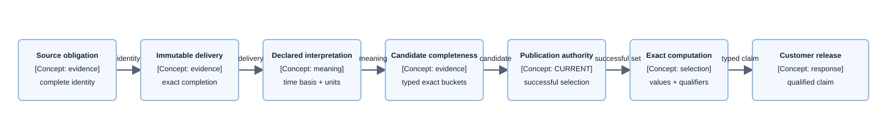

# Concept — The provenance chain

| | |
|---|---|
| **Level** | L2 — concept |
| **Status** | Current provenance and immutable-landing obligation contract. |
| **Last updated** | 2026-09-29 |
| **Owns** | The per-layer obligations that preserve grain, measurement basis, coverage, and completeness; and the generic immutable-landing contract. |
| **Applied by** | [Source Acquisition](../capabilities/source-acquisition/README.md) · [Data Layer](../capabilities/data-layer/README.md) · [Load Path](../capabilities/load-path/README.md) · [Publication State](../capabilities/publication-state/README.md) · [Query Path](../capabilities/query-path/README.md) · [Conversational Runtime](../capabilities/conversational-runtime/README.md) |
| **Conventions** | [Documentation conventions](../conventions.md) |

## 1. What this concept is

Every analytical claim carries four properties from source evidence to customer release:

| Property | Question answered |
|---|---|
| **Grain** | What does one row or value represent? |
| **Measurement basis** | Which measurement system produced it? |
| **Coverage** | Which exact period is supported and where are its holes? |
| **Completeness** | What was withheld, unavailable, dropped, or truncated? |

This concept owns the obligations that preserve those properties across boundaries. **Lives elsewhere:** source-specific behavior belongs to [source references](../sources/); landing implementation belongs to [Source Acquisition](../capabilities/source-acquisition/README.md); publication ordering belongs to [Load Path](../capabilities/load-path/README.md); serving authority belongs to [Publication State](../capabilities/publication-state/README.md); computation belongs to [Query Path](../capabilities/query-path/README.md); and customer release belongs to [Conversational Runtime](../capabilities/conversational-runtime/README.md).

## 2. The rule

> **A layer may narrow grain, basis, coverage, or completeness. A layer may never widen, infer, or silently drop any of them.**

Where a property cannot be established, the chain stops or returns a typed limit. Later computation, publication, or prose cannot reconstruct missing provenance.

### 2.1 Boundary obligations

| Boundary | Must preserve | Must never do |
|---|---|---|
| Source to landing | Exact delivered bytes, source-owned identity/options, and completion order | Transform bytes, infer options, or signal completion early |
| Landing to interpretation | Immutable object version, checksum, and governed source identity | Select a latest object or mutable path |
| Interpretation to candidate | Declared grain, basis, time, units, and typed source evidence | Infer mapping, identity, or row time |
| Candidate to authority | Complete gate evidence and exact buckets | Create success while any blocker applies |
| Authority to computation | Exact successful publication set and coverage | Bridge holes or query before selection |
| Computation to release | Typed values and mandatory qualifiers; a conversational answer is [measured after release](semantic-accuracy.md#3-how-it-works) | Let model/browser rewrite observed claims |

### 2.2 Generic landing contract

A completed delivery binds one immutable result object to a final completion document. The completion document carries the source-owned dataset/scope/options, covered period, source watermark, retrieval identity, execution identity where applicable, governed interpretation identity, and the exact object version. The finalizer derives byte count, checksum, and additional repository-governed digests from the accepted object; the producer does not invent them.

The default producer sequence is result first, completion document last. A canonical manifest is the only event that authorizes downstream ingestion. Exact key shape, source-specific required fields, suppression representation, report options, restatement behavior, and source availability semantics remain with the source reference and Source Acquisition capability.

## 3. How it works

**Component diagram — provenance-to-release chain; evidence-custody viewpoint, component depth.**

> **Takeaway.** Every handoff may narrow provenance, coverage, or completeness; no later handoff can restore what an earlier one did not establish.

## 4. Rejected alternatives

- Reconstructing hidden source completeness downstream — [ADR-030](../decisions/adr-030-the-raw-zone-landing-contract.md)
- Normalizing or replacing source bytes before retained evidence exists — [ADR-044](../decisions/adr-044-materialize-source-aligned-data-and-centralize-canonical-publication.md)
- Treating mutable operational state as serving authority — [ADR-047](../decisions/adr-047-separate-attempts-leases-publications-and-coverage.md)
- Trusting model-authored numerical narration — [ADR-049](../decisions/adr-049-make-validation-and-grounded-narration-part-of-publication-accuracy.md) (model-derived figures are now evaluated rather than refused — [ADR-082](../decisions/adr-082-govern-the-agent-by-evaluation-and-audit-not-text-heuristics.md))

## 5. Decisions

| Decision | Owner |
|---|---|
| Manifest-last immutable landing | [ADR-030](../decisions/adr-030-the-raw-zone-landing-contract.md) |
| Source-aligned and canonical materialization | [ADR-044](../decisions/adr-044-materialize-source-aligned-data-and-centralize-canonical-publication.md) |
| Separate delivery and canonical identities | [ADR-045](../decisions/adr-045-separate-delivery-commerce-marketplace-and-product-identities.md) |
| Exact coverage and `CURRENT` authority | [ADR-047](../decisions/adr-047-separate-attempts-leases-publications-and-coverage.md) |
| Streamed conversational answer governed by audit and evaluation | [ADR-083](../decisions/adr-083-stream-the-agent-answer-and-govern-it-by-audit-and-evaluation.md) |

## 6. Open items

| Item | What resolves it | Blocks |
|---|---|---|
| Source identity gaps | Evidence in the owning source reference and governed source pack | Only the affected source scope |
| Non-additive suppressed quantities | Source-specific evidence and a declared computation rule | Only arithmetic requiring additivity |
