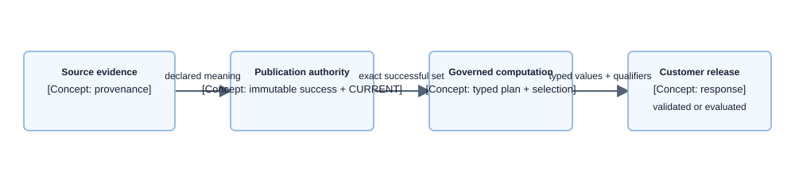

# Concept — Semantic Accuracy

| | |
|---|---|
| **Level** | L2 — concept |
| **Status** | Current cross-capability accuracy invariant. |
| **Last updated** | 2026-09-29 |
| **Owns** | The acceptance criterion that a released analytical claim preserves evidence, identity, time, compatible aggregation, coverage, and qualification meaning end to end. |
| **Applied by** | [Data Layer](../capabilities/data-layer/README.md) · [Load Path](../capabilities/load-path/README.md) · [Publication State](../capabilities/publication-state/README.md) · [Query Path](../capabilities/query-path/README.md) · [Conversational Runtime](../capabilities/conversational-runtime/README.md) |
| **Conventions** | [Documentation conventions](../conventions.md) |

## 1. What this concept is

Semantic Accuracy is the cross-capability acceptance rule for released analytical claims. It does not own source provenance, field definitions, publication mechanics, computation, or response publication; those mechanisms remain with their linked owners.

## 2. The rule

> **No released analytical claim may erase, infer, widen, or silently change its evidence, identity, time, compatible axes, coverage, quality state, units, basis, or mandatory qualification.**

A capability may narrow or refuse a claim. It may not replace missing semantics with a convenient default.

## 3. How it works

**Component diagram — semantic-accuracy release path; meaning-preservation viewpoint, component depth.**

> **Takeaway.** A released claim is accurate only when every owner preserves the same meaning across its boundary.

The acceptance matrix is distributed: provenance is checked by [Provenance Chain](provenance-chain.md), current authority by [Publication State](../capabilities/publication-state/README.md), compatibility by [Query Path](../capabilities/query-path/README.md), and customer release by [Conversational Runtime](../capabilities/conversational-runtime/README.md). A conversational answer is not checked before the user sees it: evaluation measures each complete turn against its governed evidence and answer obligations after release ([ADR-083](../decisions/adr-083-stream-the-agent-answer-and-govern-it-by-audit-and-evaluation.md)).

## 4. Rejected alternatives

- Trust each capability's local tests as end-to-end semantic proof — [ADR-049](../decisions/adr-049-make-validation-and-grounded-narration-part-of-publication-accuracy.md)
- Treat canonical rows as the complete provenance record — [ADR-044](../decisions/adr-044-materialize-source-aligned-data-and-centralize-canonical-publication.md)
- Describe exceptional aggregation in prose instead of executable contracts — [ADR-048](../decisions/adr-048-make-metric-compatibility-and-axis-aware-aggregation-runtime-semantics.md)
- Rewrite model-authored analytical content after generation — [ADR-056](../decisions/adr-056-publish-conversation-as-evidence-bound-semantic-blocks.md)
- Hold the conversational answer until a pre-release check passes — [ADR-083](../decisions/adr-083-stream-the-agent-answer-and-govern-it-by-audit-and-evaluation.md)

## 5. Decisions

| Decision | Owner |
|---|---|
| Source-aligned evidence and canonical publication | [ADR-044](../decisions/adr-044-materialize-source-aligned-data-and-centralize-canonical-publication.md) |
| Separate identity domains | [ADR-045](../decisions/adr-045-separate-delivery-commerce-marketplace-and-product-identities.md) |
| Exact coverage and `CURRENT` authority | [ADR-047](../decisions/adr-047-separate-attempts-leases-publications-and-coverage.md) |
| Executable publication and grounded-release gates | [ADR-049](../decisions/adr-049-make-validation-and-grounded-narration-part-of-publication-accuracy.md) |
| Streamed conversational answer governed by audit and evaluation | [ADR-083](../decisions/adr-083-stream-the-agent-answer-and-govern-it-by-audit-and-evaluation.md) |

## 6. Open items

| Item | What resolves it | Blocks |
|---|---|---|
| New cross-capability invariant | Named owners and an executable acceptance criterion | Only the claim class governed by that invariant |
