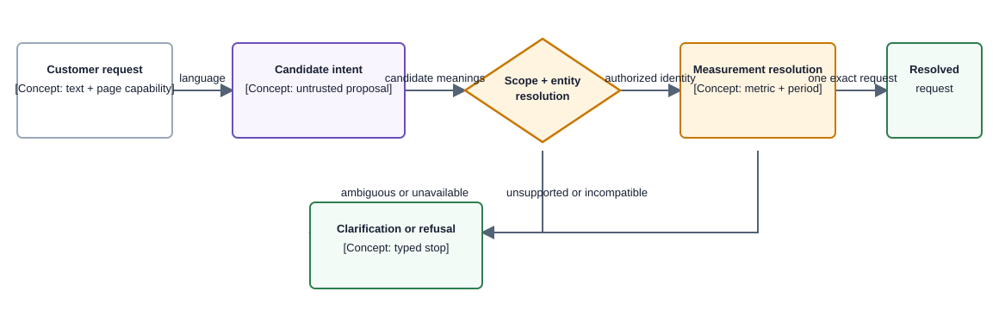

# Concept — Semantic Resolution

| | |
|---|---|
| **Level** | L2 — concept |
| **Status** | Current deterministic resolution contract. |
| **Last updated** | 2026-09-04 |
| **Owns** | The cross-capability result contract that turns customer language and typed page context into one authorized canonical measurement request or a typed clarification/refusal. |
| **Applied by** | [Authentication](authentication.md) · [Conversational Runtime](../capabilities/conversational-runtime/README.md) · [Query Path](../capabilities/query-path/README.md) |
| **Conventions** | [Documentation conventions](../conventions.md) |

## 1. What this concept is

Semantic Resolution separates a customer’s language from authorized measurement. A model may propose candidate intent; deterministic resolution decides whether a population, entity, metric, period, operation, and page context are known, authorized, compatible, and executable.

**Lives elsewhere:** canonical fields remain in the [Canonical Model](../canonical-model.md), current server-side request framing and route publication in [Conversational Runtime](../capabilities/conversational-runtime/README.md), and computation in [Query Path](../capabilities/query-path/README.md). [ADR-039](../decisions/adr-039-assembled-context-replaces-the-declared-prompt.md) retains the superseded context-assembly rationale.

## 2. The rule

> **Never execute measurement while a population-changing entity, scope, metric meaning, period, or operation remains unresolved or ambiguous.**

Only a resolved typed request reaches planning. Ambiguity, unsupported capability, invalid context, or incompatible semantics returns a bounded clarification or refusal rather than a plausible zero-row answer.

## 3. How it works

**Component diagram — semantic request resolution; authorization viewpoint, component depth.**

> **Takeaway.** The model can suggest meaning; only deterministic resolution authorizes measurement.

## 4. Rejected alternatives

- Letting a model fill measurement arguments — [ADR-028](../decisions/adr-028-a-validated-plan-replaces-the-template-registry.md)
- Querying broadly and letting a model select a row — [ADR-054](../decisions/adr-054-scope-analytical-visibility-to-the-customer-deployment.md)
- Collapsing entity aliases, marketplace mapping, metric defaults, and taxonomy into one string dictionary — [ADR-045](../decisions/adr-045-separate-delivery-commerce-marketplace-and-product-identities.md)
- Treating source, platform, and channel as synonyms — [ADR-052](../decisions/adr-052-separate-ecosystem-platform-channel-and-ad-product.md)
- Treating conversation memory as authorization or current identity — [ADR-039](../decisions/adr-039-assembled-context-replaces-the-declared-prompt.md)

## 5. Decisions

| Decision | Owner |
|---|---|
| Identity domains remain distinct | [ADR-045](../decisions/adr-045-separate-delivery-commerce-marketplace-and-product-identities.md) |
| Compatibility and axes are executable semantics | [ADR-048](../decisions/adr-048-make-metric-compatibility-and-axis-aware-aggregation-runtime-semantics.md) |
| Current context is assembled outside memory | [ADR-039](../decisions/adr-039-assembled-context-replaces-the-declared-prompt.md) |
| Analytical visibility is deployment-scoped | [ADR-054](../decisions/adr-054-scope-analytical-visibility-to-the-customer-deployment.md) |

## 6. Open items

| Item | What resolves it | Blocks |
|---|---|---|
| Unsupported candidate meanings | A governed capability contract and resolver fields | Only that measurement path |
| Additional source/platform scope | Explicit source and identity evidence | Only that source/platform |
