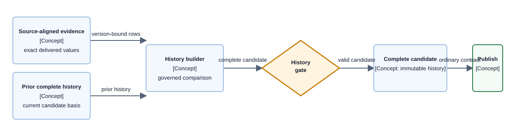

# Concept — Slowly Changing Dimensions

| | |
|---|---|
| **Level** | L2 — concept |
| **Status** | Current immutable-history candidate rule. |
| **Last updated** | 2026-09-04 |
| **Owns** | Version identity, interval validity, complete history-candidate, and reader-visibility invariants for changing dimensions. |
| **Applied by** | [Data Layer](../capabilities/data-layer/README.md) · [Load Path](../capabilities/load-path/README.md) · [Publication State](../capabilities/publication-state/README.md) |
| **Conventions** | [Documentation conventions](../conventions.md) |

## 1. What this concept is

A slowly changing dimension preserves historical attribute meaning by producing complete versioned history in an immutable candidate rather than overwriting a readable row. Facts join to the version valid on their business date.

**Lives elsewhere:** Data Layer owns physical storage, Load Path owns publication ordering, and Publication State owns `CURRENT` serving authority.

## 2. The rule

> **A dimension-history candidate must be complete and internally valid before publication; no intermediate history state may become readable.**

Versions use governed business key plus `valid_from`; intervals do not overlap; currentness is internally consistent; omitted delivery identities are not deletions without an explicit source contract; and byte-identical reprocessing converges.

## 3. How it works

**Component diagram — complete dimension-history publication path; history viewpoint, component depth.**

> **Takeaway.** Readers see either the prior complete history or the next complete history, never an in-place close/open transition.

## 4. Rejected alternatives

- Overwriting the current row and erasing historical meaning — [ADR-025](../decisions/adr-025-applying-an-scd2-plan-without-a-transaction.md)
- Separate close/open mutation statements that expose no-current or two-current states — [ADR-025](../decisions/adr-025-applying-an-scd2-plan-without-a-transaction.md)
- Treating a partial/restated delivery as a deletion declaration — [ADR-030](../decisions/adr-030-the-raw-zone-landing-contract.md)
- Tracking retrieval metadata as a business attribute and creating non-idempotent versions — [ADR-003](../decisions/adr-003-canonical-model-decomposition.md)

## 5. Decisions

| Decision | Owner |
|---|---|
| Historical in-place transition rationale | [ADR-025](../decisions/adr-025-applying-an-scd2-plan-without-a-transaction.md) |
| Governed product natural key | [ADR-023](../decisions/adr-023-product-natural-key.md) |
| Additive canonical schema evolution | [ADR-003](../decisions/adr-003-canonical-model-decomposition.md) |

## 6. Open items

| Item | What resolves it | Blocks |
|---|---|---|
| Source-declared deletion semantics | An explicit source contract | Deletion-like history transitions for that source |
| New tracked dimension attribute | Governed semantic declaration and candidate validation | Only that attribute’s history |
