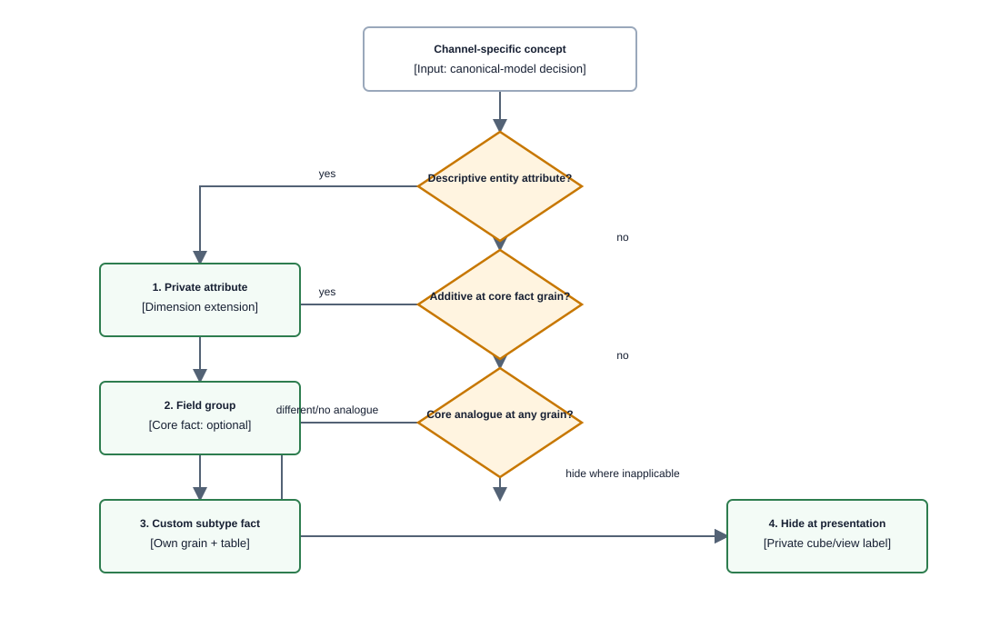

# ADR-003 — Canonical model decomposition and naming

| | |
|---|---|
| **Status** | Accepted |
| **Date** | 2026-08-17 |
| **Decision** | **Domains are analytical stories. Channel is a conformed dimension, not a domain.** Channel-specific concepts attach via Kimball's core/custom (supertype/subtype) pattern, not by forking the model per channel. |
| **Related** | [ADR-002](adr-002-canonical-data-model.md) · [ADR-023](adr-023-product-natural-key.md) · [ADR-052](adr-052-separate-ecosystem-platform-channel-and-ad-product.md) · [data-layer](../capabilities/data-layer/README.md) · [sources/amc](../sources/amc.md) · [sources/vendor-central](../sources/vendor-central.md) |

> **Implementation amendment, 2026-08-24.** The channel-as-dimension decision remains accepted.
> [ADR-023](adr-023-product-natural-key.md) supersedes this ADR's original product-surrogate detail:
> current facts join product by marketplace-qualified natural identity. The contract inventory in
> this ADR was an adoption-time hypothesis and is not current authority; [canonical model](../canonical-model.md)
> §4a owns the generated contract-to-fact inventory. [ADR-052](adr-052-separate-ecosystem-platform-channel-and-ad-product.md)
> proposes the ecosystem/platform hierarchy without reopening channel-as-dimension.

## Context

[ADR-002](adr-002-canonical-data-model.md) settled *what* we conform — dimensions and metric semantics, not facts. It did not settle *how the model is decomposed or named*.

The requirement driving this: the platform must extend to further channels **by adding data, not by adding structure**. Amazon is the first channel, not the only one. Future channels are not yet chosen, and may include other retail media networks or data a customer supplies from their own systems.

The hypothesis put forward was: treat each channel as a domain, with data domains inside it that tell specific data stories.

Constraints already fixed:
- Facts stay at their source-permitted grain — AMC fixes grain at query time via privacy thresholds and it cannot be re-cut downstream.
- Every fact carries a `measurement_basis`, because ad-attributed and retail-actual are different measurement systems that never reconcile.
- Advertising and retail data share only ASIN × date × marketplace, because the retail source has no campaign dimension.

## Decision

**Domains are the analytical stories. Channel is a conformed dimension.**

### Why — four convergent lines, strongest first

**1. Kimball's unit of decomposition is the measurement event, not the source.** "Ad impression served" is one business process regardless of which network served it. Channel-as-domain would put the same process in multiple bus-matrix rows, and cross-channel comparison would then require *drill-across* — Kimball's hardest operation — for the question this product exists to answer. As a dimension, that comparison collapses to a `GROUP BY`. ([10 Essential Rules](https://www.kimballgroup.com/2009/05/the-10-essential-rules-of-dimensional-modeling/), Rule #2; [Drilling Across](https://www.kimballgroup.com/2003/04/the-soul-of-the-data-warehouse-part-two-drilling-across/))

**2. dbt names the inverse an anti-pattern and supplies the naming rule.** Building the same concept differently per consumer is called out explicitly; the fix is to name by *what differs*, not *whose it is* — "`tax_revenue` and `revenue`, not `finance_revenue` and `marketing_revenue`". Transposed: not `amazon_conversions` alongside a per-channel twin, but one `fct_attributed_conversion` with a channel dimension. ([dbt Marts](https://docs.getdbt.com/best-practices/how-we-structure/4-marts))

**3. Both reference implementations that solved this exact problem chose channel-as-dimension.** Fivetran's `dbt_ad_reporting` unifies **11 ad platforms** and decomposes by *grain* (`account_report`, `campaign_report`, `ad_group_report`…) with platform as a column, not per-platform marts. Google Meridian treats channel as a coordinate alongside geo and time. ([fivetran/dbt_ad_reporting](https://github.com/fivetran/dbt_ad_reporting) · [Meridian data collection](https://developers.google.com/meridian/docs/pre-modeling/collect-data))

**4. It is the literal statement of the requirement.** Channel-as-domain costs N structural changes per new channel. Channel-as-dimension costs N rows.

### Where channel-as-domain *would* have been right

If separately owned domains held separate channels and needed independent release cadence — the Data Mesh case. This is one repository with one release cadence, and the documented critique puts the coordination overhead of mesh below roughly a 100-person organisation with 2–3 data FTEs. We borrow mesh's *layering vocabulary* (source-aligned / aggregate / consumer-aligned) and its **polyseme** concept for cross-channel identity; we discard domain ownership and federated governance. ([10 reasons you are not ready to adopt data mesh](https://medium.com/google-cloud/10-reasons-why-you-should-not-adopt-data-mesh-7a0b045ea40f), Google Cloud PS, Jan 2022 · [Data Mesh founding article](https://martinfowler.com/articles/data-monolith-to-mesh.html))

## Conformed dimensions

Managed once, reused by every fact.

| Dimension | Notes |
|---|---|
| `dim_date` | mandatory on every fact |
| `dim_channel` | **the hypothesis-resolving dimension.** Amazon today, further channels as rows. Attributes: name, type (marketplace / retailer-owned / network / customer-supplied), operator |
| `dim_marketplace` | country/locale of transaction |
| `dim_product` | Marketplace-qualified natural product identity with namespaced source identifiers and SCD2 attributes. Channel-private attributes permitted here |
| `dim_campaign` | campaign / ad group / placement hierarchy. **Absent from the retail process** — recorded as a bus-matrix gap, not a null |
| `dim_measurement_basis` | `ad_attributed` \| `retail_actual` \| `modelled`, with attribution window, lookback, methodology reference |
| `dim_ad_product` | sponsored product / sponsored brand / display / in-store |
| `dim_treatment_type` | `paid_media` \| `organic_media` \| `non_media_treatment` \| `control` |

Two of these deserve explanation.

**`dim_measurement_basis` promoted to a conformed dimension** is the highest-value naming decision in the model. It makes non-reconciliation a *queryable fact* rather than tribal knowledge that lives in someone's head until a board deck contradicts itself.

**`dim_treatment_type`** borrows Meridian's four-way split, which is a better vocabulary than "channel" alone and gives Amazon retail levers — price changes, Subscribe & Save promotion state — a principled conformed home instead of an Amazon-specific dumping ground.

## Domains

Seven. Each is a folder and a schema; grain and `measurement_basis` are fixed per fact.

| # | Domain | The question it answers | Primary facts | Basis |
|---|---|---|---|---|
| 1 | `exposure` | who did we reach, how often, at what cost | `fct_ad_exposure` | ad_attributed |
| 2 | `conversion` | what did the advertising claim credit for | `fct_attributed_conversion`, `fct_conversion_path` | ad_attributed |
| 3 | `retail_demand` | what actually happened in the store | `fct_retail_sales`, `fct_product_page_views` | retail_actual |
| 4 | `retail_availability` | could the customer even buy it | `snap_product_availability` | retail_actual |
| 5 | `shopper_lifecycle` | are we acquiring or milking | `fct_shopper_acquisition` | varies |
| 6 | `incrementality` | what would have happened anyway | `fct_incremental_effect` | modelled |
| 7 | `cross_channel_performance` | the consolidated view | `fct_cross_channel_performance` | multiple, labelled |

**`retail_availability` is separated deliberately.** Its grain is a periodic snapshot, not a transaction, so Kimball's one-grain-per-fact rule forces the split. It is also the domain that explains ad underperformance — spend against an out-of-stock ASIN — and it is nearly always modelled too late.

**`cross_channel_performance` is a consolidated fact table**, at ASIN-equivalent × date × marketplace × channel. Kimball permits these explicitly as "a complement to the detailed single-process fact tables, not a substitute". It is built by aggregate-then-merge on conformed row headers, **never by joining facts** (see Consequences).

### Our twelve contracts land as follows

A sanity check on whether the domains are genuinely source-independent:

| Domain | Contracts |
|---|---|
| `exposure` | `amc-reach-frequency`, `amc-campaign-overlap`, `amc-audience-performance` |
| `conversion` | `amc-new-to-brand`, `amc-time-to-convert`, `amc-format-attribution`, `amc-organic-vs-ad`, `amc-path-to-purchase` |
| `retail_demand` | `vendor-sales-by-asin`, `vendor-traffic-by-asin` |
| `shopper_lifecycle` | `amc-repurchase-behavior`, `amc-customer-loyalty` |
| `retail_availability` | *none yet* — the vendor inventory report would feed it |
| `incrementality` | *none yet* |

All twelve land somewhere, and no domain is defined by its source. Two domains are empty, which is correct — they are known future capability, not speculative structure.

## How a channel-specific concept attaches

Four mechanisms, in preference order. Use the cheapest that fits.

**Decision tree — channel-specific concept attachment; canonical-model decision viewpoint, component depth.** Structural boundaries do not apply to a decision tree; the gates are the subject.

> **Takeaway.** Reach for a new table last. Most "channel-specific" things are attributes or absent measures, not new structure.

The core is the **intersection**, not the union. Fivetran's calibration across 11 ad platforms is sobering: what genuinely conforms is roughly **five metrics** — clicks, impressions, spend, conversions, conversion value. Everything else is passthrough. Start there and let extensions carry the rest.

### Two of our assumed Amazon-specifics are actually conformable

This materially changes the model, and it is the most useful correction the research produced:

- **New-to-brand is not Amazon-proprietary.** [IAB Europe's Commerce Media Measurement Standards V2.1](https://iabeurope.eu/knowledge_hub/iab-europes-commerce-incl-retail-media-measurement-standards-v2/) (22 Jan 2026) standardises new-to-brand *and* new-to-category with **five generic timeframes**. NTB belongs in the conformed core with the lookback window as an explicit attribute. Amazon's own windows already disagree with each other — 12 months, 365 days, and a 14-day order window across different surfaces — so parameterising the window is required regardless.
- **Product identity is marketplace-qualified and source-namespaced.** This is the polyseme problem: one product entity, differently identified per channel. The current Amazon path uses the natural `(amazon_asin, marketplace_key)` identity chosen by [ADR-023](adr-023-product-natural-key.md); a future cross-retailer crosswalk remains a distinct governed identity rather than a universal surrogate assumed in advance. **Never name a table or metric after ASIN.**

Genuinely Amazon-specific and needing extensions: **brand halo** (changes grain — promoted ASIN and converted ASIN are different products, so it must be a subtype fact) and **Subscribe & Save** (a `dim_treatment_type` value plus subtype facts).

## Consequences

**Accepted:**

- **Never join two fact tables in one query.** Kimball is unusually blunt: the many-to-many relationship makes the inner/outer join decision "effectively impossible to get right, even if you're an expert SQL programmer", and aggregated totals can come out too low, too high, or both. Cross-process analysis is multi-pass queries merged on identical conformed row headers. This is a stronger constraint than the "join at ASIN × date × marketplace" framing we had before, and it is why `cross_channel_performance` exists as one named, deliberately-built place.
- **Store only additive facts. Derive every ratio in the semantic layer.** ROAS, CTR, and CPC are not summable — 2% and 3% CTR do not make 5%. Meridian requires raw summable volumes; Kimball's one-grain rule says the same thing from another direction.
- **Measurement windows are explicit, never implicit.** `purchases_new_to_brand_365d`, not `ntb_purchases`.
- **Schema evolution is purely additive.** Adding fields is fine. Removing, renaming, redefining, or moving a field is breaking. Adopted from XDM, and it is what makes "extend by adding data" true rather than aspirational.
- **Stay normalised.** dbt's guidance splits on whether you use a semantic layer: denormalise heavily if not, stay as normalised as possible if you do. We want metrics defined once, so narrow additive facts plus query-time joins.
- **No channel token in a conformed object's name.** `dim_product`, not `dim_asin`. `fct_retail_sales`, not `fct_vendor_central_sales`. The single exception is a subtype suffix on a custom fact — `fct_attributed_conversion_amazon` — which Kimball's core/custom technique licenses.
- **`snap_` prefix for snapshot-grain facts.** Kimball names three grain archetypes; transaction and periodic-snapshot facts behave differently under aggregation, and an identical `fct_` prefix hides that. Summing a snapshot across time is silently wrong.
- **Grain is never encoded in a name.** It is declared in one fixed field. Otherwise every regrain becomes a rename.
- **Source names live only in staging.** `stg_amazon_ads__campaigns`, `stg_vendor_central__sales`.

**Rejected:** one big table (it requires exactly the fact-to-fact join Kimball forbids), per-channel marts, and an EAV `metric_name`/`metric_value` bag.

## Why this survives the canonical-model critique

There is a real and well-argued case that canonical data models are an anti-pattern — [Tilkov/INNOQ, *Why You Should Avoid a Canonical Data Model*](https://www.innoq.com/en/blog/2015/03/thoughts-on-a-canonical-data-model/) calls it "a horrible, horrible idea". Worth engaging with rather than ignoring, because the critique is largely correct about what it attacks.

Tilkov's objection is to *universal whole-object schemas negotiated by committee*, which end up "with tons of optional attributes because everyone insisted theirs need to be there". His prescription is the opposite of abandonment: **standardise small reusable fragments, "akin to microformats"**, and let teams pull them rather than having a central team push them.

That is the same architecture as XDM's field groups and as Kimball's conformed dimensions — three traditions converging independently on *small standardised fragments, not universal objects*.

His two remaining objections are organisational: central push, and cross-team negotiation. **For one team in one repo they largely evaporate.** That is the honest reason a canonical model is defensible here and would not be at enterprise integration scale. Our residual risk is not political, it is technical: over-generalisation into optional-attribute soup. The intersection-not-union rule is the guard against it.

## Confidence — read before committing

Carried forward from the research, because several load-bearing pieces are extrapolation rather than citation.

| Claim | Confidence |
|---|---|
| Channel as dimension, not domain | **High** — convergent from Kimball, dbt, and two reference implementations. But no source publishes "do not partition by channel" as a rule; it is inference |
| Kimball core/custom for extensions | **High** — directly quoted technique |
| Never join fact tables | **High** — directly quoted |
| Additive-only facts, ratios in semantic layer | **High** — Meridian and Kimball agree |
| **The seven-domain list and all domain names** | **Invented.** No source publishes a retail media analytical domain decomposition. IAB gives metric *categories* (media / attribution / campaign insight) and chapter structure; promoting those to domains is our step |
| `dim_measurement_basis` as a conformed dimension | **Our construct.** Kimball's "measure type" and "audit" dimensions are the nearest analogues and were not read |
| The four-tier extension decision rule | **Ordering is synthesised.** Each mechanism is sourced; the ranking is not |
| NTB is cross-channel conformable | **Snippet-level.** From IAB Europe's V2.1 changelog; the definitions themselves are in an unfetchable PDF. If NTB is less standardised than the changelog implies, it moves from core to extension |
| IAB metric names | **Do not adopt verbatim yet.** The IAB/MRC (Jan 2024) and IAB Europe V1/V2.1 standards are PDFs that were not readable. Read them before borrowing names; target V2.1, since the V1 grace period ended July 2026 |
| unsupported ≠ zero marker | **Our addition.** Fivetran's documented convention is a bare null, which conflates the two. Given `measurement_basis`, conflating them is a defect — but that is our judgement |

## Review triggers

- A second channel is onboarded and the mapping layer, not the model, is where the work concentrates → the model is working; consider materialising more consolidated facts.
- A third measurement basis appears (e.g. panel or MMM-derived) → check `dim_measurement_basis` still holds.
- The conformed core grows past roughly ten metrics → suspect premature conformance; re-read the intersection rule.
- IAB Europe publishes V3, or the PDFs are read and NTB proves non-conformable.
