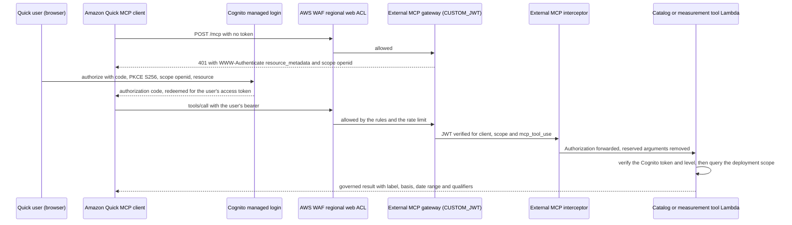

# ADR-150: Expose the governed tools to Amazon Quick through a user-authorized MCP gateway

Date: 2026-10-22
Status: Proposed (2026-10-22). A demo slice, built behind a flag that is off in every environment
and refused outside dev. The owner approved the scope on 2026-10-22 ("yes to everything", items
1–5 of the overnight record): the infrastructure, no new dependency, the two dev deploy passes, and
the Amazon Quick console steps as a click path. Live acceptance and the Amazon Quick hop are pending;
[Use Adlytics in Amazon Quick](../amazon-quick.md) owns the setup and the demo script. Amends
[ADR-077](adr-077-carry-the-end-user-identity-to-every-hop-through-token-exchange.md) §5 and
[ADR-078](adr-078-serve-quality-review-to-programmatic-callers-through-the-cloudfront-edge.md) §3.

## Context

The owner asked for the governed chat tools to be usable from Amazon Quick, for a demo on
2026-10-23. Amazon Quick connects only to remote MCP servers over streamable HTTP, and authorizes a
user to one with 3-legged OAuth (authorization code with PKCE S256 and RFC 8707 resource
indicators) or with service credentials
([Quick MCP integration](https://docs.aws.amazon.com/quicksuite/latest/userguide/mcp-integration.html))
[verified 2026-10-22]. It needs an Amazon Quick Enterprise subscription [verified 2026-10-22, same
page]. The published AgentCore Gateway samples for Quick use 2-legged client credentials, which is
one shared identity for every Quick user.

Three facts of this repository shape the answer:
- Every tool already verifies its caller's signed bearer before it reads a call (ADR-077 §5), and
  every app route binds a credential to one client (ADR-078 §3).
- Analytical scope is deployment-wide (ADR-054), so identity at a tool is attribution, and the
  entitlement is a Cognito group projected into the closed `quality_review_levels` claim.
- A tool returns a `ShapedResponse`: finished, governed figures with their basis, coverage,
  qualifiers and labels. The in-app answer is governed after release by its audit receipt and
  evaluation ([ADR-083](adr-083-stream-the-agent-answer-and-govern-it-by-audit-and-evaluation.md)).
  An external client's model narrates on its own.

## Decision

**A second AgentCore Gateway, the external MCP gateway, admits only a Cognito access token issued
to one new public PKCE client for a user in one new group. Its targets are the existing catalog and
measurement functions, unforked. Each tool verifies that token again. A regional web ACL with the
edge's rules fronts it. It is off everywhere and refused outside dev.**

1. **Gateway.** `ExternalMcpGateway`, `CUSTOM_JWT` on the user pool: `allowedClients` the MCP
   client, `allowedScopes` `openid`, and the custom claim `quality_review_levels` CONTAINS
   `mcp_tool_use`. MCP versions 2025-06-18 and 2025-03-26, no semantic search, sanitised errors,
   and `FAIL_CLOSE` if WAF cannot be reached.
2. **Client and entitlement.** A public Cognito client with authorization code and PKCE only, scope
   `openid`, one callback (Amazon Quick's Region callback), no explicit auth flow, and its own
   managed-login branding. The group `mcp-tool-users` maps to the level `mcp_tool_use`. No route
   requires that level, so it opens no app route.
3. **Interceptor.** A stricter entry point of the existing interceptor module: every JSON-RPC
   method, not only `tools/call`, must carry a bearer, which it forwards. The in-app interceptor is
   unchanged.
4. **Tool verification.** With `ADL_MCP_CLIENT_ID` set, a token whose `kid` is not the token
   service's is verified against the pool's AWS-managed key set: signature, `exp`, `iss`,
   `client_id`, `token_use=access`, then `mcp_tool_use`, or `ADLY-CALLER-0001` with the cause
   `entitlement_missing`. Unset, that branch does not exist.
5. **Web ACL.** The edge's managed groups and order, its 8,192-byte body ceiling on every request,
   and a per-source-IP rate rule. Count first, then block, as ADR-078 §1 requires; synth refuses the
   targets while any rule counts. Matched requests only are logged, with `authorization` and `cookie`
   redacted and sampling off.
6. **Read-only.** The same five read tools. Nothing on this path writes, publishes or activates.
7. **The external-client rule.** The tool contract generates one rule beside the tools,
   `external_client_rule` in `contracts/generated/tools.json`. This gateway states it as the server
   instructions and appends it to each tool description. It tells the client to quote each figure
   as returned with its basis, date range and stated window, and never to total, recompute or sum
   attributed sales across networks. The in-app descriptions do not carry it.

### Identity flow

**Sequence diagram — one Amazon Quick tool call through the external MCP gateway (demo slice).**

> **Takeaway.** The gateway verifies the user's own Cognito identity and the tool verifies it again;
> no hop substitutes a service identity for the user.

Amazon Quick's RFC 8414 metadata fetch fails against Cognito, which answers 400 at
`/.well-known/oauth-authorization-server` [verified 2026-10-22, dev issuer]. The connection
therefore depends on the authorization and token URLs entered by hand, which is unproven.

### The owner-accepted risk

The owner, 2026-10-22: **"we dont need to audit quick its an accepted risk"**. Its scope as read
here: Amazon Quick's own model narrating the answers, and the absence of a per-turn audit receipt
and evaluation on the Quick path. The tool records only that its caller verified, attributed to the
user and the MCP client.

The mitigations that remain on this path:
- Tools return only finished governed figures, each with its basis, date range and qualifiers.
- The external-client rule forbids recomputing, totalling, and summing attributed sales across
  networks.
- A non-additive result states its own rule (`data.additivity`), beside the figures.
- [Semantic accuracy](../concepts/semantic-accuracy.md) scopes the figure-verification guarantee to
  in-app chat.

### Known gaps

- Known gap, demo only: for purchases, purchases_incl_halo, conversions, units_attributed and
  units_attributed_incl_halo the tool result states no attribution window (the dictionary's is 14
  days). Quick is told never to assume one. The demo script uses none of them. Closing it means a
  contract-first change (each label states its window, then the generators); it is not in this
  slice. Pending owner confirmation.
- Catalog answers state no period: their requested coverage is empty and their window zero-width.

### Data residency

Tool results leave the Adlytics workload for an Amazon Quick instance. The integration is supported
only when that subscription is in the deployment's own AWS account and the same geography, which
the setup checks before any connector exists. **The same-account rule is an operating
precondition, not a technical control.** A public client's ID appears in every authorize URL, and
its one callback is Amazon Quick's Region-wide callback, so a member of `mcp-tool-users` who signs
in through a Quick instance in another account sends governed results there. In dev the only
members are a synthetic persona and the owner's named user. The redirect URL Amazon Quick displays
for the MCP connector is recorded at connector creation and read against this paragraph.

Inside the account, Amazon Quick stores data in its primary Region, and may process prompts and
outputs in other Regions of the same geography by cross-Region inference, which cannot be
configured ([Quick Regions](https://docs.aws.amazon.com/quicksuite/latest/userguide/regions.html))
[verified 2026-10-22]. The in-app models already use `us.` cross-Region inference profiles, so the
geography posture is unchanged. "Customer data never leaves the customer's AWS account" holds for
a same-account Quick instance, and for this demo it rests on the precondition above. The owner
confirms that reading before any customer deployment relies on it.

### Throttling, the flag and teardown

- The web ACL's rate rule limits each source IP. Amazon Quick calls from shared service egress, so
  the dev value is 1000 requests per 5 minutes (approvals (c)1), sized for aggregate demo traffic.
- `ADLYTICS_EXTERNAL_MCP_GATEWAY` turns the slice on, `ADLYTICS_EXTERNAL_MCP_TARGETS_ATTACHED`
  attaches the tools in the second pass, and the rate has no default. Removal condition: remove the
  flag when the owner promotes the integration from demo, or delete the feature if not.
- After the demo, unless promoted, the owner decides the teardown: remove the users from the group,
  then set the flag to `false` and redeploy, diff first, which removes the gateway, web ACL,
  interceptor, client, group and parameters.

## Consequences

- One new public endpoint, the gateway URL, JWT-gated and WAF-fronted. Its audience is signed-in
  members of `mcp-tool-users` in this deployment's pool.
- A Quick user's access is per user, ends with their group membership at the next 15-minute access
  token, and is refused at the gateway, by the interceptor if the gateway ever admits a request
  without a bearer, and by the tool on a direct invoke.
- The tool roles gain no grant: the pool's key set is public HTTPS. The gateway role may invoke
  exactly the interceptor and the two tool functions.
- Amazon Quick's answers carry no audit receipt and no evaluation. That is the accepted risk above,
  not a property of the in-app path.

## Amendments

- **ADR-077 §5.** The tool's Cognito branch relaxes three §5 rules, plus one statement about the
  actor, for this client only:
  1. the key comes from an issuer endpoint, Cognito's AWS-managed key set rather than our floodable
     issuer;
  2. an unknown `kid` triggers one refresh rather than a refusal, because Cognito rotates on its own
     schedule;
  3. the token is confined by `client_id` rather than `aud`, because a Cognito access token carries
     `aud` only with `resource`, and every app route refuses this client;
  4. the actor is the configured MCP client, which the signed `client_id` must equal; no `act`
     claim exists on this path.
- **ADR-078 §3.** A third credential: an MCP-client access token is valid only at the external MCP
  gateway, and every app route refuses it.

## Alternatives considered

- **2-legged client credentials,** the published Quick sample's shape. One shared identity for every
  Quick user, which would let any Quick user read as any other.
- **The interceptor exchanging the Cognito token for a token-service Gateway token.** One credential
  class at the tool, at the cost of a third exchange function, a resource-policy Deny, a KMS
  signature on every call and an interceptor holding signing authority. More bespoke security code
  for no extra guarantee in a demo.
- **Widening the in-app gateway.** An authorizer takes one discovery URL, so it cannot admit both
  issuers.
- **Duplicate tool functions for Quick.** This duplicates the lake read grants and forks the tool
  logic and its deployment.
- **An OpenAPI target, `AUTHENTICATE_ONLY`, or no gateway auth with passthrough.** Each adds a
  public HTTP surface or removes the gateway's own authorization.
- **Our own RFC 8414 metadata proxy for Cognito.** A new public surface and a third issuer-shaped
  document, for a need that is unverified.

## Review trigger

- Before any customer deployment relies on the same-account rule: replace the public client with a
  confidential client whose secret is entered only in the deployment account's connector, which
  enforces the binding the public client cannot.
- When the owner confirms or rejects the attribution-window gap above.
- When Amazon Quick documents Cognito as a supported OAuth provider, or the Quick hop fails.
