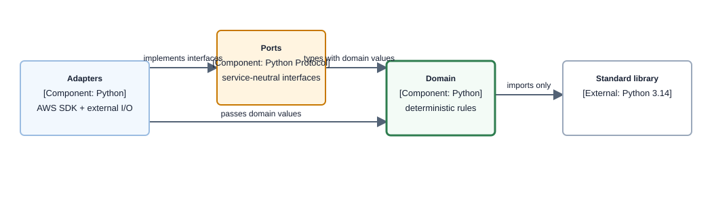

# Repo Structure

| | |
|---|---|
| **Status** | Semantic V2 is the current repository-owned analytical data path; [validation results](../validation/RESULTS.md) record dated acceptance conclusions. |
| **Last updated** | 2026-10-20 |
| **Languages** | Python (backend, ML) · TypeScript (frontend, CDK) |

## 1. Top level

```
adlytics-ai/
├── .githooks/              # tracked commit and push hooks; make install-hooks activates them
├── .kiro/                  # reusable agent tooling; machine/session state is excluded
├── contracts/              # governed source, semantic, table, and tool declarations
├── docs/                   # current design docs and ADRs
├── presentation/           # versioned analytical page declarations
├── infra/                  # CDK v2, TypeScript
├── src/                    # Python backend, hexagonal
├── frontend/               # Next.js static export
├── tests/                  # unit, contract, integration, and evaluation tests
├── evaluation/             # scenario, report, and run assets consumed by supported evaluation workflows
├── validation/             # reusable probes and sanitized conclusions; raw evidence excluded
└── scripts/                # development and operational scripts
```

`src/` and `infra/` do not import from each other. Governed declarations under `contracts/` and deployed resource names are their integration boundary.

`presentation/pages/v1/pages.yaml` is the active structural analytical-page contract. It references metric keys owned by the metric dictionary and declares page identity, context vocabulary, grain, metric slots, sections, and evidence destinations without copying metric definitions. [UI page intent validation](ui/README.md) and its page-specific children own the stronger question, typed artifact, deterministic decision rules, state model, assistant context, and acceptance contract that each route must satisfy. `src/adapters/jobs/presentation_validation/generate.py` projects the active declaration and governed labels into the committed `frontend/generated/page-bindings.json`; `make validate-page-schemas` rejects stale or malformed bindings and validates every page, metric slot, section, boundary, and action. A breaking contract format receives a new versioned directory rather than changing the existing reader silently.

`presentation/navigation.yaml` is the one source of hubs, tabs and routes ([ADR-115](decisions/adr-115-organise-the-app-into-customer-question-hubs-from-one-navigation-file.md)): it lists hubs and operator static routes, and a v2 page entry that is a tab carries a `navigation` block. `src/adapters/jobs/presentation_validation/navigation.py` projects it into the committed `frontend/generated/route-manifest.json`, which the shell reads, and `contracts/generated/route-allowlist.json`, the 404 allowlist infrastructure reads; `make validate-page-schemas` rejects either when stale, and the frontend build fails when an exported page and the manifest disagree.

## 2. `src/` — Python backend, hexagonal

```
src/
├── domain/                       # PURE: no AWS SDK, I/O, or service types
│   ├── shared_kernel/            # errors, provenance vocabulary, value objects
│   ├── data_contracts/           # governed source and canonical validation
│   ├── curation/                 # source assessment, landing, mapping
│   ├── producer/                 # governed packs, registration, result policy, status
│   ├── semantics/                # V2 candidate, DQ, and publication rules
│   ├── identity/                 # session, token verification, issuance, and caller identity (ADR-077)
│   ├── measurement/              # planning and deterministic figures
│   ├── catalog/                  # capability, freshness, and catalog answer rules
│   ├── narrative/                # shaped evidence and grounding publication
│   ├── presentation/             # safe page models and analytical page schemas
│   ├── evaluation/               # evaluation envelope, outbox, and per-evaluator linkage
│   └── conversation/             # managed turn, custody and trajectory, answer stream, grounded evaluation context, audit contracts
├── ports/
│   └── outbound/                 # query, storage, publication, producer landing/status, audit
└── adapters/
    ├── producer/                 # governed pack, CSV, registration, manifest filesystem adapters
    ├── inbound/
    │   ├── conversation/          # verified managed-Harness conversation entrypoint
    │   ├── tool_handlers/        # one handler per deployed tool domain, each verifying its caller
    │   ├── gateway_interceptor/  # Gateway REQUEST interceptor that forwards the caller's bearer
    │   ├── token_service/        # route exchange and public issuer (ADR-077)
    │   ├── presentation_handlers/ # analytical page presentation entrypoint
    │   ├── auth_handlers/        # callback, refresh, logout, authorizer
    │   ├── quality_review/       # entitled redacted quality-review entrypoint
    │   ├── producer_handlers/    # registration Finalizer entrypoint
    │   └── ingestion_handlers/   # Semantic V2 ingestion entrypoint
    ├── outbound/
    │   ├── athena/               # checked-plan composition and execution
    │   ├── dynamodb/             # audit receipts, evaluation outbox, page context, producer status, semantic state
    │   ├── s3/                   # exact VersionId reads, immutable V2 writes
    │   ├── glue/                 # V2 catalog and DQ adapters
    │   ├── bedrock/              # ApplyGuardrail
    │   ├── agentcore/            # managed Harness invocation, strict result decoding, and Harness control plane
    │   ├── cognito/              # identity provider reads
    │   ├── kms/                  # token signing and public-key reads
    │   ├── secretsmanager/       # agent client secret reads
    │   ├── token_service/        # route-exchange invocation from the conversation route
    │   ├── sqs/                  # evaluation envelope transport
    │   ├── telemetry/            # OTel and metrics wiring
    │   ├── publication_selection.py
    │   ├── semantic_storage.py
    │   └── v2_storage_catalog.py
    └── jobs/
        ├── presentation_validation/ # page schema loader, binding generator, and drift gate
        ├── ingest_delivery/      # manifest-bound V2 publication path
        ├── producer/             # local pack/result/registration conformance CLI
        ├── producer_pack_generation/ # generated distributable pack registry
        ├── reprocess_semantic_v2/# exact-version reprocessing
        ├── agent_quality_processor/ # asynchronous structural audit processor
        ├── evaluation_writer/    # released-response evaluation input writer
        ├── evaluation_outbox_dispatcher/ # scheduled outbox-to-queue dispatch
        ├── evaluation_result_ingress/ # admitted per-evaluator result ingress
        ├── evaluation_result_linker/ # result-to-audit linkage
        ├── backfill_record_expiry/ # one-time operator backfill of record expiry (ADR-080 §5)
        ├── rotate_origin_verify/ # operator rotation of the edge origin-verify value (ADR-078)
        ├── quality_review_token/ # quality-review route authorizer
        ├── harness_resource/     # custom resource that owns the managed Harness (ADR-077)
        ├── curation/             # source-pack support
        ├── land_fixtures/        # operator-run dev job no stack deploys
        ├── schema_generation/, tool_schema_generation/ # generated-artifact producers
        └── contract_validation/  # standalone contract checks
```

### Dependency rule

**Component diagram — allowed imports across the Python hexagon; dependency viewpoint, component depth.**



> **Takeaway.** Dependencies point inward. `make lint-boundaries` makes an outward domain import a build failure.

`adapters/jobs/` contains infrastructure orchestration. Reusable arithmetic remains in `domain/`, so jobs and request-time tools share deterministic rules without sharing AWS code.

## 3. `infra/` — CDK v2, TypeScript

```
infra/
├── bin/                          # application entrypoint
├── lib/
│   ├── config/                   # typed per-environment configuration
│   ├── mixins/                   # tagging, encryption, logs, removal policy
│   ├── constructs/
│   │   ├── data-lake/            # retained V2 storage, catalogs, state
│   │   ├── agent/                # generated tool schemas
│   │   ├── agent-quality/        # record-table policies and tamper patterns
│   │   ├── api/                  # API composition
│   │   ├── edge/                 # web ACLs with matched-request logging (ADR-078)
│   │   ├── ml/                   # planned capability
│   │   └── observability/        # conditional account-wide resources
│   └── stacks/
└── test/                         # CDK assertions and policy gates
```

### Current stack layout

| Stack | Repository responsibility | State policy |
|---|---|---|
| `DependenciesStack` | shared Python Lambda layer | DESTROY |
| `DataV2Stack` | retained Semantic V2 raw, publication/result storage, Glue catalogs, Athena workgroups, and attempts/leases/publications state | RETAIN |
| `OperationalStatusStoreStack` | retained operational data-flow read model; composed only when `operationalStatus.provisioned` is true (dev-only — any other environment fails synth) | RETAIN |
| `OperationalStatusProcessorStack` | attempts-stream projector writing the retained operational read model; composed only when `operationalStatus.provisioned` is true (dev-only) | DESTROY |
| `PublisherArtifactStoreStack` | retained baked preset artifacts (S3) and artifact pointers (DynamoDB) | RETAIN |
| `PublisherStack` | preset artifact baker reading Semantic V2 publication updates and writing the retained artifact store | DESTROY |
| `InsightPromptRegistryStack` | retained immutable insight prompt versions, calibration outcomes, and per-slot/tier activation pointers | RETAIN |
| `InsightPromptRegistrySeedStack` | contract-digest-triggered seed installing initial prompt versions from `contracts/insights/` | DESTROY |
| `InsightCacheStack` | retained per-identity insight narration and deep-analysis cache | RETAIN |
| `InsightContinuationStack` | durable continuation queue/DLQ and worker for insight generations that exceed a request envelope | DESTROY |
| `InsightPromptCalibrationStack` | prompt-calibration queue/DLQ, retained-outbox dispatcher, leased worker, and queue alarms | DESTROY |
| `InsightPrecomputeStack` | post-publication warmer that pre-fills portfolio insight slots | DESTROY |
| `EdgeSecurityStack` | Always in us-east-1 and deployed before `FrontendStack`; owns the `CLOUDFRONT`-scope web ACL and its matched-request log, and publishes the ACL ARN as an SSM parameter in us-east-1 ([edge entry](concepts/authentication.md#edge-entry-adr-078)) | DESTROY |
| `FrontendStack` | CloudFront, static-site S3 origin, OAC, response headers, and the viewer-request check that refuses a non-canonical API path ([edge entry](concepts/authentication.md#edge-entry-adr-078)). Attaches the web ACL whose ARN it reads at deploy (in-region in us-east-1, otherwise through an SDK-call custom resource pinned to us-east-1), and owns the origin-verify header and its secret ([edge entry](concepts/authentication.md#edge-entry-adr-078)) | DESTROY |
| `AuthStack` | Cognito pool, BFF client, public PKCE client ([credential binding](concepts/authentication.md#credential-binding-adr-078)), login domain, secret, and the review groups ([authorization](capabilities/protected-quality-review-api/low-level-design.md#authorization-contract-adr-078)), and the user pool's regional web ACL ([edge entry](concepts/authentication.md#edge-entry-adr-078)) | retained identity resources |
| `TokenServiceStack` | ADR-077 token issuer: KMS signing key, route-exchange and issuer functions, WAF-protected regional REST API, agent client secret, and its AgentCore credential provider | DESTROY |
| `MemoryStack` | AgentCore Memory events and strategies | RETAIN |
| `AgentQualityStack` | retained content-minimized audit receipts, the findings table, and aggregates. TTL on `expires_at` and a one-writer resource policy on the receipts and findings tables, not the aggregates ([record-family storage](capabilities/agent-quality-loop/low-level-design.md#record-family-storage-mandated-by-adr-080), whose implementation status is the current state). It also owns the retained reviewer access log group ([access log](concepts/observability.md#38-reviewer-access-log-adr-081)). The receipts table denies item reads to all but its named readers (ADR-080). | RETAIN |
| `AgentQualityProcessorStack` | asynchronous structural audit processor. Its receipts stream mapping admits only `INSERT` events ([record-family storage](capabilities/agent-quality-loop/low-level-design.md#record-family-storage-mandated-by-adr-080)) | DESTROY |
| `ObservabilityStack` | X-Ray Transaction Search and logs policy; composed only when `transactionSearchEnabled` is true | DESTROY |
| `AgentStack` | `CUSTOM_JWT` Gateway, its REQUEST interceptor, and purpose-built tool functions; optional Gateway policy | DESTROY |
| `HarnessStack` | primary managed AgentCore Harness, owned by a custom-resource provider, and its configured tools/memory boundary | DESTROY |
| `EvaluationEvidenceStack` | default-encrypted released-response evaluation input group, the evaluation outbox, and the evaluation deliveries, writer receipts, and verdicts tables, each with TTL on `expires_at` and a one-writer resource policy ([record-family storage](capabilities/agent-quality-loop/low-level-design.md#record-family-storage-mandated-by-adr-080), whose implementation status is the current state); composed only when `evaluationInput.provisioned` is true; plus one owned result group per provisioned evaluation family, with retention and deletion protection and no key, and its name parameter ([result custody](concepts/observability.md#37-evaluation-result-custody-adr-079)) | RETAIN |
| `RecordIntegrityStack` | ADR-080 tamper detection: one named EventBridge pipe per record-table stream admitting non-TTL item changes, with a failure alarm each; CloudTrail rules for data-copy and control-plane calls and AWS Backup jobs on the record tables, for changes to functions and roles a record-table policy names, and for changes to the detection itself; and a log group, metric filter, and alarm per tamper group ([record-family storage](capabilities/agent-quality-loop/low-level-design.md#record-family-storage-mandated-by-adr-080), whose implementation status is the current state); watches the evaluation tables only when `evaluationInput.provisioned` is true | DESTROY |
| `EvaluationInputStack` | released-response queue/DLQ and writer transport; the queue admits `SendMessage` only from the outbox dispatcher role; composed only when `evaluationInput.provisioned` is true | DESTROY |
| `EvaluationOutboxDispatchStack` | scheduled compute that drains the retained evaluation outbox to the queue; it reads the release records on every run, alone decides what reaches evaluation, and writes each row's delivery receipt ([release records](capabilities/agent-quality-loop/low-level-design.md#release-records-and-dispatch-adr-079)); composed only when `evaluationInput.provisioned` is true | DESTROY |
| `ApiStack` | HTTP API, auth handlers, one review function for the two review routes ([storage access](capabilities/protected-quality-review-api/low-level-design.md#refusal-storage-access-and-logging-adr-078-adr-080-adr-081)), and streaming managed-Harness conversation route; its stage access log writes to `AgentQualityStack`'s group | DESTROY |
| `EvaluationV4Stack` | the three grounded V4 dimension evaluators and the family's verifying gate, which owns the online configuration and writes the family's release record ([enablement gate](capabilities/agent-quality-loop/low-level-design.md#evaluation-enablement-gate-adr-079)); composed only when `onlineEvaluation.provisioned` is true | evaluators RETAIN (versioned for replacement); gate DESTROY |
| `EvaluationQualityStack` | the evaluation quality dashboard, one worst-label alarm per current evaluator, and the no-dispatch alarm ([quality over time](capabilities/agent-quality-loop/low-level-design.md#quality-over-time-adr-079)) | DESTROY |
| `EvaluationResultLinkV3Stack` | protected V4 dimension result subscription with one admitted result persisted per evaluator; its projection queue admits `SendMessage` only from the result ingress role; the ingress admits a result by the turn's delivery receipt and is invocable only by CloudWatch Logs from the owned groups (Lambda's own service principal, which runs each delivery, is exempt); deploys after `EvaluationEvidenceStack` and before `EvaluationV4Stack` ([enablement gate](capabilities/agent-quality-loop/low-level-design.md#evaluation-enablement-gate-adr-079)); composed only when `onlineEvaluation.provisioned` is true | DESTROY |
| `IngestionStack` | manifest rule/queue/DLQ, Semantic V2 load function, core alarms and alarm topic; optional producer half with cross-account landing role, registration rule/queue/DLQ, Finalizer, operational status, producer alarms and onboarding parameters/outputs | DESTROY |

`DataV2Stack` is the retained analytical data-loss boundary. There is no separate state stack: attempts, leases, successful publications, and `CURRENT` selectors determine which retained bytes are readable and therefore remain with the data plane.

Semantic V2 data/query and scoped Conversational Runtime evidence are recorded in
[validation results](../validation/RESULTS.md). Agent Quality and Protected Quality Review have their
own documented acceptance scopes. Forecasting and Saturation remain proposed capability contracts. ML
has no deployed capability resources.

[Architecture](architecture.md) owns the L1 container topology. Current storage semantics belong to [data-layer](capabilities/data-layer/README.md), ingestion sequence to [load-path](capabilities/load-path/README.md), and historical rationale to the linked [ADRs](decisions/).

### CDK and packaging boundaries

- CDK v2 uses typed environment configuration; deployed cross-stack values use SSM parameters rather than construct references or CloudFormation exports.
- Retained and destroyable resources do not share a stack.
- Lambda artifacts are built by `make build-lambdas` for Python 3.14 on arm64 and referenced with stable `lambda.Code.fromAsset()` constructs.
- One dependency layer is published by `DependenciesStack`; one Lambda per domain is the deployment boundary.
- `contracts/generated/` supplies generated table and Gateway schemas to infrastructure; it is not a second semantic authority.

The construct and composition decisions are indexed by [architecture](architecture.md) §11. Their reasoning remains in the ADRs.

## 4. `contracts/`

```
contracts/
├── amc/
│   └── query-packs/          # eight governed producer definitions plus exact AMC SQL
├── vendor-central/           # Vendor source declarations
├── v2/
│   └── source-packs.json     # governed Semantic V2 source packs
├── prompts/
│   └── v1/                   # versioned Harness system prompt and evaluator instructions
├── generated/                # V2 tables, Gateway schemas, and producer-packs.json
└── shared/                   # metric dictionary and shared semantic policy
```

Contracts are consumed by Python ingestion/tools and TypeScript infrastructure. Generated files project governed declarations and never replace their source.

## 5. `frontend/`

```
frontend/
├── app/           # one fixed App Router route per page in the static export
├── features/      # session, page loading, and in-memory selection orchestration
├── components/    # accessible shell, page, entity, and chat components
├── generated/     # committed page bindings projected from pages.yaml
├── lib/           # same-origin API, strict decoding, streaming, and binding clients
├── e2e/           # Playwright checks against the static export
├── scripts/       # export hardening utilities
├── public/
└── test/          # Vitest, Testing Library, jsdom, and axe checks
```

The frontend is a static export. It contains no server route handlers or secrets. One application
controller owns the authenticated session, selected exact reporting period, and current opaque
page-context capability across route changes. Each page declares a preferred duration; the server
resolves either that complete default or one exact shorter common interval and labels the result as
preferred, partial, or user-selected. A custom period remains exact and all page metrics share it;
CURRENT selection may refuse it but never shorten, widen, bridge, or zero-fill it. Presentation
responses carry governed display descriptors such as `channel` and `marketplace`; the decoder
rejects canonical selector fields, and canonical values never become browser-owned selection
authority.

## 6. `tests/`

```
tests/
├── unit/           # pure domain logic
├── contract/       # declarations against source fixtures
├── integration/    # adapters against explicitly selected deployed resources
├── evaluation/     # refusal, qualifier, and grounding behavior
└── fixtures/       # schema-derived generated data and hand-built behavior/consistency traps
```

`mutation-priorities.yaml` at the root lists every mutation unit by priority tier with its mapped tests. Mutation results and every other test or gate run live in gitignored [run records](test-run-records.md) under `.runs/`, with a local coverage map; a missing or stale coverage-map entry means unreviewed, not clean.

## 7. Boundary commands

| Command | Scope |
|---|---|
| `make test` | Python unit tests |
| `make test-integration PROFILE=...` | adapter integration tests against selected resources |
| `make lint-boundaries` | hexagonal import enforcement |
| `make validate-contracts` | governed data-contract validation |
| `make validate-page-schemas` | page schemas plus generated frontend binding drift |
| `make build-lambdas` | arm64 dependency and source artifacts |
| `make frontend-typecheck` | frontend TypeScript check |
| `cd frontend && npm run lint` | frontend dependency and code-quality rules |
| `cd frontend && npm test` | frontend Vitest, Testing Library, jsdom, and axe tests |
| `cd frontend && npm run build` | hardened six-route static export |
| `cd frontend && npm run test:e2e` | Playwright checks against the built export |
| `make synth ENV=... PROFILE=...` | CDK synthesis |
| `make infra-test` | CDK assertions |

## 8. Current state

Semantic V2 is the current repository-owned analytical read/write path. `DataV2Stack` owns retained analytical data; the shared application stacks listed in §3 remain. Extraction and Amazon credentials stay outside this repository. `IngestionStack` always composes the canonical-manifest Semantic V2 path and composes the cross-account registration/Finalizer half only when producer onboarding is explicitly enabled. Production acceptance is not implied; exact acceptance evidence stays in [validation results](../validation/RESULTS.md).

The conversation path is managed-Harness only. The planner-era domain (turn plans, drafts, reasoning assessment, investigation, evidence bundles, the publisher, the epistemic store) and its `EpistemicEvidenceStack` were deleted after an import-reachability pass from every deployed handler and build root found them unreached ([ADR-064](decisions/adr-064-retire-planner-era-contracts-and-anchor-the-audit-trajectory.md)). `src/domain/conversation/` now holds the managed turn, tool custody and trajectory, the `ConversationStream.v4` answer stream, the grounded evaluation context, and the audit contracts. The presentation plan, semantic verification, the block stream, and the presentation finalizer tool were removed with [ADR-083](decisions/adr-083-stream-the-agent-answer-and-govern-it-by-audit-and-evaluation.md). Operator-run jobs that no stack deploys (`land_fixtures`, `ingest_delivery`, `reprocess_semantic_v2`, `producer`, `backfill_record_expiry`) remain because they are documented tools, not runtime paths.
