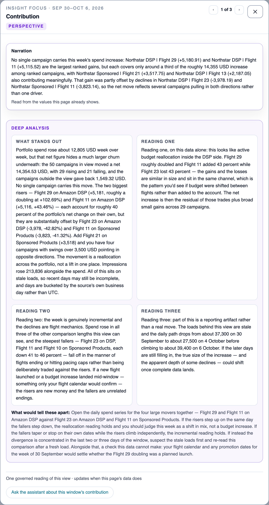
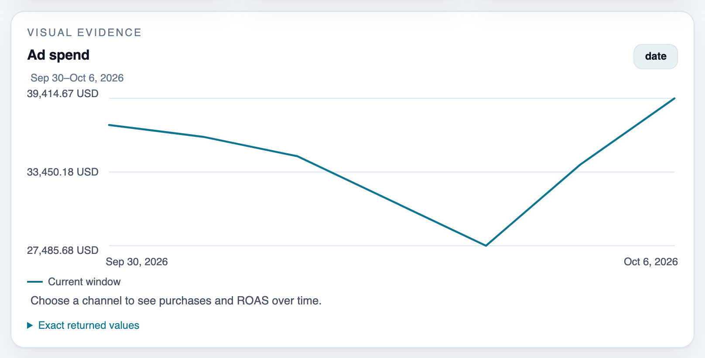

# Campaigns

Find the Amazon Ads campaigns to scale, hold or cut, with the reasons behind each change one click away.

One of the [Adlytics AI solutions](../../../README.md#solutions). It deploys with the full sample, which is sample code and not production-ready: read [Cost](../../../README.md#cost) and [Security considerations](../../../README.md#security-considerations) first.

## Who it's for

| Reader | Question | Decision |
|---|---|---|
| Media buyer, at an agency or in-house | Which campaigns should get more or less? | Scale, hold or cut campaigns, in Amazon Ads |
| Brand or category manager | Which campaigns drove this week's change in spend or return? | What to ask the media buyer to change |

Every persona and view is listed in [who it is for](../../business-context.md#who-it-is-for).

## What you see

The screenshots come from a development deployment with synthetic data, in the light theme, captured in October 2026. Campaign names and figures are fictional. To regenerate them, see [capturing screenshots](../../../validation/README.md#regenerating-readme-screenshots).

![Campaigns page under the Performance hub, with its question Which campaigns should get more or less?, for all channels with 1 day, 7 days, 14 days and 30 days windows and a note that the data runs through Oct 6, 2026, an answer sentence saying 60 campaigns spent 240,337.56 USD, up 5.6%, ad spend and impressions tiles with prior values and changes, a line asking to pick a channel to see sales and return, three insight cards and the top of the daily ad spend chart, with the assistant docked on the right](../../images/campaign-portfolio.png)

**Portfolio.** 60 campaigns spent 240,337.56 USD in the week, up 5.6%. Under All channels the page shows only what can be totalled, spend and impressions, and asks for a channel before it shows sales and return, because one purchase can be credited to more than one channel. Only published windows can be chosen ([temporal control](../../ui/temporal-control-contract.md)). See [campaign portfolio](../../ui/campaign-portfolio/README.md).

**Campaign detail.** One campaign for the same window, with eight tiles against the prior window. Cost per click and per thousand impressions tell a campaign that got more expensive from one that stopped converting. A card with nothing worth saying reads "Nothing noteworthy" ([insight card states](../../ui/insight-presentation-contract.md#2-the-five-designed-card-states)), and ‹ › steps through the campaigns in the order you opened it from, here by ad spend.

### Close-ups

**Campaigns table.** Every campaign, ranked by the column you choose, so a media buyer can sort by return to find the ones to fix; "Find a campaign" searches every channel. The Late data note warns that recent days may be incomplete. Here it repeats one sentence for each stale load, a known copy issue ("Read the staleness note above the Campaigns table at a glance" in [Known limits](../../../README.md#known-limits)).

**Opening a tile explains the change.** The drivers are the largest changes among the 50 campaigns with the most ad spend, of 60, with what the rest contributed. The deep analysis offers three readings and names the evidence that would tell them apart. See [metric focus](../../ui/metric-focus-contract.md#2-composition).

**Opening an insight card shows the full reading**, so a team can check the reasoning before it acts. The text reads only figures the page already shows, or values worked from them, such as a difference; here it also notes that the figures sit on stale loads. See [insight focus dialog](../../ui/insight-presentation-contract.md#3-clickable-cards-and-the-insight-focus-dialog).

**Trend chart.** Daily spend plotted from zero, with the exact values one click away for anyone who needs to cite them.

## What it answers, and what it won't

| Ask it | Where |
|---|---|
| Which campaigns changed spend most this week? | Portfolio insight cards and the metric focus drivers |
| Which Sponsored Products campaigns have the highest attributed return? | Pick the channel, then sort the table by attributed ROAS |
| Did this campaign get more expensive, or stop converting? | Campaign detail: cost per click and per thousand impressions beside purchases |
| How is spend split across campaigns? | Insight cards, and the assistant on this page |

What it won't do:

- Claim retail impact, cause, incremental lift, or a return per campaign with each sale counted once. Returns here are Amazon-attributed, per channel ([campaign portfolio](../../ui/campaign-portfolio/README.md)).
- Total sales or return across channels; pick one channel first ([ADR-127](../../decisions/adr-127-serve-the-campaigns-channel-filter-from-render-only-siblings-of-one-bake.md)).
- Filter by brand. Use the campaign name filter instead.
- Rows in [Known limits](../../../README.md#known-limits): "Read the staleness note above the Campaigns table at a glance", "Ask chat for Amazon DSP cost per click" (the page shows it) and "Filter by brand…". Very large estates: [Sizing for large catalogs](../../../README.md#sizing-for-large-catalogs).

## Data it uses

| Source | What it supplies | Grain and windows | Freshness |
|---|---|---|---|
| [Amazon Marketing Cloud](../../sources/amc.md) | Per campaign: spend, impressions, clicks, Amazon-attributed purchases and sales, for Amazon DSP and sponsored ads | Daily per campaign, served as 1, 7, 14 and 30 days, each against the prior window | AMC data lands about 48 hours late and keeps 13 months; attributed sales can be restated for up to 30 days; pages refresh when your pipeline lands a delivery |

No Vendor Central data is used, so this page fills in a customer deployment today.

## How it works

**Call-flow diagram — how the Campaigns page gets its figures and insight text.**

![Call-flow diagram: how the Campaigns page gets its figures and insight text, from your data to your browser. Your AMC pipeline, which you run from another AWS account, lands query results in the data lake, where they are checked against the data contracts. Each new version starts a page bake on AWS Lambda and Amazon Athena that computes every campaign for each window and channel and stores the finished pages. The sign-in and page API, on Amazon CloudFront, AWS WAF, Amazon Cognito and Lambda, serves the current page to the Campaigns portfolio, table and campaign detail in your browser. For insight cards, the API gives an Amazon Bedrock model the page's own figures and gets back insight text, kept per page revision; the model follows a prompt version that is active only after its calibration passes. Customer deployments refresh one page at a time; only the dev environment refreshes every affected page as one set.](diagrams/how-it-works.svg)

> **Takeaway.** Figures come from the bake; the AI model only writes the insight text around them, from a prompt that passed calibration.

- Your pipeline lands AMC query results, and the [platform](../platform/README.md) checks and publishes each delivery. Each new version bakes the page for every window and channel; customer deployments refresh one page at a time, and only the dev environment refreshes affected pages as one set.
- The bake covers the whole estate: the table is stored as ranked segments for each sortable column, so a large account pages through every campaign ([ADR-071](../../decisions/adr-071-reach-the-full-campaign-estate-through-baked-ordered-segments.md), [ADR-145](../../decisions/adr-145-serve-ten-thousand-campaigns-with-a-sharded-roster-and-streamed-writes.md)).
- Insight cards are filled by direct Amazon Bedrock calls from the page's own figures, kept per page revision ([ADR-068](../../decisions/adr-068-fill-declared-insight-slots-with-direct-structured-model-calls.md), [ADR-076](../../decisions/adr-076-tier-insight-narration-across-card-and-deep-dive-models.md)). A prompt version is used only after it passes calibration ([ADR-069](../../decisions/adr-069-version-insight-prompts-in-a-calibration-gated-registry.md)).
- A ratio over zero, such as return with no spend, is served as absent rather than as a number ([ADR-087](../../decisions/adr-087-serve-a-ratio-over-a-zero-denominator-as-typed-absent.md)).

## Deploy it

- It deploys with the full solution; there is no separate deploy. Follow the hub's [Quickstart](../../../README.md#quickstart) and [Deploy](../../../README.md#deploy), which use `make deploy-all`.
- The page fills once your AMC deliveries land; [Load your data](../../../README.md#load-your-data) says how.
- For more campaigns than the default bake memory covers, follow [Sizing for large catalogs](../../../README.md#sizing-for-large-catalogs).

## Adapt it

| To change | Edit | Then run |
|---|---|---|
| The page's tiles, table columns or windows | Page `campaigns` in [`presentation/pages/v2/pages.yaml`](../../../presentation/pages/v2/pages.yaml) | The "page or preset view" row of [Extend it](../../../README.md#extend-it) |
| Insight cards and their prompts | [`contracts/insights/`](../../../contracts/insights/), [`contracts/prompts/insights/`](../../../contracts/prompts/insights/) | The "insight narration" row; activate the new version in [Prompt administration](../../ui/prompt-administration/README.md) |
| A metric | [`contracts/shared/metric-dictionary.yaml`](../../../contracts/shared/metric-dictionary.yaml) | The "metric" row |

## Learn more

- Page designs: [campaign portfolio](../../ui/campaign-portfolio/README.md) and its [low-level design](../../ui/campaign-portfolio/low-level-design.md), [metric focus](../../ui/metric-focus-contract.md), [insight presentation](../../ui/insight-presentation-contract.md), [visual narration](../../ui/workspace-assistant.md#5-page-owned-visual-narration).
- Decisions: ADR-068, ADR-069, ADR-071, ADR-076, ADR-087, ADR-127 and ADR-145, linked above.
- Related solutions: [Performance](../performance/README.md), [Analytics assistant](../analytics-assistant/README.md), [Platform](../platform/README.md).
