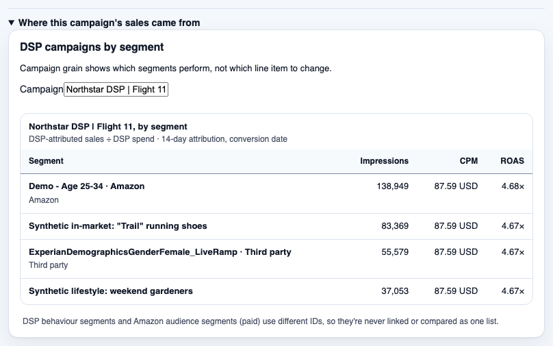

# Reach and audiences

See whether Amazon DSP reaches shoppers your sponsored ads miss, where more ads stop paying, and which audiences your buyers belong to.

One of the [Adlytics AI solutions](../../../README.md#solutions). It deploys with the full sample, which is sample code and not production-ready: read [Cost](../../../README.md#cost) and [Security considerations](../../../README.md#security-considerations) first.

## Who it's for

| Reader | Question | Decision |
|---|---|---|
| Media buyer, at an agency or in-house | Does DSP reach shoppers sponsored ads miss, and when do more ads stop paying? | DSP's role in the plan, and its frequency cap |
| Media buyer | Who buys, compared with who we reach? | Which audience to build in Amazon DSP |

Every persona and view is listed in [who it is for](../../business-context.md#who-it-is-for).

## What you see

The screenshots come from a development deployment with synthetic data, in the light theme, captured in October 2026. Campaigns and figures are fictional; audience segment names are synthetic or follow their providers' own naming. To regenerate them, see [capturing screenshots](../../../validation/README.md#regenerating-readme-screenshots).

**Reach and funnel.** Amazon DSP reached 438,444 shoppers in September 2026 that the sponsored ads didn't, 30.46% of shoppers reached. A cell with too few shoppers reads "Not available" rather than a number AMC withheld. The quarter reads "Not available yet" because the synthetic data has no spend for 1–15 July. See [reach and funnel](../../ui/reach-and-funnel/README.md).

**Audiences.** Shoppers in one synthetic in-market segment are 35.0% of buyers but 20.0% of shoppers reached, so they are 1.75× as common among buyers. That is a candidate audience to build in your own tools; Adlytics doesn't create or activate audiences. See [audiences](../../ui/audiences/README.md).

### Close-ups

**Frequency.** The share who bought rises from 2.00% at 1 ad to 5.30% at 10 or more, while sales per ad dollar fall from 11.25× to 2.13×, which helps a media buyer set a frequency cap. The notice says this shows association, not cause. Return per channel reads "Not available per channel", because one purchase can follow ads on several channels.

**DSP campaigns by segment.** For one DSP campaign, impressions, CPM and return per segment, with its provider where it has one. The synthetic data is flat here: CPM is 87.59 USD on every segment and return is 4.67× to 4.68×.

## What it answers, and what it won't

| Ask it | Where |
|---|---|
| How many shoppers did DSP reach that sponsored ads didn't? | Reach and funnel, overlap |
| Do shoppers who saw both kinds of ads search and buy more? | Reach and funnel, full funnel by exposure group |
| At what number of ads does the return fall off? | Reach and funnel, frequency |
| Which audience segments over-index among my buyers? | Audiences, segment profile |
| How did one DSP campaign perform per segment? | Audiences, DSP campaigns by segment |

What it won't do:

- Claim cause. Exposure groups aren't random, so every funnel and frequency figure carries "This shows association, not cause" ([ADR-102](../../decisions/adr-102-flag-association-only-metrics-and-require-their-caveat.md)).
- Add segment figures up. One shopper can belong to many segments, so shares never total 100% ([ADR-103](../../decisions/adr-103-model-audience-segments-as-a-source-namespaced-overlapping-dimension.md)).
- Describe an individual shopper. Shopper IDs never leave AMC, and a withheld cell stays withheld ([ADR-035](../../decisions/adr-035-suppression-is-a-quantity-not-a-flag.md)).
- Show Amazon audience segments without the AMC Paid Features subscription; that profile reads "Available with the paid feature" ([ADR-107](../../decisions/adr-107-derive-paid-feature-availability-from-delivery-evidence.md)).
- Rows in [Known limits](../../../README.md#known-limits): "See AMC history older than 13 months…", "See Audiences when a redelivered bake outruns the Baker's run…", "Ask chat for reach by channel last quarter" and "Filter by brand, or use Audiences and Retention outside the US". Large DSP estates: [Sizing for large catalogs](../../../README.md#sizing-for-large-catalogs).

## Data it uses

| Source | What it supplies | Grain and windows | Freshness |
|---|---|---|---|
| [Amazon Marketing Cloud](../../sources/amc.md) | Distinct shoppers by exposure group, purchase and search rates, purchases by number of ads seen, DSP delivery by segment | One complete period: the latest week, month or quarter on Reach and funnel; the latest month on Audiences, for one marketplace | AMC data lands about 48 hours late and keeps 13 months; a period shows once it has fully landed |
| AMC Paid Features (optional) | Amazon audience segment membership of buyers and reached shoppers | The latest complete month | As above; without it, only the "DSP-exposed buyers only" profile fills |

AMC drops rows that describe too few shoppers ([aggregation thresholds](../../sources/amc.md#5-constraints--the-aggregation-thresholds)). Shopper counts are a fact of their own and are never summed across days ([ADR-099](../../decisions/adr-099-treat-distinct-shopper-counts-as-a-new-kind-of-fact.md)).

## How it works

**Call-flow diagram — how Reach and funnel and Audiences get their figures.**

![Call-flow diagram: how Reach and funnel and Audiences get their figures, from your AMC instance to your browser. Your AMC instance returns only aggregated rows and hides groups with too few shoppers. Your AMC pipeline lands those shopper counts, never shopper IDs, in the data lake, where they are checked against the data contracts. Each new version starts a page bake on AWS Lambda and Amazon Athena that computes each page for complete weeks, months or quarters and stores the finished pages. The sign-in and page API, on Amazon CloudFront, AWS WAF, Amazon Cognito and Lambda, serves the current page to Reach and funnel and to Audiences in your browser. Customer deployments refresh one page at a time; only the dev environment refreshes every affected page as one set.](diagrams/how-it-works.svg)

> **Takeaway.** Only aggregated, privacy-thresholded shopper counts leave AMC, and each page is computed for a complete period before anyone sees it.

- Your pipeline runs the declared AMC SQL and lands the results. The [platform](../platform/README.md) checks and publishes each delivery, and each new version bakes these pages. Customer deployments refresh one page at a time; only the dev environment refreshes affected pages as one set.
- Each shopper is placed in one group, DSP only, sponsored ads only or both, from the ads seen within 14 days of their first ad in the period ([ADR-101](../../decisions/adr-101-model-shopper-groupings-as-disjoint-axes-with-one-window-per-shopper.md)).
- Audiences shows each segment's share of buyers beside its share of reached shoppers, and fetches the per-campaign segment table one campaign at a time ([ADR-141](../../decisions/adr-141-reach-every-audiences-campaign-through-grouped-reads-and-per-campaign-pages.md)).
- Whether the quarter window is published or retired is decided on measured data ([ADR-146](../../decisions/adr-146-publish-the-reach-quarter-or-retire-it-on-measured-partitions.md)).

## Deploy it

- It deploys with the full solution; there is no separate deploy. Follow the hub's [Quickstart](../../../README.md#quickstart) and [Deploy](../../../README.md#deploy), which use `make deploy-all`.
- The pages fill once your AMC deliveries for a complete period land; [Load your data](../../../README.md#load-your-data) says how.
- Amazon audience segments need an AMC Paid Features subscription ([what it answers](../../../README.md#what-it-answers-and-what-it-refuses)).

## Adapt it

| To change | Edit | Then run |
|---|---|---|
| Either page's sections or windows | Pages `reach` and `audiences` in [`presentation/pages/v2/pages.yaml`](../../../presentation/pages/v2/pages.yaml) | The "page or preset view" row of [Extend it](../../../README.md#extend-it) |
| The AMC SQL behind a figure | [`contracts/amc/`](../../../contracts/amc/) | The "AMC query or Vendor Central report" row |
| A metric | [`contracts/shared/metric-dictionary.yaml`](../../../contracts/shared/metric-dictionary.yaml) | The "metric" row |

## Learn more

- Page designs: [reach and funnel](../../ui/reach-and-funnel/README.md) and its [low-level design](../../ui/reach-and-funnel/low-level-design.md), [audiences](../../ui/audiences/README.md).
- Concepts: [business outcome measurement](../../concepts/business-outcome-measurement.md), [answerable questions](../../answerable-questions.md).
- Related solutions: [New customers and retention](../new-customers-and-retention/README.md), [Campaigns](../campaigns/README.md), [Platform](../platform/README.md).
