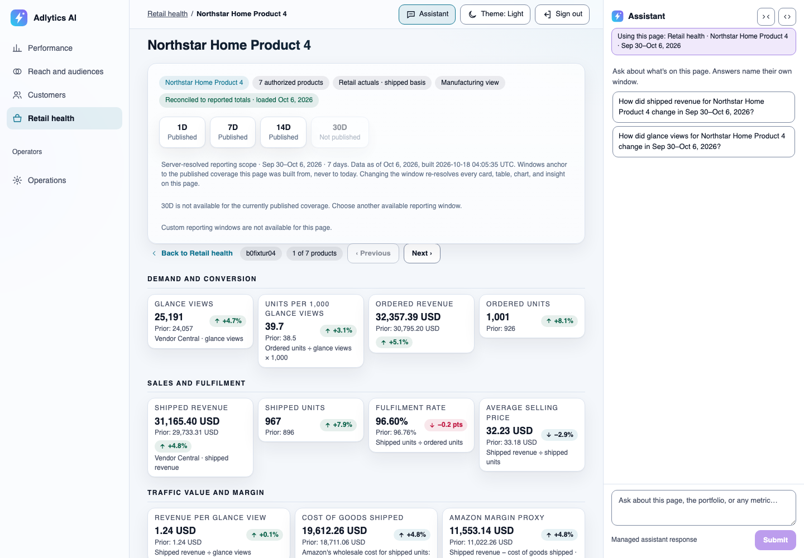

# Retail health

See whether your products are selling on Amazon, where sales leak between page view, order, shipment and return, and which products your ads lean on, from Vendor Central figures reconciled to Vendor Central's own totals.

One of the [Adlytics AI solutions](../../../README.md#solutions). It deploys with the full sample, which is sample code and not production-ready: read [Cost](../../../README.md#cost) and [Security considerations](../../../README.md#security-considerations) first. It runs on the shared [platform](../platform/README.md) and covers two tabs: Retail health, with a page per product, and Products and ads.

> **A customer deployment can't load Vendor Central reports yet.** Producer onboarding accepts only the AMC query packs, so outside the dev environment these pages stay on their designed empty state. See **Load Vendor Central reports** in the hub's [Known limits](../../../README.md#known-limits).

## Who it's for

| Page | Reader | Question | Decision it leads to |
|---|---|---|---|
| Retail health › Retail health (`/retail-health/`) | Brand or category manager | Are products selling, and where do sales leak? | What to raise with Amazon about shipping or returns |
| Retail health › Products and ads (`/products-and-ads/`) | Brand or category manager | Which products do my ads lean on? | Which products to advertise, feature or fix |

Each persona and view is described in [who it is for](../../business-context.md#who-it-is-for). The product is read-only: every decision is made in your own Amazon tools.

## What you see

These screenshots come from a development deployment with synthetic data, in the light theme, captured in October 2026. Products and figures are fictional. The synthetic data spends more on ads than it ships, so ad spend reads above 100% of shipped sales and a product's ad-credited sales can exceed its shipped sales. To regenerate them, see [regenerating README screenshots](../../../validation/README.md#regenerating-readme-screenshots).

**Whether products are selling, and where sales leak.** The answer says Amazon shipped 151,582.76 USD, up 4.0% on the prior week, and a chip says the product rows match the Vendor Central totals loaded Oct 6, 2026. Where sales leak shows fulfilment rate, units per 1,000 product page views and return rate against the prior week. Ads beside retail puts the week's ad spend beside shipped sales with no return figure; here ad spend is 158.6% of shipped sales. The 30-day window reads "Not available yet". See [Retail health](../../ui/retail-health/README.md) and [Ads beside retail](../../ui/retail-health/low-level-design.md#ads-beside-retail-ui-refresh-25-od-ux-13-added-2026-10-22).

**Which product moved a figure.** Selecting a product opens its own page for the same window, here 1 of 7 products, with Previous and Next. Its tiles cover demand and conversion, sales and fulfilment, and traffic value and margin, each against the prior week. See [ADR-125](../../decisions/adr-125-serve-retail-product-detail-as-a-baked-child-of-retail-health.md).

![Products and ads tab under Retail health for Sep 30 to Oct 6, 2026: the same window control, an answer sentence saying 7 products shipped and Northstar Home Product 4 shipped most, 31,165.40 USD, up 4.8%, Amazon DSP, Sponsored Products and Sponsored Brands channel buttons, a note that the two systems never add up or divide into each other, and a table of each product's shipped sales and change, product page views, units per 1,000 page views, Amazon DSP ad-credited sales and purchases, and First-time purchases reading Not measured yet, with the assistant docked on the right](../../images/products-and-ads.png)

**Which products the ads lean on.** Each product's Vendor Central shipped sales and page views sit beside what one channel, here Amazon DSP, credits to it, under a note that the two systems never add up or divide into each other. In the synthetic data the top product's ad-credited sales, 64,689.69 USD, exceed its shipped sales of 31,165.40 USD. First-time purchases read "Not measured yet". See [Products and ads](../../ui/products-and-ads/README.md).

## What it answers, and what it won't

Example questions:

- What did Amazon ship, and how did it change on the prior window?
- Where do sales leak: fulfilment rate, units per 1,000 product page views, or return rate?
- Which products added most shipped revenue, and how did one product's page views change?
- Which products does each ad channel credit with the most sales, beside what they shipped?

What it won't do:

- **Credit retail sales to a campaign, or give a return on ad spend per product.** Vendor Central has no campaign dimension and ad spend isn't recorded per product, so the two systems sit side by side and are never added or divided ([answerable questions](../../answerable-questions.md)).
- **Count first-time buyers per product.** That column reads "Not measured yet" until a governed per-product metric exists ([What's coming next](../../../README.md#whats-coming-next)).
- **List every product.** Counts, sums and movers cover the whole catalog, but only the top 50 products by shipped revenue get a row and a product page ([ADR-152](../../decisions/adr-152-read-page-sized-answers-in-sql-with-no-arbitrary-row-ceiling.md)).

Known limits that affect these pages, in the hub's [Known limits](../../../README.md#known-limits): **Load Vendor Central reports**; **Load one delivery of more than 20,000 rows, or one table unit of more than 50,000**; **See a list row or detail page past the top 50 products on Retail health**; **Read the staleness note above the Campaigns table at a glance**, which also covers Retail health's products note; and **Filter by brand, or use Audiences and Retention outside the US**.

## Data it uses

| Data | What it gives these pages | Grain |
|---|---|---|
| Vendor Central sales report, by product and as Vendor Central's reported total | Shipped and ordered revenue and units, cost of goods shipped and customer returns, plus the total the rows are checked against | Day and product (ASIN) |
| Vendor Central traffic report, by product and as the reported total | Product page views | Day and product |
| Vendor Central product hierarchy | Product names and labels | Product |
| Amazon Marketing Cloud ad-attributed purchases and revenue | Ad-credited sales and purchases per product and channel, on Products and ads | Day, product and channel; 14-day attribution by conversion date |
| The Scorecard's served 7-day page | Ad spend and ad spend as a share of shipped sales, in Ads beside retail | 7 days |

The Vendor Central contracts are in [`contracts/vendor-central/`](../../../contracts/vendor-central/). Vendor Central makes a weekly period available about 48 hours after it closes and a daily period about 72 hours after. Its revenue is net of returns, so recent history changes as returns arrive ([Vendor Central freshness and restatement](../../sources/vendor-central.md#7-freshness-and-restatement)). Pages change only when a new delivery is published.

## How it works

**Call-flow diagram — how Retail health and Products and ads get their figures, in a customer deployment.**

![Call-flow diagram: how Retail health and Products and ads get their figures, in a customer deployment. Your extraction pipeline, in a second AWS account, fetches Vendor Central sales, traffic, product and reported-total reports and runs the declared Amazon Marketing Cloud queries, then lands each delivery in the S3 landing bucket, where it is checked against its data contract and published to the governed data lake as an immutable version. A dotted box and arrow mark the Vendor Central path, which isn't built yet: a customer deployment can't land Vendor Central reports, and the dev environment holds synthetic ones. A new published version starts the page bake on AWS Lambda and Amazon Athena, which compares the product rows with Vendor Central's reported totals and writes Retail health, a page per product and each product's ad credit to the page store, with figures or a designed absence. The Presentation API serves each page's latest good version to the signed-in user. Amazon Bedrock insight narration, held in the insight cache and attached to the served page by its revision, explains the figures on the Demand, Returns pressure and Ordered vs shipped cards; the Largest movers card is a fixed rule baked with the page, with no model. Customer deployments bake one page at a time; building all affected pages as one set runs in the dev environment only.](diagrams/retail-health.svg)

> **Takeaway.** Retail figures are computed once by tested code and checked against Vendor Central's own totals; ad credit sits beside them and is never added to them.

- **Reconciliation.** The data lake keeps Vendor Central's reported totals apart from the product rows, so the page can show that the rows add up to Vendor Central's own total, or show a dated discrepancy when they don't ([Retail health](../../ui/retail-health/README.md)).
- **Model-written text.** When you open a tile, its "Why this moved" interpretation and deep analysis are written by the model from the drivers the server computed, under the `retail-metric-focus` prompt ([metric focus](../../ui/metric-focus-contract.md#2-composition)). The drivers themselves are computed by code.
- **One bake, three views.** The same bake writes Retail health, a page per product and each product's ad credit, so Products and ads loads with one request and never computes at serve time ([ADR-125](../../decisions/adr-125-serve-retail-product-detail-as-a-baked-child-of-retail-health.md), [ADR-151](../../decisions/adr-151-compose-a-customer-tab-from-served-page-presentations.md)).
- **Landing.** Landing, the data lake and the secure edge are shared with every solution and described in the [platform](../platform/README.md). In the dev environment, synthetic Vendor Central deliveries fill these pages ([development seeding](../../concepts/dev-seeding.md)).
- **Refresh.** Customer deployments bake one page at a time, and a page that fails keeps its last good version; building every affected page as one set runs only in the dev environment ([preset artifact publisher](../../ui/preset-artifact-publisher.md#the-pipeline)).

## Deploy it

- **It deploys with the full solution.** There is no separate install: `make deploy-all` builds these pages with the rest. Follow the hub's [Quickstart](../../../README.md#quickstart) and [Deploy](../../../README.md#deploy).
- **Before the pages fill,** they need Vendor Central deliveries, which a customer deployment can't land yet (see the note at the top). Products and ads also needs AMC query-pack deliveries of ad-attributed purchases, and Ads beside retail needs the Scorecard's data ([Load your data](../../../README.md#load-your-data)).

## Adapt it

- **The pages.** The `retail-health` entry in [`presentation/pages/v2/pages.yaml`](../../../presentation/pages/v2/pages.yaml) declares the tab, its windows and its assistant starter questions; Products and ads is a composed route in [`presentation/navigation.yaml`](../../../presentation/navigation.yaml). Regenerate with the "A page or preset view" row of [Extend it](../../../README.md#extend-it).
- **The insight cards.** The `retail-*` contracts in [`contracts/insights/`](../../../contracts/insights/), with prompts in [`contracts/prompts/insights/`](../../../contracts/prompts/insights/); see the "Insight narration" row. The exception is [`retail-movers.yaml`](../../../contracts/insights/retail-movers.yaml), the Largest movers card, a fixed rule with no prompt.
- **The reports.** The contracts in [`contracts/vendor-central/`](../../../contracts/vendor-central/); see the "An AMC query or Vendor Central report" row.
- **The pattern.** Checking rows against the source's own reported totals, and showing two measurement systems side by side without joining them, carry over to any retail or marketplace source.

## Learn more

- Page designs: [Retail health](../../ui/retail-health/README.md) and its [low-level design](../../ui/retail-health/low-level-design.md), [Products and ads](../../ui/products-and-ads/README.md), [page absence copy](../../ui/page-absence-copy.md)
- Source facts: [Vendor Central](../../sources/vendor-central.md), [Amazon Marketing Cloud](../../sources/amc.md)
- Decisions: [ADR-020](../../decisions/adr-020-vendor-sources-split-by-capability.md), [ADR-004](../../decisions/adr-004-timezone-and-fx.md), [ADR-125](../../decisions/adr-125-serve-retail-product-detail-as-a-baked-child-of-retail-health.md), [ADR-151](../../decisions/adr-151-compose-a-customer-tab-from-served-page-presentations.md), [ADR-152](../../decisions/adr-152-read-page-sized-answers-in-sql-with-no-arbitrary-row-ceiling.md)
- The whole solution: [Adlytics AI](../../../README.md) and the [platform](../platform/README.md)
