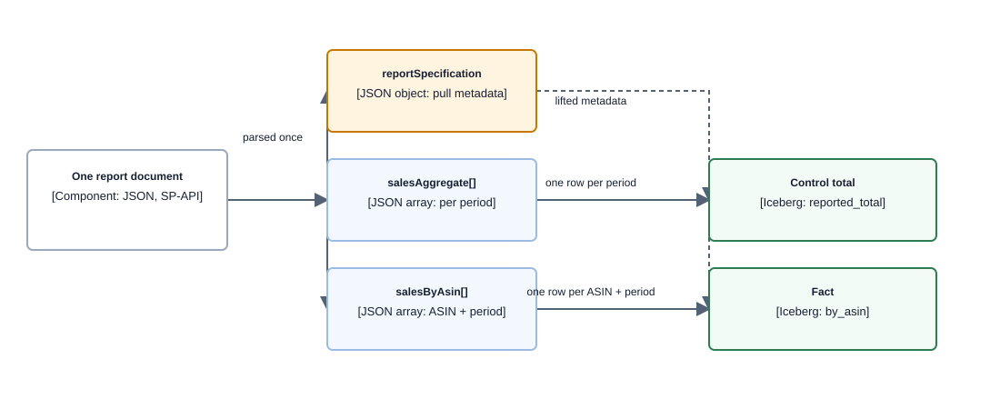
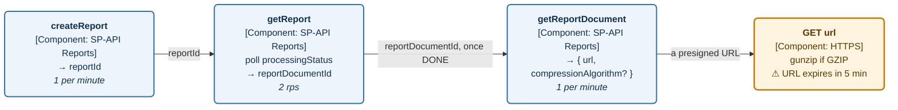

# Source — Vendor Central (Selling Partner API)

| | |
|---|---|
| **Level** | L2 — source reference |
| **Status** | Research complete for schema design; not validated against a live account |
| **Researched** | 2026-08-17 |
| **Owns** | every fact about Vendor Central and SP-API. No other doc in this repo restates these; they link here. |
| **Depended on by** | [data-layer](../capabilities/data-layer/README.md) · [architecture](../architecture.md) · the 2 vendor data contracts |

## 1. What this is

Vendor Central retail analytics, retrieved through the Selling Partner API Reports API. It is the source of **actual retail truth** — what shipped, what was ordered, what was returned, and how many people viewed a product page.

It is a fundamentally different measurement system from [AMC](amc.md), not a second opinion on the same facts. AMC is advertising-pipeline sourced with attribution windows; this is retail-pipeline sourced and net of returns. **They will never reconcile at any grain**, and the canonical model keeps them distinguishable via `measurement_basis` rather than trying to.

## 2. Provenance

Compiled by research sub-agents on 2026-08-17. `developer-docs.amazon.com` renders normally, with two caveats:

- Report attribute lists on the docs pages are collapsed accordions and render **truncated**. Exact field lists were taken from the official JSON Schemas in [`amzn/selling-partner-api-models`](https://github.com/amzn/selling-partner-api-models) under `schemas/reports/`, which the docs themselves link to. Those are authoritative.
- The vendor-reports FAQ page now **301-redirects to a broken host** and appears to have been consolidated away. Nothing FAQ-specific was retrievable.

**Confidence markers:** **[verified]** fetched and read · **[snippet]** search snippet only · **[unverified]** could not confirm.

Not independently re-verified by a human.

## 3. Available data

All eight vendor report types are current. All are **Vendor only**, role **Brand Analytics**, output **JSON**, and **request-only — they cannot be scheduled.** **[verified]**

| Report type | Status |
|---|---|
| `GET_VENDOR_SALES_REPORT` | current — **in scope** |
| `GET_VENDOR_TRAFFIC_REPORT` | current — **in scope** |
| `GET_VENDOR_INVENTORY_REPORT` | current |
| `GET_VENDOR_NET_PURE_PRODUCT_MARGIN_REPORT` | current |
| `GET_VENDOR_FORECASTING_REPORT` | current |
| `GET_VENDOR_REAL_TIME_SALES_REPORT` | current |
| `GET_VENDOR_REAL_TIME_TRAFFIC_REPORT` | current |
| `GET_VENDOR_REAL_TIME_INVENTORY_REPORT` | current |

**Removed** (deprecated 2022-03-31, removed 2022-06-27): `GET_VENDOR_DEMAND_FORECAST_REPORT`, `GET_VENDOR_INVENTORY_HEALTH_AND_PLANNING`, `GET_VENDOR_SALES_DIAGNOSTIC_REPORT`. **[verified]**

Also vendor-accessible: `GET_BRAND_ANALYTICS_MARKET_BASKET_REPORT`, `GET_BRAND_ANALYTICS_SEARCH_TERMS_REPORT`, `GET_BRAND_ANALYTICS_REPEAT_PURCHASE_REPORT`.

### Document shape — one report, two grains

The single most important structural fact. Every non-real-time vendor report contains **two sibling arrays at two different grains**, which must become **two curated tables**.

**Component diagram — SP-API report document decomposition; ingestion viewpoint, component depth.**



> **Takeaway.** `reportSpecification` must be stamped onto every row of both tables, because without it a `MANUFACTURING` pull and a `SOURCING` pull are indistinguishable and will double-count.

### `GET_VENDOR_SALES_REPORT` schema

From `schemas/reports/vendorSalesReport.json`. **[verified]**

```
reportSpecification
  reportType        enum [GET_VENDOR_SALES_REPORT]
  reportOptions     { distributorView, reportPeriod, sellingProgram }
  lastUpdatedDate   YYYY-MM-DD
  dataStartTime     (time component ignored)
  dataEndTime       (time component ignored)
  marketplaceIds    array

salesAggregate[]   required: startDate, endDate, shippedCogs, shippedRevenue, shippedUnits
salesByAsin[]      required: the same + asin

  customerReturns   integer   — populated only when sellingProgram is RETAIL or BUSINESS
  orderedRevenue    Amount    — populated only when distributorView is MANUFACTURING
  orderedUnits      integer   — populated only when distributorView is MANUFACTURING
  shippedCogs       Amount
  shippedRevenue    Amount
  shippedUnits      integer

Amount = { amount: number, currencyCode: string /* ISO 4217 */ }
```

Notes that affect the schema directly:

- **Money is a nested object**, not a scalar, and there are nine money-ish fields across the report family. **Decided in [ADR-021](../decisions/adr-021-money-column-shape.md): one `currency_code` per fact, not per field**, with a load-time assertion that every `Amount.currencyCode` in a row is equal. AMC carries one currency per table, so per-field columns there would fabricate structure Amazon does not have; the assertion is what keeps the shared column from being a silent assumption on this side.
- **`shippedCogs` semantics** (verified 2026-09-17 against `schemas/reports/vendorSalesReport.json`, both `SalesAggregate` and `SalesByAsin`): *"Revenue based on the cost of goods sold. Adjustments are made for returns."* **[verified]** That is: the value of the shipped units measured at Amazon's cost of goods — the price Amazon paid the vendor — net of returns, on the same returns-adjustment basis as `shippedRevenue`. From the vendor's side this is revenue received, not cost incurred. Consequently `shippedRevenue − shippedCogs` is **Amazon's** gross margin on the vendor's shipped units before Amazon's own costs, never the vendor's margin; any derived margin figure must be framed as Amazon's ("Amazon margin proxy"). This lifts the metric dictionary's stated precondition on deriving a margin metric from `cogs_shipped`.
- **No `marketplaceId` on the rows** — it lives on `reportSpecification`.
- Revenue fields are documented as *adjusted for returns*, i.e. **net of returns**, which is why they restate.
- `shippedRevenue / shippedUnits` = average sale price.
- **Absent fields:** no `parentAsin`, no SKU, no model number, no `netPPM` (separate report), no glance views (separate report).

### `GET_VENDOR_TRAFFIC_REPORT` schema

```
reportSpecification { reportType, reportOptions{reportPeriod}, lastUpdatedDate,
                      dataStartTime, dataEndTime, marketplaceIds }
trafficAggregate[]  required: startDate, endDate, glanceViews
trafficByAsin[]     required: startDate, endDate, asin, glanceViews
```

**`glanceViews` is the only metric** — customer views of the vendor's product detail pages. Only `reportPeriod` is configurable; **no `distributorView`, no `sellingProgram`.** **[verified]**

> **Consequence.** Because traffic has no `distributorView`, a `SOURCING` sales pull cannot be cleanly rate-ed against traffic. Conversion rate (`orderedUnits / glanceViews`) is only coherent under `MANUFACTURING`.

### `reportOptions` — the same report type yields different schemas

| Option | Values | Effect |
|---|---|---|
| `reportPeriod` | `DAY` \| `WEEK` \| `MONTH` \| `QUARTER` \| `YEAR` | sets the grain of both arrays |
| `distributorView` | `MANUFACTURING` \| `SOURCING` | `MANUFACTURING` = ASINs you manufacture regardless of who sourced them. `SOURCING` = only ASINs sourced directly from your vendor group. **`orderedRevenue`/`orderedUnits` are null under `SOURCING`** |
| `sellingProgram` | `RETAIL` \| `BUSINESS` \| `FRESH` | **`customerReturns` is null under `FRESH`** |

All three are required for the sales report. Inventory and forecasting accept only `RETAIL`/`FRESH`.

**`reportOptions` is part of the dataset identity, not a runtime flag.** It must be in the partition key and stamped on every row. Optionality is driven by option values, so the same report type produces genuinely different effective schemas across pulls.

**Date boundary rules are strict:** `dataStartTime`/`dataEndTime` must be valid first/last days of the `reportPeriod` — Sunday to Saturday for `WEEK`. Bad boundaries are not silently corrected.

### Other report schemas, for reference

- **`vendorInventoryReport`** — much richer than the docs page suggests: `procurableProductOutOfStockRate`, `uft`, `receiveFillRate`, `vendorConfirmationRate`, `netReceivedInventoryCost/Units`, `openPurchaseOrderUnits`, `averageVendorLeadTimeDays`, `sellThroughRate`, `unfilledCustomerOrderedUnits`, `sellableOnHandInventoryCost/Units`, `unsellableOnHandInventoryCost/Units`, `aged90PlusDaysSellableInventoryCost/Units`, `unhealthyInventoryCost/Units`. `InventoryByAsin` drops the three aggregate-only rate fields.
- **`vendorRealTimeSalesReport`** — `reportData[]`: `startTime`, `endTime`, `asin`, `orderedUnits`, `orderedRevenue`. ⚠️ **`orderedUnits` can be negative** — cancellations are booked at cancellation time.
- **`vendorForecastingReport`** — `forecastByAsin[]`: `forecastGenerationDate`, `asin`, `startDate`, `endDate`, `meanForecastUnits`, `p70/p80/p90ForecastUnits`. ⚠️ **Only the most recent forecast is available — no history.** If forecast-accuracy tracking is ever wanted, we must snapshot it ourselves keyed on `forecastGenerationDate`. Nobody can supply it retroactively. One marketplace per request or it errors.
- **`vendorNetPureProductMarginReport`** — aggregate + by-ASIN, single metric `netPureProductMargin`.

## 4. Identifiers

| Identifier | Detail |
|---|---|
| `asin` | A bare 10-character string, described only as "the Amazon Standard Identification Number" |
| **`parentAsin`** | **Absent.** No `asinGranularity` option either (the *seller* report has `PARENT\|CHILD\|SKU`; vendors get no equivalent) |
| SKU / model number | **Absent** — lives in the procurement APIs (orders, shipments, invoices), not these reports |
| `marketplaceId` | On `reportSpecification`, not on rows. **One marketplace per report** |

⚠️ **The docs never state whether vendor report ASINs are parent or child.** **[unverified]** This remains true of the Reports API surface and is unlikely to be resolved from documentation.

**It is no longer a blocker.** [ADR-020](../decisions/adr-020-vendor-sources-split-by-capability.md) sources the hierarchy from Data Kiosk, which states it explicitly, so nothing has to be inferred from the Reports API `asin`. The dimension is still slowly-changing, because variation relationships change. What survives is a narrower residual: if the two vendor surfaces disagree, the mismatch appears as an unresolvable ASIN in `dim_product` — a loud failure rather than a silent one.

### Reconciling to AMC

| Issue | Detail |
|---|---|
| **Only `MANUFACTURING` reconciles** | AMC's `amazon_retail_purchases` is documented to match *Vendor Central → Retail Analytics → Sales → Distributor View = MANUFACTURING*. `SOURCING` pulls will not tie out and should be treated as a separate, non-reconcilable fact table |
| **Brand halo contamination** | AMC's `tracked_asin` includes same-brand products that were not advertised. Joining it to vendor `asin` conflates advertised and halo performance, in the direction that flatters ROAS |
| **`tracked_item` is polymorphic** | never join it to `asin` without filtering to purchase events first |
| **Marketplace cardinality differs** | one vendor report = one marketplace; AMC rows are inherently multi-marketplace, and AMC's `marketplace_id` is `INTERNAL` so only `marketplace_name` is usable |
| **Selling program has no clean AMC equivalent** | AMC has `is_business_flag`, `is_amazon_business`, `purchase_program_name`, `purchase_retail_program` — related, but no documented 1:1 mapping to `sellingProgram` |
| **No campaign dimension at all** | see the join-grain limit in §9 |

## 5. Constraints

### Lookback and span — the sharpest constraint in the whole surface

Identical for sales, traffic, inventory and net PPM. **[verified]**

| `reportPeriod` | Max lookback from today | Max span per request |
|---|---|---|
| `DAY` | 1,460 days (~4 years) | **15 days** |
| `WEEK` | **7 weeks** | 7 weeks |
| `MONTH` | 36 months | 15 months |
| `QUARTER` | 8 quarters | 4 quarters |
| `YEAR` | 3 years | 2 years |

> **The `WEEK` lookback of 7 weeks is the constraint that shapes the load design.** You get ~4 years of daily history but only ~7 weeks of weekly history. **Weekly history cannot be backfilled** — store `DAY` as the source of truth and derive weeks ourselves. Same logic for `MONTH` at 36 months.

Real-time reports: 30-day lookback; max span 7 days (inventory) or 14 days (sales, traffic).

### Rate limits

Defaults from `reports_2021-06-30.json`. The `x-amzn-RateLimit-Limit` response header reports actuals, which can be higher. **[verified]**

| Operation | Rate (rps) | Burst |
|---|---|---|
| **`createReport`** | **0.0167 (1 per 60s)** | 15 |
| `getReport` | 2 | 15 |
| **`getReportDocument`** | **0.0167 (1 per 60s)** | 15 |
| `getReports` | 0.0222 | 10 |
| `cancelReport` | 0.0222 | 10 |
| `createReportSchedule` / `getReportSchedule(s)` / `cancelReportSchedule` | 0.0222 | 10 |

> **`createReport` at one per minute is the binding constraint, and `getReportDocument` shares it.** Every distinct `(reportType, reportPeriod, distributorView, sellingProgram, marketplace, window)` combination is a separate call. Sales alone is 2 distributor views × 3 selling programs = **6 calls per window per marketplace**, against a 15-day max span for daily grain. Multiply by marketplaces and the burst of 15 is consumed quickly. Treat `reportOptions` as dataset identity and budget calls deliberately.

**Vendor reports cannot be scheduled** — `createReportSchedule` does not apply to them. We own the scheduler.

## 6. Time, money, currency

**Timezone: PST, always.** Repeated verbatim on every Vendor Retail Analytics report page — the universal default time zone is Pacific Standard Time **irrespective of the vendor's location or the store's local time zone**. **[verified]**

⚠️ The docs say **PST**, not "US/Pacific", and are **silent on daylight saving**. We must decide and document whether we interpret it as fixed UTC−8 or as `America/Los_Angeles`. `startDate`/`endDate` are bare dates with no offset; `dataStartTime`/`dataEndTime` accept ISO 8601 but the time component is ignored. Real-time reports use hourly `startTime`/`endTime`, also PST.

**Currency:** ISO 4217, carried **inside each `Amount`** as `currencyCode` — per value, not per report. A schema change could in principle introduce mixed currencies in one document. Data Kiosk instead takes a single `currencyCode` query argument.

Whether the values within one row can differ is **[unverified]** — the docs neither promise nor forbid it, and one report is one marketplace so they should always agree. [ADR-021](../decisions/adr-021-money-column-shape.md) asserts the agreement on every load rather than assuming it, so this stays an open question that production answers.

**No FX conversion is provided.** Multi-marketplace rollups need our own rate table with an explicit as-of policy.

## 7. Freshness and restatement

### Availability SLA

| Report | Available |
|---|---|
| Weekly periods (Saturday-ending) | end of day **Monday** — 48h after period close |
| Non-Saturday **daily** periods | **72h** after period close |
| Inventory | 72h after period close |
| Forecasting | within 72h after week end |
| Real-time inventory & sales | **5 minutes** after the hour closes |
| Real-time traffic | 65–115 minutes |

⚠️ **Requesting an unavailable period does not return partial data — it returns `processingStatus: FATAL`.** The orchestrator must treat `FATAL` as *retry later*, not *permanent failure*. **[verified]**

### Restatement

There is no documented restatement *window*, but restatement itself is unambiguous:

1. **`lastUpdatedDate` was added to all five non-real-time vendor reports in April 2024.** That field exists precisely because report contents change after first publication. **Capture it — it is the restatement watermark.** **[verified]**
2. Revenue fields are net of returns, and returns arrive later than shipments, so historical periods move.
3. `customerReturns` is itself a lagging metric.
4. AMC's own docs corroborate: retail data is *sourced from retail data pipeline including restatements*.

**Consequence:** loads must be `MERGE`/partition-overwrite keyed on `(report_type, report_options_hash, marketplace, period_start, period_end)`, with `retrieved_at` and `last_updated_date` tracked separately from the period bounds. A re-pull must never append, and a monotonicity check on `lastUpdatedDate` is required or an out-of-order delivery silently reverts corrected data.

**`null` has three distinct meanings** and must not be collapsed: option-dependent absence (`SOURCING`/`FRESH`), genuinely-not-yet-available (partial period — Data Kiosk documents nulls for days requested within one to two business days), and zero. Encode which with an explicit status column.

## 8. Access mechanics

**Call-flow diagram — SP-API report retrieval sequence; report-access viewpoint, interaction depth.**



> **Takeaway.** Four calls per dataset, two of them rate-limited to one per minute, and the final URL dies after five minutes — so fetch on receipt rather than queueing.

Details **[verified]**:

- **No decryption step.** Reports v2021-06-30 dropped the encryption/InitVec scheme of older versions. Only `compressionAlgorithm` remains.
- `compressionAlgorithm` enum is `GZIP` only and is **optional** — if absent, download directly. Handle both.
- Optional query param **`enableContentEncodingUrlHeader=true`** sets `Content-Encoding: gzip` on the presigned URL so HTTP clients auto-decompress.
- `processingStatus` ∈ `IN_QUEUE`, `IN_PROGRESS`, `DONE`, `CANCELLED`, **`FATAL`**.
- **Generated reports are retained 90 days**; undownloaded reports must be regenerated.
- Amazon's guidance: *encryption at rest must always be maintained; unencrypted report content must never be stored on disk, even temporarily.* Relevant to the raw-zone configuration.
- ⚠️ Amazon explicitly warns that **new fields and field values are added over time**, and that parsers must handle such updates. Use additive-tolerant schema-on-read; strict reject-on-unknown will break on Amazon's schedule.

## 9. What Vendor Central cannot supply

| Concept | Where it must come from |
|---|---|
| **Any advertising dimension** | [AMC](amc.md) — there is no campaign, ad group, or creative in these reports |
| **Parent ASIN** | **Data Kiosk** — [ADR-020](../decisions/adr-020-vendor-sources-split-by-capability.md). Not from these reports |
| SKU / vendor model number | SP-API procurement APIs |
| Forecast history | nowhere — only the latest generation exists; snapshot it ourselves |
| Ad-attributed conversions | AMC, and they are a different measurement basis |

> **The join-grain limit.** Vendor Central has **no campaign dimension at all**. AMC keys advertising on campaign and ASIN. So advertising and retail facts can only be joined at **ASIN × date × marketplace**, and no finer. Actual retail sales can never be attributed to a campaign from these two sources. This is a hard constraint on the answerable question set and should be confirmed with whoever owns the product definition.

## 10. Open items

| Item | What would resolve it |
|---|---|
| ~~Reports API or Data Kiosk?~~ | **settled — both, split by capability**, [ADR-020](../decisions/adr-020-vendor-sources-split-by-capability.md). Facts from the Reports API, hierarchy from Data Kiosk. The remaining work belongs to the producer that operates extraction (outside this repository): one GraphQL query, folded into the [F-01](../decision-coverage-registry.md#finding-register-f-nn) raw-zone renegotiation |
| ~~Are vendor report ASINs parent or child?~~ | Still undocumented, but no longer blocking — the hierarchy is sourced from Data Kiosk rather than inferred from this surface |
| PST with or without DST? | Our decision to make and document. Affects every day-grain join with AMC |
| Whether search-query performance reports are vendor-accessible | the report-type table renders run-together and is easy to misread; verify against the actual account |

### Data Kiosk — the second vendor surface

**Committed as the source of the ASIN hierarchy, and only that** ([ADR-020](../decisions/adr-020-vendor-sources-split-by-capability.md)). It is also where Amazon's vendor-analytics development is actually happening — every 2025–2026 vendor-analytics release note lands there, not in the Reports API. Dataset `analytics_vendorAnalytics_2024_09_30`. **[verified]**

**Hierarchy time is technical first observation, not Amazon business-effective time.** The dataset
exposes current hierarchy attributes and no verified observation/effective-date field, and this
repository has no configured Data Kiosk client that could establish one. Semantic V2 therefore
orders hierarchy snapshots by the immutable raw manifest version's S3 `LastModified` instant under
the explicit `system_first_observed` basis. The canonical snapshot uses a `technical_utc` calendar
and UTC day. This means “first seen by this landing system,” not “changed at Amazon”: state before
the first snapshot is unknown, changes between snapshots collapse, a source correction is
indistinguishable from a hierarchy change, and this technical day must never be joined to Vendor
fact dates as though both were business dates.

The comparison below is why the current design keeps facts on the Reports API despite Data Kiosk being the stronger long-term surface: our field-level knowledge of the Reports API is `[verified]` against published JSON Schemas, and our knowledge of Data Kiosk is one page deep. Revisit once the vendor surface has live validation.

| | Reports API | Data Kiosk |
|---|---|---|
| Interface | REST, one report at a time | GraphQL |
| Output | JSON, two grains per document | **JSONL** — flatter |
| **`parentAsin`** | absent | **present** in `groupByKey` |
| Cross-domain joins | no — separate reports | **yes, one query** |
| Multi-marketplace | one per report | **multiple per call** |
| Metrics | per-report | 100+ across sales, traffic, inventory, forecast, costs, satisfaction |
| Group-by | fixed | `asin`, `parentAsin`, `brandCode`, `brand`, `productGroup`, `productTitle`, `vendorCode`, plus geo |
| Views | `distributorView` option | `sourcingView` / `manufacturingView` |
| Freshness | 48–72h | ready after 34 hours; a given day available 10 AM local two days later |
| Rate pressure | `createReport` 1/min | fewer calls for the same coverage |

The `parentAsin` difference is the one that matters most to us, and it is why Data Kiosk is now in scope: it removes the need to source the ASIN hierarchy from a third system.

## 11. Citations

**Reports API**
- [Reports API v2021-06-30 model](https://developer-docs.amazon.com/sp-api/docs/reports-api-v2021-06-30-model)
- [Retrieve a report](https://developer-docs.amazon.com/sp-api/docs/reports-api-v2021-06-30-retrieve-a-report)
- [Report type values](https://developer-docs.amazon.com/sp-api/docs/report-type-values) · [Analytics report types](https://developer-docs.amazon.com/sp-api/docs/report-type-values-analytics)
- [SP-API deprecation schedule](https://developer-docs.amazon.com/sp-api/docs/sp-api-deprecations)
- [`lastUpdatedDate` added to five vendor reports, April 2024](https://developer-docs.amazon.com/sp-api/v2.0/changelog/update-lastupdateddate-field-added-to-five-vendor-reports)
- Vendor reports FAQ — **now 301-redirects to a broken host; content unavailable**

**Schemas (authoritative field lists)**
- [`amzn/selling-partner-api-models`](https://github.com/amzn/selling-partner-api-models) → `schemas/reports/vendorSalesReport.json`, `vendorTrafficReport.json`, `vendorInventoryReport.json`, `vendorRealTimeSalesReport.json`, `vendorForecastingReport.json`, `vendorNetPureProductMarginReport.json`

**Data Kiosk**
- [Vendor analytics dataset guide](https://developer-docs.amazon.com/sp-api/docs/vendor-analytics-dataset-guide)

**Related**
- [AWS Prescriptive Guidance — SP-API and generative AI](https://docs.aws.amazon.com/prescriptive-guidance/latest/strategy-gen-ai-selling-partner-api/data-sp-api.html)
- [AMC source reference](amc.md) — for the reconciliation and join-grain constraints
