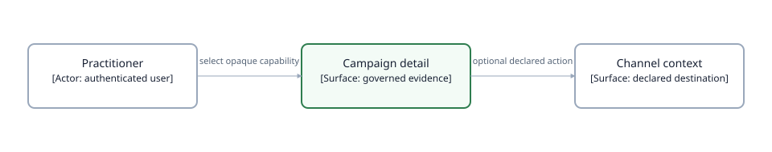

# Campaign Portfolio

| | |
|---|---|
| **Level** | Delivery page package |
| **Status** | Command-center design mandated 2026-09-15 as the exact implementation target; carried forward unchanged at `2026-10-09.2` (the wave 2b package revisions don't touch this page); carried forward unchanged at `2026-10-09.1` (the New customers package doesn't touch this page); carried forward unchanged at `2026-10-08.1` (the business-outcome page packages don't touch this page); carried forward at `2026-10-01.1` (2026-10-01: the low-level design's dated amendments record the server `display_value` on this page's metric values and `MetricFocus.v3` per [ADR-084](../../decisions/adr-084-display-monetary-values-at-currency-scale-from-a-server-display-value.md); the mockup is unchanged); revised at `2026-09-25.1` (2026-09-25: the insight-focus dialog goes single-column and both dialogs render the ADR-076 deep analysis as a full-width band — readings three-up wide, stacked narrow — with one customer-word provenance strip; no citations or internal vocabulary render, grounding stays a server-side gate); previously revised at `2026-09-24.1` (2026-09-24: the detail summary metrics render as a uniform two-row × four-column grid of equal tiles — no labeled section groups, superseding the single-row rule for this strip only); previously revised at `2026-09-23.4` (single-row equal-height card groups, ten-row display paging over the baked segments, and the in-detail campaign switcher; carries the `2026-09-23.1` insight card absence states and clickable insight-focus dialog per the [insight-presentation contract](../insight-presentation-contract.md), accepted 2026-09-23) and `2026-09-17.3` (estate reach per [ADR-071](../../decisions/adr-071-reach-the-full-campaign-estate-through-baked-ordered-segments.md); itemized insufficiency per [ADR-072](../../decisions/adr-072-name-why-evidence-is-insufficient-with-governed-slot-conditions.md)) |
| **Design revision** | `2026-10-09.2` |
| **Owns** | Campaign Portfolio → Campaign Detail business outcome, delivery scope, insight-slot roster, metric focus view, and page-level acceptance |
| **Parent** | [Decision Workspace UI](../README.md) |

## 1. Purpose and scope

Campaign Portfolio lets a user find a server-authorized campaign and inspect campaign-level outcome and delivery evidence. It helps a practitioner connect exposure, engagement, campaign-attributed outcomes, qualifications, and the next governed investigation without claiming retail impact, causality, incrementality, or campaign-level deduplicated ROAS.

> **Delivery decision (command center, 2026-09-15).** The mandated composition is two pages. The **Portfolio** page is a triage surface: portfolio-total KPI tiles with prior-window deltas, a portfolio trend chart, purpose-typed insight slots ([ADR-068](../../decisions/adr-068-fill-declared-insight-slots-with-direct-structured-model-calls.md)), and a metric-bearing campaign table with server-ordered rows and spark series — so `CampaignPortfolioArtifact.v1` is now **required**, not separate. The **Detail** page is the campaign command center: title band with the hybrid window control (preset cards plus bounded custom slider — Custom later withdrawn by [ADR-070](../../decisions/adr-070-serve-declared-preset-windows-from-publish-time-artifacts.md)), insight row, eight KPI tiles, full-width series chart with prior overlay and grain switching, window-grain values table, and the **metric focus modal** opened from any tile. CampaignAttribution V2 delivery metrics (impressions, clicks, CTR, CPC, CPM, daily series, DSP-only media quality) remain required and feed the tiles. Every rendered label, column, and grain word derives from the resolved window; a coverage gap, empty metric, or unavailable preset renders its designed plain-words state, never a reason code.

> **Estate reach and itemized insufficiency (mandated 2026-09-17).** The portfolio table
> reaches the full authorized population: baked ordered segments per declared sortable column
> with pagination state ("1–50 of N" with the boundless total) and a name filter over the
> baked roster
> ([ADR-071](../../decisions/adr-071-reach-the-full-campaign-estate-through-baked-ordered-segments.md)).
> An insufficient delivery or attribution card is an opener, never a dead end: it presents a
> detail sheet listing each metric's status in served plain words with what would fill it
> ([ADR-072](../../decisions/adr-072-name-why-evidence-is-insufficient-with-governed-slot-conditions.md));
> condition codes stay on the wire and in logs. Both are implemented and live-verified
> 2026-09-24; the LLD owns the wire contracts.

> **Display paging and in-detail campaign switching (mandated 2026-09-23).**
> The table displays **ten rows per page** — a browser slice over the baked 50-row ordered
> segments, so the serving contract is unchanged: four of five page turns need no request,
> and reaching a segment's last slice prefetches the next sibling. Fifty rendered rows at
> once is rejected as a wall. The campaign command center carries a **campaign switcher** in
> its title band: ‹ › walks the same server-declared ordering the campaign was opened from
> (position readout beside it, naming its ordering). A swap inside the loaded segment needs
> no segment fetch — the neighbor's capability is already in hand — and issues the same
> detail request a table selection does, rendered in place under the skeleton discipline and
> cache-served when previously viewed; boundary crossings fetch the baked sibling first. The
> jump field searches the estate-wide name roster, whose positions are canonical-ordering
> positions per ADR-071: a jump lands in the canonical ordering and the readout renames
> accordingly — the browser never ranks. The reporting window carries across swaps; the
> breadcrumb still returns to the portfolio. Design mandated 2026-09-23; implemented and
> live-verified 2026-09-24 with the rest of this revision.

**User-journey diagram — Campaign Portfolio review, business-flow viewpoint.** A user moves from a safe campaign choice to a qualified campaign detail, then may investigate the declared channel context without assigning a cause or using hidden page authority.

> **Takeaway.** The user reviews one server-authorized campaign detail before following a declared next investigation; the browser never ranks campaigns or creates scope.

## 2. Where this fits

The target user route is `/campaigns/`; the current frontend route is `/campaign-detail/`. The package refines the Decision Workspace campaign review surface and consumes the shared [visual and temporal policy](../README.md#4-visual-evidence-and-temporal-controls), [workspace assistant](../workspace-assistant.md), and [cutover policy](../implementation-cutover.md).

## 3. Black-box contract and delivery readiness

| Concern | Current or target contract | Delivery gate |
|---|---|---|
| Campaign choices | Safe label, channel, marketplace, platform, list evidence, opaque selection capability, expiry. | Implemented V1. |
| Estate reach | Baked ordered segments per declared sortable column, pagination state with boundless total, baked name roster for client-side filtering. | Required by [ADR-071](../../decisions/adr-071-reach-the-full-campaign-estate-through-baked-ordered-segments.md); implemented and live-verified 2026-09-24. |
| Insufficiency transparency | Per-slot conditions with safe counts on the wire, served plain-language readings, insufficient card opens the status sheet, structured log per insufficient reduction. | Required by [ADR-072](../../decisions/adr-072-name-why-evidence-is-insufficient-with-governed-slot-conditions.md); implemented and live-verified 2026-09-24. |
| Outcome detail | Purchases, default ROAS, ad spend, equal-length prior comparison, dated purchases. | Implemented V1. |
| Delivery detail | Impressions, clicks, CTR, CPC, CPM, daily series. | Required CampaignAttribution V2. |
| DSP media quality | Measurable/viewable/estimated impressions and rate; Sponsored unavailable. | V2 source and evidence qualification required. |
| Portfolio metrics | Measured rows, server order, per-row deltas and spark series, qualification. | Required `CampaignPortfolioArtifact.v1`. |
| Insight slots | Purpose-typed, deterministic findings narrated by one structured model call per slot, silence conditions, revision-keyed cache. | [ADR-068](../../decisions/adr-068-fill-declared-insight-slots-with-direct-structured-model-calls.md); prompts via [ADR-069](../../decisions/adr-069-version-insight-prompts-in-a-calibration-gated-registry.md). |
| Metric focus | Modal per metric: value, prior, series, related metrics, one "why it moved" slot; metric hopping; same artifact, no new query. | Renders from the detail artifact; focus-slot insight generated on first open, then cached. |
| Browser guarantee | No canonical selectors, metric math, period derivation, ranking, or hidden chat context. | Required for every release. |

## Delivery map

- [High-level design](high-level-design.md) — topology, API roles, lifecycle, insight generation, and V2 cutover flow.
- [Operational design](operational-design.md) — latency budgets, caching, authorization, data protection, failure containment, observability, and cost.
- [Low-level design](low-level-design.md) — wire contracts, artifact schema, custody, rendering, state, implementation seams, and tests.
- [Mockup](mockup.html) — the mandated visual reference (command center): the portfolio view, the in-place campaign detail view, and the hardened metric-focus dialog as state illustrations in one document.
- [Visual Narration Harness](../visual-narration-harness.md) — separate deployment-composed agent capability, opaque visual-context custody, structured output, cancellation, and deterministic fallback.
- [Shared UI policy](../README.md) — cross-page design rules.
