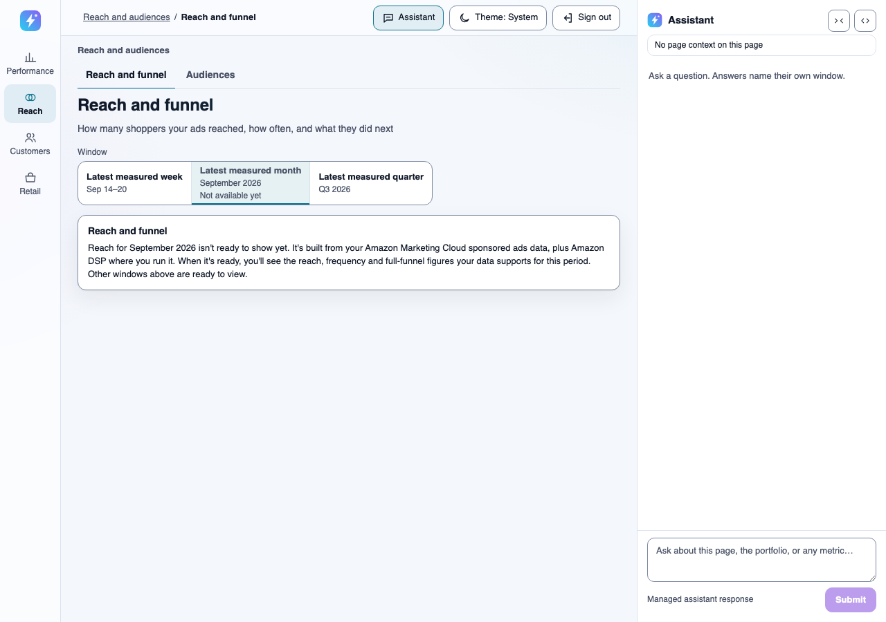
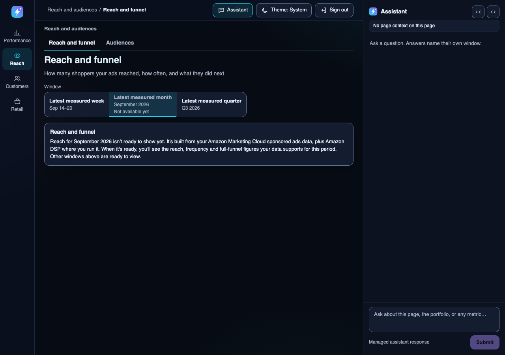

# Page absence copy

| | |
|---|---|
| **Type** | Shared UI copy catalog |
| **Status** | Owner-approved 2026-10-22 under OD-UX-9 (UI refresh), implemented under [ADR-139](../decisions/adr-139-serve-designed-absence-and-advance-pages-only-with-a-grantable-cohort.md). The browser-owned Campaigns and Retail health rows were revised to say what is missing, why, and who acts; ABS-RH-3 and ABS-RH-4 give Retail health distinct empty and insufficient copy |
| **Owns** | Every server-owned page-level absence text, the serving-refusal text, the one browser fallback for a `domain` refusal, and the browser-owned Campaigns and Retail health absence text |
| **Parent** | [Decision Workspace UI](README.md) |

Each v2 `window_unavailable.message` is chosen from this catalog by an explicit trigger
(`src/domain/presentation/absence_copy.py`, `AbsenceTrigger`, whose values are the IDs below). The
server rows equal `ABSENCE_COPY`, `OTHER_WINDOWS_READY` and `SERVING_CHECK_TEXT`, and PI-DOMAIN equals
the browser's `PI_DOMAIN_FALLBACK` (`frontend/components/PresentationV2RouteController.tsx`). ABS-CAMP-1,
ABS-CAMP-2, ABS-RH-1 to ABS-RH-4 equal the `CAMPAIGN_ABSENCE_…` and `RETAIL_HEALTH_…` constants
(`frontend/components/CampaignRouteAdapter.tsx`, `frontend/components/RetailHealthRouteAdapter.tsx`), ABS-OV-1 and ABS-OV-2 equal the Overview's
`sourceIssueText` and `OVERVIEW_NO_SPEND_TREND` (`frontend/components/OverviewView.tsx`), and ABS-SC-CH equals
`CHANNEL_NEW_CUSTOMERS_ABSENT` (`frontend/components/ScorecardView.tsx`),
whose v1 contract carries no server text. Equality tests on both sides read this file. `{period_label}` is the served period's label. Each page LLD's
"Designed states" table links its row here and restates no text.

**Truth rule for the "no `CURRENT` pointer" rows.** That trigger fires when the source has never
delivered, when the data has landed but this preset's bake has not committed yet, or when the source
returned nothing for this one period, and the server cannot tell them apart. So no row says the data
"hasn't arrived" or is "being prepared". Each says only that the page isn't ready to show, names what
the page is built from, and says what it will show. The closing "you'll see" clause holds for every
outcome the page's artifact declares (`empty`, `insufficient`) and every preset the trigger covers, so
it is conditioned on the data and never promises a section some covered case doesn't render.

The page renders the text in the shared `PageAbsence` callout below the window control: a heading with
the page's governed `display_name`, the message, no live role and no focus move. The controller's one
persistent status region announces it ([temporal contract §6](temporal-control-contract.md#6-browser-rendering-and-accessibility)).

## Server rows

### ABS-REACH-1

- Surface: Reach
- Trigger: the selected calendar preset has no `CURRENT` pointer (`preset_unavailable`).
- Today: "This window isn't published yet. Choose another window."
- Text: "Reach for {period_label} isn't ready to show yet. It's built from your Amazon Marketing Cloud sponsored ads data, plus Amazon DSP where you run it. When it's ready, you'll see the reach, frequency and full-funnel figures your data supports for this period."

### ABS-AUD-1

- Surface: Audiences
- Trigger: the latest complete month has no `CURRENT` pointer.
- Today: "This window isn't published yet. Choose another window."
- Text: "Audiences for {period_label} isn't ready to show yet. It's built from your Amazon Marketing Cloud audience segment data. When it's ready, you'll see which audience segments your buyers belong to, where there are enough shoppers to show them."

### ABS-AUD-2

- Surface: Audiences
- Trigger: the month's body is `AudienceProfileUnavailable` with `audiences_body_over_bound`.
- Today: "This window isn't published yet. Choose another window."
- Text: "Audiences for {period_label} has more segment and campaign detail than this page can show. Ask the assistant about a DSP campaign to see its figures."

### ABS-RET-1

- Surface: Retention
- Trigger: no vintage `CURRENT` pointer (`vintage_unavailable`).
- Today: "No Retention vintage is published"
- Text: "Retention isn't ready to show yet. It's built from your Amazon Marketing Cloud new-to-brand data. When it's ready, you'll see how many of the new customers your ads won come back to buy again, where there's enough evidence to show it."

### ABS-SC-1

- Surface: Scorecard
- Trigger: a rolling preset (7 or 30 days) has no `CURRENT` pointer.
- Today: "This window isn't published yet. Choose another window."
- Text: "The Scorecard for this window isn't ready to show yet. It's built from your Amazon Ads data, plus Vendor Central sales where you have them. When it's ready, you'll see the return on ad spend by network and channel your data supports for this window."

### ABS-SC-2

- Surface: Scorecard
- Trigger: a calendar preset whose period is measured has no `CURRENT` pointer.
- Today: "This window isn't published yet. Choose another window."
- Text: "The Scorecard for {period_label} isn't ready to show yet. It's built from your Amazon Ads data, plus Vendor Central sales where you have them. When it's ready, you'll see the return on ad spend by network and channel your data supports for {period_label}."

### ABS-SC-3

- Surface: Scorecard
- Trigger: a calendar preset with no complete period measured.
- Text: unchanged, the calendar `none_text` owned by `calendar_presets.py`.

### ABS-NC-1

- Surface: New customers
- Trigger: a rolling preset has no `CURRENT` pointer.
- Today: "This window isn't published yet. Choose another window."
- Text: "New customers for this window isn't ready to show yet. It's built from your Amazon Marketing Cloud new-to-brand data and your Amazon Ads spend. When it's ready, you'll see the new-to-brand purchases your data supports for this window. New buyers are measured for complete weeks and months."

### ABS-NC-2

- Surface: New customers
- Trigger: a calendar preset whose period is measured has no `CURRENT` pointer.
- Today: "This window isn't published yet. Choose another window."
- Text: "New customers for {period_label} isn't ready to show yet. It's built from your Amazon Marketing Cloud new-to-brand data and your Amazon Ads spend. When it's ready, you'll see the new-to-brand purchases and new buyers your data supports for {period_label}."

### ABS-NC-3

- Surface: New customers
- Trigger: no complete period measured.
- Text: unchanged, the calendar `none_text`.

### ABS-ALT

- Surface: Reach, Scorecard, New customers (never Audiences)
- Trigger: appended, after one space, when the served control lists a published preset other than the selected one.
- Text: "Other windows above are ready to view."

### API-0002

- Surface: the API error body's `error`, shown on the page by `PageIssue`
- Trigger: an `ungranted_generation` or `serving_refresh_pending` refusal.
- Today: "This reporting window's baked generation is not served."
- Text: "This page's latest data is still being checked before it's shown. Try again later."

## Browser rows

### PI-DOMAIN

- Surface: every v2 page (browser fallback)
- Trigger: a `domain` refusal that reaches `PageIssue` with no server `error` text. No current path takes it; every `domain` refusal today carries validated server text.
- Today: "This page cannot be shown safely right now."
- Text: "This page's latest data is still being checked before it's shown. Try again later."

### PI-DOMAIN-SERVER

- Surface: every v2 page
- Trigger: every other `domain` refusal (for example "No reporting period is available for this page.").
- Text: unchanged server text. `PageIssue` shows the refusal's own validated `error` text as sent; this catalog adds no text for these refusals, and each message's home stays its `raise DomainError` site.

### ABS-CAMP-1

- Surface: Campaigns
- Trigger: `window_unavailable` and the served control has at least one available preset.
- Title: "No campaign results for this period"
- Text: "No campaign results are published for this period. Choose another period above."

### ABS-CAMP-2

- Surface: Campaigns
- Trigger: `window_unavailable` and the served control has no available preset (custom periods are off for this page, so presets are the only choosable periods).
- Title: "No campaign results for this period"
- Text: "Campaign results aren't ready to show yet. They're built from your Amazon Ads data, which your administrator connects. When they're ready, you'll see the campaign results your data supports for each published window."

### ABS-RH-1

- Surface: Retail health
- Trigger: `window_unavailable` and the served control has at least one available preset.
- Title: "Retail health isn't published for this period"
- Text: "Choose another period above to see shipped sales, traffic and returns."

### ABS-RH-2

- Surface: Retail health
- Trigger: `window_unavailable` and the served control has no available preset (custom periods are off for this page, so presets are the only choosable periods).
- Title: "Retail health isn't published for this period"
- Text: "Retail health isn't ready to show yet. It's built from your Vendor Central data, which your administrator connects. When it's ready, you'll see the sales, traffic, conversion and returns your data supports, per product."

### ABS-RH-3
- Surface: Retail health
- Trigger: a served `empty` body: Vendor Central covered the window and reported no retail movement.
- Title: "No retail movement in this period"
- Text: "Vendor Central reported no shipped sales, traffic or returns for this period. If you expected sales, ask your administrator to check the Vendor Central connection."
### ABS-RH-4
- Surface: Retail health
- Trigger: a served `insufficient` body.
- Title: "Not enough Vendor Central data for this period"
- Text: "There isn't enough Vendor Central data to show this period safely. Choose another period above. If this keeps happening, ask your administrator to check the Vendor Central connection."
### ABS-SC-CH
- Surface: Scorecard channel cards
- Trigger: the same-preset New customers request failed, its window or currency isn't the Scorecard's, or no served row joins the channel on its governed ad product key. A New customers `window_unavailable` or non-complete body shows its own served text instead.
- Text: "New-customer figures aren't available for this window."
### ABS-OV-1
- Surface: Overview › Growth check, any band
- Trigger: the band's source presentation request failed (the composed tab settles each source on its own, ADR-151). `{tab}` is the source tab's name. A source served as `window_unavailable`, `empty` or `insufficient` shows that source's own served or catalog text instead (ABS-SC, ABS-NC, ABS-RH-1, ABS-RH-3, ABS-RH-4, ABS-CAMP title).
- Text: "This part comes from {tab}, which can't be shown right now. Try again later."
### ABS-OV-2
- Surface: Overview › Growth check, daily ad spend chart
- Trigger: the served Campaigns body has no portfolio trend for the window.
- Text: "This window has no daily ad spend to draw."
## Why the wording

Reach, Audiences and Retention are Amazon Marketing Cloud packs (each LLD's "Materializer"). A Reach
instance without DSP still renders sponsored-side frequency, hence "plus Amazon DSP where you run it",
and ABS-REACH-1 promises no single Reach section: overlap and the full funnel need DSP and sponsored
ads on one instance, and frequency is not shown for the week preset or with fewer than four active
campaigns ([Reach LLD](reach-and-funnel/low-level-design.md)). The Scorecard reads Vendor Central
sales only for TACoS, so an account without it still gets a Scorecard ([Scorecard
LLD](scorecard/low-level-design.md)). `audiences_body_over_bound` fires on too many profile or
campaign rows or an over-cap body, and only DSP campaigns have a governed assistant read ([Audiences
LLD](audiences/low-level-design.md)). New buyers are a calendar-period section, so ABS-NC-1 (rolling
presets) promises only new-to-brand purchases ([New customers LLD](new-customers/low-level-design.md)).
Every closing clause is conditioned on the data because a ready page can still bake an `empty` or
`insufficient` outcome.
