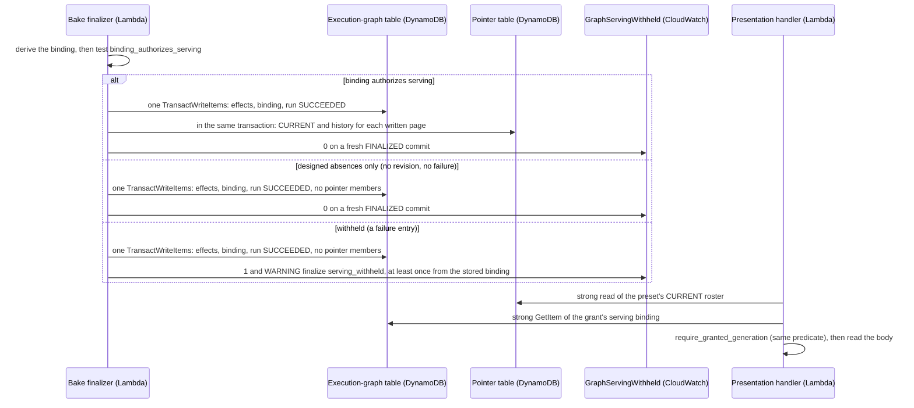

# Preset artifact publisher

| | |
|---|---|
| **Type** | Shared UI serving concept |
| **Status** | Current development implementation under [ADR-070](../decisions/adr-070-serve-declared-preset-windows-from-publish-time-artifacts.md); dated acceptance scope is owned by [validation results](../../validation/RESULTS.md). |
| **Owns** | The publish-time bake pipeline, artifact store, and preset serve path shared by artifact-served pages |
| **Parent** | [Decision Workspace UI](README.md) |

Pages consuming this concept: [Campaign Portfolio](campaign-portfolio/README.md),
[Retail Health](retail-health/README.md), [Scorecard](scorecard/README.md),
[New customers](new-customers/README.md), [Reach and funnel](reach-and-funnel/README.md),
[Retention](retention/README.md) and [Audiences](audiences/README.md). A page's LLD owns its route, artifact contract, window
policy, and insight roster. The generated page dependency contract under `presentation/pages/v2/`
owns the complete metric and non-visual dependency cohort; this concept owns shared publisher
mechanics. [Data-Flow Completion and Service Levels](../concepts/data-flow-completion-and-service-levels.md)
owns completion clocks, child obligations, and objective evaluation;
[ADR-074](../decisions/adr-074-define-authority-backed-data-flow-completion-and-service-level-objectives.md)
owns that policy's rationale.

## The pipeline

**Two bake entries.** Where the development operational plane is provisioned
(`ADLYTICS_OPERATIONAL_STATUS_PROVISIONED`, which synth accepts only for an environment named `dev`),
the execution-graph authority runs in `GRAPH` mode: a dependency cohort is baked once as one graph
run, all roster page rows together, and pages advance only under that cohort's serving binding
([GRAPH serving authority](#the-serve-path)). This path was live-accepted on dev on 2026-10-18
([D2 live acceptance](../../validation/RESULTS.md#d2-pages-and-graph-control-plane-live-acceptance-on-dev--2026-10-18)).
Everywhere else the authority is absent, which reads as `LEGACY` (`src/adapters/graph_authority.py`),
and pages bake through the legacy entry described below: one page/variant per bake message, each
advancing its own pointer. Publication keeps the legacy entry for every non-dev deployment, so pages
refresh one at a time there (decided 2026-10-18; a [known limit](../../README.md#known-limits)).
Making `GRAPH` deployable in every environment and retiring the legacy entry is the next planned
change. The 2026-10-18 live acceptance covers the `GRAPH` entry on dev only. The legacy entry is
unit- and integration-proven, not live-validated, for the 2026-10-19 publication: its
fresh-environment deploy loads no data, so nothing is baked
([validation results](../../validation/RESULTS.md#d2-pages-and-graph-control-plane-live-acceptance-on-dev--2026-10-18)).

Three decoupled parts follow the publications stream, so semantic publication, scheduling, and baking
fail and retry independently. The mandated target under
[ADR-075](../decisions/adr-075-generate-page-artifacts-once-per-dependency-cohort.md) is stated in
[Target pipeline](#target-pipeline); the paragraphs below describe the legacy entry, the one every
environment except `dev` runs.

**Stream consumer.** The enqueue Lambda accepts `CURRENT` stream records, re-attests the exact current
publication, and sends the complete V2 page/preset declaration to the bake queue for every retained
canonical-curation publication. The current implementation does **not** filter by changed dataset,
complete source cohort, affected page, or real baker registration. It performs no measurement, but its
global fan-out is what [ADR-075](../decisions/adr-075-generate-page-artifacts-once-per-dependency-cohort.md) §1 replaces (see [Target pipeline](#target-pipeline)).

**Bake queue.** SQS FIFO `MessageGroupId = page#variant` serializes one page/variant while distinct
page/variants may run concurrently. The stable body and deduplication ID contain only `(page, variant)`,
not publication, flow, generation, or expected revision. Transport deduplication can collapse identical
messages within its service window, but does not avoid producer-side sends or define a publication
cohort. Bounded receive exhaustion reaches a dedicated DLQ, whose arrival raises the
`preset-bake-dead-lettered` alarm in both entries (`infra/lib/stacks/publisher-stack.ts`); the
publisher stack does not define the lag alarms described by page operational targets.

**Baker.** One invocation reads current retained truth for its page/variant. Every roster page in
`presentation/pages/v2/pages.yaml` (Campaigns, Retail health, Scorecard, New customers, Reach,
Retention and Audiences) has a real materializer, and each page's v2 entry is declared, so each
materializer composes; the composition conditions below say what keeps one closed. A page whose
source data has not landed bakes its own `<page>_materialization_unavailable` designed absence.
The Scorecard materializer (`src/adapters/jobs/preset_artifact_publisher/scorecard_source.py`) is
registered with the baker and composes through the v2 `scorecard` page entry, which the Scorecard's UI
build added; without that entry its intents would never be declared, so it would never run. It bakes
`NetworkScorecardArtifact` v1 for rolling presets only, because the calendar presets need the browser half of
temporal transport v2. Its 16-plan batch runs once per governed marketplace (the commerce identity bridge's
canonical populations), each plan pinned to that marketplace, so each card carries its own currency and two
currencies are never converted or added. A partial answer in any marketplace bakes nothing, and an artifact
invariant break is reported through `report_error` before the bake returns nothing.
The New customers materializer (`src/adapters/jobs/preset_artifact_publisher/new_customers_source.py`) is
registered the same way and composes while the v2 `new-customers` page entry, added with the tab, declares
exactly the `new_customers` `NewCustomersArtifact` v2 artifact with its three outcomes and the sections the
bake fills; any other declaration keeps it closed, and the baker answers
`new_customers_materialization_unavailable`. It bakes `NewCustomersArtifact` v2 with one batch per governed
marketplace: step 1 at ad-product grain, the gateway at ad product × product only when the pack-v2 coverage
gate covers every day of the window (otherwise each channel bakes its coverage text and no gateway plan runs),
and new buyers for the resolved calendar period: the tiles at grain set `platform` and, once the per-channel
delivery for the period has landed, the per-channel table at grain set `channel`, planned with the ad-product
roster attached (`attach_roster`), so a rostered ad product with no row bakes "not available"; before it lands,
the table bakes its own pending or missing line and the tiles render. A bake variant is the declared preset id itself, never
mapped, so the variant identifier admits `_` and `last_complete_week` and `last_complete_month` bake as
variants once a page declares them; serving still needs the browser half of temporal transport v2. Nothing
is divided in the adapter, and an invariant break goes through `report_error`. Two limits: the share
change block carries `sentiment: null`, reserved until the dictionary declares ADR-121's
`favourable_direction`, so the chip shows direction and text only; and the `portfolio-acquisition`
sentence names no marketplace, so with two governed marketplaces their moves would read alike (one is
governed today; the New customers package's next revision decides the wording).
The Reach and funnel materializer (`src/adapters/jobs/preset_artifact_publisher/reach_source.py`) is
registered the same way and composes while the v2 `reach` page entry declares exactly the
`reach` `ReachAndFunnelArtifact` v1 artifact with its three outcomes, `overlap` and `funnel` on the week and
month presets as anchors and `frequency` on the month and quarter presets, not anchoring (any other
declaration keeps it closed). While it is closed the baker answers `reach_materialization_unavailable`. It also
stays closed while the governed AMC instance declaration (`contracts/shared/amc-instance.yaml`, `kind:
standard` for this deployment) is missing or names an unknown kind, answering `amc_instance_kind_missing`
or `amc_instance_kind_unknown`; the kind is never defaulted. On `instant_access` it plans nothing: the week
and month presets resolve to the latest complete period on the calendar, and overlap and funnel read "Needs
DSP and sponsored ads on one AMC instance". It bakes the
calendar presets only, one batch per governed marketplace: the six pack 5 cells (exposure group × identity
space) for the resolved period and the prior one, each read from the pack variant series holding that
period's CURRENT publication (the base pack's `combined` rows, or the touch-only variant's reach on
`exposure` rows and outcomes on `outcome` rows), then the
overlap shares, funnel rates and index divided inside one delivery in domain code, never in the adapter. A
period two series hold bakes nothing, and a prior period of another series shows no change
(`pack_variant_mismatch`). A
`not_returned` cell bakes "Not available" with "too few shoppers, or none", and a share or rate that needs it
does too. Frequency reads pack 6 on the month and quarter presets (it anchors the quarter preset, and on the
month preset reads its pending text until pack 6 lands): the per-bucket shoppers, purchasers, sales and the
two window spends of the period's one bucket-scheme series, then the curve's purchaser rates and the
platform return per bucket in domain code, adding the two spends only where their currencies agree. Pack 7
names the per-channel table's rows (the ad-product spend roster, then any ad product it holds off it), and
every cell reads "Not available per channel" because its credit branch isn't built. With fewer than 4
campaigns with spend in the period, frequency reads "Needs at least 4 active campaigns". On
`instant_access` frequency still bakes, sponsored-side only. The `reach-overlap`,
`full-funnel-association` and `frequency-saturation` findings bake beside the sections.
The Retention materializer (`src/adapters/jobs/preset_artifact_publisher/retention_source.py`) is registered
the same way and composes while the v2 `retention` page entry declares a vintage policy and
exactly the `retention` `RetentionCohortArtifact` v1 artifact, and holds the `path`, `triangle`,
`retention-curve` and `boundary` sections (any other declaration keeps it closed). While it is closed the
baker answers `retention_materialization_unavailable`. A vintage page bakes its policy's default variant,
`latest_with_current_publication`, never a calendar preset: one batch per governed marketplace for the latest
`as_of_month` with a current pack 14 publication, read from the one series holding it (monthly cohorts, or the
calendar-quarter variant once switched on); a vintage two series hold, or with no standard publication, bakes
nothing. Every per-cell figure is planned through the measurement layer, grouped by cohort, follow-up month
and acquisition channel group on one path: pack 14's cohort sizes, repeat buyers and account-ID cumulative
repeat buyers, and pack 15's repeat and cumulative repeat buyers. Every rate, the account-ID repeat curve
and the ARP rate are computed in domain code (`src/domain/presentation/retention.py`), never in the adapter.
The ARP rate divides pack 15's repeat buyers by pack 14's account-ID cohort size and is withheld with
"cohort sizes changed between runs" when pack 15's own count, read from its publication's cell-loss
evidence, differs or the numerator exceeds the denominator. A `not_returned` cell bakes "Not available",
hatched with the withheld-cell legend; a follow-up month the vintage hasn't reached bakes "Not yet"; an
absent cohort bakes its own text. With no pack 15 delivery for the vintage, the paid path bakes its paid
callout and plans nothing paid. The `retention-shift` finding bakes beside the sections. The Repeat purchase
by product pointer isn't baked (it waits on pack 16).

The Audiences materializer (`src/adapters/jobs/preset_artifact_publisher/audiences_source.py`) is registered
the same way and stays closed, answering `audiences_materialization_unavailable`, unless the v2 `audiences`
page entry declares exactly the entry the [Audiences](audiences/low-level-design.md) LLD specifies; that LLD
owns the entry, the artifact contract, the absence texts, the paid states and the insight. It bakes the
latest complete month any buyer-profile path has published, from retained publications only: 24 statements
per marketplace at any campaign count, each phase at most `athena_query_batch_max_concurrency` at once.
Phase 1 reads each profile path's roster and every DSP campaign's three figures and prior-month segments,
each once for all campaigns; phase 2 the profile measurement and the history walk for campaigns with no
segments last month. Each figure is planned through the measurement layer chat reads and graded against its
own path's or campaign's roster; every share, index, CPM and ROAS is computed in domain code
(`src/domain/presentation/audiences.py`). The campaign pages are written as parts, one campaign at a time
([entity-streamed reads](#bake-width-and-the-memory-model)).

A real materializer resolves current-plus-prior coverage, takes per-pack evidence snapshots, executes the
page's bounded measurement batch, renders immutable artifacts, derives the revision from exact
publication identities plus render format, persists required bodies/custody/siblings, and advances the
forward-only pointer last. The deployed execution ceiling is owned by `PublisherStack`; it is not a
completion SLO.

The revision sees nothing but publications and render format, and a body key accepts only its first
bytes, so any change to what a renderer writes for the same publications bumps that page's render
format. That includes governed inputs the renderer bakes in: a compared metric's
`favourable_direction` or change scale is written into every change block
([ADR-121](../decisions/adr-121-declare-change-direction-and-sentiment-on-the-server.md)), so a change
to either bumps both the Campaigns and the Retail Health render formats. Without the bump the re-bake
is refused at the existing key, baked tiles keep the old tone, and the serve-time focus shows the new
one. `tests/unit/test_change_semantics_render_format.py` fails until both formats move.

AI insight precompute is **not** part of this baker. A separate publications-stream consumer remeasures
Campaign evidence and warms revision-keyed model slots. Campaign serving later reads or first-fills that
cache; Retail Health bakes deterministic movers and typed unavailable prompted slots. Optional AI
settlement follows the shared completion/SLO concept and never gates deterministic pointer publication.

## Target pipeline

Mandated by [ADR-075](../decisions/adr-075-generate-page-artifacts-once-per-dependency-cohort.md).
The `GRAPH` cohort bake on dev (above) is the deployed step toward it; outside dev the legacy entry
still runs, and ADR-075's status line owns which stages are accepted. Each component below is built only against its accepted low-level design in
[Generation coordination](generation-coordination.md) and
[Generation materialization](generation-materialization.md). It replaces the stream consumer and bake
unit above in one change, never alongside them.

**Dependency router.** Consumes the same `CURRENT` stream, reacting to servable-projection advances
rather than authority advances ([write discipline](../capabilities/load-path/write-discipline.md#23-envelope-attestation-and-readers)),
re-attests the exact publication, and maps its dataset through the generated page dependency contract
to affected pages and presets only. A page
with no registered materializer, or whose cohort does not name the changed dataset, receives nothing.

**Generation coordinator.** Records each page/window generation as defined by
[Data-Flow Completion and Service Levels](../concepts/data-flow-completion-and-service-levels.md#clock-contract),
carrying the flow and causation identity from the semantic transition. Before any measurement it derives
the expected revision from the frozen cohort's exact publication identities plus render format and
terminates a generation whose revision equals the current pointer as `completed_no_change`. At most one
materialization runs per generation, and a superseded generation's materialization is abandoned.

**Generation materializer.** Executes the page's measurement batch once for a frozen, eligible
generation and persists an immutable, revision-bound materialization: exact source roster, resolved
windows, deterministic metric results, findings and decompositions, and custody inputs. Preset reuse
follows ADR-075's declared-only rule; each variant's revision derives from its own exact identities.
Materialization is budgeted separately from rendering in the bakeability gate.

**Consumers.** The parent renderer, the ordered-segment renderer, preset-artifact insight slots, and
the operational measurement read the materialization. Preset insight slots consume deterministic
findings and execute no Athena; Campaign Insight Precompute as a separate remeasuring consumer is
retired. Request-time tiers — the live detail tail and metric-focus first generation — remain
request-path consumers under their own budgets. An advancing pointer transaction records the
generation identity, source-roster digest, advance instant, and `ADVANCED`; `NO_OP` and `STALE`
outcomes are recorded on the generation, since no pointer item changes. The serving receipt records the
selected pointer revision and generation.

## The artifact store

Bodies are immutable S3 objects under a page/variant/revision identity. Pointers are retained in one
DynamoDB table with `CURRENT` plus immutable revision history. A page that declares estate reach under
[ADR-071](../decisions/adr-071-reach-the-full-campaign-estate-through-baked-ordered-segments.md) also
persists ordered public/private siblings and a parent custody manifest under the same revision closure.
The pointer remains the sole commit point: all required bytes and digests attest before it advances.

**Streamed writes and the sharded sibling index** ([ADR-145](../decisions/adr-145-serve-ten-thousand-campaigns-with-a-sharded-roster-and-streamed-writes.md)).
A source's publication carries its parent body, a pointer template (every pointer field but the
custody digest), its page's own custody fields as a header, and its siblings as a re-iterable stream
of body/custody pairs with a declared count. Campaigns renders each segment and filter sibling as the
stage draws it; Retail wraps its product-detail children. One stage writes every source, in order:

1. Retail's closed child set: the stream's identities must be exactly the served rows, else an
   invariant before any write.
2. The pairs, body then custody, at most 8 in flight, drawing the next pair only as one completes
   and keeping only its descriptor (identity, body digest, custody digest). The first failure, or a
   refusal the stream raises (a sibling over its cap), stops submission; the pairs in flight are
   observed and the error is raised.
3. The descriptors, sorted by identity path, in index shards of 800 at
   `custody/{page}/{variant}/{revision}/index/segment-NNNN.json`. A descriptor is at most 256 bytes,
   so a shard fits the cap.
4. The parent body, then the parent custody: the header plus `sibling_index`, one
   `{first_identity, last_identity, digest}` per shard. The pointer is the template completed with
   that custody's digest.

The stage reports every write chain (each pair, each shard, the parent) and its bytes, which are the
task's `pairs` and `written_bytes` on both entries. Every sibling of every source is indexed, and a
sibling-free page writes no custody. A serve reads a sibling in two levels: pointer, parent custody,
the shard whose range covers the identity (checked against the parent's digest), the descriptor, then
the body and custody (each checked against it). An identity no shard lists, a listed shard or sibling
that S3 doesn't hold, or one whose bytes don't match, is the malformed-artifact refusal, never a
fallback.
Superseded history receives retention TTL; current records do not expire. Baked bodies are
capability-free, and the serve path mints session custody.

## The serve path

An artifact-served page validates the requested preset, strongly reads the declared pointer roster,
reads and digest-attests the selected body, reads Campaign custody/siblings when required, mints
owner/session capabilities, fills optional insight slots by artifact revision, and responds. Missing
source coverage and resolvable-but-not-yet-baked state are distinct completion reasons even though both
currently reach typed unavailability at the page boundary. There is no live-measurement fallback for a
preset parent page; last-good serving is continuity, not proof that a new flow met freshness.

**GRAPH serving authority** ([ADR-139](../decisions/adr-139-serve-designed-absence-and-advance-pages-only-with-a-grantable-cohort.md)).
A grant-bearing pointer serves only under a `SERVING#<grant>/BINDING` that authorizes serving
(`binding_authorizes_serving`): direct, executed, not stale, naming the pointer's generation, and
every `unavailable` entry a designed absence. A designed absence is a roster page's own
`<page>_materialization_unavailable` on that page's key, or `insight_slot_unavailable`; any other
reason is a failure. The bake finalizer commits page pointers in the same transaction as the binding,
and only when that binding authorizes serving, so `CURRENT` is the last-good generation by
construction and presentation's one `CURRENT` read is the last-good read. A withheld cohort (a failure
entry) completes, stores its binding and moves no page; `GraphServingWithheld` pages it. A cohort of
designed absences only moves no page and is not withheld. A grant-serving refusal therefore means the
write-side invariant broke: it returns 409 with the catalog's API-0002 text
([page absence copy](page-absence-copy.md#api-0002)) and is counted `PresentationServingRefused`.

**Sequence diagram — a GRAPH cohort finalizes and a page serves; runtime viewpoint, one cohort.**



The page reads only `CURRENT`, which never names a generation the predicate refuses, so a withheld
cohort leaves every page on the generation it already served.

## Declaring a new consuming page

1. Declare the page's preset/window policy and pass the bakeability gate.
2. Add the complete metric and non-visual artifact cohort to the generated page dependency contract
   ([generation coordination §2](generation-coordination.md#2-generated-page-dependency-contract));
   reference that exact version from the governed flow registry.
3. Register the page materializer and only its dependency-matched enqueue targets.
4. State page-owned serving and bake engineering budgets. The governed flow registry separately owns
   accepted SLO targets and may reference, but never copy ownership from, those design budgets.
5. Prove body/custody/pointer completion and optional insight behavior under ADR-074 acceptance.

Until steps 2–3 exist in implementation, a V2 page declaration is transport fan-out input, not proof
that the publisher can materialize that page.

## First bake and recovery

Stream records do not guarantee a first artifact after a fresh deployment or declaration change. The
publisher custom resource carries a **content-derived generation of the declared page input** and
backfills the complete declared page/variant set only when those declarations change, and only on the
legacy entry. In `GRAPH` mode the changed declaration still fires the event, but the backfill sends
nothing: the gate closes on `BACKFILL_AFTER_CUTOVER`, because a legacy send would be a second,
ungranted bake writer, and the next granted run's bake re-evaluates every registered page instead
(`src/adapters/jobs/preset_artifact_publisher/backfill.py`, T1L-2 correction of 2026-10-22). A deploy
that changes only code or contracts leaves the property unchanged, so CloudFormation sends no event and
the backfill does not fire; such a change reaches existing artifacts through the next publication bake.
No repository-owned operator backfill interface exists today; adding one with explicit target inputs and
flow identity is a required recovery capability. The custom-resource path remains idempotent at the
revision/pointer boundary, but neither substitutes for dependency-aware scheduling or objective
attainment evidence.

**Updating to the sharded sibling index ([ADR-145](../decisions/adr-145-serve-ten-thousand-campaigns-with-a-sharded-roster-and-streamed-writes.md)).**
Campaigns render format 12 and Retail health render format 10 name their siblings and product-detail
children only through the sibling index, and serving reads no other shape. A Campaigns (format 11) or
Retail health (format 9) pointer baked before the update has no index, so from the deploy until that
page's next bake every view of it is the malformed-artifact refusal: the page shows its failed state
and the ERROR invariant alarms. The update changes only code, so the backfill above doesn't fire, and
no repository-owned re-bake command exists yet: the next publication bake of each page rebuilds it.
Deploy the update shortly before a delivery for both pages lands, and check both pages after that bake.

## Page isolation

A bake limit or failure is one of two things ([ADR-142](../decisions/adr-142-isolate-a-bake-refusal-to-its-own-scope-and-alarm-on-defects.md);
the closed table is `src/domain/operations/bake_refusals.py`):

- **An isolated refusal** (a scale limit, a data-history gap or a dependency that stayed down) is
  its own scope's designed absence, and everything else publishes. Designed absence has three
  scopes. An **item** (one Audiences campaign or profile path) or a **section** (only a section
  that declares `period_anchor: false`) renders its absence inside a body that publishes, and the
  absence is part of the revision. A **page** refusal settles the page's
  `<page>_materialization_unavailable` absence: the page keeps its last good body, its siblings
  advance, and on the graph entry the cohort still binds. A source decides the scope; the page
  execution refuses a claim the page doesn't declare. Every body a source builds is size-checked
  first, so an over-cap body is that page's `body_over_cap`, never the D18 failure.
- **A defect** (over the certified query count, a plan-count mismatch, any invariant, the D18
  ceiling reached past a source's check) still holds every page on the graph entry and only its own
  page on the legacy entry, and pages the operator.

Both entries render through one page execution (`page_bake.py`), so the classification is the same:
a source's `DomainError` or `ValidationError` is the page's `source_refused` (or
`partitions_over_bound` for the selector's exact-partition bounds); a bake-wait timeout is
`statement_time_over_invocation` on any receive; any other dependency failure retries, and on the
record's final receive is the page's `dependency_unavailable` instead of a dead letter. One
exception on the legacy entry: a write that stays down on the final receive (`stage_page`'s stage
or pointer write) still dead-letters the record (`BakeDeadLettered`); the graph entry settles it
as `dependency_unavailable`.

**The pin's bounded retry.** On the graph entry the fan-out's pin pass retries a dependency
failure in place, per row and around its own release-store calls, up to three attempts with full
jitter (0.5 s base, 4 s cap) and only while 60 s of the invocation remain for the pin write. A row
whose attempts run out pins with zero requests and its `pin_refusal`; the cohort proceeds and that
row's task settles `dependency_unavailable`. A release-store call whose attempts run out re-raises,
as before.

**The runtime write deadline.** `stage` and `publish` take the invocation's remaining time and the
contract's `tail_seconds` (30 s) as required arguments. Before each body/custody pair is submitted,
less than the tail left stops submission, the pairs in flight are observed, and the page settles
`bodies_over_invocation`: no index shard, parent, custody or pointer is written, so the pairs
already written are unreferenced objects no custody names. A page-scope refusal the stream raises
while the stage draws it settles the page's absence the same way. Telemetry for all of it is in
[observability](../concepts/observability.md#32-application-spans-and-metrics).

## Bake width and the memory model
Every bake read is page-sized or bounded by governed axes ([ADR-152](../decisions/adr-152-read-page-sized-answers-in-sql-with-no-arbitrary-row-ceiling.md)). A page that shows a ranked slice reads it ranked in SQL, with the population's count and sums in the same statement (the [query path](../capabilities/query-path/architecture.md#row-ceilings-result-transports-and-folds) owns the shapes). A read grouped only by days, marketplaces and governed media-taxonomy axes is bounded by them. A read that renders one entity at a time is **entity-streamed**: it reads `ORDER BY` its grain through a `GroupSink` (`group_stream.py`), a fold that hands one entity's rows at a time across a one-slot queue, so only the groups in flight are resident. Audiences reads every DSP campaign this way: a count pass in the render builds the campaign index, and a page pass, the same requests answered by result reuse, renders each campaign's pages as the stage writes them. Its reads have no row `LIMIT` (`BAKE_GROUPED`): the sink, not the row count, bounds memory. Campaigns renders every campaign whole, so it folds its reads into one compact record per campaign (`KeyedColumns`, one column per read) and keeps at most `BAKE_MAX_ROWS` records; its reads have no row `LIMIT` either. A reduction streams up to `BAKE_MAX_STREAMED_ROWS` through a fold that keeps a bounded summary. The Baker streams each result from its result object, so one buffer is resident at any row count.

A bounded read that comes back cut is a defect. An entity-wide read cut at `BAKE_MAX_ROWS` is its page's `rows_over_ceiling` (or `population_over_ceiling`), and the `isolated_refusal` line names the operator action: raise the Baker memory.

`make check-bakeability` certifies every roster row's resident bytes term by term and prints them:

```text
resident(row) = W                               # writes in flight: 2 x S3 chains per baker x 256,000 B
              + Q x max_held x B_raw            # raw rows of at most Q slots being shaped at once
              + sum(held widths) x B_shaped     # every shaped answer, resident until the render ends
              + sum(fold max_kept) x B_kept     # each fold's enforced bound
              + max_held x B_render             # the render's own per-row structures
              + sum(record stores) x B_record   # one compact record per entity, and its rows
certified iff resident(row) <= 0.5 x the Baker's memory
```

A held slot's width is read from the batch the source builds: its fixed axes' own bound (days, marketplaces and media-taxonomy terms), its ranked bound (50 rows, 3 movers, 10 per ad product), or `BAKE_MAX_ROWS` for a population read. `resident` is affine in that ceiling, so the ceiling is derived, not chosen: `BAKE_MAX_ROWS = floor((0.5 x memory − BAKE_FIXED_BYTES) / BAKE_BYTES_PER_ROW)`, the binding row's intercept and slope (`domain/operations/bake_memory.py`). The gate recomputes both from the real batches and fails on any difference, and prints the ceiling at 1,024, 2,048, 4,096 and 10,240 MiB. The per-row byte terms are the row-ceiling probe's (`validation/probe_bake_row_ceiling.py`), recorded with their date in `BAKE_MEMORY_TERMS`; `B_record` is the real Campaigns bake's traced peak per campaign. The Baker's memory has one home, `bake_tasks.baker_memory_mib` in `contracts/operations/execution-graphs.yaml`: the stack sizes the function from it and the model derives the ceiling from it. Bodies stream, so `W` is the only body term.

## Scale envelope
The one home of each page's own-absence thresholds at publish time. The README's [sizing table](../../README.md#sizing-for-large-catalogs) links here.

| Threshold | Value | Above it | Owner |
|---|---|---|---|
| `BAKE_MAX_ROWS`, rows one held entity-wide answer may keep | derived from the Baker's memory and printed by `make check-bakeability` | that page's `rows_over_ceiling`; raise the Baker memory | ADR-152 |
| `BAKE_MAX_STREAMED_ROWS`, rows one bake reduction may stream | 31 days x `BAKE_MAX_ROWS` | the reduction's section shows its absence | ADR-143 |
| Audiences DSP campaigns | every campaign with delivery in the month, each with every segment, in 50-row pages. Its reads have no row limit; the campaign index, its segment set and one campaign's segments are each held up to `BAKE_MAX_ROWS` | the page's `rows_over_ceiling`; raise the Baker memory | ADR-141 |
| Retail health product rows | the top 50 by current shipped revenue, with the count and sums of every product, at any catalog size | none | [Retail LLD](retail-health/low-level-design.md) |
| Campaigns population | every campaign, up to the memory-derived ceiling `BAKE_MAX_ROWS` | the page's `population_over_ceiling`, which alarms with the operator action: raise `bake_tasks.baker_memory_mib` | ADR-152 |
| Campaigns and Audiences writes | the stage's runtime write deadline; their bodies grow with campaigns, so each is certified at the whole write allowance. Projected to reach the deadline (900 s less the 30 s tail) at about 62,000–85,000 campaigns and, on Audiences, about 35,700–45,700 DSP campaigns in a month, both below the 4,096 and 10,240 MiB `BAKE_MAX_ROWS` [projection, linear in objects written: dev's write phase took 9.07–11.62 ms per fresh Campaigns object over four 131-object bakes (2026-10-25, aws/spans); 1.132–1.2128 Campaigns objects per campaign (the 10,000-campaign estate and `campaign_bake_object_count`); 2.1 Audiences objects per DSP campaign on dev; a fresh Audiences write is assumed to cost what a Campaigns one does, unmeasured]. A redelivered stage whose objects already exist is slower: each conditional PUT is refused and the object re-read, 26.84 ms per object over one replayed 63-object Audiences bake, so Audiences crosses at about 15,400 then [projection]. Campaigns passes its 570 s budget from about 40,000–56,000; Audiences its 600 s budget from about 24,600–31,500, or about 10,600 replayed. Both count write time only, so each crossing is if anything lower | the page's `bodies_over_invocation`. The write waits on S3 at `s3_chains_per_baker` pairs in flight: on dev those PUTs filled 68–75% of Campaigns' write phase, so more Baker memory (CPU and network share) isn't shown to shorten it | ADR-145 |
| Exact-read partitions per source pack | 1,000 (`MAX_PRESET_SNAPSHOT_PARTITIONS`, equal to Publication State's exact-read bound). It's derived so the worst serving read fits the presentation function's 29 s with the Athena statement's 20 s kept: ⌊9,000 / (9 × 95.0 ms p95 in-Region)⌋ = 10 transactions per pass (ADR-070). The gate's model, days doubled for the prior and one lens, fits a 500-day preset; the Reach quarter's pin reads 184, 92 days × 2 lenses. Each 100 partitions add 3 sequential DynamoDB transactions per attempt | `make check-bakeability` refuses the declaration; at a bake, that page's `partitions_over_bound` | ADR-070 |

## Scaling and operational gaps

The legacy bake unit is one variant. A page's scale failure is that page's own absence on either
entry ([Page isolation](#page-isolation)); a defect still withholds the whole `GRAPH` cohort, so
every page stays on its last good generation until a cohort serves. When a page approaches its
page-owned envelope, decompose into revision-bound required children rather than raising a timeout.
Current unresolved controls are:

- the [target pipeline](#target-pipeline) mandated by ADR-075, including complete cohort
  registration and retirement of global fan-out;
- implemented queue-age, DLQ, bake-duration, and publication-lag alarms;
- objective values and error-budget policy under ADR-074; and
- the Campaigns and Audiences write ceiling: one invocation writes a page's every object, so
  past the projected sizes in the [scale envelope](#scale-envelope) the page stays on its last
  good version. Lifting it (more write concurrency, or a page's writes split across
  invocations) is an owner-approved follow-up (2026-10-26), not built yet.
