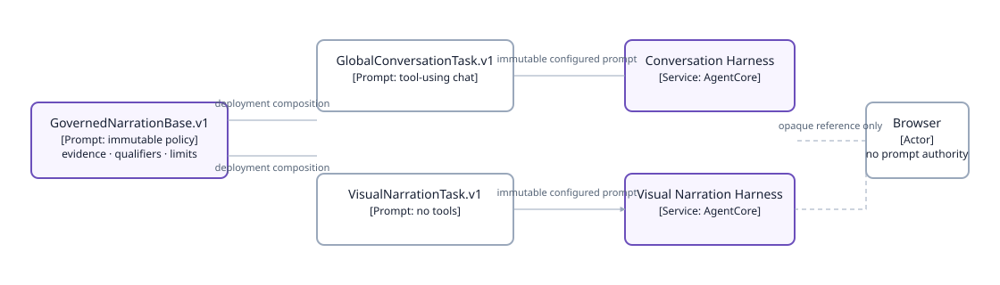

# Visual Narration Harness

| | |
|---|---|
| **Type** | Shared delivery capability for page-scoped AI narration |
| **Status** | Proposed — separate Harness, internal route, and typed context contract required |
| **Owns** | Prompt composition, opaque visual-context custody, narration output contract, streaming/cancellation, fallback, and acceptance |
| **Parent** | [Decision Workspace UI](README.md) · [Workspace assistant](workspace-assistant.md) |

## 1. Purpose and scope

Visual Narration Harness supplies an agent-authored Perspective or Hypothesis for one already rendered, server-governed visual. It never replaces the global conversational Harness, browser rendering, metric computation, typed evidence, or deterministic Observed/Limit state.

The global conversation Harness retains its deployed system prompt and its global governed tools. This capability is a separate internal Harness with no browser-provided prompt or data authority and, initially, no tools.

## 2. Prompt composition

The existing conversation Harness has a deployed base prompt. Invocation-level `systemPrompt` precedence is unverified, so no page feature may override or append it at runtime.

**Component diagram — Visual Narration Harness prompt composition, deployment viewpoint.** Shared reviewed policy components are composed into two immutable deployment prompts; a page request cannot alter either prompt.



> **Takeaway.** Prompt composition occurs at deployment from reviewed versioned components; neither the browser nor a page request can replace the global conversation prompt.

## 3. Opaque visual-context lifecycle

A selected page artifact mints zero or more visual narration references. Each reference is bound server-side to:

- verified owner and conversation session;
- parent page artifact type, version, revision, and expiry;
- one visual identity and metric cohort;
- safe display scope, resolved periods, grain, basis, qualification, and allowed action identities.

The browser may send only `{session_id, narration_reference}` to the proposed authenticated `POST /api/presentation/visual-narration` route. It cannot send visual text, values, metrics, canonical selectors, page artifact, page context, prompt instruction, task profile, or tool configuration.

**Call-flow diagram — Visual narration request and cancellation, authority viewpoint.** The typed page renders first; a selected visual requests its own narration, and changing the visual aborts the old stream without changing page evidence.


> **Takeaway.** The visual remains useful without narration; narration is an authenticated, cancellable, artifact-bound enhancement that cannot alter the page’s data or authority.

## 4. Server-built narration input and output

The server passes a typed, bounded context to the narration Harness, not a browser message:

```text
VisualNarrationContext.v1
  narration_reference
  page_id / artifact_type / artifact_version / artifact_revision
  visual_id / metric cohort
  safe scope labels
  current and comparison periods
  metric values and returned series
  units / basis / grain / qualification
  fixed interpretation boundaries
  declared action identities
```

The Visual Narration Harness has no tools in V1. It may use only this context and emits `VisualNarration.v1`:

```text
observed: required evidence-bound text
perspective: optional bounded interpretation
hypothesis: optional explicitly unproven explanation + validation direction
limit: required when evidence/narration cannot support perspective
transparency: exact visual scope, period, basis, grain, qualification
```

The server validates output against the input before release: visual identity, transparency fields, declared metrics/actions, output bounds, and qualification state must match. A failed call, malformed output, or unavailable context yields deterministic Observed/Limit content; it never blocks the artifact chart/table.

## 5. Prompt and authority rules

- Never use per-invocation `systemPrompt` until a non-production integration probe proves its precedence preserves the configured base prompt.
- Never add server visual context as a second user-role message on the global conversation Harness.
- Never copy the global system prompt into a request override.
- Never provide visual narration references, owner/session identity, or canonical selectors as model tool arguments.
- The Visual Narration Harness prompt must require plain structured output, no fabricated data, no causal guarantee, no unqualified recommendation, and no tool invocation.
- Global chat remains the only place for an open-ended user question and globally governed tool use.

## 6. Streaming, refresh, and fallback

The frontend renders deterministic artifact evidence immediately. Selecting a narrative-eligible visual starts a narration stream with an abort signal. Selecting another visual, changing reporting period, refreshing an expired selection, or unmounting the page aborts the current stream and clears only narration state.

The page artifact refreshes using its existing page-specific lifecycle. A narration reference is invalidated whenever the parent artifact revision/capability expires. A validation failure refreshes the page’s normal selection/list path; it does not retry narration with weaker scope.

## 7. Delivery requirements

| Area | Required implementation and proof |
|---|---|
| Prompt artifacts | Versioned shared base and task profile; deployment-time composition; prompt digest/receipt; no invocation override. |
| Separate Harness | No-tools Visual Narration Harness, distinct from global conversation Harness, least-privilege runtime/route/telemetry. |
| Context capability | Typed visual narration reference bound to owner/session/artifact revision/expiry/visual identity; strong validation and nondisclosing failure. |
| API/UI | Protected streaming route; strict event/output decoder; abort/cancellation; generation guard; deterministic fallback. |
| Validation | Unit tests reject user prompt/data/context fields; custody/expiry/revision tests; output-schema and transparency equality tests; browser tests for cancellation/fallback/no data mutation. |
| Integration | Explicit non-production Harness test proves configured prompt and task profile behavior; no deployment is approved until that result is read. |
