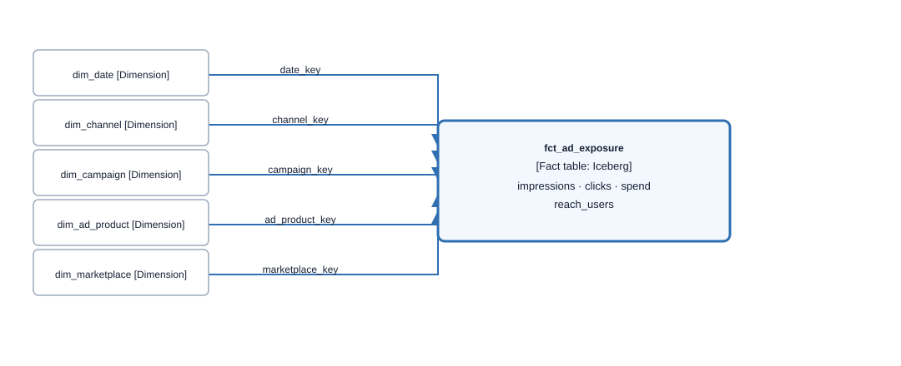
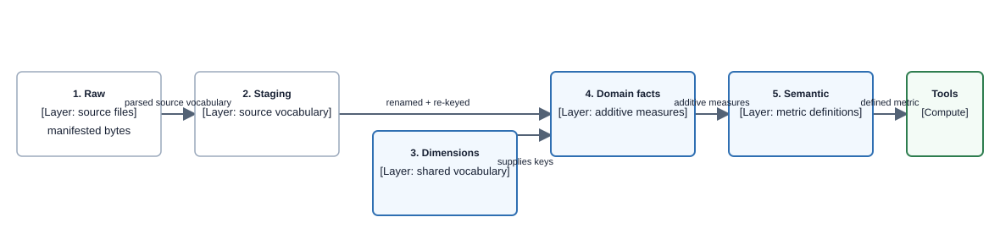
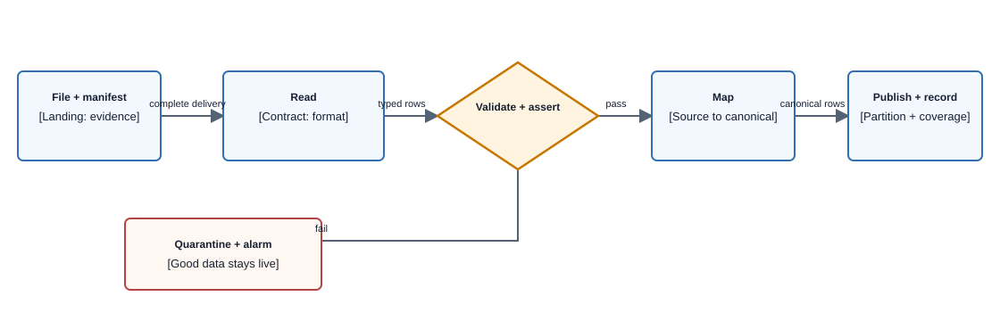

# Understanding the data model

| | |
|---|---|
| **Type** | Primer. Assumes no data-modelling background |
| **Status** | Living |
| **Last updated** | 2026-09-25 |
| **Read next** | [business-context](business-context.md) for why this exists · [answerable-questions](answerable-questions.md) for what it can tell a customer |

## How to read this

| If you are | Read | Then |
|---|---|---|
| **a stakeholder, or new to the project** | §1–§4. That is the whole idea | [answerable-questions](answerable-questions.md) |
| **landing data for us** | §1–§4, then §8 | [provenance-chain](concepts/provenance-chain.md) §2.2, which is your spec |
| **an engineer** | all of it | [Data Layer](capabilities/data-layer/README.md), then [canonical-model](canonical-model.md) |

**§1–§4 is a complete explanation and you can stop there.** Sections 5 onward are the mechanics.

> **This document owns concepts, never values.** It explains why a divisor belongs to a column; it does not list the divisors. Every number, column name and mapping lives in [canonical-model](canonical-model.md) and `contracts/`, which are verified by `make check-lineage` — this document is not, so keeping values out of it is what stops it going quietly stale.

---

## 1. The crux

Two mistakes destroy an analytics product. Everything here is machinery to prevent them.

**Mistake one: adding up numbers that were measured differently.**

Amazon tells you two different truths about your sales. Amazon Marketing Cloud says *"these ads get credit for $50,000."* Vendor Central says *"you shipped $180,000."* Neither is wrong. One is an attribution model with a 14-day window; the other is what physically left a warehouse. Add them and you get $230,000, a number describing nothing that happened.

**Mistake two: adding up numbers whose granularity you do not know.**

Given a row saying `revenue = 4,200`, you cannot safely add it to anything unless you know whether that is one product for one day, one product for a week, or every product for a day. The failure is silent: the sum computes, and it looks plausible.

**So every number must answer two questions before anyone touches it:** what does one row represent, and which measurement system produced it. That is the foundation. Everything below follows from it.

## 2. The vocabulary

Six words. Five are standard dimensional-modelling terms; the last is ours.

| Term | Plain meaning |
|---|---|
| **Fact** | A table of things that happened, holding numbers you can add up. Long and narrow — millions of rows, few columns |
| **Measure** | One of those addable numbers. Revenue, impressions, spend |
| **Dimension** | A table of things you slice *by*. Product, date, campaign. These are your "group by" options. Short and wide |
| **Grain** | What exactly one row of a fact represents, stated as a list of columns. *"One row per product per day per marketplace"* |
| **Conformed** | A dimension means the same thing everywhere it is used. **One** product dimension, shared by advertising and retail facts |
| **Measurement basis** | Ours. A column on every fact naming which measurement system produced the number: ad-attributed, retail-actual, or modelled |

Two of these carry more weight than the rest.

**Grain is the single most important declaration in the model.** A correct figure at an unstated grain is the failure this product must not have, because it cannot be detected by looking at it.

**Measurement basis is not a quality flag.** A retail-actual number is not better than an ad-attributed one. They answer different questions, and the column exists so that nothing can add them together by accident.

## 3. Why not one big table

The instinct is a single wide table with every column in it. It fails three ways.

**You cannot state a grain**, because different columns are true at different granularities. Ad spend is per campaign. Product page views are per product. One row cannot be both.

**Every change is a migration.** A new dimension alters the schema; a new source adds columns nobody else uses.

**It hides mistake one completely.** If ad-attributed revenue and retail revenue are two columns on one row, someone will add them, and nothing in the structure will stop them.

### The shape we use instead

A fact in the middle, dimensions around it, joined by keys. This is a **star schema**.

**Component diagram — `fct_ad_exposure` with its conformed dimensions; data-model viewpoint, table depth.**

> **Takeaway.** The fact holds only addable numbers and keys. Everything you would slice by is a dimension reached through a key.

**Why the keys are named for what they mean, not for a retailer.** A key column is `product`, `channel`, `marketplace` — the *concept* — even though today the only product identifier in it is an ASIN. That is what lets a second retailer be onboarded by widening the same dimension rather than building a parallel set of tables, and it is why nothing here is named after ASIN: an ASIN is an identifier namespace, not a concept.

The textbook move at this point is a **surrogate key** — an internal meaningless number, with the ASIN demoted to an attribute. This model deliberately does not do that; a fact carries the identifier itself and joins on it. The reasoning is [ADR-023](decisions/adr-023-product-natural-key.md), and the shape of the join, which is not quite the obvious one because the dimension keeps history, is owned by [canonical-model](canonical-model.md) §1.

## 4. Additivity — the property that bites

Most measures are **additive**: sum them across any dimension and the answer is right. Impressions, spend, units.

Some are not, and this is where intuition fails.

**Reach is non-additive.** It counts distinct people. Monday's 1,000 distinct shoppers plus Tuesday's 1,000 is not 2,000 distinct shoppers, because the same person may appear on both days. There is no way to fix this afterwards — the identities were never stored, and Amazon's privacy model means they cannot be. So reach must be computed at the exact grain you want it, and asking for a coarser one means a new extraction rather than a sum.

**Ratios are never stored. Ever.** Return on ad spend, click-through rate, conversion rate. A stored ratio is wrong the moment two rows are combined, because an average of averages is not an average. So the model stores the numerator and the denominator as additive facts and computes the ratio when someone asks.

Average frequency — impressions divided by reach — is the worst case, because its denominator is non-additive too. Stored, it would be wrong twice over.

> **This is the pattern to carry away.** When something cannot be safely combined, the model refuses to store it in a combinable form. The constraint is enforced by structure rather than by everyone remembering.

**If you are a stakeholder, that is the whole idea.** [answerable-questions](answerable-questions.md) is the natural next read: it lists what a customer can ask and what the product refuses.

---

## 5. The layers

Data moves through five. The rule that matters: **each layer can only narrow what the previous one established, and no layer can restore what an earlier one lost.**

**Component diagram — five data-model layers; data-flow viewpoint, component depth.**

> **Takeaway.** A tool only ever reads the semantic layer. It never touches a raw file and does not know one exists.

**1 · Raw.** Files land in S3 exactly as received, never modified, kept permanently. This is the evidence of what upstream actually delivered — and we do not run the extraction, so upstream is treated as an untrusted producer.

**2 · Staging.** One table per source dataset, still in Amazon's vocabulary. Exists so that *"what did the source actually say"* stays answerable after conformance.

**3 · Conformed dimensions.** The shared vocabulary, built once and reused. Some are loaded from a source; others are seed data we author, because the values are decisions rather than observations — there are exactly three measurement bases because we decided there are three.

Dimensions change over time, and that matters more than it sounds. A product moves to a different variation family; a brand is renamed. If you overwrite, last quarter's brand report silently changes. So the product dimension keeps history: a change opens a new row rather than editing the old one. This is a **slowly changing dimension**.

**4 · Domain facts.** Narrow additive facts, grouped by the business question they answer rather than by where the data came from. Delivery, conversion and retail demand are three domains; channel is a *dimension*, which is why onboarding another retailer adds rows rather than tables.

**5 · Semantic layer.** Where metrics are defined once, in a single machine-readable file that three consumers read — the pipeline that decides what to precompute, the tools that compute at query time, and the layer that tells the model what a metric means. One definition is what stops those three from drifting apart, and drift there is invisible because every number still looks plausible.

### Two more terms you will meet

**Drill-across** — asking one question of two facts and stitching the answers on their shared dimensions. Spend and retail revenue by product by week reads two facts, aggregates each to product × week, then joins the **results**. Joining the facts row-to-row instead would multiply rows and double-count.

**Bus matrix** — a grid of facts against dimensions showing which apply to which. Ours reveals the constraint that shapes the entire product: the campaign dimension reaches both advertising facts and **neither retail fact**. That is why actual retail sales can never be attributed to a campaign.

## 6. Worked example: "What was my ROAS by campaign last week?"

### The extraction, and why it needs two queries

Return on ad spend is attributed revenue divided by ad spend. Those live in different Amazon Marketing Cloud tables, and here is the part that surprises people: **the table holding attributed revenue has no ad-spend column at all.** ROAS cannot be computed inside one table.

So two extractions run and are combined at a shared aggregate grain — appended, then summed. Never joined row-to-row, because one impression can lead to many conversions, so a join would repeat the spend once per conversion and inflate it.

Two things are decided at extraction that nothing downstream can recover.

**Whether privacy suppression is visible.** Amazon enforces a floor: a row must represent enough distinct people or it is not released. Left to its default, Amazon **silently deletes** the rows below the floor. No gap, no marker, no error — the totals just quietly do not add up. Asked to do otherwise, it keeps the rows, blanks the values, and flags them. That request is made in the extraction query, and if it was not made, the information is destroyed before delivery and no downstream check can recover it.

**Which of two near-identical tables is read.** One of them automatically extends its own window after the fact, so the same query returns different numbers on different runs. The model reads the other one.

### The load

**Component diagram — landed-file publication gate; ingestion viewpoint, component depth.**

> **Takeaway.** A bad file stops at the gate. It never partially lands, and it never takes the last good data down with it.

**Validation and assertion are different things.** Validation asks whether the file is well-formed. Assertions check claims that could be wrong even in a perfectly well-formed file — that the privacy flags are present, that every amount in a row shares one currency, that every product and marketplace resolves in its dimension, and that the per-product rows sum to the total Amazon itself reported. A failed assertion quarantines rather than writing a number we would not defend.

**Mapping is where a contract earns its keep.** Source names become canonical names, and the traps are handled in one declared place rather than in code. The sharpest example: on the display platform, spend arrives in one unit; on the sponsored-ads platform, the same canonical column arrives in a unit **one thousand times smaller**. One table even mixes both scales internally. That is why the scaling factor is a property of the *column*, never of the table or the platform — and why applying a cost scaling factor to a revenue column would be an error of five to eight orders of magnitude in the numerator of every ROAS figure.

**The merge overwrites rather than appends**, because Amazon revises these numbers after publishing them. A check on the source's own revision timestamp stops an out-of-order delivery from reverting corrected figures to stale ones.

### Answering

Four gates stand between the question and a number.

**Component diagram — figure-computation refusal gates; measurement viewpoint, component depth.**

> **Takeaway.** A refusal is a stated reason, never a failure and never a guess.

The third gate is the subtle one, and it is the difference between two things that sound alike. Gate two is **structural**: this metric cannot be broken down that way for anybody, ever. Gate three is **measured**: this metric can be broken down that way in principle, but *this* customer's volume is low enough that Amazon's privacy floor would remove too much of it to be honest. The first is permanent and true for everyone. The second is specific to one account and can change between loads.

Past the gates, a tool builds a **query plan** — a structure naming a metric, a grain and some filters, and carrying no SQL — and the adapter composes the statement from it. **The model never writes the query, and never names a column or a table either**; it asks for a metric at a grain, and every identifier in the resulting SQL is resolved from the metric dictionary and the contract ([ADR-028](decisions/adr-028-a-validated-plan-replaces-the-template-registry.md)). The plan sums revenue from one fact and spend from another, groups each to campaign and week, joins the two results, and divides. The ratio is computed here and never read from storage.

### The answer

> *"Campaign 'Spring Refresh' returned 4.2x last week — $42,000 of ad-attributed revenue on $10,000 of spend. This is Amazon's own attribution over a 14-day window, and it will not match your shipped revenue, which is a different measurement system. Three percent of rows were withheld by Amazon's privacy thresholds, so campaign figures will not sum exactly to your account total."*

Every clause there is **forced by the model rather than chosen by the writer**. The 14-day window comes from the metric's own name. The reconciliation warning comes from the measurement basis. The suppression figure comes from what the load recorded. The response envelope has no way to omit them: the suppression field is required with no default, and a suppressed result cannot be constructed without a stated reason.

## 7. The one-paragraph version

The model is a set of narrow, additive facts that share one set of dimensions, where every row is labelled with what it represents and which measurement system produced it. That makes slicing cheap, and makes it structurally difficult to combine two numbers that do not belong together. Ratios are computed on read, never stored. Anything that cannot be combined safely is not stored in a combinable form. And when a question cannot be answered honestly, the product says so and says why.

## 8. If you are sending us data

The layer rule — each layer can only narrow, none can restore — means the extraction step decides things that no amount of downstream care can fix.

| What we need | Why it cannot be added later |
|---|---|
| The file **exactly** as Amazon returned it | It is the only evidence of what was actually delivered |
| A **manifest** per batch | Upstream is an untrusted producer, and the manifest is the only statement of what arrived |
| Privacy-suppression flags **requested in the query** | Otherwise Amazon deletes the affected rows before we ever see the file |
| The **revision timestamp** the source supplies | Without it, an out-of-order delivery silently reverts corrected figures |
| **Which options** produced the file | The same report type yields genuinely different data under different options, and merging them double-counts |

The generic landing contract, including what the manifest carries, is [provenance-chain](concepts/provenance-chain.md) §2.2; per-source detail belongs to the [source references](sources/) and [Source Acquisition](capabilities/source-acquisition/README.md). Those are the documents to work from.

## 9. Where to go next

| Question | Doc |
|---|---|
| Why does this product exist, and what does it unlock? | [business-context](business-context.md) |
| What can a customer actually ask? | [answerable-questions](answerable-questions.md) |
| How does the pipeline work, and what are the load rules? | [Data Layer](capabilities/data-layer/README.md) |
| What is every field, and where does it come from? | [canonical-model](canonical-model.md) |
| Why was a particular choice made? | [decisions/](decisions/) |
| What does Amazon's data actually contain? | [sources/amc](sources/amc.md) · [sources/vendor-central](sources/vendor-central.md) |
